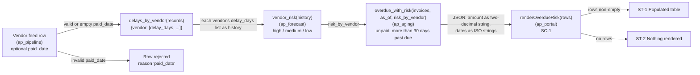
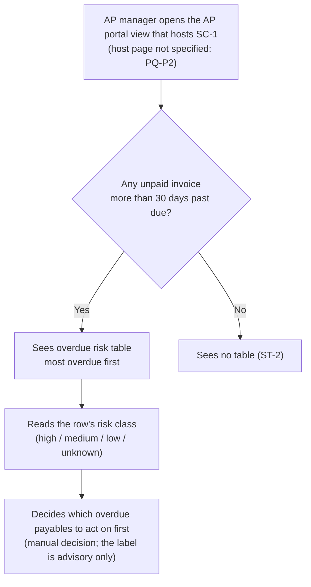

# Delivery pack FEAT-ZD-48600

AP managers want to see which overdue invoices belong to vendors that usually pay late, so they can chase them first. (1) Data engineering, ap_pipeline: the vendor feed gains an optional paid_date column (ISO date, empty when unpaid); an invalid paid_date rejects the row with reason 'paid_date'; add delays_by_vendor(records) returning {vendor: [delay_days, ...]} for paid records with a paid_date, where delay_days = (paid_date - due_date) in days, in feed order. (2) AI / data science, ap_forecast: add vendor_risk(history) returning 'high' when predict_delay_days(history) > 30, 'medium' when it is > 10, otherwise 'low'; build_explanation_request gains an optional risk argument and, when given, the prompt ends with ' Risk level: <risk>.'. (3) Backend, ap_aging: add overdue_with_risk(invoices, as_of, risk_by_vendor) returning, for unpaid invoices more than 30 days past due, a list of {'id', 'vendor', 'days', 'amount', 'risk'} sorted by days descending then id, with risk 'unknown' for vendors not in risk_by_vendor. (4) Frontend, ap_portal: add renderOverdueRisk(rows) rendering '<table class="overdue-risk">' with one '<tr class="risk-RISK">' per row showing id, vendor, days and amount to two decimals, and an empty string when there are no rows. The whole flow must be proven end to end: feed -> delays -> risk -> overdue list -> portal table.

## REQ-01 Requirement Intake (Requirement agent): feat.intake

# feat.intake: FEAT-ZD-48600

Original intake item, recorded as received. The ticket text is data. It is copied word for word below and has not been changed.

## Source

| Field | Value | Source |
|---|---|---|
| Trace ID | FEAT-ZD-48600 | record:brief |
| Intake ID | ZD-48600 | record:intake |
| Channel | Customer Feedback | record:intake |
| Source | Zendesk ticket ZD-48600 (sample, synthetic) | record:intake |
| Received | 2026-10-24 | record:intake |
| Source link (GitHub) | `hobasa-agentic-sdlc/requirements/ZD-48600.md` | record:intake; file:hobasa-agentic-sdlc/requirements/ZD-48600.md |
| Repositories named on the source item | ap_pipeline, ap_forecast, ap_aging, ap_portal | file:hobasa-agentic-sdlc/requirements/ZD-48600.md |
| Workbook trigger | Email/Ticket | record:brief; record:intake |

## Original text (verbatim)

> AP managers want to see which overdue invoices belong to vendors that usually pay late, so they can chase them first. (1) Data engineering, ap_pipeline: the vendor feed gains an optional paid_date column (ISO date, empty when unpaid); an invalid paid_date rejects the row with reason 'paid_date'; add delays_by_vendor(records) returning {vendor: [delay_days, ...]} for paid records with a paid_date, where delay_days = (paid_date - due_date) in days, in feed order. (2) AI / data science, ap_forecast: add vendor_risk(history) returning 'high' when predict_delay_days(history) > 30, 'medium' when it is > 10, otherwise 'low'; build_explanation_request gains an optional risk argument and, when given, the prompt ends with ' Risk level: <risk>.'. (3) Backend, ap_aging: add overdue_with_risk(invoices, as_of, risk_by_vendor) returning, for unpaid invoices more than 30 days past due, a list of {'id', 'vendor', 'days', 'amount', 'risk'} sorted by days descending then id, with risk 'unknown' for vendors not in risk_by_vendor. (4) Frontend, ap_portal: add renderOverdueRisk(rows) rendering '<table class="overdue-risk">' with one '<tr class="risk-RISK">' per row showing id, vendor, days and amount to two decimals, and an empty string when there are no rows. The whole flow must be proven end to end: feed -> delays -> risk -> overdue list -> portal table.

Source: record:intake; file:hobasa-agentic-sdlc/requirements/ZD-48600.md

## Change requests extracted from the text

The ticket is split into its change requests using the ticket's own wording. Nothing is added here. Interpretation and gaps are in feat.prebacklog.

| CR | Area / repository (as named in the ticket) | Change request | Source |
|---|---|---|---|
| CR-0 | Business need | AP managers want to see which overdue invoices belong to vendors that usually pay late, so they can chase them first. | record:intake |
| CR-1 | Data engineering / ap_pipeline | The vendor feed gains an optional `paid_date` column (ISO date, empty when unpaid). An invalid `paid_date` rejects the row with reason `'paid_date'`. | record:intake |
| CR-2 | Data engineering / ap_pipeline | Add `delays_by_vendor(records)` returning `{vendor: [delay_days, ...]}` for paid records with a `paid_date`, where `delay_days = (paid_date - due_date)` in days, in feed order. | record:intake |
| CR-3 | AI / data science / ap_forecast | Add `vendor_risk(history)` returning `'high'` when `predict_delay_days(history) > 30`, `'medium'` when it is `> 10`, otherwise `'low'`. | record:intake |
| CR-4 | AI / data science / ap_forecast | `build_explanation_request` gains an optional `risk` argument. When it is given, the prompt ends with `' Risk level: <risk>.'`. | record:intake |
| CR-5 | Backend / ap_aging | Add `overdue_with_risk(invoices, as_of, risk_by_vendor)`. For unpaid invoices more than 30 days past due, it returns a list of `{'id', 'vendor', 'days', 'amount', 'risk'}` sorted by days descending, then by id. Vendors not in `risk_by_vendor` get risk `'unknown'`. | record:intake |
| CR-6 | Frontend / ap_portal | Add `renderOverdueRisk(rows)`. It renders `<table class="overdue-risk">` with one `<tr class="risk-RISK">` per row, showing id, vendor, days and amount to two decimals. It returns an empty string when there are no rows. | record:intake |
| CR-7 | Cross-repository | The whole flow must be proven end to end: feed -> delays -> risk -> overdue list -> portal table. | record:intake |

## Feature-specific context attached to the source item

The source file carries org overrides for this item. They are listed here so the link between the intake and its context is visible:

- Data model: `Invoice` gains `paid_date (date or None) [paid_date added in feed v3]`; `amount (Decimal, 2 dp)`. Source: file:hobasa-agentic-sdlc/requirements/ZD-48600.md
- Customer mapping: vendor feed v3 adds column `paid_date (optional, ISO date, empty when unpaid)`, mapped to `Invoice.paid_date`. The schedule is unchanged. Source: file:hobasa-agentic-sdlc/requirements/ZD-48600.md
- Architecture: "Four repositories in one flow." JSON between services carries amounts as strings with two decimals and dates as ISO strings. "Keep every existing signature; add new functions." Source: file:hobasa-agentic-sdlc/requirements/ZD-48600.md
- Risk map: "No finance posting, authentication, tenancy or payment execution in this change; tier T2. The risk label is advisory only." Source: file:hobasa-agentic-sdlc/requirements/ZD-48600.md


## REQ-01 Requirement Intake (Requirement agent): feat.prebacklog

# feat.prebacklog: FEAT-ZD-48600

Pre Backlog requirement entry. This is a draft for review at the PM gate.

## Entry

| Field | Value | Source |
|---|---|---|
| Trace ID | FEAT-ZD-48600 | record:brief |
| Title | Show which overdue invoices belong to vendors that usually pay late | record:intake |
| Intake link | ZD-48600, `hobasa-agentic-sdlc/requirements/ZD-48600.md` (full text in feat.intake) | record:intake |
| Channel / received | Customer Feedback / 2026-10-24 | record:intake |
| Business need | AP managers want to see which overdue invoices belong to vendors that usually pay late, so they can chase them first. | record:intake |
| Linked roadmap item | **R-AP-12**: "give AP managers earlier visibility of overdue payables" (Q4 2026 roadmap, AP module, owner PM) | org.roadmap |
| Not linked | R-AP-14 (aging export for finance close). The ticket asks for no export. | org.roadmap; record:intake |
| Affected components | ap_pipeline (Data engineering), ap_forecast (AI / data science), ap_aging (Backend), ap_portal (Frontend), plus an end-to-end proof of the flow feed -> delays -> risk -> overdue list -> portal table | record:intake |
| Change requests | CR-0 to CR-7, listed in feat.intake | record:intake |
| Status | Draft entry for review; gate: PM | record:brief |

## Intake checks (workbook action)

| Check | Result | Source |
|---|---|---|
| Read the ticket | Done. The ticket text is captured word for word and split into CR-0 to CR-7 (feat.intake). | record:intake |
| Read the roadmap item and match it to planned work | Matches **R-AP-12**. The ticket asks to see overdue invoices so they can be chased first. This falls under "earlier visibility of overdue payables". | org.roadmap; record:intake |
| Check against the Pre Backlog sheet and DevOps board | Neither the Pre Backlog sheet nor the DevOps board is in this step's context. As a substitute, I read the related intake files in `requirements/`. That found no duplicate, but it did find three related open items (see "Related items"). See open question Q-1. | file:hobasa-agentic-sdlc/requirements/ZD-48211.md; file:hobasa-agentic-sdlc/requirements/ZD-48501.md; file:hobasa-agentic-sdlc/requirements/ZD-48455.md |
| Check the decision for conflict with prior decisions | No conflict found (see "Decision log check"). | org.decision_log; record:intake |
| Regulatory sources (section and page) | Not applicable: "No regulatory source applies to this change." No section or page is captured, and no rule is affected. | org.regulatory_sources |
| Connector inventory | The inventory states: "No source-system connector is affected by the ap_aging library." It does not mention the vendor feed that ap_pipeline ingests, and CR-1 changes that feed (new optional `paid_date` column, feed v3). The connector impact of CR-1 is therefore unconfirmed. See open question Q-2. | org.connector_inventory; record:intake; file:hobasa-agentic-sdlc/requirements/ZD-48600.md |
| Model dependency map | ap_forecast uses provider acme-llm, model acme-text-2 (config `src/ap_forecast/models.json`), for the payment-delay explanation. CR-4 changes the prompt sent to it (optional trailing `' Risk level: <risk>.'`); the ticket asks for no change of provider or model. `vendor_risk` (CR-3) "uses no LLM; it is a rule on the predicted delay". Affected feature: the payment-delay explanation. | org.model_dependency_map; record:intake |
| External patterns / market research | Not applicable. The trigger is a customer ticket (channel Customer Feedback), not a market research or competitive analysis change, so no external sources were gathered. | record:intake; record:brief |
| Notification | Not sent. The only connector approved for this step is api:github, which allows GET only. I filed a capability_request for a notification channel. It is pending approval. See open question Q-3. | mcp:hobasa-context; record:brief |

## Decision log check

| Decision / lesson | Relation to this item | Result | Source |
|---|---|---|---|
| D-2026-031: aging buckets use calendar days after due date | CR-5 "more than 30 days past due" and CR-2 `delay_days = (paid_date - due_date) in days`. Assumed to be calendar days (A-1). | Consistent | org.decision_log; record:intake |
| D-2026-044: monetary amounts use Decimal, never float | CR-5 returns `amount`; CR-6 shows amount to two decimals. The data model has `amount (Decimal, 2 dp)`, and JSON between services carries amounts as strings with two decimals. | Consistent, provided amounts stay Decimal or two-decimal strings and never pass through float (A-2) | org.decision_log; record:intake; file:hobasa-agentic-sdlc/requirements/ZD-48600.md |
| D-2026-050: paid invoices are excluded from aging | CR-5 covers only unpaid invoices. | Consistent | org.decision_log; record:intake |
| L-007: test the boundary day (exactly 30 days) explicitly for any day-count rule | CR-5 uses "more than 30 days", so an invoice exactly 30 days past due is not listed. CR-3 uses the strict thresholds `> 30` and `> 10`. Both boundaries need explicit tests. | Carry forward to testing | record:memory; record:intake |
| L-011: keep Decimal arithmetic; never convert amounts to float | Same as D-2026-044 for CR-5 and CR-6. | Carry forward to design | record:memory |

## Related items (open; not duplicates)

| Item | Overlap | Source |
|---|---|---|
| ZD-48501 (open) | `overdue_summary(invoices, as_of)` in ap_aging, for "unpaid invoices more than 30 days past due". This is the same overdue rule as CR-5, but it adds a different function and a portal badge (`badge-overdue`). | file:hobasa-agentic-sdlc/requirements/ZD-48501.md |
| ZD-48211 (open) | Flag every open invoice "more than 30 days past its due date" as overdue and add an overdue summary. "Paid invoices should never count as overdue." This is the same overdue definition. | file:hobasa-agentic-sdlc/requirements/ZD-48211.md |
| ZD-48455 (open) | ap_portal aging table: highlight rows as "overdue risk" with CSS class `row-overdue`. This uses similar wording but a different table and class from CR-6 (`overdue-risk`, `risk-RISK`). | file:hobasa-agentic-sdlc/requirements/ZD-48455.md |

## Assumptions (non-blocking; please confirm at the PM gate)

- **A-1**: "Days past due" in CR-5 and `delay_days` in CR-2 are calendar days, following D-2026-031. (org.decision_log)
- **A-2**: Inside ap_aging, `amount` in the CR-5 output is the Invoice `amount (Decimal, 2 dp)`. When the overdue list passes from ap_aging to ap_portal as JSON, the amount travels as a string with two decimals, as the architecture states for all JSON between services. ap_portal (CR-6) then shows it to two decimals. At no point is it converted to float (D-2026-044, L-011). (org.decision_log; record:memory; record:intake; file:hobasa-agentic-sdlc/requirements/ZD-48600.md)
- **A-3**: The `history` passed to `vendor_risk` (CR-3) is one vendor's list of `delay_days` from `delays_by_vendor` (CR-2). `risk_by_vendor` (CR-5) maps each vendor to that vendor's `vendor_risk` result. This follows the stated flow "feed -> delays -> risk -> overdue list". (record:intake)
- **A-4**: A negative `delay_days` (paid before the due date) is kept as computed. The ticket defines `delay_days = (paid_date - due_date)` and sets no floor. (record:intake)
- **A-5**: A record marked paid that has no `paid_date` is left out of `delays_by_vendor`. It is not rejected, because the ticket covers only "paid records with a paid_date". (record:intake)
- **A-6**: The risk label is advisory only. No finance posting or payment execution is in scope. (file:hobasa-agentic-sdlc/requirements/ZD-48600.md)

## Open questions (non-blocking)

- **Q-1**: The Pre Backlog sheet and DevOps board were not available to this step. The duplicate check covered only the related `requirements/` intake files. Can the PM confirm that no existing board item covers this? Should this item share one overdue definition with ZD-48501 and ZD-48211, or be merged with them?
- **Q-2**: Is the vendor feed (feed v3, new `paid_date` column) a registered source-system connector? If so, the connector inventory needs an entry and a version update. The current inventory speaks only about the ap_aging library.
- **Q-3**: A notification channel is pending approval through capability_request. Until it is approved, who notifies the PM of this entry?
- **Q-4**: How should a row that is unpaid but has a `paid_date` be handled: reject it, or ignore the date? The ticket defines rejection only for an invalid `paid_date`.
- **Q-5**: Should `renderOverdueRisk` (CR-6) HTML-escape the vendor names and ids it renders? The ticket does not say.


## REQ-02 Grouping (Requirement agent): feat.classification

# feat.classification: FEAT-ZD-48600

Grouping result for the Pre Backlog entry FEAT-ZD-48600 (ZD-48600). It gives the category, the Technical sub-category and qualifier, and the duplicate check against the other open intake items. This is a draft for automated checks and sampled human evaluation.

## Classification

| Field | Value | Source |
|---|---|---|
| Trace ID | FEAT-ZD-48600 | record:brief; feat.prebacklog |
| Intake ID / channel | ZD-48600 / Customer Feedback, received 2026-10-24 | feat.intake |
| Title | Show which overdue invoices belong to vendors that usually pay late | feat.prebacklog |
| **Category** | **New Feature** (reasoning under "Why New Feature") | feat.intake; org.architecture |
| Technical sub-category | Present in every repository part (see "Technical sub-category per change request") | feat.intake; org.architecture |
| **Qualifier** | **Not Technical Only.** The item adds a capability that customers can see: an overdue-risk table in the portal for AP managers. | feat.intake |
| Linked roadmap item | R-AP-12 "give AP managers earlier visibility of overdue payables" | feat.prebacklog |
| Risk tier (from the source item) | T2. "No finance posting, authentication, tenancy or payment execution in this change". The risk label is advisory only. | feat.intake |
| Duplicates merged | None. No open item asks for the same change (see "Duplicate check"). | file:hobasa-agentic-sdlc/requirements/ZD-48211.md; file:hobasa-agentic-sdlc/requirements/ZD-48501.md; file:hobasa-agentic-sdlc/requirements/ZD-48455.md |
| Related items grouped with this entry | ZD-48501 and ZD-48211 share the overdue rule. ZD-48470 and PROV-ACME-2026-11 change the same code (the vendor feed; `build_explanation_request`). None of them is a duplicate. | see "Duplicate check" |

Impacted repositories: ap_pipeline, ap_forecast, ap_aging, ap_portal

(Routing: org.routing_map; file:hobasa-agentic-sdlc/org/org.routing_map.md. See "Routing by repository".)

## Why New Feature

- The ticket asks for new behaviour that does not exist today. It adds four new functions: `delays_by_vendor`, `vendor_risk`, `overdue_with_risk` and `renderOverdueRisk`. It also adds a new optional feed column, `paid_date`. (feat.intake, CR-1 to CR-6)
- The existing functions are kept. The architecture says "Keep every existing signature; add new functions". The current functions (`aging_buckets`, `days_past_due`, `bucket_for`, `predict_delay_days`, `renderAgingSummary`, and others) are not redefined. Two changes touch existing behaviour, and both are additive:
  - `build_explanation_request` gains an optional argument (CR-4).
  - Feed ingestion accepts the new optional `paid_date` column. This also adds a new reject reason, `'paid_date'`, and a new field, `Invoice.paid_date` (CR-1).

  (org.architecture; feat.intake)
- It is not a Defect: no current behaviour is reported as wrong. It is not Documentation only or Configuration only, because code behaviour changes in four repositories. It is not Compliance: "No regulatory source applies to this change". (feat.intake; feat.prebacklog)

## Technical sub-category per change request

The workbook trigger for this step says "Technical has to be a sub-category under each and should be classified as Technical Only" where it applies (record:brief). Each part below has technical work. In this agent's judgement, none of the parts is Technical Only on its own, because each one feeds the customer-visible table. The "Category of the part" column is also this agent's judgement; the sources do not state it. The flow is "feed -> delays -> risk -> overdue list -> portal table" (CR-7).

| CR | Repository / area | Category of the part | Technical sub-category (what is technical in it) | Source |
|---|---|---|---|---|
| CR-1 | ap_pipeline / Data engineering | New Feature (data input) | Feed schema change: vendor feed v3 adds optional `paid_date` (ISO date, empty when unpaid), mapped to `Invoice.paid_date`. An invalid value rejects the row with reason `'paid_date'`. The schedule is unchanged. The connector impact is still open (feat.prebacklog Q-2). | feat.intake; feat.prebacklog |
| CR-2 | ap_pipeline / Data engineering | New Feature | New transform `delays_by_vendor(records)`; day-count rule `delay_days = (paid_date - due_date)` | feat.intake |
| CR-3 | ap_forecast / AI / data science | New Feature | New rule `vendor_risk(history)` on `predict_delay_days`, with thresholds `> 30` and `> 10`. It "uses no LLM; it is a rule on the predicted delay". | feat.intake; feat.prebacklog |
| CR-4 | ap_forecast / AI / data science | Enhancement within the feature | LLM prompt change: `build_explanation_request` gains an optional `risk` argument. Today ap_forecast uses provider acme-llm, model acme-text-2, for the payment-delay explanation. This ticket itself asks for no change of provider or model. A separate open item, PROV-ACME-2026-11, replaces acme-text-2 with acme-text-3 because acme-text-2 is deprecated on 2026-12-01. CR-4 must therefore not assume a particular model. See OQ-3. | feat.intake; feat.prebacklog; file:hobasa-agentic-sdlc/requirements/PROV-ACME-2026-11.md |
| CR-5 | ap_aging / Backend | New Feature | New function `overdue_with_risk(invoices, as_of, risk_by_vendor)`; rule "more than 30 days past due"; amounts stay Decimal (D-2026-044, L-011); paid invoices are excluded (D-2026-050) | feat.intake; feat.prebacklog; record:memory |
| CR-6 | ap_portal / Frontend | New Feature (customer-visible) | New renderer `renderOverdueRisk(rows)`; amounts arrive as strings with two decimals in the JSON between services | feat.intake; org.architecture |
| CR-7 | Cross-repository | Testing scope | End-to-end proof across all four repositories. The feature routing map sends it to the Testing Agent. | feat.intake; org.routing_map |

## Duplicate check

I compared ZD-48600 with every other intake item in `hobasa-agentic-sdlc/requirements/`. All of them are open. None asks for the same change, so nothing was merged. Four items share a rule or touch the same code; they are grouped here so that later steps can keep them consistent and plan their order. The rest are not grouped.

| Item | Status | Relation | Grouping decision | Source |
|---|---|---|---|---|
| ZD-48501 | open | Uses the same overdue rule in ap_aging: "unpaid invoices more than 30 days past due". It asks for a different function, `overdue_summary` (count and total), and a different portal output, `badge-overdue`. | Grouped as related (shared rule), not a duplicate. Both should share one overdue definition. See OQ-1. | file:hobasa-agentic-sdlc/requirements/ZD-48501.md |
| ZD-48211 | open | Uses the same overdue definition: "more than 30 days past its due date"; "Paid invoices should never count as overdue". It asks for an overdue flag and an overdue summary in the aging output. | Grouped as related (shared rule), not a duplicate. Share the definition. See OQ-1. | file:hobasa-agentic-sdlc/requirements/ZD-48211.md |
| ZD-48470 | open | Also changes the vendor feed in ap_pipeline: feed v2 adds `currency`. CR-1 refers to feed v3 adding `paid_date`. | Grouped as related (shared code), not a duplicate. Whether v3 must wait for v2 is unconfirmed. See OQ-2. | file:hobasa-agentic-sdlc/requirements/ZD-48470.md; feat.intake |
| PROV-ACME-2026-11 | open | Also changes `build_explanation_request` in ap_forecast: acme-text-2 (deprecated on 2026-12-01) is replaced by acme-text-3, and a `system` field is added. CR-4 adds a `risk` argument to the same function. | Grouped as related (shared code), not a duplicate. Both change the same function, so the changes need ordering. See OQ-3. | file:hobasa-agentic-sdlc/requirements/PROV-ACME-2026-11.md; feat.intake |
| ZD-48455 | open | Also an ap_portal table change with "overdue risk" wording. It uses a different table (the aging table) and a different class: `row-overdue`, where this item uses `overdue-risk` and `risk-RISK`. | Not grouped and not a duplicate. The wording overlaps, so the class names must stay distinct. | file:hobasa-agentic-sdlc/requirements/ZD-48455.md; feat.intake |
| FIN-OPS-2026-07 | open | Configuration change only: reduce the ap_forecast explanation max_tokens from 300 to 200, with "No code or behaviour change other than this configuration value". ZD-48600 does not touch max_tokens. | Not grouped and not a duplicate: it shares no rule or code with this item. A side observation for the PM, outside this item: FIN-OPS-2026-07 conflicts with PROV-ACME-2026-11, which says "Our explanation requests must keep max_tokens at 300" (see OQ-5). | file:hobasa-agentic-sdlc/requirements/FIN-OPS-2026-07.md; file:hobasa-agentic-sdlc/requirements/PROV-ACME-2026-11.md |
| ZD-48510 | open | Similar goal (acting on overdue invoices), but it asks for payment execution. Payment execution is out of scope for this item ("No ... payment execution in this change"). | Not grouped | file:hobasa-agentic-sdlc/requirements/ZD-48510.md; feat.intake |
| ZD-48377, RETRO-2026-19, ZD-48480, REG-LPR-2026-4.2 | open | All four are about ap_aging: a boundary defect in the aging buckets, error messages for missing fields, README bucket definitions, and the Late rule at more than 60 days. None asks for vendor risk or an overdue-risk list. | Not grouped; not duplicates | file:hobasa-agentic-sdlc/requirements/ZD-48377.md; file:hobasa-agentic-sdlc/requirements/RETRO-2026-19.md; file:hobasa-agentic-sdlc/requirements/ZD-48480.md; file:hobasa-agentic-sdlc/requirements/REG-LPR-2026-4.2.md |

Limitation: the Pre Backlog sheet and the DevOps board are not in this step's context. This duplicate check covers only the intake files in `requirements/`. This carries forward feat.prebacklog Q-1.

## New ticket (workbook action)

| Field | Value | Source |
|---|---|---|
| Ticket | FEAT-ZD-48600, category New Feature, qualifier Not Technical Only, linked to roadmap item R-AP-12 | record:brief; feat.prebacklog |
| Created in an external tracker | No. The connector approved for this step is api:github, which allows GET requests on the Hobasa repositories. It cannot create tickets. This file is the ticket record. The spine pushes it after evaluation. | record:brief |

## Routing by repository

| Repository | Owner agent (feature routing map) | Source |
|---|---|---|
| ap_pipeline | Data Engineering Coding Agent | org.routing_map |
| ap_forecast | Data Science Agent | org.routing_map |
| ap_aging | Backend Coding Agent; owner: backend developer | org.routing_map; file:hobasa-agentic-sdlc/org/org.routing_map.md |
| ap_portal | Frontend Coding Agent | org.routing_map |
| Integration and end-to-end (CR-7) | Testing Agent | org.routing_map |

The organisation-level routing map (`org/org.routing_map.md`) lists only ap_aging. The routing for the other three repositories comes from the feature override. See OQ-4.

## Open questions (non-blocking)

- **OQ-1**: ZD-48501, ZD-48211 and CR-5 all use "unpaid and more than 30 days past due". Should one shared overdue definition in ap_aging serve all three, so they cannot drift apart? Or should they stay separate? This needs a PM decision. Nothing was merged.
- **OQ-2**: CR-1 names feed v3, and ZD-48470 brings feed v2 (`currency`). Must ZD-48470 be delivered first, or is v3 independent of v2?
- **OQ-3**: PROV-ACME-2026-11 and CR-4 both change `build_explanation_request`. PROV-ACME-2026-11 moves it from acme-text-2 to acme-text-3 and adds a `system` field; CR-4 adds `risk`. Which order should they land in? Should the CR-4 tests run against whichever model is current at delivery?
- **OQ-4**: Should `org/org.routing_map.md` be updated with the owners of ap_pipeline, ap_forecast and ap_portal? Today they exist only in the feature override.
- **OQ-5** (outside this item, for the PM): PROV-ACME-2026-11 keeps max_tokens at 300, while FIN-OPS-2026-07 lowers it from 300 to 200. Which one applies?
- Carried forward from feat.prebacklog:
  - Q-1: duplicate check against the Pre Backlog sheet and DevOps board.
  - Q-2: is feed v3 a registered connector?
  - Q-3: notification channel.
  - Q-4: how to handle an unpaid row that has a `paid_date`.
  - Q-5: HTML escaping in `renderOverdueRisk`.


## REQ-03 Product Fitment Validation (Requirement agent): feat.fitment

# feat.fitment: FEAT-ZD-48600

Product fitment check for the Pre Backlog entry FEAT-ZD-48600 (ZD-48600, "Show which overdue invoices belong to vendors that usually pay late"). The entry is checked against the product capability, the Q4 2026 roadmap and the product strategy. This is a draft verdict. The PM and Leadership decide Yes or No at the gate.

Statements marked "agent judgement" are this agent's own assessment. No input states them.

## Verdict

| Field | Value | Source |
|---|---|---|
| Trace ID | FEAT-ZD-48600 | record:brief; feat.classification |
| **Fitment verdict** | **Yes** (recommended; agent judgement). The PM and Leadership make the decision. | evidence below |
| **Reason code** | **FIT-Y-ROADMAP**: the entry fits a named roadmap item (R-AP-12), builds on the existing capability, and supports the stated strategy. | org.roadmap; org.strategy_capability; feat.classification |
| Linked roadmap item | R-AP-12 "give AP managers earlier visibility of overdue payables" (Q4 2026 roadmap, AP module, owner: PM) | org.roadmap; feat.classification |
| Category / qualifier | New Feature / Not Technical Only | feat.classification |
| Risk tier (advisory) | T2: "No finance posting, authentication, tenancy or payment execution in this change". The risk label is advisory only. | feat.classification |
| Conditions on the Yes | None blocking. The gate should confirm FQ-1, the business meaning of "vendors that usually pay late" and "chase them first". See "Open questions". | this file |

FIT-Y-ROADMAP is this agent's own code. This step's inputs contain no list of reason codes (see FQ-5).

## Evidence

### 1. Roadmap fit

| Check | Evidence | Source |
|---|---|---|
| Is there a roadmap item? | Yes. The Q4 2026 AP module roadmap lists (R-AP-12) "give AP managers earlier visibility of overdue payables". feat.classification records R-AP-12 as the entry's linked roadmap item, citing feat.prebacklog as the source of the link. | org.roadmap; feat.classification |
| Does the entry match it? | The ticket says "AP managers want to see which overdue invoices belong to vendors that usually pay late, so they can chase them first". Agent judgement: this matches R-AP-12. Both name AP managers as the users. Both are about overdue items: R-AP-12 says "overdue payables" and the ticket says "overdue invoices". Both aim at seeing those items. The entry adds a portal table of unpaid invoices "more than 30 days past due", each with a vendor risk level. | org.roadmap; file:hobasa-agentic-sdlc/requirements/ZD-48600.md |
| Overlap with the other roadmap item | R-AP-14 is "aging export for finance close". No change request in feat.classification (CR-1 to CR-7) adds an export. | org.roadmap; feat.classification |

### 2. Capability fit

| Check | Evidence | Source |
|---|---|---|
| Current capability | "ap_aging service computes aging buckets (current, 1-30, 31-60, 61-90, 90+) for open invoices." | org.strategy_capability |
| How the entry relates | CR-5 adds `overdue_with_risk(invoices, as_of, risk_by_vendor)` to ap_aging for unpaid invoices "more than 30 days past due". The architecture says "Keep every existing signature; add new functions". The existing functions (`aging_buckets`, `days_past_due`, `bucket_for` and others) are not redefined. Agent judgement: the entry builds on the current capability's invoices and days past due. | feat.classification; file:hobasa-agentic-sdlc/requirements/ZD-48600.md |
| New capability added | The entry adds a vendor payment-delay history (`delays_by_vendor`, ap_pipeline). It adds a vendor risk rule (`vendor_risk`, ap_forecast). It adds a customer-visible overdue-risk table (`renderOverdueRisk`, ap_portal). | feat.classification |
| Gap in the capability statement | org.strategy_capability describes ap_aging and does not mention ap_pipeline, ap_forecast or ap_portal. In the material read for this step, those three repositories are described in the feature's architecture override (ZD-48600). For those three repositories, this check therefore draws on the override, not on the org capability statement (FQ-3). | org.strategy_capability; file:hobasa-agentic-sdlc/requirements/ZD-48600.md |
| Product scope boundaries | org.strategy_capability states no explicit out-of-scope list, so this step cannot check the entry against one (FQ-6). Related facts: the feature's risk map, which sets the advisory tier, records "No finance posting, authentication, tenancy or payment execution in this change". ZD-48510 asks for payment execution, and feat.classification marks it "Not grouped" with this entry. | org.strategy_capability; feat.classification |

### 3. Strategy fit

| Strategy statement | Evidence | Source |
|---|---|---|
| "help finance teams pay on time and avoid late-payment penalties" | The table lists unpaid invoices more than 30 days past due, "sorted by days descending then id", each with a vendor risk level. The ticket's stated purpose is "so they can chase them first". Agent judgement: showing overdue payables with a priority signal supports acting on them sooner, and so supports this statement. The sources do not say how the risk level should change the order in which invoices are paid (FQ-1). | org.strategy_capability; file:hobasa-agentic-sdlc/requirements/ZD-48600.md |
| "auditability and traceability are core product promises" | Each rule in the entry is stated explicitly. `vendor_risk` "uses no LLM; it is a rule on the predicted delay", with thresholds `> 30` and `> 10`. The delay rule is `delay_days = (paid_date - due_date)`. A row with an invalid `paid_date` is rejected with the reason `'paid_date'`. A vendor not in `risk_by_vendor` gets risk `'unknown'`. Agent judgement: explicit rules and a named reject reason (`'paid_date'`) support auditability and traceability. | org.strategy_capability; feat.classification; file:hobasa-agentic-sdlc/requirements/ZD-48600.md |

### 4. Consistency with the decision log

| Decision | Status | Source |
|---|---|---|
| D-2026-050: paid invoices are excluded from aging | Consistent. `overdue_with_risk` covers only unpaid invoices. | record:memory; file:hobasa-agentic-sdlc/requirements/ZD-48600.md |
| D-2026-044: monetary amounts use Decimal, never float | Consistent. CR-5 keeps amounts as Decimal. Between services, amounts travel as strings with two decimals. | record:memory; feat.classification |
| D-2026-031: aging buckets use calendar days after due date | No conflict found. The entry does not say how "days past due" is counted. Assumption: it follows D-2026-031 (calendar days). The BRD should confirm this (FQ-4). | record:memory; file:hobasa-agentic-sdlc/requirements/ZD-48600.md |

No conflict with a recorded decision was found.

## Risks and dependencies that do not change the verdict

These items come from feat.classification and the related intake files. They affect delivery planning, not fitment (agent judgement).

- **Model deprecation**: PROV-ACME-2026-11 replaces acme-text-2, which is deprecated on 2026-12-01, with acme-text-3. It changes `build_explanation_request`, the same function that CR-4 changes. The two changes need ordering (feat.classification OQ-3).
- **Shared overdue definition**: ZD-48501 and ZD-48211 use the same "more than 30 days past due" rule (feat.classification OQ-1).
- **Feed order**: CR-1 needs feed v3, and ZD-48470 brings feed v2 (feat.classification OQ-2).
- **Terminology**: the open regulatory item REG-LPR-2026-4.2 defines "Late" as a payable "more than 60 days past its due date" that remains unpaid. This entry's "overdue" means more than 30 days past due. Recommendation (agent judgement): keep the two labels distinct in the portal and the BRD (FQ-2). Source: file:hobasa-agentic-sdlc/requirements/REG-LPR-2026-4.2.md.

## Notification (workbook outcome)

| Field | Value | Source |
|---|---|---|
| To | PM and Leadership, the gate owners for REQ-03 | record:brief |
| Message | "FEAT-ZD-48600 fitment: Yes recommended (FIT-Y-ROADMAP, R-AP-12). Please decide Yes or No and confirm FQ-1 at the gate." | this file |
| Channel | Not set. The notification channel is still open (feat.prebacklog Q-3, carried forward in feat.classification). The only connector approved for this step is api:github, limited to GET requests on the Hobasa repositories, so no message was sent. This file, pushed by the spine after the gate, is the notification record. | feat.classification; record:brief |

## Open questions (non-blocking)

- **FQ-1 (PM / Leadership, business meaning)**: The roadmap item is about "overdue payables". The ticket asks about "vendors that usually pay late" and wants to "chase them first". It measures delay as `paid_date - due_date` on invoices from each vendor. Agent judgement: in an AP context the vendor is the party being paid, so this wording is ambiguous. Assumption used for the verdict: the risk level helps AP managers decide which overdue payables to act on first. Please confirm. If a different meaning is intended, the strategy fit should be checked again.
- **FQ-2**: Keep "overdue" (more than 30 days) and the regulatory "Late" (more than 60 days, REG-LPR-2026-4.2) as distinct labels.
- **FQ-3**: Should org.strategy_capability be extended to cover ap_pipeline, ap_forecast and ap_portal? Today it does not mention them.
- **FQ-4**: Confirm that "days past due" in `overdue_with_risk` uses calendar days (D-2026-031), and test the boundary of exactly 30 days (L-007).
- **FQ-5**: Is there an approved list of fitment reason codes? FIT-Y-ROADMAP is this agent's own code.
- **FQ-6**: org.strategy_capability states no product out-of-scope list. Should one be added so that later fitment checks can test scope explicitly?
- Carried forward from feat.classification: OQ-1 to OQ-5, and feat.prebacklog Q-1 to Q-5.


## REQ-04 BRD Preparation (Requirement agent): feat.brd

# feat.brd: FEAT-ZD-48600

Business Requirement Document for FEAT-ZD-48600 (ZD-48600, "Show which overdue invoices belong to vendors that usually pay late"). This is a draft for the REQ-04 gate.

Statements marked "agent judgement" are an agent's own assessment, and no input states them as fact. Where the judgement was made in an earlier step, the step is named. Assumptions are listed in section 10 and need confirmation at the gate.

| Field | Value | Source |
|---|---|---|
| Trace ID | FEAT-ZD-48600 | record:brief; feat.intake |
| Intake | ZD-48600, Zendesk ticket (sample, synthetic), channel Customer Feedback, received 2026-10-24 | feat.intake |
| Source link (GitHub) | `hobasa-agentic-sdlc/requirements/ZD-48600.md` | feat.intake; file:hobasa-agentic-sdlc/requirements/ZD-48600.md |
| Fitment | feat.fitment recommends "Yes", with reason code FIT-Y-ROADMAP and linked roadmap item R-AP-12. FIT-Y-ROADMAP is the REQ-03 agent's own code; no approved list of reason codes exists (FQ-5). The REQ-03 gate decisions were "PM: approve by sim.pm" and "Leadership: approve by sim.leadership"; gates in this run are SIMULATED. | feat.fitment; file:hobasa-agentic-sdlc/features/FEAT-ZD-48600/COMMUNICATION.md |
| Category / qualifier | New Feature / Not Technical Only, as classified by the REQ-02 agent (feat.classification) and carried in feat.fitment | feat.fitment; file:hobasa-requirement-agent/outputs/FEAT-ZD-48600/feat.classification.md |
| Risk tier (advisory) | T2. "The risk label is advisory only." | feat.fitment; feat.intake |
| Owner of this step | PM | record:brief |
| Gate for this document | Leadership | record:brief |
| Template | BRD template: problem, business outcome, users, scope, out of scope, business rules, success measures, approvals | org.templates |

## 1. Problem

| Statement | Source |
|---|---|
| "AP managers want to see which overdue invoices belong to vendors that usually pay late, so they can chase them first." | feat.intake (CR-0) |
| Today the AP module's capability is that the "ap_aging service computes aging buckets (current, 1-30, 31-60, 61-90, 90+) for open invoices". The capability statement mentions neither a vendor payment-delay history nor a vendor risk level. feat.fitment records that the entry adds both (`delays_by_vendor` in ap_pipeline, `vendor_risk` in ap_forecast). | org.strategy_capability; feat.fitment |
| The business meaning is still open. feat.fitment notes, as agent judgement, that in an AP context the vendor is the party being paid, so "vendors that usually pay late" and "chase them first" are ambiguous. It assumed that "the risk level helps AP managers decide which overdue payables to act on first". This BRD keeps that assumption (B-A1) and carries the question forward (OQ-B1). | feat.fitment (FQ-1) |

## 2. Business outcome

| Outcome | Source |
|---|---|
| AP managers see a table in the portal. It lists unpaid invoices more than 30 days past due, sorted by days descending then id, "each with a vendor risk level". Each row carries a risk class (`risk-high`, `risk-medium`, `risk-low` or `risk-unknown`). The visible columns are Invoice, Vendor, Days overdue and Amount. Whether the risk level is also shown as visible text is open (OQ-B9). | feat.fitment; feat.intake (CR-5, CR-6); file:hobasa-agentic-sdlc/requirements/ZD-48600.md |
| Roadmap link. feat.fitment gives R-AP-12, "give AP managers earlier visibility of overdue payables" (Q4 2026 roadmap, AP module), as the linked roadmap item. Its agent judgement is that the entry matches R-AP-12: both name AP managers as the users, and both are about seeing overdue items. | feat.fitment |
| Strategy link (agent judgement, recorded in feat.fitment). Showing overdue payables with a priority signal supports acting on them sooner, and so supports the strategy statement "help finance teams pay on time and avoid late-payment penalties". The sources do not say how the risk level should change the order in which invoices are paid (OQ-B1). | org.strategy_capability; feat.fitment |
| Product-promise link (agent judgement, recorded in feat.fitment). Explicit rules and a named reject reason support the promise "auditability and traceability are core product promises". The facts behind this judgement come from the sources: `vendor_risk` "uses no LLM; it is a rule on the predicted delay", and an invalid `paid_date` is rejected with the reason `'paid_date'`. | org.strategy_capability; feat.fitment; feat.intake; file:hobasa-agentic-sdlc/requirements/ZD-48600.md |

## 3. Users

| User | Need | Source |
|---|---|---|
| AP managers (the users named in the ticket) | See which overdue invoices belong to vendors that usually pay late, so they can chase them first. | feat.intake |
| Finance teams (agent judgement: they benefit indirectly, as the group named in the strategy) | The strategy is to "help finance teams pay on time and avoid late-payment penalties". | org.strategy_capability |

The inputs name no other user group.

## 4. Scope

The flow in scope is "feed -> delays -> risk -> overdue list -> portal table", across the repositories named on the source item: ap_pipeline, ap_forecast, ap_aging and ap_portal (feat.intake, Source table and CR-7). The architecture rule is "Keep every existing signature; add new functions" (feat.intake; file:hobasa-agentic-sdlc/requirements/ZD-48600.md). feat.classification records that the ticket adds four new functions (`delays_by_vendor`, `vendor_risk`, `overdue_with_risk`, `renderOverdueRisk`). It also records that "Two changes touch existing behaviour, and both are additive":

- `build_explanation_request` gains an optional argument (CR-4).
- Feed ingestion accepts the new optional `paid_date` column, which also adds a new reject reason, `'paid_date'`, and a new field, `Invoice.paid_date` (CR-1).

(file:hobasa-requirement-agent/outputs/FEAT-ZD-48600/feat.classification.md)

| ID | In scope (business view) | Repository / area | Change request | Source |
|---|---|---|---|---|
| S-1 | Capture when each paid invoice was paid. The vendor feed gains an optional `paid_date` column (ISO date, empty when unpaid), mapped to `Invoice.paid_date` (vendor feed v3). The schedule is unchanged. | ap_pipeline / Data engineering | CR-1 | feat.intake |
| S-2 | Build each vendor's payment-delay history. `delays_by_vendor(records)` returns `{vendor: [delay_days, ...]}` for paid records with a `paid_date`, in feed order. | ap_pipeline / Data engineering | CR-2 | feat.intake |
| S-3 | Give each vendor a risk level from its predicted delay: `vendor_risk(history)`. | ap_forecast / AI / data science | CR-3 | feat.intake |
| S-4 | `build_explanation_request` gains an optional `risk` argument. When it is given, the prompt ends with `' Risk level: <risk>.'`. | ap_forecast / AI / data science | CR-4 | feat.intake |
| S-5 | Produce the overdue list with risk: `overdue_with_risk(invoices, as_of, risk_by_vendor)`. | ap_aging / Backend | CR-5 | feat.intake |
| S-6 | Show the overdue-risk table in the portal: `renderOverdueRisk(rows)`. | ap_portal / Frontend | CR-6 | feat.intake |
| S-7 | Prove the whole flow end to end: feed -> delays -> risk -> overdue list -> portal table. | Cross-repository | CR-7 | feat.intake |

## 5. Out of scope

| ID | Out of scope | Source |
|---|---|---|
| OS-1 | Finance posting, authentication, tenancy and payment execution: "No finance posting, authentication, tenancy or payment execution in this change". | feat.intake; file:hobasa-agentic-sdlc/requirements/ZD-48600.md |
| OS-2 | Acting on the risk level automatically (agent judgement from "The risk label is advisory only."). | feat.intake |
| OS-3 | An aging export for finance close (roadmap item R-AP-14). No change request adds an export. | feat.fitment |
| OS-4 | Changing the LLM provider or model. The ticket asks for no change of provider or model. The model replacement is a separate open item, PROV-ACME-2026-11. | file:hobasa-requirement-agent/outputs/FEAT-ZD-48600/feat.prebacklog.md; feat.fitment |
| OS-5 | Using an LLM to set the risk level. `vendor_risk` "uses no LLM; it is a rule on the predicted delay". | file:hobasa-agentic-sdlc/requirements/ZD-48600.md |
| OS-6 | Changes to existing behaviour beyond the two additive changes named in section 4 (CR-1, CR-4): "Keep every existing signature; add new functions." | feat.intake; file:hobasa-requirement-agent/outputs/FEAT-ZD-48600/feat.classification.md |
| OS-7 | The work asked for in the related open items ZD-48501 and ZD-48211 (overdue summary, overdue flag, overdue badge). They share this item's overdue rule but were not merged with it. | feat.fitment; file:hobasa-requirement-agent/outputs/FEAT-ZD-48600/feat.classification.md |
| OS-8 | The regulatory "Late" rule (REG-LPR-2026-4.2, a payable "more than 60 days past its due date" that remains unpaid). This item's "overdue" is a different label. | feat.fitment |

## 6. Business rules

| ID | Rule | Source |
|---|---|---|
| BR-1 | `paid_date` is optional. It is an ISO date, and it is empty when the invoice is unpaid. | feat.intake (CR-1) |
| BR-2 | A feed row with an invalid `paid_date` is rejected with the reason `'paid_date'`. | feat.intake (CR-1) |
| BR-3 | A vendor's payment delay is `delay_days = (paid_date - due_date)` in days. It is computed only for paid records that have a `paid_date`, and the values are kept in feed order. | feat.intake (CR-2) |
| BR-4 | Vendor risk is `'high'` when `predict_delay_days(history) > 30`, `'medium'` when it is `> 10`, and `'low'` otherwise. | feat.intake (CR-3) |
| BR-5 | The risk thresholds are strict. A predicted delay of exactly 30 is `'medium'`, and exactly 10 is `'low'` (agent judgement, read directly from the `>` comparisons). | feat.intake (CR-3) |
| BR-6 | The vendor risk level is a rule on the predicted delay. It uses no LLM. | file:hobasa-agentic-sdlc/requirements/ZD-48600.md |
| BR-7 | An invoice is in the overdue list only when it is unpaid and more than 30 days past due. An invoice exactly 30 days past due is not listed. | feat.intake (CR-5); file:hobasa-requirement-agent/outputs/FEAT-ZD-48600/feat.prebacklog.md |
| BR-8 | Paid invoices are excluded. | org.decision_log (D-2026-050); feat.intake (CR-5) |
| BR-9 | Days past due are counted in calendar days after the due date. This BRD applies D-2026-031 to the overdue list; the ticket does not say how days are counted (assumption B-A2, OQ-B4). | org.decision_log (D-2026-031); feat.fitment (FQ-4) |
| BR-10 | Each overdue row carries `id`, `vendor`, `days`, `amount` and `risk`. Rows are sorted by days descending, then by id. | feat.intake (CR-5) |
| BR-11 | A vendor with no risk level in `risk_by_vendor` gets risk `'unknown'`. | feat.intake (CR-5) |
| BR-12 | Monetary amounts use Decimal, never float. The Invoice `amount` is Decimal, 2 dp. JSON between services carries amounts as strings with two decimals and dates as ISO strings. The `amount` in the overdue list is assumed to be the Invoice amount (B-A7). | org.decision_log (D-2026-044); record:memory (L-011); feat.intake; file:hobasa-agentic-sdlc/requirements/ZD-48600.md |
| BR-13 | The portal table is `<table class="overdue-risk">`, with one `<tr class="risk-RISK">` per row showing id, vendor, days and amount to two decimals. When there are no rows, the result is an empty string. | feat.intake (CR-6) |
| BR-14 | Row classes are `risk-high`, `risk-medium`, `risk-low` or `risk-unknown`. The columns are Invoice, Vendor, Days overdue and Amount (two decimals). | file:hobasa-agentic-sdlc/requirements/ZD-48600.md |
| BR-15 | When a `risk` argument is given to `build_explanation_request`, the prompt it builds ends with `' Risk level: <risk>.'`. | feat.intake (CR-4) |
| BR-16 | The risk label is advisory only. | feat.intake; file:hobasa-agentic-sdlc/requirements/ZD-48600.md |

## 7. Success measures

The inputs give no business KPI, for example a target for faster chasing or fewer late-payment penalties. This BRD therefore states delivery success measures that can be checked, and asks the owners for a business KPI (OQ-B3).

| ID | Success measure | Source |
|---|---|---|
| SM-1 | The whole flow is proven end to end: feed -> delays -> risk -> overdue list -> portal table. | feat.intake (CR-7) |
| SM-2 | Every day-count boundary is tested explicitly: an invoice exactly 30 days past due (not listed), and the strict risk thresholds at exactly 30 and exactly 10 (BR-5). | record:memory (L-007); file:hobasa-requirement-agent/outputs/FEAT-ZD-48600/feat.prebacklog.md; feat.intake |
| SM-3 | Amounts follow the stated representation at each point. The Invoice `amount` is Decimal (2 dp), and Decimal arithmetic is kept (never float). In the JSON between services, amounts travel as strings with two decimals. The ap_portal table (Node.js) shows the amount to two decimals. The inputs do not say how ap_portal handles the amount string internally; that is left to the PRD and TRD (OQ-B10). | org.decision_log (D-2026-044); record:memory (L-011); feat.intake (CR-6); file:hobasa-agentic-sdlc/requirements/ZD-48600.md |
| SM-4 | A row with an invalid `paid_date` is rejected with reason `'paid_date'`. | feat.intake (CR-1) |
| SM-5 | The architecture rule "Keep every existing signature; add new functions" is met. Existing behaviour changes only in the two additive ways recorded in feat.classification: the optional argument added to `build_explanation_request` (CR-4), and feed ingestion accepting the optional `paid_date` column with the new reject reason `'paid_date'` and the new field `Invoice.paid_date` (CR-1). Callers that do not pass `risk` are assumed to get today's prompt (B-A6). | feat.intake; file:hobasa-requirement-agent/outputs/FEAT-ZD-48600/feat.classification.md |
| SM-6 | Business KPI: not defined in the inputs (OQ-B3). | this file |

## 8. Approvals

| Role | What is asked | Status | Source |
|---|---|---|---|
| Leadership | Approve or reject this BRD (REQ-04 gate). | Pending | record:brief |

Open questions that need a business decision are listed in section 11, with the owners recorded by the step that raised them.

## 9. Business question set

The step action asks for the business question set. org.templates names the templates (BRD, PRD, TRD, story) but holds no separate business question set (OQ-B7). The questions below are therefore this agent's own set. They cover the BRD template sections and the checks this step must make. Each was checked against the inputs; no stakeholder was contacted in this step. BQ-3 has no answer in the inputs. Questions without an answer go to the owners as open questions.

| # | Question | Answer from the inputs | Source |
|---|---|---|---|
| BQ-1 | What business problem is being solved? | AP managers want to see which overdue invoices belong to vendors that usually pay late, so they can chase them first. | feat.intake |
| BQ-2 | Who are the users? | AP managers. Finance teams, the group named in the strategy, benefit indirectly (agent judgement). | feat.intake; org.strategy_capability |
| BQ-3 | What do "vendors that usually pay late" and "chase them first" mean in AP? | Not answered. Assumed: the risk level helps AP managers decide which overdue payables to act on first (B-A1). | feat.fitment (FQ-1) → OQ-B1 |
| BQ-4 | What is in scope and out of scope? | See sections 4 and 5. | feat.intake; feat.fitment |
| BQ-5 | Which roadmap item and strategy is it linked to? | Linked roadmap item R-AP-12, which feat.fitment judges the entry matches. The strategy statement is "help finance teams pay on time and avoid late-payment penalties" (the strategy fit is agent judgement in feat.fitment). | feat.fitment; org.strategy_capability |
| BQ-6 | What are the business rules? | See section 6. | feat.intake; org.decision_log |
| BQ-7 | How is success measured? | By delivery measures SM-1 to SM-5. There is no business KPI. | feat.intake → OQ-B3 |
| BQ-8 | Does any prior decision conflict? | No conflict (section 12). | org.decision_log |
| BQ-9 | Does a regulation apply? | "No regulatory source applies to this change." The regulatory "Late" label (more than 60 days) is a different term. As agent judgement, feat.fitment recommends keeping the two labels distinct (OQ-B2). | file:hobasa-requirement-agent/outputs/FEAT-ZD-48600/feat.prebacklog.md; feat.fitment (FQ-2) |
| BQ-10 | Is there money movement, posting or payment execution? | No: "No finance posting, authentication, tenancy or payment execution in this change." | feat.intake |
| BQ-11 | Who approves? | Leadership, at the REQ-04 gate. | record:brief |

## 10. Assumptions (non-blocking; please confirm at the gate)

| ID | Assumption | Source |
|---|---|---|
| B-A1 | The risk level helps AP managers decide which overdue payables to act on first. | feat.fitment (FQ-1) |
| B-A2 | "Days past due" (BR-7) and `delay_days` (BR-3) are calendar days, following D-2026-031. | org.decision_log; file:hobasa-requirement-agent/outputs/FEAT-ZD-48600/feat.prebacklog.md (A-1) |
| B-A3 | The `history` given to `vendor_risk` is one vendor's list of `delay_days` from `delays_by_vendor`. `risk_by_vendor` maps each vendor to its `vendor_risk` result. This follows the flow "feed -> delays -> risk -> overdue list". | file:hobasa-requirement-agent/outputs/FEAT-ZD-48600/feat.prebacklog.md (A-3); feat.intake |
| B-A4 | A negative `delay_days` (paid before the due date) is kept as computed. The rule sets no floor. | file:hobasa-requirement-agent/outputs/FEAT-ZD-48600/feat.prebacklog.md (A-4) |
| B-A5 | A record marked paid that has no `paid_date` is left out of the delay history. It is not rejected. | file:hobasa-requirement-agent/outputs/FEAT-ZD-48600/feat.prebacklog.md (A-5) |
| B-A6 | When no `risk` argument is given, `build_explanation_request` builds the same prompt as today. This is agent judgement from "Keep every existing signature"; CR-4 does not say it. | feat.intake |
| B-A7 | Inside ap_aging, `amount` in the overdue list is the Invoice `amount (Decimal, 2 dp)`. When the list passes from ap_aging to ap_portal as JSON, the amount travels as a string with two decimals. | file:hobasa-requirement-agent/outputs/FEAT-ZD-48600/feat.prebacklog.md (A-2) |

## 11. Open questions (non-blocking)

| ID | Question | Owner (as recorded by the raising step) | Source |
|---|---|---|---|
| OQ-B1 | Confirm the business meaning of "vendors that usually pay late" and "chase them first" (B-A1). If a different meaning is intended, the strategy fit should be checked again. | PM / Leadership | feat.fitment (FQ-1) |
| OQ-B2 | Keep "overdue" (more than 30 days) and the regulatory "Late" (more than 60 days, REG-LPR-2026-4.2) as distinct labels in the portal and in later documents. | Not recorded | feat.fitment (FQ-2) |
| OQ-B3 | What business KPI should measure success, for example time to chase or late-payment penalties avoided? The inputs give none. | Not recorded | this file |
| OQ-B4 | Confirm calendar days for "days past due" in `overdue_with_risk` (D-2026-031), with the 30-day boundary tested (L-007). | Not recorded | feat.fitment (FQ-4) |
| OQ-B5 | Should one shared overdue definition serve this item, ZD-48501 and ZD-48211? | PM | file:hobasa-requirement-agent/outputs/FEAT-ZD-48600/feat.classification.md (OQ-1) |
| OQ-B6 | How should an unpaid row that has a `paid_date` be handled: reject it, or ignore the date? | Not recorded | file:hobasa-requirement-agent/outputs/FEAT-ZD-48600/feat.prebacklog.md (Q-4) |
| OQ-B7 | The brief describes org.templates as holding the business question set, but its content holds only the templates. Should an approved question set be added? | Not recorded | org.templates; record:brief |
| OQ-B8 | Should `renderOverdueRisk` HTML-escape the vendor names and ids it renders? | Not recorded | file:hobasa-requirement-agent/outputs/FEAT-ZD-48600/feat.prebacklog.md (Q-5) |
| OQ-B9 | Should the portal show the risk level as visible text, or only as the row class `risk-RISK`? CR-6 lists the shown values as id, vendor, days and amount. | Not recorded | feat.intake (CR-6); file:hobasa-agentic-sdlc/requirements/ZD-48600.md |
| OQ-B10 | How should ap_portal (Node.js) format the two-decimal amount string it receives without converting it to a binary floating-point number (D-2026-044)? This is for the PRD and TRD. | Not recorded | org.decision_log; file:hobasa-agentic-sdlc/requirements/ZD-48600.md |
| — | Carried forward unchanged: feat.fitment FQ-3, FQ-5 and FQ-6. Also carried forward: the open questions that feat.fitment records as carried from feat.classification (OQ-1 to OQ-5) and feat.prebacklog (Q-1 to Q-5). | — | feat.fitment |

## 12. Validation check

### Decision log

| Decision | Result | Source |
|---|---|---|
| D-2026-031: aging buckets use calendar days after due date | No conflict. BR-9 applies it to the overdue list as an assumption (B-A2). | org.decision_log |
| D-2026-044: monetary amounts use Decimal, never float | Consistent (BR-12, SM-3). The handling inside ap_portal is open (OQ-B10). | org.decision_log |
| D-2026-050: paid invoices are excluded from aging | Consistent (BR-8). | org.decision_log |

No conflict with a recorded decision was found.

### Template and grounding

| Check | Result | Source |
|---|---|---|
| All BRD template sections are present (problem, business outcome, users, scope, out of scope, business rules, success measures, approvals) | Pass: sections 1 to 8. | org.templates |
| Every change request CR-0 to CR-7 is covered | Pass: CR-0 in section 1, and CR-1 to CR-7 in S-1 to S-7. | feat.intake |
| Every business rule cites its source | Pass: BR-1 to BR-16 each cite an input or a source file. No regulation applies, so no section and page are cited. | file:hobasa-requirement-agent/outputs/FEAT-ZD-48600/feat.prebacklog.md |
| The fitment verdict is consistent with this BRD | Pass: Yes, linked to R-AP-12. Out of scope matches the fitment evidence (R-AP-14, payment execution). | feat.fitment |
| A business KPI is present | Not met: the inputs have no KPI (OQ-B3). This does not block the BRD. | this file |

### Risks and dependencies (do not change scope)

| Item | Source |
|---|---|
| PROV-ACME-2026-11 replaces acme-text-2 (deprecated on 2026-12-01) with acme-text-3 and changes `build_explanation_request`, the same function as CR-4. The two changes need ordering. | feat.fitment |
| CR-1 needs feed v3, and ZD-48470 brings feed v2. | feat.fitment |
| ZD-48501 and ZD-48211 use the same "more than 30 days past due" rule. | feat.fitment |


## REQ-05 Product Requirement Preparation (Requirement agent): feat.prd

# feat.prd: FEAT-ZD-48600

Product Requirement Document for FEAT-ZD-48600 (ZD-48600, "Show which overdue invoices belong to vendors that usually pay late"). This is a draft for the REQ-05 gate (PM).

This PRD carries forward the decisions in the approved BRD (feat.brd). It adds no scope. It turns the BRD scope (S-1 to S-7) and business rules (BR-1 to BR-16) into user stories, numbered acceptance criteria in EARS form and non-functional requirements, and ends with a validation check. Statements marked "agent judgement" are this agent's own reading; no input states them as fact. PRD-level assumptions (P-A) and questions (PQ) are new in this step and need confirmation at the gate.

| Field | Value | Source |
|---|---|---|
| Trace ID | FEAT-ZD-48600 | record:brief; feat.brd |
| Intake | ZD-48600, Zendesk ticket (sample, synthetic), channel Customer Feedback, received 2026-10-24 | feat.brd; file:hobasa-agentic-sdlc/requirements/ZD-48600.md |
| Source link (GitHub) | `hobasa-agentic-sdlc/requirements/ZD-48600.md` | feat.brd |
| Trigger | BRD approved | record:brief |
| Fitment | "Yes", linked roadmap item R-AP-12 ("give AP managers earlier visibility of overdue payables") | feat.brd |
| Category / qualifier | New Feature / Not Technical Only | feat.brd |
| Risk tier (advisory) | T2. "The risk label is advisory only." | feat.brd; file:hobasa-agentic-sdlc/requirements/ZD-48600.md |
| Repositories | ap_pipeline, ap_forecast, ap_aging, ap_portal | feat.brd; file:hobasa-agentic-sdlc/requirements/ZD-48600.md |
| Owner / gate of this step | PM / PM | record:brief |
| Template | PRD template: summary, user stories, numbered acceptance criteria (EARS: When <trigger>, the system shall <response>), non-functional requirements, open questions | org.templates |

## 1. Summary

| Item | Statement | Source |
|---|---|---|
| Problem | "AP managers want to see which overdue invoices belong to vendors that usually pay late, so they can chase them first." | feat.brd (section 1) |
| What the product will do | Build each vendor's payment-delay history from a new optional `paid_date` in the vendor feed, give each vendor a rule-based risk level (`high`, `medium`, `low`) from its predicted delay, list unpaid invoices more than 30 days past due with that risk level, and show the list as a table in the portal. | feat.brd (sections 2, 4) |
| Flow | feed -> delays -> risk -> overdue list -> portal table, proven end to end. | feat.brd (S-7, SM-1) |
| Users | AP managers. Finance teams benefit indirectly (agent judgement carried from the BRD). | feat.brd (section 3) |
| Business meaning | Carried from the BRD as an assumption: the risk level helps AP managers decide which overdue payables to act on first (B-A1, still open as OQ-B1). | feat.brd (B-A1, OQ-B1) |
| Architecture rule | "Keep every existing signature; add new functions." Existing behaviour changes only in two additive ways: the optional `risk` argument on `build_explanation_request` (CR-4) and feed ingestion accepting the optional `paid_date` (CR-1). | feat.brd (section 4, SM-5) |
| Not in this change | Finance posting, authentication, tenancy and payment execution; acting on the risk level automatically; an aging export (R-AP-14); a change of LLM provider or model; using an LLM to set the risk level; the work of ZD-48501 and ZD-48211; the regulatory "Late" rule (REG-LPR-2026-4.2). | feat.brd (OS-1 to OS-8) |

## 2. User stories

Stories follow the story template's "As a / I want / So that" form. They are product-level stories; the backlog stories in NEW state are written later, in REQ-08. The "So that" of US-1 comes from the BRD (B-A1). The "So that" clauses of US-2 to US-5, and the choice of the PM as the actor in US-5, are agent judgement: the BRD states the rules and scope behind them but not these purposes.

| ID | As a | I want | So that | BRD scope | Source |
|---|---|---|---|---|---|
| US-1 | AP manager | to see, in the portal, the unpaid invoices that are more than 30 days past due, each with its vendor's risk level, sorted by days overdue (most overdue first) | I can decide which overdue payables to act on first (B-A1) | S-5, S-6 | feat.brd (section 2, S-5, S-6, B-A1) |
| US-2 | AP manager | each vendor's payment-delay history to be built from the date each invoice was actually paid | the risk level reflects how late the vendor's invoices have actually been settled | S-1, S-2 | feat.brd (S-1, S-2, BR-3) |
| US-3 | AP manager | each vendor to get a risk level from a fixed, explicit rule on its predicted delay, with no LLM involved | I can trust and trace why a vendor is marked high, medium or low | S-3 | feat.brd (S-3, BR-4, BR-6, section 2 product-promise link) |
| US-4 | AP manager | the payment-delay explanation to state the vendor's risk level when one is given | the explanation and the table tell the same story | S-4 | feat.brd (S-4, BR-15) |
| US-5 | PM | the whole flow to be proven end to end, from the feed to the portal table | I know the four repositories work together before release | S-7 | feat.brd (S-7, SM-1); record:brief |

## 3. Acceptance criteria (EARS)

Each criterion uses the EARS form "When <trigger>, the system shall <response>" (org.templates). "Days" are calendar days after the due date (BR-9, B-A2).

### 3.1 Vendor feed `paid_date` (ap_pipeline, S-1, US-2)

| # | Acceptance criterion | Traces to | Source |
|---|---|---|---|
| AC-1 | When a vendor feed row has an empty `paid_date`, the system shall accept the row and set `Invoice.paid_date` to None. | BR-1, S-1 | feat.brd (BR-1, S-1); file:hobasa-agentic-sdlc/requirements/ZD-48600.md (org.data_model: "paid_date (date or None)") |
| AC-2 | When a vendor feed row that is marked paid has a `paid_date` that is a valid ISO date, the system shall map it to `Invoice.paid_date`. (A row that is unpaid but has a valid `paid_date` is not covered here; its handling is open as OQ-B6.) | BR-1, S-1 | feat.brd (BR-1, S-1, OQ-B6) |
| AC-3 | When a vendor feed row has a `paid_date` that is not empty and is not a valid ISO date, the system shall reject the row with the reason `'paid_date'`. | BR-2, SM-4 | feat.brd (BR-2, SM-4); assumption P-A3 |

### 3.2 Payment-delay history (ap_pipeline, S-2, US-2)

| # | Acceptance criterion | Traces to | Source |
|---|---|---|---|
| AC-4 | When `delays_by_vendor(records)` is called, the system shall return `{vendor: [delay_days, ...]}` built only from records that are paid and have a `paid_date`, where `delay_days = (paid_date - due_date)` in days, with each vendor's values in feed order. | BR-3, S-2 | feat.brd (BR-3, S-2) |
| AC-5 | When a record is marked paid but has no `paid_date`, the system shall leave it out of the delay history and shall not reject it. | B-A5 | feat.brd (B-A5) |
| AC-6 | When a paid record's `paid_date` is before its `due_date`, the system shall keep the negative `delay_days` as computed, with no floor. | B-A4 | feat.brd (B-A4) |

### 3.3 Vendor risk level and explanation (ap_forecast, S-3, S-4, US-3, US-4)

| # | Acceptance criterion | Traces to | Source |
|---|---|---|---|
| AC-7 | When `vendor_risk(history)` is called and `predict_delay_days(history) > 30`, the system shall return `'high'`. | BR-4 | feat.brd (BR-4) |
| AC-8 | When `vendor_risk(history)` is called and `predict_delay_days(history)` is greater than 10 and not greater than 30 (including exactly 30), the system shall return `'medium'`. | BR-4, BR-5, SM-2 | feat.brd (BR-4, BR-5, SM-2) |
| AC-9 | When `vendor_risk(history)` is called and `predict_delay_days(history)` is not greater than 10 (including exactly 10), the system shall return `'low'`. | BR-4, BR-5, SM-2 | feat.brd (BR-4, BR-5, SM-2) |
| AC-10 | When `vendor_risk` computes a risk level, the system shall apply the rule on the predicted delay only and shall not call an LLM. | BR-6, OS-5 | feat.brd (BR-6, OS-5) |
| AC-11 | When `build_explanation_request` is called with a `risk` argument, the system shall build a prompt that ends with `' Risk level: <risk>.'`. | BR-15, S-4 | feat.brd (BR-15, S-4) |
| AC-12 | When `build_explanation_request` is called without a `risk` argument, the system shall build the same prompt as today. | B-A6, SM-5 | feat.brd (B-A6, SM-5) |

### 3.4 Overdue list with risk (ap_aging, S-5, US-1)

| # | Acceptance criterion | Traces to | Source |
|---|---|---|---|
| AC-13 | When `overdue_with_risk(invoices, as_of, risk_by_vendor)` is called, the system shall include an invoice only when it is unpaid and more than 30 days past due as of `as_of`, counting calendar days after the due date. | BR-7, BR-9, S-5 | feat.brd (BR-7, BR-9, S-5); assumption P-A1 |
| AC-14 | When an unpaid invoice is exactly 30 days past due as of `as_of`, the system shall not include it in the overdue list. | BR-7, SM-2 | feat.brd (BR-7, SM-2); record:memory (L-007) |
| AC-15 | When an invoice is paid, the system shall exclude it from the overdue list, whatever its days past due. | BR-8 | feat.brd (BR-8); record:memory (D-2026-050) |
| AC-16 | When the overdue list is returned, the system shall give each row the keys `id`, `vendor`, `days`, `amount` and `risk`, and shall sort the rows by `days` descending, then by `id`. | BR-10 | feat.brd (BR-10); assumption P-A2 |
| AC-17 | When an invoice's vendor has no entry in `risk_by_vendor`, the system shall set that row's `risk` to `'unknown'`. | BR-11 | feat.brd (BR-11) |
| AC-18 | When the system sets a row's `amount`, it shall use the Invoice `amount` as a Decimal with 2 dp; when the list is passed from ap_aging to ap_portal as JSON, the system shall carry the amount as a string with two decimals and dates as ISO strings. | BR-12, B-A7, SM-3 | feat.brd (BR-12, B-A7, SM-3) |

### 3.5 Portal table (ap_portal, S-6, US-1)

| # | Acceptance criterion | Traces to | Source |
|---|---|---|---|
| AC-19 | When `renderOverdueRisk(rows)` is called with a non-empty list of rows, the system shall render `<table class="overdue-risk">` with one `<tr class="risk-RISK">` per row, showing id, vendor, days and amount to two decimals under the columns Invoice, Vendor, Days overdue and Amount. | BR-13, BR-14, S-6 | feat.brd (BR-13, BR-14, S-6) |
| AC-20 | When a row is rendered, the system shall set its class to `risk-high`, `risk-medium`, `risk-low` or `risk-unknown` to match the row's `risk` value. | BR-14 | feat.brd (BR-14) |
| AC-21 | When `renderOverdueRisk(rows)` is called with no rows, the system shall return an empty string. | BR-13 | feat.brd (BR-13); file:hobasa-agentic-sdlc/requirements/ZD-48600.md (org.design_library: "render nothing when there are no rows") |

### 3.6 End to end (cross-repository, S-7, US-5)

| # | Acceptance criterion | Traces to | Source |
|---|---|---|---|
| AC-22 | When the end-to-end test runs on a vendor feed, the system shall carry the data through feed -> delays -> risk -> overdue list -> portal table, and the rendered table shall match the overdue list built from that feed. | S-7, SM-1 | feat.brd (S-7, SM-1); assumption P-A4 |
| AC-23 | When the end-to-end test runs, the system shall pass each vendor's `delay_days` list from `delays_by_vendor` to `vendor_risk` as its `history`, and shall pass the resulting vendor-to-risk map to `overdue_with_risk` as `risk_by_vendor`. | B-A3 | feat.brd (B-A3) |

## 4. Non-functional requirements

| ID | Requirement | Traces to | Source |
|---|---|---|---|
| NFR-1 | Monetary amounts use Decimal, never float; Decimal arithmetic is kept and amounts are never converted to float. | BR-12, SM-3 | feat.brd (BR-12, SM-3); record:memory (D-2026-044, L-011) |
| NFR-2 | JSON between services carries amounts as strings with two decimals and dates as ISO strings. | BR-12 | feat.brd (BR-12); file:hobasa-agentic-sdlc/requirements/ZD-48600.md (org.architecture) |
| NFR-3 | ap_portal shows the amount to two decimals without converting it to a binary floating-point number. Agent judgement: D-2026-044 applies to ap_portal too. How ap_portal does this is left to the TRD (REQ-07); OQ-B10 stays open for confirmation. | SM-3, OQ-B10 | feat.brd (SM-3, OQ-B10); record:memory (D-2026-044) |
| NFR-4 | Backward compatibility: "Keep every existing signature; add new functions." Only the two additive changes CR-1 and CR-4 touch existing behaviour; callers that do not pass `risk` see no change (AC-12). | SM-5, OS-6 | feat.brd (section 4, SM-5, OS-6) |
| NFR-5 | Auditability: the risk level comes from an explicit rule (no LLM), and rejected feed rows carry a named reason (`'paid_date'`). | BR-2, BR-6 | feat.brd (section 2 product-promise link, BR-2, BR-6) |
| NFR-6 | The risk label is advisory only. No risk value shall trigger an automatic action, posting or payment. | BR-16, OS-1, OS-2 | feat.brd (BR-16, OS-1, OS-2) |
| NFR-7 | Security and tenancy: no finance posting, authentication, tenancy or payment execution in this change (risk tier T2). Whether `renderOverdueRisk` must HTML-escape vendor names and ids is open (OQ-B8). | OS-1, OQ-B8 | feat.brd (OS-1, OQ-B8); file:hobasa-agentic-sdlc/requirements/ZD-48600.md (org.risk_map) |
| NFR-8 | Testability: boundary cases are tested explicitly: an unpaid invoice exactly 30 days past due (not listed, AC-14), and predicted delays of exactly 30 (`'medium'`, AC-8) and exactly 10 (`'low'`, AC-9). | SM-2 | feat.brd (SM-2); record:memory (L-007) |
| NFR-9 | Feed schedule unchanged: daily 02:00 Asia/Kolkata. | S-1 | feat.brd (S-1: "The schedule is unchanged"); file:hobasa-agentic-sdlc/requirements/ZD-48600.md (org.customer_mappings: "Schedule: daily 02:00 Asia/Kolkata (unchanged)") |
| NFR-10 | Terminology: the portal and later documents keep "overdue" (more than 30 days past due) distinct from the regulatory "Late" label (more than 60 days, REG-LPR-2026-4.2). Carried as a recommendation; OQ-B2 stays open. | OS-8, OQ-B2 | feat.brd (OS-8, OQ-B2) |
| NFR-11 | Performance, data volume and availability targets: not given in the inputs (PQ-4). | — | feat.brd; file:hobasa-agentic-sdlc/requirements/ZD-48600.md |

Background, not a requirement: org.architecture describes ap_pipeline, ap_forecast and ap_aging as Python 3.9 and ap_portal as Node.js 22 CommonJS (file:hobasa-agentic-sdlc/requirements/ZD-48600.md). No input sets a requirement on runtimes, so this PRD sets none; runtime matters are for the TRD (REQ-07).

## 5. Assumptions

### 5.1 Carried from the approved BRD

| ID | Assumption | Used in | Source |
|---|---|---|---|
| B-A1 | The risk level helps AP managers decide which overdue payables to act on first. | Summary, US-1 | feat.brd |
| B-A2 | "Days past due" and `delay_days` are calendar days, following D-2026-031. | AC-4, AC-13 | feat.brd; record:memory (D-2026-031) |
| B-A3 | `history` for `vendor_risk` is one vendor's `delay_days` list from `delays_by_vendor`; `risk_by_vendor` maps each vendor to its `vendor_risk` result. | AC-23 | feat.brd |
| B-A4 | A negative `delay_days` is kept as computed. | AC-6 | feat.brd |
| B-A5 | A paid record with no `paid_date` is left out of the delay history, not rejected. | AC-5 | feat.brd |
| B-A6 | Without `risk`, `build_explanation_request` builds today's prompt. | AC-12 | feat.brd |
| B-A7 | The overdue-list `amount` is the Invoice `amount` (Decimal, 2 dp) and travels to ap_portal as a two-decimal string. | AC-18 | feat.brd |

### 5.2 New in this PRD (please confirm at the gate)

| ID | Assumption | Used in | Source |
|---|---|---|---|
| P-A1 | `days` in an overdue row is the number of calendar days from `due_date` to `as_of` (agent judgement from BR-9 and the `as_of` argument). | AC-13, AC-16 | feat.brd (BR-9, S-5) |
| P-A2 | "Then by id" means ascending order of `id`, compared as text, because the data model types `id` as a string (agent judgement; the ticket does not state the direction). | AC-16 | feat.brd (BR-10); file:hobasa-agentic-sdlc/requirements/ZD-48600.md (org.data_model: "id (str)") |
| P-A3 | An "invalid" `paid_date` is a non-empty value that is not a valid ISO date (agent judgement from "ISO date, empty when unpaid"). | AC-3 | feat.brd (BR-1, BR-2) |
| P-A4 | "Proven end to end" means the end-to-end test checks that the rendered table matches the overdue list built from the same feed (agent judgement; the BRD says only that the flow is proven end to end). | AC-22 | feat.brd (S-7, SM-1) |

## 6. Open questions (non-blocking)

### 6.1 Carried from the approved BRD

| ID | Question | Owner (as recorded) | Source |
|---|---|---|---|
| OQ-B1 | Confirm the business meaning of "vendors that usually pay late" and "chase them first" (B-A1). | PM / Leadership | feat.brd |
| OQ-B2 | Keep "overdue" (more than 30 days) and the regulatory "Late" (more than 60 days) as distinct labels (NFR-10). | Not recorded | feat.brd |
| OQ-B3 | Which business KPI should measure success? The inputs give none. | Not recorded | feat.brd |
| OQ-B4 | Confirm calendar days for "days past due" in `overdue_with_risk`, with the 30-day boundary tested. | Not recorded | feat.brd |
| OQ-B5 | Should one shared overdue definition serve this item, ZD-48501 and ZD-48211? | PM | feat.brd |
| OQ-B6 | How should an unpaid row that has a `paid_date` be handled: reject it, or ignore the date? No acceptance criterion is written for this case until it is answered. | Not recorded | feat.brd |
| OQ-B7 | Should an approved business question set be added to org.templates? | Not recorded | feat.brd; org.templates |
| OQ-B8 | Should `renderOverdueRisk` HTML-escape the vendor names and ids it renders (NFR-7)? | Not recorded | feat.brd |
| OQ-B9 | Should the portal show the risk level as visible text, or only as the row class `risk-RISK`? AC-19 follows CR-6 (id, vendor, days, amount shown) until answered. | Not recorded | feat.brd |
| OQ-B10 | How should ap_portal format the two-decimal amount string without converting it to a binary float (NFR-3)? | Not recorded | feat.brd |
| — | Carried unchanged: feat.fitment FQ-3, FQ-5 and FQ-6, and the questions feat.fitment carries from feat.classification (OQ-1 to OQ-5) and feat.prebacklog (Q-1 to Q-5). | — | feat.brd (section 11) |

### 6.2 New in this PRD

| ID | Question | Why it matters | Source |
|---|---|---|---|
| PQ-1 | What should `vendor_risk` return when `history` is empty? The inputs do not say how `predict_delay_days` behaves on an empty list. Agent judgement: if, under B-A3, a vendor with no paid history is given no entry in `risk_by_vendor`, its rows get `'unknown'` (AC-17); but the inputs do not say whether such a vendor gets an entry, and a direct call with an empty list is not specified. | Edge case for AC-7 to AC-9 | feat.brd (BR-4, BR-11, B-A3) |
| PQ-2 | Confirm P-A1 to P-A4 (meaning of `days`, the direction and type of the `id` tie-break, the meaning of "invalid" `paid_date`, and what the end-to-end test checks). | Exact test expectations for AC-3, AC-13, AC-16, AC-22 | this file |
| PQ-3 | Should the overdue list have a named JSON contract between ap_aging and ap_portal (field names, the type of `days`, `amount` as a string)? Proposed for the TRD (REQ-07); the type of `days` is not given in the inputs. | Interface between two coding lanes | feat.brd (BR-12, B-A7) |
| PQ-4 | Are there performance, data volume or availability targets (NFR-11)? | Non-functional completeness | this file |
| PQ-5 | Who decides the order of this change and PROV-ACME-2026-11, which both change `build_explanation_request`? | Delivery dependency for AC-11, AC-12 | feat.brd (section 12, risks and dependencies) |
| PQ-6 | CR-1 needs feed v3 and ZD-48470 brings feed v2. Is feed v3 available to ap_pipeline for this change? | Delivery dependency for AC-1 to AC-3 | feat.brd (section 12, risks and dependencies) |

## 7. Traceability (BRD to PRD)

| BRD item | PRD coverage |
|---|---|
| S-1 | US-2; AC-1, AC-2, AC-3; NFR-9 |
| S-2 | US-2; AC-4, AC-5, AC-6 |
| S-3 | US-3; AC-7, AC-8, AC-9, AC-10 |
| S-4 | US-4; AC-11, AC-12 |
| S-5 | US-1; AC-13 to AC-18 |
| S-6 | US-1; AC-19, AC-20, AC-21 |
| S-7 | US-5; AC-22, AC-23 |
| BR-1 / BR-2 | AC-1, AC-2 / AC-3 |
| BR-3 | AC-4 |
| BR-4 / BR-5 | AC-7, AC-8, AC-9 |
| BR-6 | AC-10; NFR-5 |
| BR-7 / BR-8 / BR-9 | AC-13, AC-14 / AC-15 / AC-13 |
| BR-10 / BR-11 | AC-16 / AC-17 |
| BR-12 | AC-18; NFR-1, NFR-2, NFR-3 |
| BR-13 / BR-14 | AC-19, AC-21 / AC-19, AC-20 |
| BR-15 | AC-11 |
| BR-16 | NFR-6 |
| SM-1 | AC-22 |
| SM-2 | AC-8, AC-9, AC-14; NFR-8 |
| SM-3 | AC-18; NFR-1, NFR-2, NFR-3 |
| SM-4 | AC-3 |
| SM-5 | AC-12; NFR-4 |
| SM-6 (no business KPI) | OQ-B3 carried |
| OS-1 to OS-8 | Summary ("Not in this change"); NFR-6, NFR-7, NFR-10 |
| B-A1 to B-A7 | Section 5.1 |
| OQ-B6 (unpaid row with a `paid_date`) | Left open; AC-2 is limited to paid rows so that it does not decide the case |

## 8. Validation check

### Template

| Check | Result | Source |
|---|---|---|
| PRD template sections present: summary, user stories, numbered acceptance criteria (EARS), non-functional requirements, open questions | Pass: sections 1, 2, 3, 4 and 6. | org.templates |
| Every acceptance criterion uses "When <trigger>, the system shall <response>" | Pass: AC-1 to AC-23. | org.templates |
| User stories use "As a / I want / So that" | Pass: US-1 to US-5. | org.templates |

### Carry-forward from the approved BRD

| Check | Result | Source |
|---|---|---|
| Every BRD scope item S-1 to S-7 is covered | Pass (section 7). | feat.brd |
| Every business rule BR-1 to BR-16 is covered by an acceptance criterion or NFR | Pass (section 7). | feat.brd |
| Every delivery success measure SM-1 to SM-5 is covered | Pass (section 7). SM-6 has no business KPI; OQ-B3 is carried. | feat.brd |
| Out of scope OS-1 to OS-8 is kept, and no new scope is added | Pass. The PRD adds no function, repository or behaviour beyond S-1 to S-7. | feat.brd |
| BRD assumptions and open questions are carried, not silently resolved | Pass. B-A1 to B-A7 and OQ-B1 to OQ-B10 are carried. NFR-3 states a requirement for OQ-B10 as agent judgement and keeps the question open. | feat.brd |
| Every non-functional requirement is backed by a BRD item, a decision, a lesson or a stated source rule | Pass. Runtime versions from org.architecture are given as background only, not as a requirement. | feat.brd; record:memory; file:hobasa-agentic-sdlc/requirements/ZD-48600.md |
| No regulation applies, so no regulation section and page is cited | Pass, as recorded in the BRD ("No regulatory source applies to this change"). | feat.brd (BQ-9) |

### Decision log

| Decision | Result | Source |
|---|---|---|
| D-2026-031: aging buckets use calendar days after due date | No conflict. Applied to the overdue list and `delay_days` as assumption B-A2 (AC-4, AC-13). | record:memory; feat.brd |
| D-2026-044: monetary amounts use Decimal, never float | Consistent (AC-18, NFR-1 to NFR-3). | record:memory; feat.brd |
| D-2026-050: paid invoices are excluded from aging | Consistent (AC-15). | record:memory; feat.brd |

No conflict with a recorded decision or with the approved BRD was found.

### Lessons applied

| Lesson | Applied in | Source |
|---|---|---|
| L-007: test the boundary day (exactly 30 days) explicitly for any day-count rule | AC-14, NFR-8 | record:memory |
| L-011: keep Decimal arithmetic; never convert amounts to float | AC-18, NFR-1, NFR-3 | record:memory |


## REQ-06 Prototype ⁷ (Requirement agent): feat.prototype

# feat.prototype: FEAT-ZD-48600

Prototype for FEAT-ZD-48600 (ZD-48600, "Show which overdue invoices belong to vendors that usually pay late"). This is a draft for the REQ-06 gate (UX lead).

The outcome is a set of low-fidelity wireframes. "Figma is not connected in this test run" (org.design_library), and the step brief lists api:github as the only connector approved for this step (record:brief). So this file holds both deliverables in text form, ready to paste:

- the **FigJam flow**: a Mermaid flow and a screen and state map
- the **Figma Make prompt**: it applies the design library, the screen inventory, the states and the synthetic data rules

The file ends with a check of the prototype against the approved PRD. Statements marked "agent judgement" are this agent's own reading; no input states them as fact. The prototype adds no function, data or behaviour beyond feat.prd. Its presentation choices (greyscale, right-aligned numbers, no row actions, wording) are labelled "design choice (agent judgement)" in section 7 and are for the UX lead to accept or change.

| Field | Value | Source |
|---|---|---|
| Trace ID | FEAT-ZD-48600 | record:brief; feat.prd |
| Trigger | PRD Reviewed | record:brief |
| Owner / gate of this step | PM / UX lead | record:brief |
| Inputs | feat.prd (approved PRD); org.design_library (feature override, text form) | record:brief |
| UI repository in scope | ap_portal, whose portal table is S-6. Agent judgement: the PRD names no other screen, so this is the only UI surface the prototype covers | feat.prd (sections 1, 3.5) |
| UI surface | One table component, `renderOverdueRisk(rows)`, inside the AP portal | feat.prd (AC-19 to AC-21) |
| Fidelity | Low Fidelity Wireframes. Design choice (agent judgement): greyscale boxes and text, no colour, no final typography | record:brief |
| Figma / FigJam | Not connected; the text form is provided instead. The only connector approved for this step is api:github | org.design_library; record:brief |

## 1. Design system applied

org.design_library gives the design rules for this feature in text form. The prototype uses each one exactly as written and adds no other token.

| # | Design-library rule (quoted) | Applied in the prototype | Source |
|---|---|---|---|
| DL-1 | "overdue risk table uses class 'overdue-risk'" | The table frame is named and classed `overdue-risk` | org.design_library; feat.prd (AC-19) |
| DL-2 | "each row has class 'risk-high', 'risk-medium', 'risk-low' or 'risk-unknown'" | Each body row carries one of the four row classes, matching the row's `risk` value | org.design_library; feat.prd (AC-20) |
| DL-3 | "columns Invoice, Vendor, Days overdue, Amount (two decimals)" | Four columns, in this order and with these exact headings. Amount is always shown with two decimals | org.design_library; feat.prd (AC-19) |
| DL-4 | "render nothing when there are no rows" | The empty state is no table at all: no header, no placeholder text | org.design_library; feat.prd (AC-21) |

**Not in the design library.** The library defines no colour, spacing or typography variables (tokens), no visual style for the `risk-*` classes and no host page layout. The wireframes stay greyscale and show each row class as an annotation, not as a colour. Visual tokens are left to the UX lead (PQ-P1).

**Amount display.** feat.prd NFR-3 says ap_portal shows the amount to two decimals "without converting it to a binary floating-point number". How it does this is left to the TRD (REQ-07), and OQ-B10 is open. So the prototype shows the two-decimal amount string exactly as it arrives from ap_aging (AC-18) and sets no formatting rule of its own.

## 2. Screen inventory

| ID | Screen / component | Purpose | User story | Source |
|---|---|---|---|---|
| SC-1 | Overdue risk table (`renderOverdueRisk`) in the AP portal | Lists unpaid invoices more than 30 days past due, each row classed by vendor risk, most overdue first | US-1 | feat.prd (US-1, AC-13, AC-16, AC-19, AC-20) |

The PRD defines only this one UI surface. The flow stages before it (feed, delays, risk, overdue list) run without any screen. They appear in the FigJam flow (section 4) for context only. The host page that holds SC-1 (navigation, title, filters) is not specified in the inputs and is not designed here (PQ-P2).

## 3. States

| ID | State | Trigger | What is shown | Source |
|---|---|---|---|---|
| ST-1 | Populated | `rows` is non-empty | `<table class="overdue-risk">` with the header row Invoice / Vendor / Days overdue / Amount and one `<tr class="risk-RISK">` per row | feat.prd (AC-19); org.design_library |
| ST-2 | Empty | `rows` is empty | Nothing: `renderOverdueRisk` returns an empty string, so no table, header or message | feat.prd (AC-21); org.design_library |
| ST-3 | Row risk variants | Row `risk` is `high`, `medium`, `low` or `unknown` | The same row layout. Only the row class changes (`risk-high`, `risk-medium`, `risk-low`, `risk-unknown`) | feat.prd (AC-20); org.design_library |
| ST-4 | Unknown vendor risk | Vendor has no entry in `risk_by_vendor` | The row is shown with class `risk-unknown` | feat.prd (AC-17, AC-20) |
| ST-5 | Days tie | Two rows have the same `days` | The rows are ordered by `id`; P-A2 assumes ascending text order, still to be confirmed (PQ-2) | feat.prd (AC-16, P-A2, PQ-2) |

**States not designed.** The PRD defines no loading, error, pagination or overflow state for the table, so none is designed (PQ-P3).

**Risk as visible text.** OQ-B9 is open. Following AC-19, the risk level is carried only by the row class, with no visible Risk column or text. Agent judgement: if `risk-*` is later styled with colour alone, risk would be signalled by colour only, which is an accessibility concern. The UX lead should weigh this when answering OQ-B9 (PQ-P4).

## 4. FigJam flow (text form)

### 4.1 Data-to-screen flow (context; only the last stage is a screen)



Sources: feat.prd (AC-1 to AC-4, AC-7 to AC-9, AC-13, AC-18, AC-19, AC-21, AC-23, section 1 "Flow").

### 4.2 User flow (AP manager)



Sources: feat.prd (US-1, AC-13, AC-16, AC-21, B-A1, NFR-6). The decision step is manual: "No risk value shall trigger an automatic action, posting or payment" (feat.prd NFR-6).

## 5. Low-fidelity wireframes

All data in the wireframes is synthetic (section 6). The `[risk-…]` tags in the left margin are designer annotations showing each row's class. They are **not** rendered text (OQ-B9).

### WF-1: SC-1, ST-1 Populated (includes ST-3, ST-4 and ST-5)

```
 AP portal  (host page not specified: PQ-P2)
                 table.overdue-risk
                ┌─────────────┬──────────────────────┬──────────────┬─────────────┐
                │ Invoice     │ Vendor               │ Days overdue │      Amount │
                ├─────────────┼──────────────────────┼──────────────┼─────────────┤
 [risk-high]    │ SYN-INV-004 │ Synthetic Vendor A   │           75 │     1250.00 │
 [risk-medium]  │ SYN-INV-002 │ Synthetic Vendor B   │           42 │      980.50 │
 [risk-unknown] │ SYN-INV-003 │ Synthetic Vendor D   │           42 │       15.00 │
 [risk-low]     │ SYN-INV-001 │ Synthetic Vendor C   │           31 │      300.00 │
                └─────────────┴──────────────────────┴──────────────┴─────────────┘
 Annotations:
  - Order: Days overdue descending; the synthetic tie is ordered by id ascending (P-A2, PQ-2).
  - Amount: the two-decimal string from ap_aging, shown as received (NFR-2, NFR-3).
  - Row class only; no visible Risk column (AC-19, OQ-B9).
  - SYN-INV-003: vendor has no risk entry, so class risk-unknown (AC-17).
  - Not shown: an unpaid invoice exactly 30 days past due (AC-14) and any paid invoice (AC-15).
```

### WF-2: SC-1, ST-2 Empty

```
 AP portal  (host page not specified: PQ-P2)
 ┌────────────────────────────────────────────────────────────────────┐
 │                                                                    │
 │   (nothing rendered: renderOverdueRisk returns "")                 │
 │                                                                    │
 └────────────────────────────────────────────────────────────────────┘
 Annotation: no table, no header, no "no results" message (AC-21; org.design_library).
 The text in brackets above is a designer note, not UI.
```

## 6. Synthetic data rules and dataset

**Rules.** The workbook action names "synthetic data rules" (record:brief), but neither the brief nor any input defines them. The rules below are agent judgement, chosen to keep the prototype safe and to exercise the PRD (PQ-P5).

| # | Rule | Why | Source |
|---|---|---|---|
| SD-1 | Synthetic data only: ids prefixed `SYN-INV-`, vendor names "Synthetic Vendor <letter>"; no real vendor, person, bank or contact data | Keeps real vendor and contact data out of a design artefact (agent judgement) | agent judgement |
| SD-2 | Amounts are two-decimal strings, never floats | Decimal amounts; JSON carries amounts as two-decimal strings | feat.prd (AC-18, NFR-1, NFR-2); record:memory (D-2026-044, L-011) |
| SD-3 | Every displayed row is unpaid and more than 30 days past due; the dataset also lists one row exactly 30 days past due and one paid row, both marked "not shown" | Shows the boundary and the paid-invoice exclusion | feat.prd (AC-13, AC-14, AC-15); record:memory (L-007, D-2026-050) |
| SD-4 | Include all four risk values, including one vendor with no risk entry | Covers every row class | feat.prd (AC-17, AC-20) |
| SD-5 | Include a tie on `days` | Shows the `id` tie-break | feat.prd (AC-16) |
| SD-6 | Values are illustrative and are not facts about any vendor | Prototype data must not be read as evidence | agent judgement |

**Dataset (synthetic, illustrative; the numbers are made-up values, not facts).**

| id | vendor | days | amount | risk | paid | Shown in WF-1 |
|---|---|---|---|---|---|---|
| SYN-INV-004 | Synthetic Vendor A | 75 | "1250.00" | high | no | Yes, row 1 |
| SYN-INV-002 | Synthetic Vendor B | 42 | "980.50" | medium | no | Yes, row 2 |
| SYN-INV-003 | Synthetic Vendor D | 42 | "15.00" | unknown (no entry) | no | Yes, row 3 |
| SYN-INV-001 | Synthetic Vendor C | 31 | "300.00" | low | no | Yes, row 4 |
| SYN-INV-005 | Synthetic Vendor A | 30 | "400.00" | high | no | No: exactly 30 days (AC-14) |
| SYN-INV-006 | Synthetic Vendor B | 90 | "220.00" | medium | yes | No: paid (AC-15) |

## 7. Figma Make prompt

Paste the block below into Figma Make once a Figma connection is available. Until then it is the specification for the text wireframes above.

```
Build a LOW-FIDELITY, greyscale wireframe of one component for the Hobasa AP portal:
the "Overdue risk table". Do not add colour, icons, brand tokens, charts or extra
screens. Do not add a page shell, navigation, filters or search; the host page is
not specified.

Component
- An HTML-style table named and classed "overdue-risk".
- Exactly four columns, in this order, with these headings:
  Invoice | Vendor | Days overdue | Amount
- Amount is right-aligned and always shows two decimals. Display the amount string
  exactly as given; do not reformat it through a floating-point number.
- One body row per item. Each row carries exactly one class: risk-high,
  risk-medium, risk-low or risk-unknown, matching the row's risk value.
  Show the class as a small grey margin annotation outside the table
  (e.g. "[risk-high]"). Do NOT add a visible Risk column or risk text inside the
  table.
- Rows are sorted by Days overdue, highest first; ties are sorted by Invoice id
  ascending.
- "Days overdue" is a count of calendar days after the due date.

Frames
1. "WF-1 Populated": the table with these synthetic rows, in this order:
   SYN-INV-004 | Synthetic Vendor A | 75 | 1250.00 | risk-high
   SYN-INV-002 | Synthetic Vendor B | 42 | 980.50  | risk-medium
   SYN-INV-003 | Synthetic Vendor D | 42 | 15.00   | risk-unknown
   SYN-INV-001 | Synthetic Vendor C | 31 | 300.00  | risk-low
   Add sticky notes: "Exactly 30 days past due is not listed",
   "Paid invoices are not listed", "Risk is advisory only; no automatic action".
2. "WF-2 Empty": an empty frame with only a designer note:
   "renderOverdueRisk returns an empty string: no table, no header, no message".

Rules
- Use synthetic data only (ids SYN-INV-*, vendors "Synthetic Vendor <letter>").
  No real names, people, emails, bank details or amounts.
- Use the word "overdue"; avoid the label "Late" (recommendation; still open).
- No buttons or actions on rows (no pay, post, approve or chase buttons).
```

Where each prompt rule comes from:

| Prompt rule | Basis | Source |
|---|---|---|
| Class `overdue-risk`; four columns and headings; two-decimal amount; row classes; empty frame | Design library and PRD | org.design_library; feat.prd (AC-19, AC-20, AC-21) |
| Show the amount string as given, no floating-point reformatting | PRD | feat.prd (AC-18, NFR-2, NFR-3, OQ-B10) |
| Sort by days descending, then id ascending | PRD and assumption | feat.prd (AC-16, P-A2) |
| Calendar days | Decision | record:memory (D-2026-031); feat.prd (B-A2) |
| Sticky notes: 30-day boundary, paid excluded, advisory only | PRD | feat.prd (AC-14, AC-15, NFR-6) |
| No visible Risk column; margin annotation | PRD default while OQ-B9 is open; the annotation style is a design choice (agent judgement) | feat.prd (AC-19, OQ-B9) |
| Avoid "Late" | PRD recommendation; OQ-B2 open | feat.prd (NFR-10, OQ-B2) |
| Synthetic data only | Synthetic data rules SD-1 to SD-6, which are agent judgement. The workbook action names synthetic data rules but defines none (PQ-P5) | section 6; record:brief |
| Greyscale; no colour, icons, tokens or charts | Design choice (agent judgement): low fidelity, and the design library defines no tokens | record:brief; org.design_library |
| Amount right-aligned | Design choice (agent judgement); the design library does not set alignment | org.design_library |
| No row buttons or actions | Design choice (agent judgement). NFR-6 forbids only automatic action, and the PRD defines no manual row action, so none is drawn (PQ-P7) | feat.prd (NFR-6, section 3.5) |
| No page shell, navigation or filters | The host page is not specified (PQ-P2) | feat.prd (AC-19) |

## 8. Check of the prototype against the PRD

| PRD item | Requirement (short) | Prototype | Result | Source |
|---|---|---|---|---|
| US-1 | AP manager sees unpaid invoices more than 30 days past due, each with the vendor's risk, sorted most overdue first | WF-1; user flow 4.2 | Pass | feat.prd (US-1) |
| AC-13 / AC-14 / AC-15 | Unpaid and more than 30 days only; exactly 30 excluded; paid excluded | Dataset SD-3; WF-1 annotations; prompt sticky notes | Pass (shown as data rules; the filter itself is in ap_aging) | feat.prd (AC-13, AC-14, AC-15) |
| AC-16 | Keys `id`, `vendor`, `days`, `amount`, `risk`; sort by `days` descending, then `id` | WF-1 order; prompt "Rows are sorted…" | Pass. The `id` direction follows P-A2, still to be confirmed (PQ-2) | feat.prd (AC-16, P-A2) |
| AC-17 | Vendor with no risk entry gets `'unknown'` | SYN-INV-003, `risk-unknown` | Pass | feat.prd (AC-17) |
| AC-18 / NFR-1 / NFR-2 / NFR-3 | Decimal amount; two-decimal string in JSON; display without a binary float | SD-2; amount shown as received; prompt "do not reformat it through a floating-point number" | Pass at prototype level. How ap_portal formats the amount is left to the TRD (OQ-B10) | feat.prd (AC-18, NFR-1 to NFR-3, OQ-B10) |
| AC-19 | `<table class="overdue-risk">`, one `<tr class="risk-RISK">` per row, columns Invoice, Vendor, Days overdue, Amount (two decimals) | WF-1; DL-1, DL-3 | Pass | feat.prd (AC-19); org.design_library |
| AC-20 | Row class `risk-high` / `risk-medium` / `risk-low` / `risk-unknown` matches `risk` | WF-1 annotations; ST-3 | Pass | feat.prd (AC-20); org.design_library |
| AC-21 | No rows: return an empty string | WF-2; ST-2; DL-4 | Pass | feat.prd (AC-21); org.design_library |
| NFR-6 | Risk label advisory only; no automatic action | No row actions; user flow ends in a manual decision; prompt forbids action buttons | Pass | feat.prd (NFR-6) |
| NFR-7 / OQ-B8 | HTML-escaping of vendor names and ids is open | Synthetic names hold no markup; escaping is not decided here | Open, carried (OQ-B8) | feat.prd (NFR-7, OQ-B8) |
| NFR-10 / OQ-B2 | Keep "overdue" distinct from the regulatory "Late" | Only "overdue" / "Days overdue" are used; the prompt asks to avoid "Late" | Pass (the recommendation is followed; OQ-B2 stays open) | feat.prd (NFR-10, OQ-B2) |
| OQ-B9 | Risk as visible text or row class only | Row class only, with margin annotations | Follows AC-19 until answered; flagged (PQ-P4) | feat.prd (OQ-B9, AC-19) |
| Scope | No new scope beyond S-1 to S-7 | One component, two states; no host page, filters, export or actions. Presentation choices are labelled as agent judgement (section 7) | Pass | feat.prd (section 1 "Not in this change", section 8) |
| Decision log | D-2026-031, D-2026-044, D-2026-050 | "Days overdue" is stated as calendar days after the due date (prompt rule); two-decimal string amounts; paid rows not shown | No conflict | record:memory; feat.prd (B-A2, section 8) |

No conflict with the approved PRD or with a recorded decision was found.

## 9. Open questions

### 9.1 New in this step (non-blocking)

| ID | Question | Why it matters | Source |
|---|---|---|---|
| PQ-P1 | What visual tokens (colour, weight, icon) should style `risk-high`, `risk-medium`, `risk-low` and `risk-unknown`? The design library defines none. | Needed before hi-fi design and front-end styling | org.design_library |
| PQ-P2 | Which portal page hosts the overdue risk table, and where on that page? | Placement and navigation are not designed here | feat.prd (AC-19); org.design_library |
| PQ-P3 | Are loading, error, pagination or long-list states needed? The PRD defines none, and data volume targets are open (PQ-4). | Completeness of states | feat.prd (AC-19 to AC-21, PQ-4) |
| PQ-P4 | If risk stays as a row class only (OQ-B9), how is it made perceivable without relying on colour alone? (agent judgement: accessibility concern) | Accessibility of the risk signal | feat.prd (OQ-B9) |
| PQ-P5 | Is there an approved synthetic data rule set for prototypes? None was among this step's inputs; SD-1 to SD-6 are agent judgement. | Prototype data governance | section 6 |
| PQ-P6 | Should Figma / FigJam be connected (capability request) so the flow and prompt can be produced as Figma files? | Delivery format of the prototype | org.design_library; record:brief |
| PQ-P7 | Should rows offer any manual action (for example, open the invoice)? The PRD defines none, so none is drawn. | Interaction scope | feat.prd (section 3.5, NFR-6) |

### 9.2 Carried from the approved PRD (unchanged)

OQ-B1 to OQ-B10 and PQ-1 to PQ-6 are carried unchanged from feat.prd (section 6). So are the questions feat.prd carries from earlier steps: feat.fitment FQ-3, FQ-5 and FQ-6, OQ-1 to OQ-5 from feat.classification, and Q-1 to Q-5 from feat.prebacklog. The ones that touch this prototype are OQ-B2 ("overdue" vs "Late"), OQ-B8 (HTML escaping), OQ-B9 (visible risk text), OQ-B10 (amount formatting without a float) and PQ-2 (direction of the `id` tie-break).

