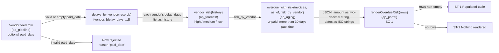
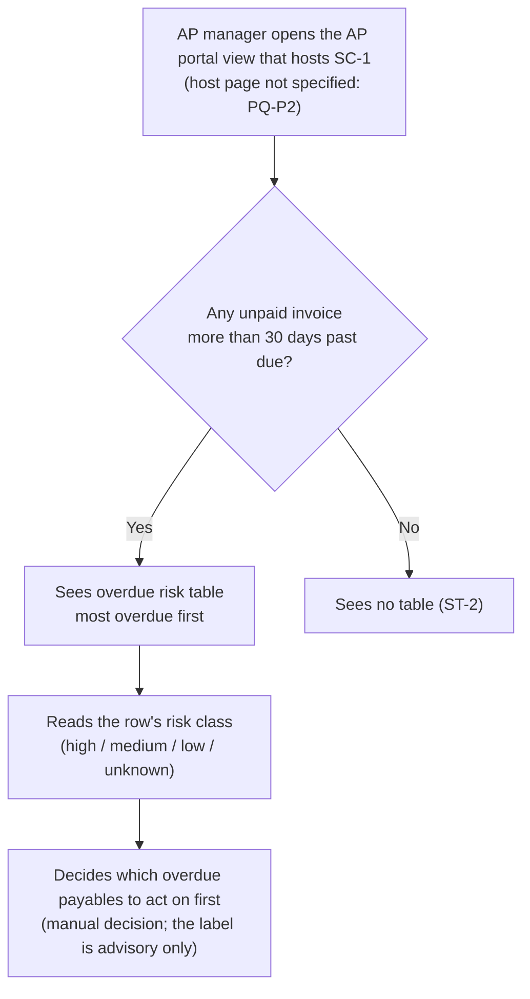
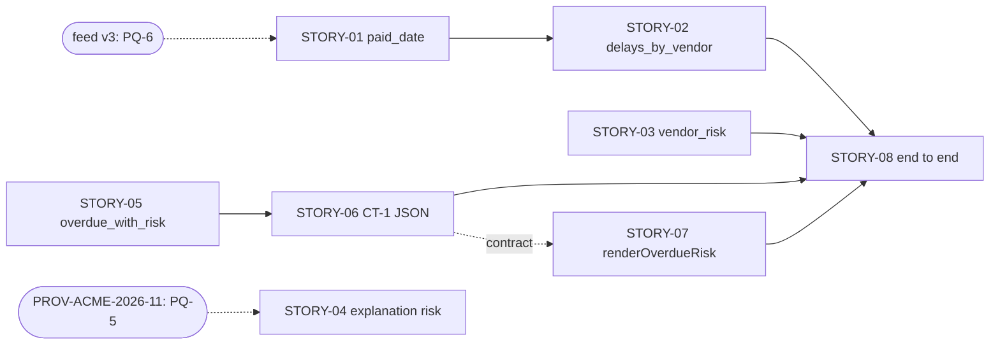
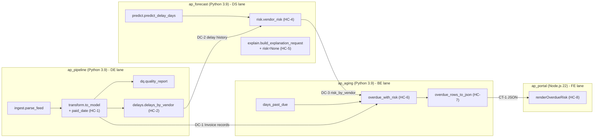
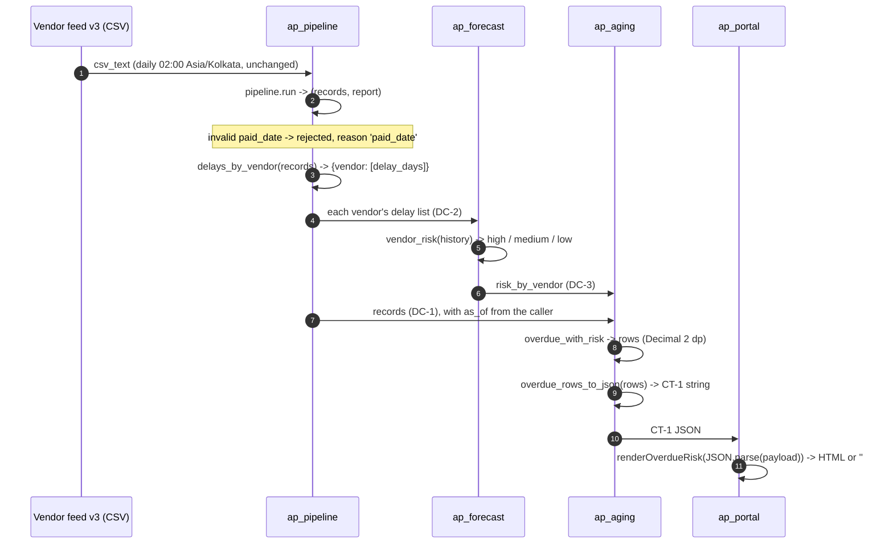
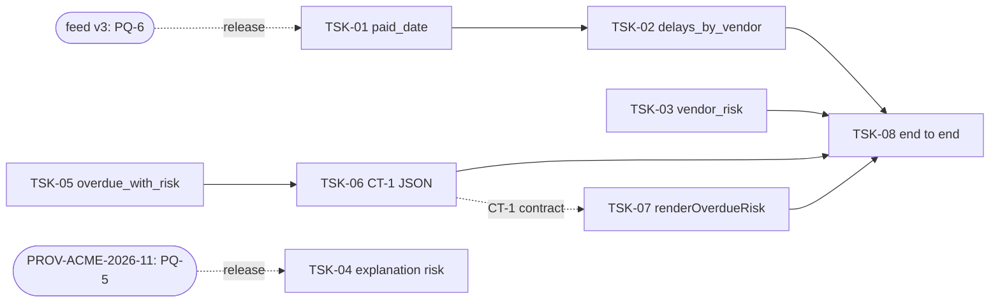
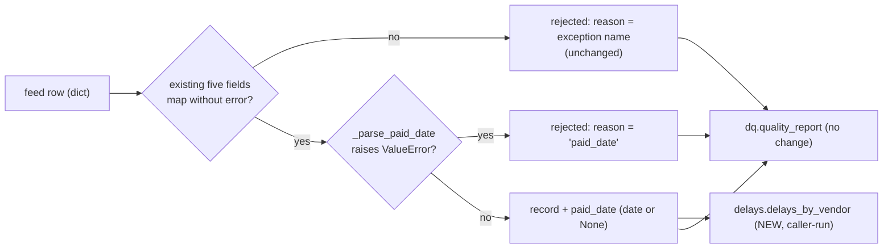
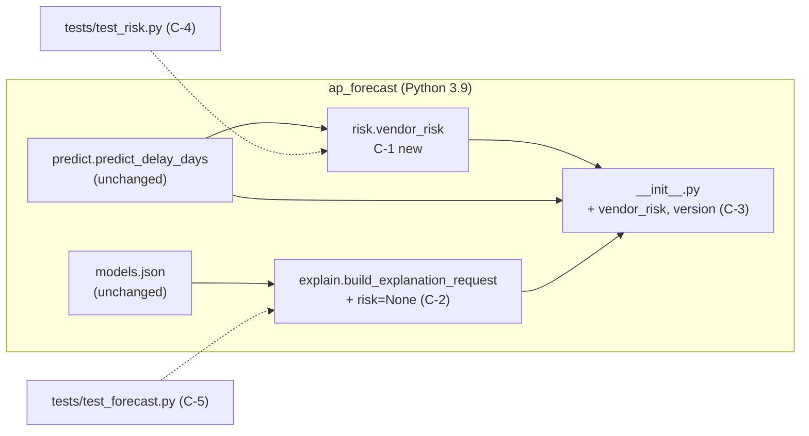
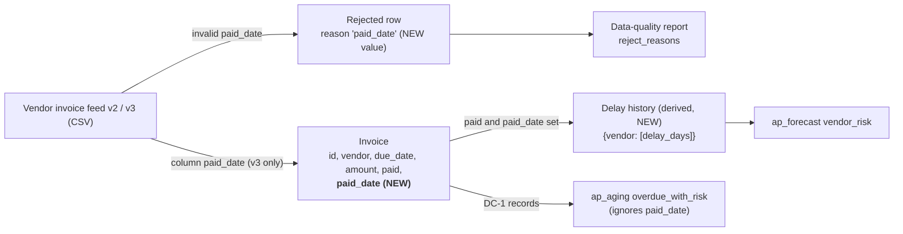

# Delivery pack FEAT-ZD-48600

AP managers want to see which overdue invoices belong to vendors that usually pay late, so they can chase them first. (1) Data engineering, ap_pipeline: the vendor feed gains an optional paid_date column (ISO date, empty when unpaid); an invalid paid_date rejects the row with reason 'paid_date'; add delays_by_vendor(records) returning {vendor: [delay_days, ...]} for paid records with a paid_date, where delay_days = (paid_date - due_date) in days, in feed order. (2) AI / data science, ap_forecast: add vendor_risk(history) returning 'high' when predict_delay_days(history) > 30, 'medium' when it is > 10, otherwise 'low'; build_explanation_request gains an optional risk argument and, when given, the prompt ends with ' Risk level: <risk>.'. (3) Backend, ap_aging: add overdue_with_risk(invoices, as_of, risk_by_vendor) returning, for unpaid invoices more than 30 days past due, a list of {'id', 'vendor', 'days', 'amount', 'risk'} sorted by days descending then id, with risk 'unknown' for vendors not in risk_by_vendor. (4) Frontend, ap_portal: add renderOverdueRisk(rows) rendering '<table class="overdue-risk">' with one '<tr class="risk-RISK">' per row showing id, vendor, days and amount to two decimals, and an empty string when there are no rows. The whole flow must be proven end to end: feed -> delays -> risk -> overdue list -> portal table.

## REQ-01 Requirement Intake (Requirement agent): feat.intake

# feat.intake: FEAT-ZD-48600

Original intake item, recorded as received. The ticket text is data. It is copied word for word below and has not been changed.

## Source

| Field | Value | Source |
|---|---|---|
| Trace ID | FEAT-ZD-48600 | record:brief |
| Intake ID | ZD-48600 | record:intake |
| Channel | Customer Feedback | record:intake |
| Source | Zendesk ticket ZD-48600 (sample, synthetic) | record:intake |
| Received | 2026-10-24 | record:intake |
| Source link (GitHub) | `hobasa-agentic-sdlc/requirements/ZD-48600.md` | record:intake; file:hobasa-agentic-sdlc/requirements/ZD-48600.md |
| Repositories named on the source item | ap_pipeline, ap_forecast, ap_aging, ap_portal | file:hobasa-agentic-sdlc/requirements/ZD-48600.md |
| Workbook trigger | Email/Ticket | record:brief; record:intake |

## Original text (verbatim)

> AP managers want to see which overdue invoices belong to vendors that usually pay late, so they can chase them first. (1) Data engineering, ap_pipeline: the vendor feed gains an optional paid_date column (ISO date, empty when unpaid); an invalid paid_date rejects the row with reason 'paid_date'; add delays_by_vendor(records) returning {vendor: [delay_days, ...]} for paid records with a paid_date, where delay_days = (paid_date - due_date) in days, in feed order. (2) AI / data science, ap_forecast: add vendor_risk(history) returning 'high' when predict_delay_days(history) > 30, 'medium' when it is > 10, otherwise 'low'; build_explanation_request gains an optional risk argument and, when given, the prompt ends with ' Risk level: <risk>.'. (3) Backend, ap_aging: add overdue_with_risk(invoices, as_of, risk_by_vendor) returning, for unpaid invoices more than 30 days past due, a list of {'id', 'vendor', 'days', 'amount', 'risk'} sorted by days descending then id, with risk 'unknown' for vendors not in risk_by_vendor. (4) Frontend, ap_portal: add renderOverdueRisk(rows) rendering '<table class="overdue-risk">' with one '<tr class="risk-RISK">' per row showing id, vendor, days and amount to two decimals, and an empty string when there are no rows. The whole flow must be proven end to end: feed -> delays -> risk -> overdue list -> portal table.

Source: record:intake; file:hobasa-agentic-sdlc/requirements/ZD-48600.md

## Change requests extracted from the text

The ticket is split into its change requests using the ticket's own wording. Nothing is added here. Interpretation and gaps are in feat.prebacklog.

| CR | Area / repository (as named in the ticket) | Change request | Source |
|---|---|---|---|
| CR-0 | Business need | AP managers want to see which overdue invoices belong to vendors that usually pay late, so they can chase them first. | record:intake |
| CR-1 | Data engineering / ap_pipeline | The vendor feed gains an optional `paid_date` column (ISO date, empty when unpaid). An invalid `paid_date` rejects the row with reason `'paid_date'`. | record:intake |
| CR-2 | Data engineering / ap_pipeline | Add `delays_by_vendor(records)` returning `{vendor: [delay_days, ...]}` for paid records with a `paid_date`, where `delay_days = (paid_date - due_date)` in days, in feed order. | record:intake |
| CR-3 | AI / data science / ap_forecast | Add `vendor_risk(history)` returning `'high'` when `predict_delay_days(history) > 30`, `'medium'` when it is `> 10`, otherwise `'low'`. | record:intake |
| CR-4 | AI / data science / ap_forecast | `build_explanation_request` gains an optional `risk` argument. When it is given, the prompt ends with `' Risk level: <risk>.'`. | record:intake |
| CR-5 | Backend / ap_aging | Add `overdue_with_risk(invoices, as_of, risk_by_vendor)`. For unpaid invoices more than 30 days past due, it returns a list of `{'id', 'vendor', 'days', 'amount', 'risk'}` sorted by days descending, then by id. Vendors not in `risk_by_vendor` get risk `'unknown'`. | record:intake |
| CR-6 | Frontend / ap_portal | Add `renderOverdueRisk(rows)`. It renders `<table class="overdue-risk">` with one `<tr class="risk-RISK">` per row, showing id, vendor, days and amount to two decimals. It returns an empty string when there are no rows. | record:intake |
| CR-7 | Cross-repository | The whole flow must be proven end to end: feed -> delays -> risk -> overdue list -> portal table. | record:intake |

## Feature-specific context attached to the source item

The source file carries org overrides for this item. They are listed here so the link between the intake and its context is visible:

- Data model: `Invoice` gains `paid_date (date or None) [paid_date added in feed v3]`; `amount (Decimal, 2 dp)`. Source: file:hobasa-agentic-sdlc/requirements/ZD-48600.md
- Customer mapping: vendor feed v3 adds column `paid_date (optional, ISO date, empty when unpaid)`, mapped to `Invoice.paid_date`. The schedule is unchanged. Source: file:hobasa-agentic-sdlc/requirements/ZD-48600.md
- Architecture: "Four repositories in one flow." JSON between services carries amounts as strings with two decimals and dates as ISO strings. "Keep every existing signature; add new functions." Source: file:hobasa-agentic-sdlc/requirements/ZD-48600.md
- Risk map: "No finance posting, authentication, tenancy or payment execution in this change; tier T2. The risk label is advisory only." Source: file:hobasa-agentic-sdlc/requirements/ZD-48600.md


## REQ-01 Requirement Intake (Requirement agent): feat.prebacklog

# feat.prebacklog: FEAT-ZD-48600

Pre Backlog requirement entry. This is a draft for review at the PM gate.

## Entry

| Field | Value | Source |
|---|---|---|
| Trace ID | FEAT-ZD-48600 | record:brief |
| Title | Show which overdue invoices belong to vendors that usually pay late | record:intake |
| Intake link | ZD-48600, `hobasa-agentic-sdlc/requirements/ZD-48600.md` (full text in feat.intake) | record:intake |
| Channel / received | Customer Feedback / 2026-10-24 | record:intake |
| Business need | AP managers want to see which overdue invoices belong to vendors that usually pay late, so they can chase them first. | record:intake |
| Linked roadmap item | **R-AP-12**: "give AP managers earlier visibility of overdue payables" (Q4 2026 roadmap, AP module, owner PM) | org.roadmap |
| Not linked | R-AP-14 (aging export for finance close). The ticket asks for no export. | org.roadmap; record:intake |
| Affected components | ap_pipeline (Data engineering), ap_forecast (AI / data science), ap_aging (Backend), ap_portal (Frontend), plus an end-to-end proof of the flow feed -> delays -> risk -> overdue list -> portal table | record:intake |
| Change requests | CR-0 to CR-7, listed in feat.intake | record:intake |
| Status | Draft entry for review; gate: PM | record:brief |

## Intake checks (workbook action)

| Check | Result | Source |
|---|---|---|
| Read the ticket | Done. The ticket text is captured word for word and split into CR-0 to CR-7 (feat.intake). | record:intake |
| Read the roadmap item and match it to planned work | Matches **R-AP-12**. The ticket asks to see overdue invoices so they can be chased first. This falls under "earlier visibility of overdue payables". | org.roadmap; record:intake |
| Check against the Pre Backlog sheet and DevOps board | Neither the Pre Backlog sheet nor the DevOps board is in this step's context. As a substitute, I read the related intake files in `requirements/`. That found no duplicate, but it did find three related open items (see "Related items"). See open question Q-1. | file:hobasa-agentic-sdlc/requirements/ZD-48211.md; file:hobasa-agentic-sdlc/requirements/ZD-48501.md; file:hobasa-agentic-sdlc/requirements/ZD-48455.md |
| Check the decision for conflict with prior decisions | No conflict found (see "Decision log check"). | org.decision_log; record:intake |
| Regulatory sources (section and page) | Not applicable: "No regulatory source applies to this change." No section or page is captured, and no rule is affected. | org.regulatory_sources |
| Connector inventory | The inventory states: "No source-system connector is affected by the ap_aging library." It does not mention the vendor feed that ap_pipeline ingests, and CR-1 changes that feed (new optional `paid_date` column, feed v3). The connector impact of CR-1 is therefore unconfirmed. See open question Q-2. | org.connector_inventory; record:intake; file:hobasa-agentic-sdlc/requirements/ZD-48600.md |
| Model dependency map | ap_forecast uses provider acme-llm, model acme-text-2 (config `src/ap_forecast/models.json`), for the payment-delay explanation. CR-4 changes the prompt sent to it (optional trailing `' Risk level: <risk>.'`); the ticket asks for no change of provider or model. `vendor_risk` (CR-3) "uses no LLM; it is a rule on the predicted delay". Affected feature: the payment-delay explanation. | org.model_dependency_map; record:intake |
| External patterns / market research | Not applicable. The trigger is a customer ticket (channel Customer Feedback), not a market research or competitive analysis change, so no external sources were gathered. | record:intake; record:brief |
| Notification | Not sent. The only connector approved for this step is api:github, which allows GET only. I filed a capability_request for a notification channel. It is pending approval. See open question Q-3. | mcp:hobasa-context; record:brief |

## Decision log check

| Decision / lesson | Relation to this item | Result | Source |
|---|---|---|---|
| D-2026-031: aging buckets use calendar days after due date | CR-5 "more than 30 days past due" and CR-2 `delay_days = (paid_date - due_date) in days`. Assumed to be calendar days (A-1). | Consistent | org.decision_log; record:intake |
| D-2026-044: monetary amounts use Decimal, never float | CR-5 returns `amount`; CR-6 shows amount to two decimals. The data model has `amount (Decimal, 2 dp)`, and JSON between services carries amounts as strings with two decimals. | Consistent, provided amounts stay Decimal or two-decimal strings and never pass through float (A-2) | org.decision_log; record:intake; file:hobasa-agentic-sdlc/requirements/ZD-48600.md |
| D-2026-050: paid invoices are excluded from aging | CR-5 covers only unpaid invoices. | Consistent | org.decision_log; record:intake |
| L-007: test the boundary day (exactly 30 days) explicitly for any day-count rule | CR-5 uses "more than 30 days", so an invoice exactly 30 days past due is not listed. CR-3 uses the strict thresholds `> 30` and `> 10`. Both boundaries need explicit tests. | Carry forward to testing | record:memory; record:intake |
| L-011: keep Decimal arithmetic; never convert amounts to float | Same as D-2026-044 for CR-5 and CR-6. | Carry forward to design | record:memory |

## Related items (open; not duplicates)

| Item | Overlap | Source |
|---|---|---|
| ZD-48501 (open) | `overdue_summary(invoices, as_of)` in ap_aging, for "unpaid invoices more than 30 days past due". This is the same overdue rule as CR-5, but it adds a different function and a portal badge (`badge-overdue`). | file:hobasa-agentic-sdlc/requirements/ZD-48501.md |
| ZD-48211 (open) | Flag every open invoice "more than 30 days past its due date" as overdue and add an overdue summary. "Paid invoices should never count as overdue." This is the same overdue definition. | file:hobasa-agentic-sdlc/requirements/ZD-48211.md |
| ZD-48455 (open) | ap_portal aging table: highlight rows as "overdue risk" with CSS class `row-overdue`. This uses similar wording but a different table and class from CR-6 (`overdue-risk`, `risk-RISK`). | file:hobasa-agentic-sdlc/requirements/ZD-48455.md |

## Assumptions (non-blocking; please confirm at the PM gate)

- **A-1**: "Days past due" in CR-5 and `delay_days` in CR-2 are calendar days, following D-2026-031. (org.decision_log)
- **A-2**: Inside ap_aging, `amount` in the CR-5 output is the Invoice `amount (Decimal, 2 dp)`. When the overdue list passes from ap_aging to ap_portal as JSON, the amount travels as a string with two decimals, as the architecture states for all JSON between services. ap_portal (CR-6) then shows it to two decimals. At no point is it converted to float (D-2026-044, L-011). (org.decision_log; record:memory; record:intake; file:hobasa-agentic-sdlc/requirements/ZD-48600.md)
- **A-3**: The `history` passed to `vendor_risk` (CR-3) is one vendor's list of `delay_days` from `delays_by_vendor` (CR-2). `risk_by_vendor` (CR-5) maps each vendor to that vendor's `vendor_risk` result. This follows the stated flow "feed -> delays -> risk -> overdue list". (record:intake)
- **A-4**: A negative `delay_days` (paid before the due date) is kept as computed. The ticket defines `delay_days = (paid_date - due_date)` and sets no floor. (record:intake)
- **A-5**: A record marked paid that has no `paid_date` is left out of `delays_by_vendor`. It is not rejected, because the ticket covers only "paid records with a paid_date". (record:intake)
- **A-6**: The risk label is advisory only. No finance posting or payment execution is in scope. (file:hobasa-agentic-sdlc/requirements/ZD-48600.md)

## Open questions (non-blocking)

- **Q-1**: The Pre Backlog sheet and DevOps board were not available to this step. The duplicate check covered only the related `requirements/` intake files. Can the PM confirm that no existing board item covers this? Should this item share one overdue definition with ZD-48501 and ZD-48211, or be merged with them?
- **Q-2**: Is the vendor feed (feed v3, new `paid_date` column) a registered source-system connector? If so, the connector inventory needs an entry and a version update. The current inventory speaks only about the ap_aging library.
- **Q-3**: A notification channel is pending approval through capability_request. Until it is approved, who notifies the PM of this entry?
- **Q-4**: How should a row that is unpaid but has a `paid_date` be handled: reject it, or ignore the date? The ticket defines rejection only for an invalid `paid_date`.
- **Q-5**: Should `renderOverdueRisk` (CR-6) HTML-escape the vendor names and ids it renders? The ticket does not say.


## REQ-02 Grouping (Requirement agent): feat.classification

# feat.classification: FEAT-ZD-48600

Grouping result for the Pre Backlog entry FEAT-ZD-48600 (ZD-48600). It gives the category, the Technical sub-category and qualifier, and the duplicate check against the other open intake items. This is a draft for automated checks and sampled human evaluation.

## Classification

| Field | Value | Source |
|---|---|---|
| Trace ID | FEAT-ZD-48600 | record:brief; feat.prebacklog |
| Intake ID / channel | ZD-48600 / Customer Feedback, received 2026-10-24 | feat.intake |
| Title | Show which overdue invoices belong to vendors that usually pay late | feat.prebacklog |
| **Category** | **New Feature** (reasoning under "Why New Feature") | feat.intake; org.architecture |
| Technical sub-category | Present in every repository part (see "Technical sub-category per change request") | feat.intake; org.architecture |
| **Qualifier** | **Not Technical Only.** The item adds a capability that customers can see: an overdue-risk table in the portal for AP managers. | feat.intake |
| Linked roadmap item | R-AP-12 "give AP managers earlier visibility of overdue payables" | feat.prebacklog |
| Risk tier (from the source item) | T2. "No finance posting, authentication, tenancy or payment execution in this change". The risk label is advisory only. | feat.intake |
| Duplicates merged | None. No open item asks for the same change (see "Duplicate check"). | file:hobasa-agentic-sdlc/requirements/ZD-48211.md; file:hobasa-agentic-sdlc/requirements/ZD-48501.md; file:hobasa-agentic-sdlc/requirements/ZD-48455.md |
| Related items grouped with this entry | ZD-48501 and ZD-48211 share the overdue rule. ZD-48470 and PROV-ACME-2026-11 change the same code (the vendor feed; `build_explanation_request`). None of them is a duplicate. | see "Duplicate check" |

Impacted repositories: ap_pipeline, ap_forecast, ap_aging, ap_portal

(Routing: org.routing_map; file:hobasa-agentic-sdlc/org/org.routing_map.md. See "Routing by repository".)

## Why New Feature

- The ticket asks for new behaviour that does not exist today. It adds four new functions: `delays_by_vendor`, `vendor_risk`, `overdue_with_risk` and `renderOverdueRisk`. It also adds a new optional feed column, `paid_date`. (feat.intake, CR-1 to CR-6)
- The existing functions are kept. The architecture says "Keep every existing signature; add new functions". The current functions (`aging_buckets`, `days_past_due`, `bucket_for`, `predict_delay_days`, `renderAgingSummary`, and others) are not redefined. Two changes touch existing behaviour, and both are additive:
  - `build_explanation_request` gains an optional argument (CR-4).
  - Feed ingestion accepts the new optional `paid_date` column. This also adds a new reject reason, `'paid_date'`, and a new field, `Invoice.paid_date` (CR-1).

  (org.architecture; feat.intake)
- It is not a Defect: no current behaviour is reported as wrong. It is not Documentation only or Configuration only, because code behaviour changes in four repositories. It is not Compliance: "No regulatory source applies to this change". (feat.intake; feat.prebacklog)

## Technical sub-category per change request

The workbook trigger for this step says "Technical has to be a sub-category under each and should be classified as Technical Only" where it applies (record:brief). Each part below has technical work. In this agent's judgement, none of the parts is Technical Only on its own, because each one feeds the customer-visible table. The "Category of the part" column is also this agent's judgement; the sources do not state it. The flow is "feed -> delays -> risk -> overdue list -> portal table" (CR-7).

| CR | Repository / area | Category of the part | Technical sub-category (what is technical in it) | Source |
|---|---|---|---|---|
| CR-1 | ap_pipeline / Data engineering | New Feature (data input) | Feed schema change: vendor feed v3 adds optional `paid_date` (ISO date, empty when unpaid), mapped to `Invoice.paid_date`. An invalid value rejects the row with reason `'paid_date'`. The schedule is unchanged. The connector impact is still open (feat.prebacklog Q-2). | feat.intake; feat.prebacklog |
| CR-2 | ap_pipeline / Data engineering | New Feature | New transform `delays_by_vendor(records)`; day-count rule `delay_days = (paid_date - due_date)` | feat.intake |
| CR-3 | ap_forecast / AI / data science | New Feature | New rule `vendor_risk(history)` on `predict_delay_days`, with thresholds `> 30` and `> 10`. It "uses no LLM; it is a rule on the predicted delay". | feat.intake; feat.prebacklog |
| CR-4 | ap_forecast / AI / data science | Enhancement within the feature | LLM prompt change: `build_explanation_request` gains an optional `risk` argument. Today ap_forecast uses provider acme-llm, model acme-text-2, for the payment-delay explanation. This ticket itself asks for no change of provider or model. A separate open item, PROV-ACME-2026-11, replaces acme-text-2 with acme-text-3 because acme-text-2 is deprecated on 2026-12-01. CR-4 must therefore not assume a particular model. See OQ-3. | feat.intake; feat.prebacklog; file:hobasa-agentic-sdlc/requirements/PROV-ACME-2026-11.md |
| CR-5 | ap_aging / Backend | New Feature | New function `overdue_with_risk(invoices, as_of, risk_by_vendor)`; rule "more than 30 days past due"; amounts stay Decimal (D-2026-044, L-011); paid invoices are excluded (D-2026-050) | feat.intake; feat.prebacklog; record:memory |
| CR-6 | ap_portal / Frontend | New Feature (customer-visible) | New renderer `renderOverdueRisk(rows)`; amounts arrive as strings with two decimals in the JSON between services | feat.intake; org.architecture |
| CR-7 | Cross-repository | Testing scope | End-to-end proof across all four repositories. The feature routing map sends it to the Testing Agent. | feat.intake; org.routing_map |

## Duplicate check

I compared ZD-48600 with every other intake item in `hobasa-agentic-sdlc/requirements/`. All of them are open. None asks for the same change, so nothing was merged. Four items share a rule or touch the same code; they are grouped here so that later steps can keep them consistent and plan their order. The rest are not grouped.

| Item | Status | Relation | Grouping decision | Source |
|---|---|---|---|---|
| ZD-48501 | open | Uses the same overdue rule in ap_aging: "unpaid invoices more than 30 days past due". It asks for a different function, `overdue_summary` (count and total), and a different portal output, `badge-overdue`. | Grouped as related (shared rule), not a duplicate. Both should share one overdue definition. See OQ-1. | file:hobasa-agentic-sdlc/requirements/ZD-48501.md |
| ZD-48211 | open | Uses the same overdue definition: "more than 30 days past its due date"; "Paid invoices should never count as overdue". It asks for an overdue flag and an overdue summary in the aging output. | Grouped as related (shared rule), not a duplicate. Share the definition. See OQ-1. | file:hobasa-agentic-sdlc/requirements/ZD-48211.md |
| ZD-48470 | open | Also changes the vendor feed in ap_pipeline: feed v2 adds `currency`. CR-1 refers to feed v3 adding `paid_date`. | Grouped as related (shared code), not a duplicate. Whether v3 must wait for v2 is unconfirmed. See OQ-2. | file:hobasa-agentic-sdlc/requirements/ZD-48470.md; feat.intake |
| PROV-ACME-2026-11 | open | Also changes `build_explanation_request` in ap_forecast: acme-text-2 (deprecated on 2026-12-01) is replaced by acme-text-3, and a `system` field is added. CR-4 adds a `risk` argument to the same function. | Grouped as related (shared code), not a duplicate. Both change the same function, so the changes need ordering. See OQ-3. | file:hobasa-agentic-sdlc/requirements/PROV-ACME-2026-11.md; feat.intake |
| ZD-48455 | open | Also an ap_portal table change with "overdue risk" wording. It uses a different table (the aging table) and a different class: `row-overdue`, where this item uses `overdue-risk` and `risk-RISK`. | Not grouped and not a duplicate. The wording overlaps, so the class names must stay distinct. | file:hobasa-agentic-sdlc/requirements/ZD-48455.md; feat.intake |
| FIN-OPS-2026-07 | open | Configuration change only: reduce the ap_forecast explanation max_tokens from 300 to 200, with "No code or behaviour change other than this configuration value". ZD-48600 does not touch max_tokens. | Not grouped and not a duplicate: it shares no rule or code with this item. A side observation for the PM, outside this item: FIN-OPS-2026-07 conflicts with PROV-ACME-2026-11, which says "Our explanation requests must keep max_tokens at 300" (see OQ-5). | file:hobasa-agentic-sdlc/requirements/FIN-OPS-2026-07.md; file:hobasa-agentic-sdlc/requirements/PROV-ACME-2026-11.md |
| ZD-48510 | open | Similar goal (acting on overdue invoices), but it asks for payment execution. Payment execution is out of scope for this item ("No ... payment execution in this change"). | Not grouped | file:hobasa-agentic-sdlc/requirements/ZD-48510.md; feat.intake |
| ZD-48377, RETRO-2026-19, ZD-48480, REG-LPR-2026-4.2 | open | All four are about ap_aging: a boundary defect in the aging buckets, error messages for missing fields, README bucket definitions, and the Late rule at more than 60 days. None asks for vendor risk or an overdue-risk list. | Not grouped; not duplicates | file:hobasa-agentic-sdlc/requirements/ZD-48377.md; file:hobasa-agentic-sdlc/requirements/RETRO-2026-19.md; file:hobasa-agentic-sdlc/requirements/ZD-48480.md; file:hobasa-agentic-sdlc/requirements/REG-LPR-2026-4.2.md |

Limitation: the Pre Backlog sheet and the DevOps board are not in this step's context. This duplicate check covers only the intake files in `requirements/`. This carries forward feat.prebacklog Q-1.

## New ticket (workbook action)

| Field | Value | Source |
|---|---|---|
| Ticket | FEAT-ZD-48600, category New Feature, qualifier Not Technical Only, linked to roadmap item R-AP-12 | record:brief; feat.prebacklog |
| Created in an external tracker | No. The connector approved for this step is api:github, which allows GET requests on the Hobasa repositories. It cannot create tickets. This file is the ticket record. The spine pushes it after evaluation. | record:brief |

## Routing by repository

| Repository | Owner agent (feature routing map) | Source |
|---|---|---|
| ap_pipeline | Data Engineering Coding Agent | org.routing_map |
| ap_forecast | Data Science Agent | org.routing_map |
| ap_aging | Backend Coding Agent; owner: backend developer | org.routing_map; file:hobasa-agentic-sdlc/org/org.routing_map.md |
| ap_portal | Frontend Coding Agent | org.routing_map |
| Integration and end-to-end (CR-7) | Testing Agent | org.routing_map |

The organisation-level routing map (`org/org.routing_map.md`) lists only ap_aging. The routing for the other three repositories comes from the feature override. See OQ-4.

## Open questions (non-blocking)

- **OQ-1**: ZD-48501, ZD-48211 and CR-5 all use "unpaid and more than 30 days past due". Should one shared overdue definition in ap_aging serve all three, so they cannot drift apart? Or should they stay separate? This needs a PM decision. Nothing was merged.
- **OQ-2**: CR-1 names feed v3, and ZD-48470 brings feed v2 (`currency`). Must ZD-48470 be delivered first, or is v3 independent of v2?
- **OQ-3**: PROV-ACME-2026-11 and CR-4 both change `build_explanation_request`. PROV-ACME-2026-11 moves it from acme-text-2 to acme-text-3 and adds a `system` field; CR-4 adds `risk`. Which order should they land in? Should the CR-4 tests run against whichever model is current at delivery?
- **OQ-4**: Should `org/org.routing_map.md` be updated with the owners of ap_pipeline, ap_forecast and ap_portal? Today they exist only in the feature override.
- **OQ-5** (outside this item, for the PM): PROV-ACME-2026-11 keeps max_tokens at 300, while FIN-OPS-2026-07 lowers it from 300 to 200. Which one applies?
- Carried forward from feat.prebacklog:
  - Q-1: duplicate check against the Pre Backlog sheet and DevOps board.
  - Q-2: is feed v3 a registered connector?
  - Q-3: notification channel.
  - Q-4: how to handle an unpaid row that has a `paid_date`.
  - Q-5: HTML escaping in `renderOverdueRisk`.


## REQ-03 Product Fitment Validation (Requirement agent): feat.fitment

# feat.fitment: FEAT-ZD-48600

Product fitment check for the Pre Backlog entry FEAT-ZD-48600 (ZD-48600, "Show which overdue invoices belong to vendors that usually pay late"). The entry is checked against the product capability, the Q4 2026 roadmap and the product strategy. This is a draft verdict. The PM and Leadership decide Yes or No at the gate.

Statements marked "agent judgement" are this agent's own assessment. No input states them.

## Verdict

| Field | Value | Source |
|---|---|---|
| Trace ID | FEAT-ZD-48600 | record:brief; feat.classification |
| **Fitment verdict** | **Yes** (recommended; agent judgement). The PM and Leadership make the decision. | evidence below |
| **Reason code** | **FIT-Y-ROADMAP**: the entry fits a named roadmap item (R-AP-12), builds on the existing capability, and supports the stated strategy. | org.roadmap; org.strategy_capability; feat.classification |
| Linked roadmap item | R-AP-12 "give AP managers earlier visibility of overdue payables" (Q4 2026 roadmap, AP module, owner: PM) | org.roadmap; feat.classification |
| Category / qualifier | New Feature / Not Technical Only | feat.classification |
| Risk tier (advisory) | T2: "No finance posting, authentication, tenancy or payment execution in this change". The risk label is advisory only. | feat.classification |
| Conditions on the Yes | None blocking. The gate should confirm FQ-1, the business meaning of "vendors that usually pay late" and "chase them first". See "Open questions". | this file |

FIT-Y-ROADMAP is this agent's own code. This step's inputs contain no list of reason codes (see FQ-5).

## Evidence

### 1. Roadmap fit

| Check | Evidence | Source |
|---|---|---|
| Is there a roadmap item? | Yes. The Q4 2026 AP module roadmap lists (R-AP-12) "give AP managers earlier visibility of overdue payables". feat.classification records R-AP-12 as the entry's linked roadmap item, citing feat.prebacklog as the source of the link. | org.roadmap; feat.classification |
| Does the entry match it? | The ticket says "AP managers want to see which overdue invoices belong to vendors that usually pay late, so they can chase them first". Agent judgement: this matches R-AP-12. Both name AP managers as the users. Both are about overdue items: R-AP-12 says "overdue payables" and the ticket says "overdue invoices". Both aim at seeing those items. The entry adds a portal table of unpaid invoices "more than 30 days past due", each with a vendor risk level. | org.roadmap; file:hobasa-agentic-sdlc/requirements/ZD-48600.md |
| Overlap with the other roadmap item | R-AP-14 is "aging export for finance close". No change request in feat.classification (CR-1 to CR-7) adds an export. | org.roadmap; feat.classification |

### 2. Capability fit

| Check | Evidence | Source |
|---|---|---|
| Current capability | "ap_aging service computes aging buckets (current, 1-30, 31-60, 61-90, 90+) for open invoices." | org.strategy_capability |
| How the entry relates | CR-5 adds `overdue_with_risk(invoices, as_of, risk_by_vendor)` to ap_aging for unpaid invoices "more than 30 days past due". The architecture says "Keep every existing signature; add new functions". The existing functions (`aging_buckets`, `days_past_due`, `bucket_for` and others) are not redefined. Agent judgement: the entry builds on the current capability's invoices and days past due. | feat.classification; file:hobasa-agentic-sdlc/requirements/ZD-48600.md |
| New capability added | The entry adds a vendor payment-delay history (`delays_by_vendor`, ap_pipeline). It adds a vendor risk rule (`vendor_risk`, ap_forecast). It adds a customer-visible overdue-risk table (`renderOverdueRisk`, ap_portal). | feat.classification |
| Gap in the capability statement | org.strategy_capability describes ap_aging and does not mention ap_pipeline, ap_forecast or ap_portal. In the material read for this step, those three repositories are described in the feature's architecture override (ZD-48600). For those three repositories, this check therefore draws on the override, not on the org capability statement (FQ-3). | org.strategy_capability; file:hobasa-agentic-sdlc/requirements/ZD-48600.md |
| Product scope boundaries | org.strategy_capability states no explicit out-of-scope list, so this step cannot check the entry against one (FQ-6). Related facts: the feature's risk map, which sets the advisory tier, records "No finance posting, authentication, tenancy or payment execution in this change". ZD-48510 asks for payment execution, and feat.classification marks it "Not grouped" with this entry. | org.strategy_capability; feat.classification |

### 3. Strategy fit

| Strategy statement | Evidence | Source |
|---|---|---|
| "help finance teams pay on time and avoid late-payment penalties" | The table lists unpaid invoices more than 30 days past due, "sorted by days descending then id", each with a vendor risk level. The ticket's stated purpose is "so they can chase them first". Agent judgement: showing overdue payables with a priority signal supports acting on them sooner, and so supports this statement. The sources do not say how the risk level should change the order in which invoices are paid (FQ-1). | org.strategy_capability; file:hobasa-agentic-sdlc/requirements/ZD-48600.md |
| "auditability and traceability are core product promises" | Each rule in the entry is stated explicitly. `vendor_risk` "uses no LLM; it is a rule on the predicted delay", with thresholds `> 30` and `> 10`. The delay rule is `delay_days = (paid_date - due_date)`. A row with an invalid `paid_date` is rejected with the reason `'paid_date'`. A vendor not in `risk_by_vendor` gets risk `'unknown'`. Agent judgement: explicit rules and a named reject reason (`'paid_date'`) support auditability and traceability. | org.strategy_capability; feat.classification; file:hobasa-agentic-sdlc/requirements/ZD-48600.md |

### 4. Consistency with the decision log

| Decision | Status | Source |
|---|---|---|
| D-2026-050: paid invoices are excluded from aging | Consistent. `overdue_with_risk` covers only unpaid invoices. | record:memory; file:hobasa-agentic-sdlc/requirements/ZD-48600.md |
| D-2026-044: monetary amounts use Decimal, never float | Consistent. CR-5 keeps amounts as Decimal. Between services, amounts travel as strings with two decimals. | record:memory; feat.classification |
| D-2026-031: aging buckets use calendar days after due date | No conflict found. The entry does not say how "days past due" is counted. Assumption: it follows D-2026-031 (calendar days). The BRD should confirm this (FQ-4). | record:memory; file:hobasa-agentic-sdlc/requirements/ZD-48600.md |

No conflict with a recorded decision was found.

## Risks and dependencies that do not change the verdict

These items come from feat.classification and the related intake files. They affect delivery planning, not fitment (agent judgement).

- **Model deprecation**: PROV-ACME-2026-11 replaces acme-text-2, which is deprecated on 2026-12-01, with acme-text-3. It changes `build_explanation_request`, the same function that CR-4 changes. The two changes need ordering (feat.classification OQ-3).
- **Shared overdue definition**: ZD-48501 and ZD-48211 use the same "more than 30 days past due" rule (feat.classification OQ-1).
- **Feed order**: CR-1 needs feed v3, and ZD-48470 brings feed v2 (feat.classification OQ-2).
- **Terminology**: the open regulatory item REG-LPR-2026-4.2 defines "Late" as a payable "more than 60 days past its due date" that remains unpaid. This entry's "overdue" means more than 30 days past due. Recommendation (agent judgement): keep the two labels distinct in the portal and the BRD (FQ-2). Source: file:hobasa-agentic-sdlc/requirements/REG-LPR-2026-4.2.md.

## Notification (workbook outcome)

| Field | Value | Source |
|---|---|---|
| To | PM and Leadership, the gate owners for REQ-03 | record:brief |
| Message | "FEAT-ZD-48600 fitment: Yes recommended (FIT-Y-ROADMAP, R-AP-12). Please decide Yes or No and confirm FQ-1 at the gate." | this file |
| Channel | Not set. The notification channel is still open (feat.prebacklog Q-3, carried forward in feat.classification). The only connector approved for this step is api:github, limited to GET requests on the Hobasa repositories, so no message was sent. This file, pushed by the spine after the gate, is the notification record. | feat.classification; record:brief |

## Open questions (non-blocking)

- **FQ-1 (PM / Leadership, business meaning)**: The roadmap item is about "overdue payables". The ticket asks about "vendors that usually pay late" and wants to "chase them first". It measures delay as `paid_date - due_date` on invoices from each vendor. Agent judgement: in an AP context the vendor is the party being paid, so this wording is ambiguous. Assumption used for the verdict: the risk level helps AP managers decide which overdue payables to act on first. Please confirm. If a different meaning is intended, the strategy fit should be checked again.
- **FQ-2**: Keep "overdue" (more than 30 days) and the regulatory "Late" (more than 60 days, REG-LPR-2026-4.2) as distinct labels.
- **FQ-3**: Should org.strategy_capability be extended to cover ap_pipeline, ap_forecast and ap_portal? Today it does not mention them.
- **FQ-4**: Confirm that "days past due" in `overdue_with_risk` uses calendar days (D-2026-031), and test the boundary of exactly 30 days (L-007).
- **FQ-5**: Is there an approved list of fitment reason codes? FIT-Y-ROADMAP is this agent's own code.
- **FQ-6**: org.strategy_capability states no product out-of-scope list. Should one be added so that later fitment checks can test scope explicitly?
- Carried forward from feat.classification: OQ-1 to OQ-5, and feat.prebacklog Q-1 to Q-5.


## REQ-04 BRD Preparation (Requirement agent): feat.brd

# feat.brd: FEAT-ZD-48600

Business Requirement Document for FEAT-ZD-48600 (ZD-48600, "Show which overdue invoices belong to vendors that usually pay late"). This is a draft for the REQ-04 gate.

Statements marked "agent judgement" are an agent's own assessment, and no input states them as fact. Where the judgement was made in an earlier step, the step is named. Assumptions are listed in section 10 and need confirmation at the gate.

| Field | Value | Source |
|---|---|---|
| Trace ID | FEAT-ZD-48600 | record:brief; feat.intake |
| Intake | ZD-48600, Zendesk ticket (sample, synthetic), channel Customer Feedback, received 2026-10-24 | feat.intake |
| Source link (GitHub) | `hobasa-agentic-sdlc/requirements/ZD-48600.md` | feat.intake; file:hobasa-agentic-sdlc/requirements/ZD-48600.md |
| Fitment | feat.fitment recommends "Yes", with reason code FIT-Y-ROADMAP and linked roadmap item R-AP-12. FIT-Y-ROADMAP is the REQ-03 agent's own code; no approved list of reason codes exists (FQ-5). The REQ-03 gate decisions were "PM: approve by sim.pm" and "Leadership: approve by sim.leadership"; gates in this run are SIMULATED. | feat.fitment; file:hobasa-agentic-sdlc/features/FEAT-ZD-48600/COMMUNICATION.md |
| Category / qualifier | New Feature / Not Technical Only, as classified by the REQ-02 agent (feat.classification) and carried in feat.fitment | feat.fitment; file:hobasa-requirement-agent/outputs/FEAT-ZD-48600/feat.classification.md |
| Risk tier (advisory) | T2. "The risk label is advisory only." | feat.fitment; feat.intake |
| Owner of this step | PM | record:brief |
| Gate for this document | Leadership | record:brief |
| Template | BRD template: problem, business outcome, users, scope, out of scope, business rules, success measures, approvals | org.templates |

## 1. Problem

| Statement | Source |
|---|---|
| "AP managers want to see which overdue invoices belong to vendors that usually pay late, so they can chase them first." | feat.intake (CR-0) |
| Today the AP module's capability is that the "ap_aging service computes aging buckets (current, 1-30, 31-60, 61-90, 90+) for open invoices". The capability statement mentions neither a vendor payment-delay history nor a vendor risk level. feat.fitment records that the entry adds both (`delays_by_vendor` in ap_pipeline, `vendor_risk` in ap_forecast). | org.strategy_capability; feat.fitment |
| The business meaning is still open. feat.fitment notes, as agent judgement, that in an AP context the vendor is the party being paid, so "vendors that usually pay late" and "chase them first" are ambiguous. It assumed that "the risk level helps AP managers decide which overdue payables to act on first". This BRD keeps that assumption (B-A1) and carries the question forward (OQ-B1). | feat.fitment (FQ-1) |

## 2. Business outcome

| Outcome | Source |
|---|---|
| AP managers see a table in the portal. It lists unpaid invoices more than 30 days past due, sorted by days descending then id, "each with a vendor risk level". Each row carries a risk class (`risk-high`, `risk-medium`, `risk-low` or `risk-unknown`). The visible columns are Invoice, Vendor, Days overdue and Amount. Whether the risk level is also shown as visible text is open (OQ-B9). | feat.fitment; feat.intake (CR-5, CR-6); file:hobasa-agentic-sdlc/requirements/ZD-48600.md |
| Roadmap link. feat.fitment gives R-AP-12, "give AP managers earlier visibility of overdue payables" (Q4 2026 roadmap, AP module), as the linked roadmap item. Its agent judgement is that the entry matches R-AP-12: both name AP managers as the users, and both are about seeing overdue items. | feat.fitment |
| Strategy link (agent judgement, recorded in feat.fitment). Showing overdue payables with a priority signal supports acting on them sooner, and so supports the strategy statement "help finance teams pay on time and avoid late-payment penalties". The sources do not say how the risk level should change the order in which invoices are paid (OQ-B1). | org.strategy_capability; feat.fitment |
| Product-promise link (agent judgement, recorded in feat.fitment). Explicit rules and a named reject reason support the promise "auditability and traceability are core product promises". The facts behind this judgement come from the sources: `vendor_risk` "uses no LLM; it is a rule on the predicted delay", and an invalid `paid_date` is rejected with the reason `'paid_date'`. | org.strategy_capability; feat.fitment; feat.intake; file:hobasa-agentic-sdlc/requirements/ZD-48600.md |

## 3. Users

| User | Need | Source |
|---|---|---|
| AP managers (the users named in the ticket) | See which overdue invoices belong to vendors that usually pay late, so they can chase them first. | feat.intake |
| Finance teams (agent judgement: they benefit indirectly, as the group named in the strategy) | The strategy is to "help finance teams pay on time and avoid late-payment penalties". | org.strategy_capability |

The inputs name no other user group.

## 4. Scope

The flow in scope is "feed -> delays -> risk -> overdue list -> portal table", across the repositories named on the source item: ap_pipeline, ap_forecast, ap_aging and ap_portal (feat.intake, Source table and CR-7). The architecture rule is "Keep every existing signature; add new functions" (feat.intake; file:hobasa-agentic-sdlc/requirements/ZD-48600.md). feat.classification records that the ticket adds four new functions (`delays_by_vendor`, `vendor_risk`, `overdue_with_risk`, `renderOverdueRisk`). It also records that "Two changes touch existing behaviour, and both are additive":

- `build_explanation_request` gains an optional argument (CR-4).
- Feed ingestion accepts the new optional `paid_date` column, which also adds a new reject reason, `'paid_date'`, and a new field, `Invoice.paid_date` (CR-1).

(file:hobasa-requirement-agent/outputs/FEAT-ZD-48600/feat.classification.md)

| ID | In scope (business view) | Repository / area | Change request | Source |
|---|---|---|---|---|
| S-1 | Capture when each paid invoice was paid. The vendor feed gains an optional `paid_date` column (ISO date, empty when unpaid), mapped to `Invoice.paid_date` (vendor feed v3). The schedule is unchanged. | ap_pipeline / Data engineering | CR-1 | feat.intake |
| S-2 | Build each vendor's payment-delay history. `delays_by_vendor(records)` returns `{vendor: [delay_days, ...]}` for paid records with a `paid_date`, in feed order. | ap_pipeline / Data engineering | CR-2 | feat.intake |
| S-3 | Give each vendor a risk level from its predicted delay: `vendor_risk(history)`. | ap_forecast / AI / data science | CR-3 | feat.intake |
| S-4 | `build_explanation_request` gains an optional `risk` argument. When it is given, the prompt ends with `' Risk level: <risk>.'`. | ap_forecast / AI / data science | CR-4 | feat.intake |
| S-5 | Produce the overdue list with risk: `overdue_with_risk(invoices, as_of, risk_by_vendor)`. | ap_aging / Backend | CR-5 | feat.intake |
| S-6 | Show the overdue-risk table in the portal: `renderOverdueRisk(rows)`. | ap_portal / Frontend | CR-6 | feat.intake |
| S-7 | Prove the whole flow end to end: feed -> delays -> risk -> overdue list -> portal table. | Cross-repository | CR-7 | feat.intake |

## 5. Out of scope

| ID | Out of scope | Source |
|---|---|---|
| OS-1 | Finance posting, authentication, tenancy and payment execution: "No finance posting, authentication, tenancy or payment execution in this change". | feat.intake; file:hobasa-agentic-sdlc/requirements/ZD-48600.md |
| OS-2 | Acting on the risk level automatically (agent judgement from "The risk label is advisory only."). | feat.intake |
| OS-3 | An aging export for finance close (roadmap item R-AP-14). No change request adds an export. | feat.fitment |
| OS-4 | Changing the LLM provider or model. The ticket asks for no change of provider or model. The model replacement is a separate open item, PROV-ACME-2026-11. | file:hobasa-requirement-agent/outputs/FEAT-ZD-48600/feat.prebacklog.md; feat.fitment |
| OS-5 | Using an LLM to set the risk level. `vendor_risk` "uses no LLM; it is a rule on the predicted delay". | file:hobasa-agentic-sdlc/requirements/ZD-48600.md |
| OS-6 | Changes to existing behaviour beyond the two additive changes named in section 4 (CR-1, CR-4): "Keep every existing signature; add new functions." | feat.intake; file:hobasa-requirement-agent/outputs/FEAT-ZD-48600/feat.classification.md |
| OS-7 | The work asked for in the related open items ZD-48501 and ZD-48211 (overdue summary, overdue flag, overdue badge). They share this item's overdue rule but were not merged with it. | feat.fitment; file:hobasa-requirement-agent/outputs/FEAT-ZD-48600/feat.classification.md |
| OS-8 | The regulatory "Late" rule (REG-LPR-2026-4.2, a payable "more than 60 days past its due date" that remains unpaid). This item's "overdue" is a different label. | feat.fitment |

## 6. Business rules

| ID | Rule | Source |
|---|---|---|
| BR-1 | `paid_date` is optional. It is an ISO date, and it is empty when the invoice is unpaid. | feat.intake (CR-1) |
| BR-2 | A feed row with an invalid `paid_date` is rejected with the reason `'paid_date'`. | feat.intake (CR-1) |
| BR-3 | A vendor's payment delay is `delay_days = (paid_date - due_date)` in days. It is computed only for paid records that have a `paid_date`, and the values are kept in feed order. | feat.intake (CR-2) |
| BR-4 | Vendor risk is `'high'` when `predict_delay_days(history) > 30`, `'medium'` when it is `> 10`, and `'low'` otherwise. | feat.intake (CR-3) |
| BR-5 | The risk thresholds are strict. A predicted delay of exactly 30 is `'medium'`, and exactly 10 is `'low'` (agent judgement, read directly from the `>` comparisons). | feat.intake (CR-3) |
| BR-6 | The vendor risk level is a rule on the predicted delay. It uses no LLM. | file:hobasa-agentic-sdlc/requirements/ZD-48600.md |
| BR-7 | An invoice is in the overdue list only when it is unpaid and more than 30 days past due. An invoice exactly 30 days past due is not listed. | feat.intake (CR-5); file:hobasa-requirement-agent/outputs/FEAT-ZD-48600/feat.prebacklog.md |
| BR-8 | Paid invoices are excluded. | org.decision_log (D-2026-050); feat.intake (CR-5) |
| BR-9 | Days past due are counted in calendar days after the due date. This BRD applies D-2026-031 to the overdue list; the ticket does not say how days are counted (assumption B-A2, OQ-B4). | org.decision_log (D-2026-031); feat.fitment (FQ-4) |
| BR-10 | Each overdue row carries `id`, `vendor`, `days`, `amount` and `risk`. Rows are sorted by days descending, then by id. | feat.intake (CR-5) |
| BR-11 | A vendor with no risk level in `risk_by_vendor` gets risk `'unknown'`. | feat.intake (CR-5) |
| BR-12 | Monetary amounts use Decimal, never float. The Invoice `amount` is Decimal, 2 dp. JSON between services carries amounts as strings with two decimals and dates as ISO strings. The `amount` in the overdue list is assumed to be the Invoice amount (B-A7). | org.decision_log (D-2026-044); record:memory (L-011); feat.intake; file:hobasa-agentic-sdlc/requirements/ZD-48600.md |
| BR-13 | The portal table is `<table class="overdue-risk">`, with one `<tr class="risk-RISK">` per row showing id, vendor, days and amount to two decimals. When there are no rows, the result is an empty string. | feat.intake (CR-6) |
| BR-14 | Row classes are `risk-high`, `risk-medium`, `risk-low` or `risk-unknown`. The columns are Invoice, Vendor, Days overdue and Amount (two decimals). | file:hobasa-agentic-sdlc/requirements/ZD-48600.md |
| BR-15 | When a `risk` argument is given to `build_explanation_request`, the prompt it builds ends with `' Risk level: <risk>.'`. | feat.intake (CR-4) |
| BR-16 | The risk label is advisory only. | feat.intake; file:hobasa-agentic-sdlc/requirements/ZD-48600.md |

## 7. Success measures

The inputs give no business KPI, for example a target for faster chasing or fewer late-payment penalties. This BRD therefore states delivery success measures that can be checked, and asks the owners for a business KPI (OQ-B3).

| ID | Success measure | Source |
|---|---|---|
| SM-1 | The whole flow is proven end to end: feed -> delays -> risk -> overdue list -> portal table. | feat.intake (CR-7) |
| SM-2 | Every day-count boundary is tested explicitly: an invoice exactly 30 days past due (not listed), and the strict risk thresholds at exactly 30 and exactly 10 (BR-5). | record:memory (L-007); file:hobasa-requirement-agent/outputs/FEAT-ZD-48600/feat.prebacklog.md; feat.intake |
| SM-3 | Amounts follow the stated representation at each point. The Invoice `amount` is Decimal (2 dp), and Decimal arithmetic is kept (never float). In the JSON between services, amounts travel as strings with two decimals. The ap_portal table (Node.js) shows the amount to two decimals. The inputs do not say how ap_portal handles the amount string internally; that is left to the PRD and TRD (OQ-B10). | org.decision_log (D-2026-044); record:memory (L-011); feat.intake (CR-6); file:hobasa-agentic-sdlc/requirements/ZD-48600.md |
| SM-4 | A row with an invalid `paid_date` is rejected with reason `'paid_date'`. | feat.intake (CR-1) |
| SM-5 | The architecture rule "Keep every existing signature; add new functions" is met. Existing behaviour changes only in the two additive ways recorded in feat.classification: the optional argument added to `build_explanation_request` (CR-4), and feed ingestion accepting the optional `paid_date` column with the new reject reason `'paid_date'` and the new field `Invoice.paid_date` (CR-1). Callers that do not pass `risk` are assumed to get today's prompt (B-A6). | feat.intake; file:hobasa-requirement-agent/outputs/FEAT-ZD-48600/feat.classification.md |
| SM-6 | Business KPI: not defined in the inputs (OQ-B3). | this file |

## 8. Approvals

| Role | What is asked | Status | Source |
|---|---|---|---|
| Leadership | Approve or reject this BRD (REQ-04 gate). | Pending | record:brief |

Open questions that need a business decision are listed in section 11, with the owners recorded by the step that raised them.

## 9. Business question set

The step action asks for the business question set. org.templates names the templates (BRD, PRD, TRD, story) but holds no separate business question set (OQ-B7). The questions below are therefore this agent's own set. They cover the BRD template sections and the checks this step must make. Each was checked against the inputs; no stakeholder was contacted in this step. BQ-3 has no answer in the inputs. Questions without an answer go to the owners as open questions.

| # | Question | Answer from the inputs | Source |
|---|---|---|---|
| BQ-1 | What business problem is being solved? | AP managers want to see which overdue invoices belong to vendors that usually pay late, so they can chase them first. | feat.intake |
| BQ-2 | Who are the users? | AP managers. Finance teams, the group named in the strategy, benefit indirectly (agent judgement). | feat.intake; org.strategy_capability |
| BQ-3 | What do "vendors that usually pay late" and "chase them first" mean in AP? | Not answered. Assumed: the risk level helps AP managers decide which overdue payables to act on first (B-A1). | feat.fitment (FQ-1) → OQ-B1 |
| BQ-4 | What is in scope and out of scope? | See sections 4 and 5. | feat.intake; feat.fitment |
| BQ-5 | Which roadmap item and strategy is it linked to? | Linked roadmap item R-AP-12, which feat.fitment judges the entry matches. The strategy statement is "help finance teams pay on time and avoid late-payment penalties" (the strategy fit is agent judgement in feat.fitment). | feat.fitment; org.strategy_capability |
| BQ-6 | What are the business rules? | See section 6. | feat.intake; org.decision_log |
| BQ-7 | How is success measured? | By delivery measures SM-1 to SM-5. There is no business KPI. | feat.intake → OQ-B3 |
| BQ-8 | Does any prior decision conflict? | No conflict (section 12). | org.decision_log |
| BQ-9 | Does a regulation apply? | "No regulatory source applies to this change." The regulatory "Late" label (more than 60 days) is a different term. As agent judgement, feat.fitment recommends keeping the two labels distinct (OQ-B2). | file:hobasa-requirement-agent/outputs/FEAT-ZD-48600/feat.prebacklog.md; feat.fitment (FQ-2) |
| BQ-10 | Is there money movement, posting or payment execution? | No: "No finance posting, authentication, tenancy or payment execution in this change." | feat.intake |
| BQ-11 | Who approves? | Leadership, at the REQ-04 gate. | record:brief |

## 10. Assumptions (non-blocking; please confirm at the gate)

| ID | Assumption | Source |
|---|---|---|
| B-A1 | The risk level helps AP managers decide which overdue payables to act on first. | feat.fitment (FQ-1) |
| B-A2 | "Days past due" (BR-7) and `delay_days` (BR-3) are calendar days, following D-2026-031. | org.decision_log; file:hobasa-requirement-agent/outputs/FEAT-ZD-48600/feat.prebacklog.md (A-1) |
| B-A3 | The `history` given to `vendor_risk` is one vendor's list of `delay_days` from `delays_by_vendor`. `risk_by_vendor` maps each vendor to its `vendor_risk` result. This follows the flow "feed -> delays -> risk -> overdue list". | file:hobasa-requirement-agent/outputs/FEAT-ZD-48600/feat.prebacklog.md (A-3); feat.intake |
| B-A4 | A negative `delay_days` (paid before the due date) is kept as computed. The rule sets no floor. | file:hobasa-requirement-agent/outputs/FEAT-ZD-48600/feat.prebacklog.md (A-4) |
| B-A5 | A record marked paid that has no `paid_date` is left out of the delay history. It is not rejected. | file:hobasa-requirement-agent/outputs/FEAT-ZD-48600/feat.prebacklog.md (A-5) |
| B-A6 | When no `risk` argument is given, `build_explanation_request` builds the same prompt as today. This is agent judgement from "Keep every existing signature"; CR-4 does not say it. | feat.intake |
| B-A7 | Inside ap_aging, `amount` in the overdue list is the Invoice `amount (Decimal, 2 dp)`. When the list passes from ap_aging to ap_portal as JSON, the amount travels as a string with two decimals. | file:hobasa-requirement-agent/outputs/FEAT-ZD-48600/feat.prebacklog.md (A-2) |

## 11. Open questions (non-blocking)

| ID | Question | Owner (as recorded by the raising step) | Source |
|---|---|---|---|
| OQ-B1 | Confirm the business meaning of "vendors that usually pay late" and "chase them first" (B-A1). If a different meaning is intended, the strategy fit should be checked again. | PM / Leadership | feat.fitment (FQ-1) |
| OQ-B2 | Keep "overdue" (more than 30 days) and the regulatory "Late" (more than 60 days, REG-LPR-2026-4.2) as distinct labels in the portal and in later documents. | Not recorded | feat.fitment (FQ-2) |
| OQ-B3 | What business KPI should measure success, for example time to chase or late-payment penalties avoided? The inputs give none. | Not recorded | this file |
| OQ-B4 | Confirm calendar days for "days past due" in `overdue_with_risk` (D-2026-031), with the 30-day boundary tested (L-007). | Not recorded | feat.fitment (FQ-4) |
| OQ-B5 | Should one shared overdue definition serve this item, ZD-48501 and ZD-48211? | PM | file:hobasa-requirement-agent/outputs/FEAT-ZD-48600/feat.classification.md (OQ-1) |
| OQ-B6 | How should an unpaid row that has a `paid_date` be handled: reject it, or ignore the date? | Not recorded | file:hobasa-requirement-agent/outputs/FEAT-ZD-48600/feat.prebacklog.md (Q-4) |
| OQ-B7 | The brief describes org.templates as holding the business question set, but its content holds only the templates. Should an approved question set be added? | Not recorded | org.templates; record:brief |
| OQ-B8 | Should `renderOverdueRisk` HTML-escape the vendor names and ids it renders? | Not recorded | file:hobasa-requirement-agent/outputs/FEAT-ZD-48600/feat.prebacklog.md (Q-5) |
| OQ-B9 | Should the portal show the risk level as visible text, or only as the row class `risk-RISK`? CR-6 lists the shown values as id, vendor, days and amount. | Not recorded | feat.intake (CR-6); file:hobasa-agentic-sdlc/requirements/ZD-48600.md |
| OQ-B10 | How should ap_portal (Node.js) format the two-decimal amount string it receives without converting it to a binary floating-point number (D-2026-044)? This is for the PRD and TRD. | Not recorded | org.decision_log; file:hobasa-agentic-sdlc/requirements/ZD-48600.md |
| — | Carried forward unchanged: feat.fitment FQ-3, FQ-5 and FQ-6. Also carried forward: the open questions that feat.fitment records as carried from feat.classification (OQ-1 to OQ-5) and feat.prebacklog (Q-1 to Q-5). | — | feat.fitment |

## 12. Validation check

### Decision log

| Decision | Result | Source |
|---|---|---|
| D-2026-031: aging buckets use calendar days after due date | No conflict. BR-9 applies it to the overdue list as an assumption (B-A2). | org.decision_log |
| D-2026-044: monetary amounts use Decimal, never float | Consistent (BR-12, SM-3). The handling inside ap_portal is open (OQ-B10). | org.decision_log |
| D-2026-050: paid invoices are excluded from aging | Consistent (BR-8). | org.decision_log |

No conflict with a recorded decision was found.

### Template and grounding

| Check | Result | Source |
|---|---|---|
| All BRD template sections are present (problem, business outcome, users, scope, out of scope, business rules, success measures, approvals) | Pass: sections 1 to 8. | org.templates |
| Every change request CR-0 to CR-7 is covered | Pass: CR-0 in section 1, and CR-1 to CR-7 in S-1 to S-7. | feat.intake |
| Every business rule cites its source | Pass: BR-1 to BR-16 each cite an input or a source file. No regulation applies, so no section and page are cited. | file:hobasa-requirement-agent/outputs/FEAT-ZD-48600/feat.prebacklog.md |
| The fitment verdict is consistent with this BRD | Pass: Yes, linked to R-AP-12. Out of scope matches the fitment evidence (R-AP-14, payment execution). | feat.fitment |
| A business KPI is present | Not met: the inputs have no KPI (OQ-B3). This does not block the BRD. | this file |

### Risks and dependencies (do not change scope)

| Item | Source |
|---|---|
| PROV-ACME-2026-11 replaces acme-text-2 (deprecated on 2026-12-01) with acme-text-3 and changes `build_explanation_request`, the same function as CR-4. The two changes need ordering. | feat.fitment |
| CR-1 needs feed v3, and ZD-48470 brings feed v2. | feat.fitment |
| ZD-48501 and ZD-48211 use the same "more than 30 days past due" rule. | feat.fitment |


## REQ-05 Product Requirement Preparation (Requirement agent): feat.prd

# feat.prd: FEAT-ZD-48600

Product Requirement Document for FEAT-ZD-48600 (ZD-48600, "Show which overdue invoices belong to vendors that usually pay late"). This is a draft for the REQ-05 gate (PM).

This PRD carries forward the decisions in the approved BRD (feat.brd). It adds no scope. It turns the BRD scope (S-1 to S-7) and business rules (BR-1 to BR-16) into user stories, numbered acceptance criteria in EARS form and non-functional requirements, and ends with a validation check. Statements marked "agent judgement" are this agent's own reading; no input states them as fact. PRD-level assumptions (P-A) and questions (PQ) are new in this step and need confirmation at the gate.

| Field | Value | Source |
|---|---|---|
| Trace ID | FEAT-ZD-48600 | record:brief; feat.brd |
| Intake | ZD-48600, Zendesk ticket (sample, synthetic), channel Customer Feedback, received 2026-10-24 | feat.brd; file:hobasa-agentic-sdlc/requirements/ZD-48600.md |
| Source link (GitHub) | `hobasa-agentic-sdlc/requirements/ZD-48600.md` | feat.brd |
| Trigger | BRD approved | record:brief |
| Fitment | "Yes", linked roadmap item R-AP-12 ("give AP managers earlier visibility of overdue payables") | feat.brd |
| Category / qualifier | New Feature / Not Technical Only | feat.brd |
| Risk tier (advisory) | T2. "The risk label is advisory only." | feat.brd; file:hobasa-agentic-sdlc/requirements/ZD-48600.md |
| Repositories | ap_pipeline, ap_forecast, ap_aging, ap_portal | feat.brd; file:hobasa-agentic-sdlc/requirements/ZD-48600.md |
| Owner / gate of this step | PM / PM | record:brief |
| Template | PRD template: summary, user stories, numbered acceptance criteria (EARS: When <trigger>, the system shall <response>), non-functional requirements, open questions | org.templates |

## 1. Summary

| Item | Statement | Source |
|---|---|---|
| Problem | "AP managers want to see which overdue invoices belong to vendors that usually pay late, so they can chase them first." | feat.brd (section 1) |
| What the product will do | Build each vendor's payment-delay history from a new optional `paid_date` in the vendor feed, give each vendor a rule-based risk level (`high`, `medium`, `low`) from its predicted delay, list unpaid invoices more than 30 days past due with that risk level, and show the list as a table in the portal. | feat.brd (sections 2, 4) |
| Flow | feed -> delays -> risk -> overdue list -> portal table, proven end to end. | feat.brd (S-7, SM-1) |
| Users | AP managers. Finance teams benefit indirectly (agent judgement carried from the BRD). | feat.brd (section 3) |
| Business meaning | Carried from the BRD as an assumption: the risk level helps AP managers decide which overdue payables to act on first (B-A1, still open as OQ-B1). | feat.brd (B-A1, OQ-B1) |
| Architecture rule | "Keep every existing signature; add new functions." Existing behaviour changes only in two additive ways: the optional `risk` argument on `build_explanation_request` (CR-4) and feed ingestion accepting the optional `paid_date` (CR-1). | feat.brd (section 4, SM-5) |
| Not in this change | Finance posting, authentication, tenancy and payment execution; acting on the risk level automatically; an aging export (R-AP-14); a change of LLM provider or model; using an LLM to set the risk level; the work of ZD-48501 and ZD-48211; the regulatory "Late" rule (REG-LPR-2026-4.2). | feat.brd (OS-1 to OS-8) |

## 2. User stories

Stories follow the story template's "As a / I want / So that" form. They are product-level stories; the backlog stories in NEW state are written later, in REQ-08. The "So that" of US-1 comes from the BRD (B-A1). The "So that" clauses of US-2 to US-5, and the choice of the PM as the actor in US-5, are agent judgement: the BRD states the rules and scope behind them but not these purposes.

| ID | As a | I want | So that | BRD scope | Source |
|---|---|---|---|---|---|
| US-1 | AP manager | to see, in the portal, the unpaid invoices that are more than 30 days past due, each with its vendor's risk level, sorted by days overdue (most overdue first) | I can decide which overdue payables to act on first (B-A1) | S-5, S-6 | feat.brd (section 2, S-5, S-6, B-A1) |
| US-2 | AP manager | each vendor's payment-delay history to be built from the date each invoice was actually paid | the risk level reflects how late the vendor's invoices have actually been settled | S-1, S-2 | feat.brd (S-1, S-2, BR-3) |
| US-3 | AP manager | each vendor to get a risk level from a fixed, explicit rule on its predicted delay, with no LLM involved | I can trust and trace why a vendor is marked high, medium or low | S-3 | feat.brd (S-3, BR-4, BR-6, section 2 product-promise link) |
| US-4 | AP manager | the payment-delay explanation to state the vendor's risk level when one is given | the explanation and the table tell the same story | S-4 | feat.brd (S-4, BR-15) |
| US-5 | PM | the whole flow to be proven end to end, from the feed to the portal table | I know the four repositories work together before release | S-7 | feat.brd (S-7, SM-1); record:brief |

## 3. Acceptance criteria (EARS)

Each criterion uses the EARS form "When <trigger>, the system shall <response>" (org.templates). "Days" are calendar days after the due date (BR-9, B-A2).

### 3.1 Vendor feed `paid_date` (ap_pipeline, S-1, US-2)

| # | Acceptance criterion | Traces to | Source |
|---|---|---|---|
| AC-1 | When a vendor feed row has an empty `paid_date`, the system shall accept the row and set `Invoice.paid_date` to None. | BR-1, S-1 | feat.brd (BR-1, S-1); file:hobasa-agentic-sdlc/requirements/ZD-48600.md (org.data_model: "paid_date (date or None)") |
| AC-2 | When a vendor feed row that is marked paid has a `paid_date` that is a valid ISO date, the system shall map it to `Invoice.paid_date`. (A row that is unpaid but has a valid `paid_date` is not covered here; its handling is open as OQ-B6.) | BR-1, S-1 | feat.brd (BR-1, S-1, OQ-B6) |
| AC-3 | When a vendor feed row has a `paid_date` that is not empty and is not a valid ISO date, the system shall reject the row with the reason `'paid_date'`. | BR-2, SM-4 | feat.brd (BR-2, SM-4); assumption P-A3 |

### 3.2 Payment-delay history (ap_pipeline, S-2, US-2)

| # | Acceptance criterion | Traces to | Source |
|---|---|---|---|
| AC-4 | When `delays_by_vendor(records)` is called, the system shall return `{vendor: [delay_days, ...]}` built only from records that are paid and have a `paid_date`, where `delay_days = (paid_date - due_date)` in days, with each vendor's values in feed order. | BR-3, S-2 | feat.brd (BR-3, S-2) |
| AC-5 | When a record is marked paid but has no `paid_date`, the system shall leave it out of the delay history and shall not reject it. | B-A5 | feat.brd (B-A5) |
| AC-6 | When a paid record's `paid_date` is before its `due_date`, the system shall keep the negative `delay_days` as computed, with no floor. | B-A4 | feat.brd (B-A4) |

### 3.3 Vendor risk level and explanation (ap_forecast, S-3, S-4, US-3, US-4)

| # | Acceptance criterion | Traces to | Source |
|---|---|---|---|
| AC-7 | When `vendor_risk(history)` is called and `predict_delay_days(history) > 30`, the system shall return `'high'`. | BR-4 | feat.brd (BR-4) |
| AC-8 | When `vendor_risk(history)` is called and `predict_delay_days(history)` is greater than 10 and not greater than 30 (including exactly 30), the system shall return `'medium'`. | BR-4, BR-5, SM-2 | feat.brd (BR-4, BR-5, SM-2) |
| AC-9 | When `vendor_risk(history)` is called and `predict_delay_days(history)` is not greater than 10 (including exactly 10), the system shall return `'low'`. | BR-4, BR-5, SM-2 | feat.brd (BR-4, BR-5, SM-2) |
| AC-10 | When `vendor_risk` computes a risk level, the system shall apply the rule on the predicted delay only and shall not call an LLM. | BR-6, OS-5 | feat.brd (BR-6, OS-5) |
| AC-11 | When `build_explanation_request` is called with a `risk` argument, the system shall build a prompt that ends with `' Risk level: <risk>.'`. | BR-15, S-4 | feat.brd (BR-15, S-4) |
| AC-12 | When `build_explanation_request` is called without a `risk` argument, the system shall build the same prompt as today. | B-A6, SM-5 | feat.brd (B-A6, SM-5) |

### 3.4 Overdue list with risk (ap_aging, S-5, US-1)

| # | Acceptance criterion | Traces to | Source |
|---|---|---|---|
| AC-13 | When `overdue_with_risk(invoices, as_of, risk_by_vendor)` is called, the system shall include an invoice only when it is unpaid and more than 30 days past due as of `as_of`, counting calendar days after the due date. | BR-7, BR-9, S-5 | feat.brd (BR-7, BR-9, S-5); assumption P-A1 |
| AC-14 | When an unpaid invoice is exactly 30 days past due as of `as_of`, the system shall not include it in the overdue list. | BR-7, SM-2 | feat.brd (BR-7, SM-2); record:memory (L-007) |
| AC-15 | When an invoice is paid, the system shall exclude it from the overdue list, whatever its days past due. | BR-8 | feat.brd (BR-8); record:memory (D-2026-050) |
| AC-16 | When the overdue list is returned, the system shall give each row the keys `id`, `vendor`, `days`, `amount` and `risk`, and shall sort the rows by `days` descending, then by `id`. | BR-10 | feat.brd (BR-10); assumption P-A2 |
| AC-17 | When an invoice's vendor has no entry in `risk_by_vendor`, the system shall set that row's `risk` to `'unknown'`. | BR-11 | feat.brd (BR-11) |
| AC-18 | When the system sets a row's `amount`, it shall use the Invoice `amount` as a Decimal with 2 dp; when the list is passed from ap_aging to ap_portal as JSON, the system shall carry the amount as a string with two decimals and dates as ISO strings. | BR-12, B-A7, SM-3 | feat.brd (BR-12, B-A7, SM-3) |

### 3.5 Portal table (ap_portal, S-6, US-1)

| # | Acceptance criterion | Traces to | Source |
|---|---|---|---|
| AC-19 | When `renderOverdueRisk(rows)` is called with a non-empty list of rows, the system shall render `<table class="overdue-risk">` with one `<tr class="risk-RISK">` per row, showing id, vendor, days and amount to two decimals under the columns Invoice, Vendor, Days overdue and Amount. | BR-13, BR-14, S-6 | feat.brd (BR-13, BR-14, S-6) |
| AC-20 | When a row is rendered, the system shall set its class to `risk-high`, `risk-medium`, `risk-low` or `risk-unknown` to match the row's `risk` value. | BR-14 | feat.brd (BR-14) |
| AC-21 | When `renderOverdueRisk(rows)` is called with no rows, the system shall return an empty string. | BR-13 | feat.brd (BR-13); file:hobasa-agentic-sdlc/requirements/ZD-48600.md (org.design_library: "render nothing when there are no rows") |

### 3.6 End to end (cross-repository, S-7, US-5)

| # | Acceptance criterion | Traces to | Source |
|---|---|---|---|
| AC-22 | When the end-to-end test runs on a vendor feed, the system shall carry the data through feed -> delays -> risk -> overdue list -> portal table, and the rendered table shall match the overdue list built from that feed. | S-7, SM-1 | feat.brd (S-7, SM-1); assumption P-A4 |
| AC-23 | When the end-to-end test runs, the system shall pass each vendor's `delay_days` list from `delays_by_vendor` to `vendor_risk` as its `history`, and shall pass the resulting vendor-to-risk map to `overdue_with_risk` as `risk_by_vendor`. | B-A3 | feat.brd (B-A3) |

## 4. Non-functional requirements

| ID | Requirement | Traces to | Source |
|---|---|---|---|
| NFR-1 | Monetary amounts use Decimal, never float; Decimal arithmetic is kept and amounts are never converted to float. | BR-12, SM-3 | feat.brd (BR-12, SM-3); record:memory (D-2026-044, L-011) |
| NFR-2 | JSON between services carries amounts as strings with two decimals and dates as ISO strings. | BR-12 | feat.brd (BR-12); file:hobasa-agentic-sdlc/requirements/ZD-48600.md (org.architecture) |
| NFR-3 | ap_portal shows the amount to two decimals without converting it to a binary floating-point number. Agent judgement: D-2026-044 applies to ap_portal too. How ap_portal does this is left to the TRD (REQ-07); OQ-B10 stays open for confirmation. | SM-3, OQ-B10 | feat.brd (SM-3, OQ-B10); record:memory (D-2026-044) |
| NFR-4 | Backward compatibility: "Keep every existing signature; add new functions." Only the two additive changes CR-1 and CR-4 touch existing behaviour; callers that do not pass `risk` see no change (AC-12). | SM-5, OS-6 | feat.brd (section 4, SM-5, OS-6) |
| NFR-5 | Auditability: the risk level comes from an explicit rule (no LLM), and rejected feed rows carry a named reason (`'paid_date'`). | BR-2, BR-6 | feat.brd (section 2 product-promise link, BR-2, BR-6) |
| NFR-6 | The risk label is advisory only. No risk value shall trigger an automatic action, posting or payment. | BR-16, OS-1, OS-2 | feat.brd (BR-16, OS-1, OS-2) |
| NFR-7 | Security and tenancy: no finance posting, authentication, tenancy or payment execution in this change (risk tier T2). Whether `renderOverdueRisk` must HTML-escape vendor names and ids is open (OQ-B8). | OS-1, OQ-B8 | feat.brd (OS-1, OQ-B8); file:hobasa-agentic-sdlc/requirements/ZD-48600.md (org.risk_map) |
| NFR-8 | Testability: boundary cases are tested explicitly: an unpaid invoice exactly 30 days past due (not listed, AC-14), and predicted delays of exactly 30 (`'medium'`, AC-8) and exactly 10 (`'low'`, AC-9). | SM-2 | feat.brd (SM-2); record:memory (L-007) |
| NFR-9 | Feed schedule unchanged: daily 02:00 Asia/Kolkata. | S-1 | feat.brd (S-1: "The schedule is unchanged"); file:hobasa-agentic-sdlc/requirements/ZD-48600.md (org.customer_mappings: "Schedule: daily 02:00 Asia/Kolkata (unchanged)") |
| NFR-10 | Terminology: the portal and later documents keep "overdue" (more than 30 days past due) distinct from the regulatory "Late" label (more than 60 days, REG-LPR-2026-4.2). Carried as a recommendation; OQ-B2 stays open. | OS-8, OQ-B2 | feat.brd (OS-8, OQ-B2) |
| NFR-11 | Performance, data volume and availability targets: not given in the inputs (PQ-4). | — | feat.brd; file:hobasa-agentic-sdlc/requirements/ZD-48600.md |

Background, not a requirement: org.architecture describes ap_pipeline, ap_forecast and ap_aging as Python 3.9 and ap_portal as Node.js 22 CommonJS (file:hobasa-agentic-sdlc/requirements/ZD-48600.md). No input sets a requirement on runtimes, so this PRD sets none; runtime matters are for the TRD (REQ-07).

## 5. Assumptions

### 5.1 Carried from the approved BRD

| ID | Assumption | Used in | Source |
|---|---|---|---|
| B-A1 | The risk level helps AP managers decide which overdue payables to act on first. | Summary, US-1 | feat.brd |
| B-A2 | "Days past due" and `delay_days` are calendar days, following D-2026-031. | AC-4, AC-13 | feat.brd; record:memory (D-2026-031) |
| B-A3 | `history` for `vendor_risk` is one vendor's `delay_days` list from `delays_by_vendor`; `risk_by_vendor` maps each vendor to its `vendor_risk` result. | AC-23 | feat.brd |
| B-A4 | A negative `delay_days` is kept as computed. | AC-6 | feat.brd |
| B-A5 | A paid record with no `paid_date` is left out of the delay history, not rejected. | AC-5 | feat.brd |
| B-A6 | Without `risk`, `build_explanation_request` builds today's prompt. | AC-12 | feat.brd |
| B-A7 | The overdue-list `amount` is the Invoice `amount` (Decimal, 2 dp) and travels to ap_portal as a two-decimal string. | AC-18 | feat.brd |

### 5.2 New in this PRD (please confirm at the gate)

| ID | Assumption | Used in | Source |
|---|---|---|---|
| P-A1 | `days` in an overdue row is the number of calendar days from `due_date` to `as_of` (agent judgement from BR-9 and the `as_of` argument). | AC-13, AC-16 | feat.brd (BR-9, S-5) |
| P-A2 | "Then by id" means ascending order of `id`, compared as text, because the data model types `id` as a string (agent judgement; the ticket does not state the direction). | AC-16 | feat.brd (BR-10); file:hobasa-agentic-sdlc/requirements/ZD-48600.md (org.data_model: "id (str)") |
| P-A3 | An "invalid" `paid_date` is a non-empty value that is not a valid ISO date (agent judgement from "ISO date, empty when unpaid"). | AC-3 | feat.brd (BR-1, BR-2) |
| P-A4 | "Proven end to end" means the end-to-end test checks that the rendered table matches the overdue list built from the same feed (agent judgement; the BRD says only that the flow is proven end to end). | AC-22 | feat.brd (S-7, SM-1) |

## 6. Open questions (non-blocking)

### 6.1 Carried from the approved BRD

| ID | Question | Owner (as recorded) | Source |
|---|---|---|---|
| OQ-B1 | Confirm the business meaning of "vendors that usually pay late" and "chase them first" (B-A1). | PM / Leadership | feat.brd |
| OQ-B2 | Keep "overdue" (more than 30 days) and the regulatory "Late" (more than 60 days) as distinct labels (NFR-10). | Not recorded | feat.brd |
| OQ-B3 | Which business KPI should measure success? The inputs give none. | Not recorded | feat.brd |
| OQ-B4 | Confirm calendar days for "days past due" in `overdue_with_risk`, with the 30-day boundary tested. | Not recorded | feat.brd |
| OQ-B5 | Should one shared overdue definition serve this item, ZD-48501 and ZD-48211? | PM | feat.brd |
| OQ-B6 | How should an unpaid row that has a `paid_date` be handled: reject it, or ignore the date? No acceptance criterion is written for this case until it is answered. | Not recorded | feat.brd |
| OQ-B7 | Should an approved business question set be added to org.templates? | Not recorded | feat.brd; org.templates |
| OQ-B8 | Should `renderOverdueRisk` HTML-escape the vendor names and ids it renders (NFR-7)? | Not recorded | feat.brd |
| OQ-B9 | Should the portal show the risk level as visible text, or only as the row class `risk-RISK`? AC-19 follows CR-6 (id, vendor, days, amount shown) until answered. | Not recorded | feat.brd |
| OQ-B10 | How should ap_portal format the two-decimal amount string without converting it to a binary float (NFR-3)? | Not recorded | feat.brd |
| — | Carried unchanged: feat.fitment FQ-3, FQ-5 and FQ-6, and the questions feat.fitment carries from feat.classification (OQ-1 to OQ-5) and feat.prebacklog (Q-1 to Q-5). | — | feat.brd (section 11) |

### 6.2 New in this PRD

| ID | Question | Why it matters | Source |
|---|---|---|---|
| PQ-1 | What should `vendor_risk` return when `history` is empty? The inputs do not say how `predict_delay_days` behaves on an empty list. Agent judgement: if, under B-A3, a vendor with no paid history is given no entry in `risk_by_vendor`, its rows get `'unknown'` (AC-17); but the inputs do not say whether such a vendor gets an entry, and a direct call with an empty list is not specified. | Edge case for AC-7 to AC-9 | feat.brd (BR-4, BR-11, B-A3) |
| PQ-2 | Confirm P-A1 to P-A4 (meaning of `days`, the direction and type of the `id` tie-break, the meaning of "invalid" `paid_date`, and what the end-to-end test checks). | Exact test expectations for AC-3, AC-13, AC-16, AC-22 | this file |
| PQ-3 | Should the overdue list have a named JSON contract between ap_aging and ap_portal (field names, the type of `days`, `amount` as a string)? Proposed for the TRD (REQ-07); the type of `days` is not given in the inputs. | Interface between two coding lanes | feat.brd (BR-12, B-A7) |
| PQ-4 | Are there performance, data volume or availability targets (NFR-11)? | Non-functional completeness | this file |
| PQ-5 | Who decides the order of this change and PROV-ACME-2026-11, which both change `build_explanation_request`? | Delivery dependency for AC-11, AC-12 | feat.brd (section 12, risks and dependencies) |
| PQ-6 | CR-1 needs feed v3 and ZD-48470 brings feed v2. Is feed v3 available to ap_pipeline for this change? | Delivery dependency for AC-1 to AC-3 | feat.brd (section 12, risks and dependencies) |

## 7. Traceability (BRD to PRD)

| BRD item | PRD coverage |
|---|---|
| S-1 | US-2; AC-1, AC-2, AC-3; NFR-9 |
| S-2 | US-2; AC-4, AC-5, AC-6 |
| S-3 | US-3; AC-7, AC-8, AC-9, AC-10 |
| S-4 | US-4; AC-11, AC-12 |
| S-5 | US-1; AC-13 to AC-18 |
| S-6 | US-1; AC-19, AC-20, AC-21 |
| S-7 | US-5; AC-22, AC-23 |
| BR-1 / BR-2 | AC-1, AC-2 / AC-3 |
| BR-3 | AC-4 |
| BR-4 / BR-5 | AC-7, AC-8, AC-9 |
| BR-6 | AC-10; NFR-5 |
| BR-7 / BR-8 / BR-9 | AC-13, AC-14 / AC-15 / AC-13 |
| BR-10 / BR-11 | AC-16 / AC-17 |
| BR-12 | AC-18; NFR-1, NFR-2, NFR-3 |
| BR-13 / BR-14 | AC-19, AC-21 / AC-19, AC-20 |
| BR-15 | AC-11 |
| BR-16 | NFR-6 |
| SM-1 | AC-22 |
| SM-2 | AC-8, AC-9, AC-14; NFR-8 |
| SM-3 | AC-18; NFR-1, NFR-2, NFR-3 |
| SM-4 | AC-3 |
| SM-5 | AC-12; NFR-4 |
| SM-6 (no business KPI) | OQ-B3 carried |
| OS-1 to OS-8 | Summary ("Not in this change"); NFR-6, NFR-7, NFR-10 |
| B-A1 to B-A7 | Section 5.1 |
| OQ-B6 (unpaid row with a `paid_date`) | Left open; AC-2 is limited to paid rows so that it does not decide the case |

## 8. Validation check

### Template

| Check | Result | Source |
|---|---|---|
| PRD template sections present: summary, user stories, numbered acceptance criteria (EARS), non-functional requirements, open questions | Pass: sections 1, 2, 3, 4 and 6. | org.templates |
| Every acceptance criterion uses "When <trigger>, the system shall <response>" | Pass: AC-1 to AC-23. | org.templates |
| User stories use "As a / I want / So that" | Pass: US-1 to US-5. | org.templates |

### Carry-forward from the approved BRD

| Check | Result | Source |
|---|---|---|
| Every BRD scope item S-1 to S-7 is covered | Pass (section 7). | feat.brd |
| Every business rule BR-1 to BR-16 is covered by an acceptance criterion or NFR | Pass (section 7). | feat.brd |
| Every delivery success measure SM-1 to SM-5 is covered | Pass (section 7). SM-6 has no business KPI; OQ-B3 is carried. | feat.brd |
| Out of scope OS-1 to OS-8 is kept, and no new scope is added | Pass. The PRD adds no function, repository or behaviour beyond S-1 to S-7. | feat.brd |
| BRD assumptions and open questions are carried, not silently resolved | Pass. B-A1 to B-A7 and OQ-B1 to OQ-B10 are carried. NFR-3 states a requirement for OQ-B10 as agent judgement and keeps the question open. | feat.brd |
| Every non-functional requirement is backed by a BRD item, a decision, a lesson or a stated source rule | Pass. Runtime versions from org.architecture are given as background only, not as a requirement. | feat.brd; record:memory; file:hobasa-agentic-sdlc/requirements/ZD-48600.md |
| No regulation applies, so no regulation section and page is cited | Pass, as recorded in the BRD ("No regulatory source applies to this change"). | feat.brd (BQ-9) |

### Decision log

| Decision | Result | Source |
|---|---|---|
| D-2026-031: aging buckets use calendar days after due date | No conflict. Applied to the overdue list and `delay_days` as assumption B-A2 (AC-4, AC-13). | record:memory; feat.brd |
| D-2026-044: monetary amounts use Decimal, never float | Consistent (AC-18, NFR-1 to NFR-3). | record:memory; feat.brd |
| D-2026-050: paid invoices are excluded from aging | Consistent (AC-15). | record:memory; feat.brd |

No conflict with a recorded decision or with the approved BRD was found.

### Lessons applied

| Lesson | Applied in | Source |
|---|---|---|
| L-007: test the boundary day (exactly 30 days) explicitly for any day-count rule | AC-14, NFR-8 | record:memory |
| L-011: keep Decimal arithmetic; never convert amounts to float | AC-18, NFR-1, NFR-3 | record:memory |


## REQ-06 Prototype ⁷ (Requirement agent): feat.prototype

# feat.prototype: FEAT-ZD-48600

Prototype for FEAT-ZD-48600 (ZD-48600, "Show which overdue invoices belong to vendors that usually pay late"). This is a draft for the REQ-06 gate (UX lead).

The outcome is a set of low-fidelity wireframes. "Figma is not connected in this test run" (org.design_library), and the step brief lists api:github as the only connector approved for this step (record:brief). So this file holds both deliverables in text form, ready to paste:

- the **FigJam flow**: a Mermaid flow and a screen and state map
- the **Figma Make prompt**: it applies the design library, the screen inventory, the states and the synthetic data rules

The file ends with a check of the prototype against the approved PRD. Statements marked "agent judgement" are this agent's own reading; no input states them as fact. The prototype adds no function, data or behaviour beyond feat.prd. Its presentation choices (greyscale, right-aligned numbers, no row actions, wording) are labelled "design choice (agent judgement)" in section 7 and are for the UX lead to accept or change.

| Field | Value | Source |
|---|---|---|
| Trace ID | FEAT-ZD-48600 | record:brief; feat.prd |
| Trigger | PRD Reviewed | record:brief |
| Owner / gate of this step | PM / UX lead | record:brief |
| Inputs | feat.prd (approved PRD); org.design_library (feature override, text form) | record:brief |
| UI repository in scope | ap_portal, whose portal table is S-6. Agent judgement: the PRD names no other screen, so this is the only UI surface the prototype covers | feat.prd (sections 1, 3.5) |
| UI surface | One table component, `renderOverdueRisk(rows)`, inside the AP portal | feat.prd (AC-19 to AC-21) |
| Fidelity | Low Fidelity Wireframes. Design choice (agent judgement): greyscale boxes and text, no colour, no final typography | record:brief |
| Figma / FigJam | Not connected; the text form is provided instead. The only connector approved for this step is api:github | org.design_library; record:brief |

## 1. Design system applied

org.design_library gives the design rules for this feature in text form. The prototype uses each one exactly as written and adds no other token.

| # | Design-library rule (quoted) | Applied in the prototype | Source |
|---|---|---|---|
| DL-1 | "overdue risk table uses class 'overdue-risk'" | The table frame is named and classed `overdue-risk` | org.design_library; feat.prd (AC-19) |
| DL-2 | "each row has class 'risk-high', 'risk-medium', 'risk-low' or 'risk-unknown'" | Each body row carries one of the four row classes, matching the row's `risk` value | org.design_library; feat.prd (AC-20) |
| DL-3 | "columns Invoice, Vendor, Days overdue, Amount (two decimals)" | Four columns, in this order and with these exact headings. Amount is always shown with two decimals | org.design_library; feat.prd (AC-19) |
| DL-4 | "render nothing when there are no rows" | The empty state is no table at all: no header, no placeholder text | org.design_library; feat.prd (AC-21) |

**Not in the design library.** The library defines no colour, spacing or typography variables (tokens), no visual style for the `risk-*` classes and no host page layout. The wireframes stay greyscale and show each row class as an annotation, not as a colour. Visual tokens are left to the UX lead (PQ-P1).

**Amount display.** feat.prd NFR-3 says ap_portal shows the amount to two decimals "without converting it to a binary floating-point number". How it does this is left to the TRD (REQ-07), and OQ-B10 is open. So the prototype shows the two-decimal amount string exactly as it arrives from ap_aging (AC-18) and sets no formatting rule of its own.

## 2. Screen inventory

| ID | Screen / component | Purpose | User story | Source |
|---|---|---|---|---|
| SC-1 | Overdue risk table (`renderOverdueRisk`) in the AP portal | Lists unpaid invoices more than 30 days past due, each row classed by vendor risk, most overdue first | US-1 | feat.prd (US-1, AC-13, AC-16, AC-19, AC-20) |

The PRD defines only this one UI surface. The flow stages before it (feed, delays, risk, overdue list) run without any screen. They appear in the FigJam flow (section 4) for context only. The host page that holds SC-1 (navigation, title, filters) is not specified in the inputs and is not designed here (PQ-P2).

## 3. States

| ID | State | Trigger | What is shown | Source |
|---|---|---|---|---|
| ST-1 | Populated | `rows` is non-empty | `<table class="overdue-risk">` with the header row Invoice / Vendor / Days overdue / Amount and one `<tr class="risk-RISK">` per row | feat.prd (AC-19); org.design_library |
| ST-2 | Empty | `rows` is empty | Nothing: `renderOverdueRisk` returns an empty string, so no table, header or message | feat.prd (AC-21); org.design_library |
| ST-3 | Row risk variants | Row `risk` is `high`, `medium`, `low` or `unknown` | The same row layout. Only the row class changes (`risk-high`, `risk-medium`, `risk-low`, `risk-unknown`) | feat.prd (AC-20); org.design_library |
| ST-4 | Unknown vendor risk | Vendor has no entry in `risk_by_vendor` | The row is shown with class `risk-unknown` | feat.prd (AC-17, AC-20) |
| ST-5 | Days tie | Two rows have the same `days` | The rows are ordered by `id`; P-A2 assumes ascending text order, still to be confirmed (PQ-2) | feat.prd (AC-16, P-A2, PQ-2) |

**States not designed.** The PRD defines no loading, error, pagination or overflow state for the table, so none is designed (PQ-P3).

**Risk as visible text.** OQ-B9 is open. Following AC-19, the risk level is carried only by the row class, with no visible Risk column or text. Agent judgement: if `risk-*` is later styled with colour alone, risk would be signalled by colour only, which is an accessibility concern. The UX lead should weigh this when answering OQ-B9 (PQ-P4).

## 4. FigJam flow (text form)

### 4.1 Data-to-screen flow (context; only the last stage is a screen)



Sources: feat.prd (AC-1 to AC-4, AC-7 to AC-9, AC-13, AC-18, AC-19, AC-21, AC-23, section 1 "Flow").

### 4.2 User flow (AP manager)



Sources: feat.prd (US-1, AC-13, AC-16, AC-21, B-A1, NFR-6). The decision step is manual: "No risk value shall trigger an automatic action, posting or payment" (feat.prd NFR-6).

## 5. Low-fidelity wireframes

All data in the wireframes is synthetic (section 6). The `[risk-…]` tags in the left margin are designer annotations showing each row's class. They are **not** rendered text (OQ-B9).

### WF-1: SC-1, ST-1 Populated (includes ST-3, ST-4 and ST-5)

```
 AP portal  (host page not specified: PQ-P2)
                 table.overdue-risk
                ┌─────────────┬──────────────────────┬──────────────┬─────────────┐
                │ Invoice     │ Vendor               │ Days overdue │      Amount │
                ├─────────────┼──────────────────────┼──────────────┼─────────────┤
 [risk-high]    │ SYN-INV-004 │ Synthetic Vendor A   │           75 │     1250.00 │
 [risk-medium]  │ SYN-INV-002 │ Synthetic Vendor B   │           42 │      980.50 │
 [risk-unknown] │ SYN-INV-003 │ Synthetic Vendor D   │           42 │       15.00 │
 [risk-low]     │ SYN-INV-001 │ Synthetic Vendor C   │           31 │      300.00 │
                └─────────────┴──────────────────────┴──────────────┴─────────────┘
 Annotations:
  - Order: Days overdue descending; the synthetic tie is ordered by id ascending (P-A2, PQ-2).
  - Amount: the two-decimal string from ap_aging, shown as received (NFR-2, NFR-3).
  - Row class only; no visible Risk column (AC-19, OQ-B9).
  - SYN-INV-003: vendor has no risk entry, so class risk-unknown (AC-17).
  - Not shown: an unpaid invoice exactly 30 days past due (AC-14) and any paid invoice (AC-15).
```

### WF-2: SC-1, ST-2 Empty

```
 AP portal  (host page not specified: PQ-P2)
 ┌────────────────────────────────────────────────────────────────────┐
 │                                                                    │
 │   (nothing rendered: renderOverdueRisk returns "")                 │
 │                                                                    │
 └────────────────────────────────────────────────────────────────────┘
 Annotation: no table, no header, no "no results" message (AC-21; org.design_library).
 The text in brackets above is a designer note, not UI.
```

## 6. Synthetic data rules and dataset

**Rules.** The workbook action names "synthetic data rules" (record:brief), but neither the brief nor any input defines them. The rules below are agent judgement, chosen to keep the prototype safe and to exercise the PRD (PQ-P5).

| # | Rule | Why | Source |
|---|---|---|---|
| SD-1 | Synthetic data only: ids prefixed `SYN-INV-`, vendor names "Synthetic Vendor <letter>"; no real vendor, person, bank or contact data | Keeps real vendor and contact data out of a design artefact (agent judgement) | agent judgement |
| SD-2 | Amounts are two-decimal strings, never floats | Decimal amounts; JSON carries amounts as two-decimal strings | feat.prd (AC-18, NFR-1, NFR-2); record:memory (D-2026-044, L-011) |
| SD-3 | Every displayed row is unpaid and more than 30 days past due; the dataset also lists one row exactly 30 days past due and one paid row, both marked "not shown" | Shows the boundary and the paid-invoice exclusion | feat.prd (AC-13, AC-14, AC-15); record:memory (L-007, D-2026-050) |
| SD-4 | Include all four risk values, including one vendor with no risk entry | Covers every row class | feat.prd (AC-17, AC-20) |
| SD-5 | Include a tie on `days` | Shows the `id` tie-break | feat.prd (AC-16) |
| SD-6 | Values are illustrative and are not facts about any vendor | Prototype data must not be read as evidence | agent judgement |

**Dataset (synthetic, illustrative; the numbers are made-up values, not facts).**

| id | vendor | days | amount | risk | paid | Shown in WF-1 |
|---|---|---|---|---|---|---|
| SYN-INV-004 | Synthetic Vendor A | 75 | "1250.00" | high | no | Yes, row 1 |
| SYN-INV-002 | Synthetic Vendor B | 42 | "980.50" | medium | no | Yes, row 2 |
| SYN-INV-003 | Synthetic Vendor D | 42 | "15.00" | unknown (no entry) | no | Yes, row 3 |
| SYN-INV-001 | Synthetic Vendor C | 31 | "300.00" | low | no | Yes, row 4 |
| SYN-INV-005 | Synthetic Vendor A | 30 | "400.00" | high | no | No: exactly 30 days (AC-14) |
| SYN-INV-006 | Synthetic Vendor B | 90 | "220.00" | medium | yes | No: paid (AC-15) |

## 7. Figma Make prompt

Paste the block below into Figma Make once a Figma connection is available. Until then it is the specification for the text wireframes above.

```
Build a LOW-FIDELITY, greyscale wireframe of one component for the Hobasa AP portal:
the "Overdue risk table". Do not add colour, icons, brand tokens, charts or extra
screens. Do not add a page shell, navigation, filters or search; the host page is
not specified.

Component
- An HTML-style table named and classed "overdue-risk".
- Exactly four columns, in this order, with these headings:
  Invoice | Vendor | Days overdue | Amount
- Amount is right-aligned and always shows two decimals. Display the amount string
  exactly as given; do not reformat it through a floating-point number.
- One body row per item. Each row carries exactly one class: risk-high,
  risk-medium, risk-low or risk-unknown, matching the row's risk value.
  Show the class as a small grey margin annotation outside the table
  (e.g. "[risk-high]"). Do NOT add a visible Risk column or risk text inside the
  table.
- Rows are sorted by Days overdue, highest first; ties are sorted by Invoice id
  ascending.
- "Days overdue" is a count of calendar days after the due date.

Frames
1. "WF-1 Populated": the table with these synthetic rows, in this order:
   SYN-INV-004 | Synthetic Vendor A | 75 | 1250.00 | risk-high
   SYN-INV-002 | Synthetic Vendor B | 42 | 980.50  | risk-medium
   SYN-INV-003 | Synthetic Vendor D | 42 | 15.00   | risk-unknown
   SYN-INV-001 | Synthetic Vendor C | 31 | 300.00  | risk-low
   Add sticky notes: "Exactly 30 days past due is not listed",
   "Paid invoices are not listed", "Risk is advisory only; no automatic action".
2. "WF-2 Empty": an empty frame with only a designer note:
   "renderOverdueRisk returns an empty string: no table, no header, no message".

Rules
- Use synthetic data only (ids SYN-INV-*, vendors "Synthetic Vendor <letter>").
  No real names, people, emails, bank details or amounts.
- Use the word "overdue"; avoid the label "Late" (recommendation; still open).
- No buttons or actions on rows (no pay, post, approve or chase buttons).
```

Where each prompt rule comes from:

| Prompt rule | Basis | Source |
|---|---|---|
| Class `overdue-risk`; four columns and headings; two-decimal amount; row classes; empty frame | Design library and PRD | org.design_library; feat.prd (AC-19, AC-20, AC-21) |
| Show the amount string as given, no floating-point reformatting | PRD | feat.prd (AC-18, NFR-2, NFR-3, OQ-B10) |
| Sort by days descending, then id ascending | PRD and assumption | feat.prd (AC-16, P-A2) |
| Calendar days | Decision | record:memory (D-2026-031); feat.prd (B-A2) |
| Sticky notes: 30-day boundary, paid excluded, advisory only | PRD | feat.prd (AC-14, AC-15, NFR-6) |
| No visible Risk column; margin annotation | PRD default while OQ-B9 is open; the annotation style is a design choice (agent judgement) | feat.prd (AC-19, OQ-B9) |
| Avoid "Late" | PRD recommendation; OQ-B2 open | feat.prd (NFR-10, OQ-B2) |
| Synthetic data only | Synthetic data rules SD-1 to SD-6, which are agent judgement. The workbook action names synthetic data rules but defines none (PQ-P5) | section 6; record:brief |
| Greyscale; no colour, icons, tokens or charts | Design choice (agent judgement): low fidelity, and the design library defines no tokens | record:brief; org.design_library |
| Amount right-aligned | Design choice (agent judgement); the design library does not set alignment | org.design_library |
| No row buttons or actions | Design choice (agent judgement). NFR-6 forbids only automatic action, and the PRD defines no manual row action, so none is drawn (PQ-P7) | feat.prd (NFR-6, section 3.5) |
| No page shell, navigation or filters | The host page is not specified (PQ-P2) | feat.prd (AC-19) |

## 8. Check of the prototype against the PRD

| PRD item | Requirement (short) | Prototype | Result | Source |
|---|---|---|---|---|
| US-1 | AP manager sees unpaid invoices more than 30 days past due, each with the vendor's risk, sorted most overdue first | WF-1; user flow 4.2 | Pass | feat.prd (US-1) |
| AC-13 / AC-14 / AC-15 | Unpaid and more than 30 days only; exactly 30 excluded; paid excluded | Dataset SD-3; WF-1 annotations; prompt sticky notes | Pass (shown as data rules; the filter itself is in ap_aging) | feat.prd (AC-13, AC-14, AC-15) |
| AC-16 | Keys `id`, `vendor`, `days`, `amount`, `risk`; sort by `days` descending, then `id` | WF-1 order; prompt "Rows are sorted…" | Pass. The `id` direction follows P-A2, still to be confirmed (PQ-2) | feat.prd (AC-16, P-A2) |
| AC-17 | Vendor with no risk entry gets `'unknown'` | SYN-INV-003, `risk-unknown` | Pass | feat.prd (AC-17) |
| AC-18 / NFR-1 / NFR-2 / NFR-3 | Decimal amount; two-decimal string in JSON; display without a binary float | SD-2; amount shown as received; prompt "do not reformat it through a floating-point number" | Pass at prototype level. How ap_portal formats the amount is left to the TRD (OQ-B10) | feat.prd (AC-18, NFR-1 to NFR-3, OQ-B10) |
| AC-19 | `<table class="overdue-risk">`, one `<tr class="risk-RISK">` per row, columns Invoice, Vendor, Days overdue, Amount (two decimals) | WF-1; DL-1, DL-3 | Pass | feat.prd (AC-19); org.design_library |
| AC-20 | Row class `risk-high` / `risk-medium` / `risk-low` / `risk-unknown` matches `risk` | WF-1 annotations; ST-3 | Pass | feat.prd (AC-20); org.design_library |
| AC-21 | No rows: return an empty string | WF-2; ST-2; DL-4 | Pass | feat.prd (AC-21); org.design_library |
| NFR-6 | Risk label advisory only; no automatic action | No row actions; user flow ends in a manual decision; prompt forbids action buttons | Pass | feat.prd (NFR-6) |
| NFR-7 / OQ-B8 | HTML-escaping of vendor names and ids is open | Synthetic names hold no markup; escaping is not decided here | Open, carried (OQ-B8) | feat.prd (NFR-7, OQ-B8) |
| NFR-10 / OQ-B2 | Keep "overdue" distinct from the regulatory "Late" | Only "overdue" / "Days overdue" are used; the prompt asks to avoid "Late" | Pass (the recommendation is followed; OQ-B2 stays open) | feat.prd (NFR-10, OQ-B2) |
| OQ-B9 | Risk as visible text or row class only | Row class only, with margin annotations | Follows AC-19 until answered; flagged (PQ-P4) | feat.prd (OQ-B9, AC-19) |
| Scope | No new scope beyond S-1 to S-7 | One component, two states; no host page, filters, export or actions. Presentation choices are labelled as agent judgement (section 7) | Pass | feat.prd (section 1 "Not in this change", section 8) |
| Decision log | D-2026-031, D-2026-044, D-2026-050 | "Days overdue" is stated as calendar days after the due date (prompt rule); two-decimal string amounts; paid rows not shown | No conflict | record:memory; feat.prd (B-A2, section 8) |

No conflict with the approved PRD or with a recorded decision was found.

## 9. Open questions

### 9.1 New in this step (non-blocking)

| ID | Question | Why it matters | Source |
|---|---|---|---|
| PQ-P1 | What visual tokens (colour, weight, icon) should style `risk-high`, `risk-medium`, `risk-low` and `risk-unknown`? The design library defines none. | Needed before hi-fi design and front-end styling | org.design_library |
| PQ-P2 | Which portal page hosts the overdue risk table, and where on that page? | Placement and navigation are not designed here | feat.prd (AC-19); org.design_library |
| PQ-P3 | Are loading, error, pagination or long-list states needed? The PRD defines none, and data volume targets are open (PQ-4). | Completeness of states | feat.prd (AC-19 to AC-21, PQ-4) |
| PQ-P4 | If risk stays as a row class only (OQ-B9), how is it made perceivable without relying on colour alone? (agent judgement: accessibility concern) | Accessibility of the risk signal | feat.prd (OQ-B9) |
| PQ-P5 | Is there an approved synthetic data rule set for prototypes? None was among this step's inputs; SD-1 to SD-6 are agent judgement. | Prototype data governance | section 6 |
| PQ-P6 | Should Figma / FigJam be connected (capability request) so the flow and prompt can be produced as Figma files? | Delivery format of the prototype | org.design_library; record:brief |
| PQ-P7 | Should rows offer any manual action (for example, open the invoice)? The PRD defines none, so none is drawn. | Interaction scope | feat.prd (section 3.5, NFR-6) |

### 9.2 Carried from the approved PRD (unchanged)

OQ-B1 to OQ-B10 and PQ-1 to PQ-6 are carried unchanged from feat.prd (section 6). So are the questions feat.prd carries from earlier steps: feat.fitment FQ-3, FQ-5 and FQ-6, OQ-1 to OQ-5 from feat.classification, and Q-1 to Q-5 from feat.prebacklog. The ones that touch this prototype are OQ-B2 ("overdue" vs "Late"), OQ-B8 (HTML escaping), OQ-B9 (visible risk text), OQ-B10 (amount formatting without a float) and PQ-2 (direction of the `id` tie-break).


## REQ-07 Technical Requirement Document (Requirement agent): feat.trd

# feat.trd: FEAT-ZD-48600

Technical Requirement Document for FEAT-ZD-48600 (ZD-48600, "Show which overdue invoices belong to vendors that usually pay late"). This is a draft for the REQ-07 gate (Architect).

The TRD is drafted from three sources: the approved PRD (feat.prd), the approved prototype (feat.prototype) and the current architecture. The current architecture means org.architecture plus the code in the four app repositories, which this step read. Code is cited as `file:<GitHub repository>/<path>`, using these GitHub repository names: `ap-pipeline-sample` (package ap_pipeline), `ap-forecast-sample` (ap_forecast), `ap-aging-sample` (ap_aging) and `ap-portal-sample` (ap_portal). The TRD adds no scope beyond feat.prd S-1 to S-7. Statements marked **TRD design (agent judgement)** are this agent's technical proposal for the Architect to accept or change; no input states them as fact. TRD assumptions (T-A) and questions (TQ) are new in this step.

| Field | Value | Source |
|---|---|---|
| Trace ID | FEAT-ZD-48600 | record:brief; feat.prd |
| Trigger | Prototype Approved | record:brief |
| Owner / gate of this step | PM / Architect | record:brief |
| Inputs | feat.prd (approved PRD), feat.prototype (approved prototype), org.architecture (feature override) | record:brief |
| Code files read (ap_pipeline) | `src/ap_pipeline/ingest.py`, `transform.py`, `dq.py`, `pipeline.py`, `__init__.py`; `ci.py` | file:ap-pipeline-sample/… (cited per row below) |
| Code files read (ap_forecast) | `src/ap_forecast/predict.py`, `explain.py`, `models.json`, `__init__.py`; `ci.py` | file:ap-forecast-sample/… (cited per row below) |
| Code files read (ap_aging) | `src/ap_aging/aging.py`, `__init__.py`; `ci.py` | file:ap-aging-sample/… (cited per row below) |
| Code files read (ap_portal) | `src/ap_portal/index.js`; `package.json`; `ci.mjs`; `tests/portal.test.js` | file:ap-portal-sample/… (cited per row below) |
| Other files read | `requirements/ZD-48600.md` (org overrides); `org/org.templates.md`; `org/org.decision_log.md`; `memory/MEMORY.md` | file:hobasa-agentic-sdlc/…; record:memory |
| Repositories | ap_pipeline, ap_forecast, ap_aging, ap_portal | feat.prd; org.architecture |
| Coding lanes (routing) | ap_pipeline → Data Engineering; ap_forecast → Data Science; ap_aging → Backend; ap_portal → Frontend; integration and end-to-end across all four → Testing Agent | file:hobasa-agentic-sdlc/requirements/ZD-48600.md (org.routing_map) |
| Risk tier (advisory) | T2; "The risk label is advisory only." | feat.prd (header, NFR-7); file:hobasa-agentic-sdlc/requirements/ZD-48600.md (org.risk_map) |
| Architecture rule | "Keep every existing signature; add new functions." | org.architecture |
| Template | TRD template: components affected, interfaces/contracts, data, security and tenancy, testing approach, risks | file:hobasa-agentic-sdlc/org/org.templates.md |

## 0. Current architecture baseline (findings from the code)

org.architecture names the functions in each repository. The code adds the facts below. They are stated as findings because the cited file shows them. Rows marked **Conflict** need an Architect decision (section 7).

| # | Finding | Effect on this change | Source |
|---|---|---|---|
| F-1 | `ingest.parse_feed(csv_text)` returns each CSV row as a `dict` of strings (`csv.DictReader`). A column missing from the header is absent from the dict. A row with fewer fields than the header gets `None` for the missing fields (agent judgement on `csv.DictReader` behaviour). | A feed without a `paid_date` column (feed v2) yields rows with no `paid_date` key; the new code must treat a missing key, `None` and an empty value the same. | file:ap-pipeline-sample/src/ap_pipeline/ingest.py |
| F-2 | `transform.to_model(rows)` returns `(records, rejected)`. Each record is a plain `dict` with keys `id` (from column `invoice_id`), `vendor`, `due_date` (`date.fromisoformat`), `amount` (`Decimal(r["amount"])`, not quantised) and `paid` (`True` only when the `paid` column is `"true"`, case-insensitive). There is no `Invoice` class. ap_pipeline `__version__ = "0.4.0"`. | "`Invoice.paid_date`" in feat.prd (AC-1, AC-2) is implemented as a new `paid_date` key in this dict. Because `amount` is not quantised, a feed value such as `"980.5"` gives a one-decimal `Decimal`; the overdue list quantises it (IF-5.5). | file:ap-pipeline-sample/src/ap_pipeline/transform.py; file:ap-pipeline-sample/src/ap_pipeline/__init__.py; feat.prd (AC-1, AC-2, AC-18) |
| F-3 | A rejected row is `{"row": r, "reason": type(e).__name__}`, so today's reasons are exception type names such as `ValueError` or `KeyError`. | The required reason `'paid_date'` (AC-3) is not an exception type name; it needs its own code path. | file:ap-pipeline-sample/src/ap_pipeline/transform.py; feat.prd (AC-3) |
| F-4 | `dq.quality_report(records, rejected)` returns `rows`, `loaded`, `rejected` and `reject_reasons` (the sorted set of rejected `reason` values). | `'paid_date'` appears in `reject_reasons` with no change to `dq.py`. | file:ap-pipeline-sample/src/ap_pipeline/dq.py |
| F-5 | `pipeline.run(csv_text)` returns a tuple `(records, quality_report(records, rejected))`, not only the records. | The end-to-end wiring takes `records` from the first element of the tuple. | file:ap-pipeline-sample/src/ap_pipeline/pipeline.py |
| F-6 | `predict_delay_days(history)` returns the rounded mean of past delays as an `int`, returns 0 when there is no history, and counts negative delays (early payments) as 0. | `vendor_risk([])` returns `'low'` (PQ-1: answers the direct-call case). Negative `delay_days` kept by AC-6 still reach `vendor_risk`, but they count as 0 in the prediction (R-5). | file:ap-forecast-sample/src/ap_forecast/predict.py; feat.prd (AC-6, PQ-1) |
| F-7 | `build_explanation_request(vendor, predicted_days, config=None)` builds the prompt "Explain in one sentence why vendor {vendor} is predicted to be paid {predicted_days} days late." and reads provider, model and `max_tokens` from `models.json` (provider `acme-llm`, model `acme-text-2`). | `risk` is added as a new last keyword argument. The prompt without `risk` stays byte-for-byte the same (AC-12). | file:ap-forecast-sample/src/ap_forecast/explain.py; file:ap-forecast-sample/src/ap_forecast/models.json |
| F-8 | ap_forecast exports `__all__ = ["predict_delay_days", "build_explanation_request"]`, `__version__ = "0.9.0"`. | `vendor_risk` must be added to `__all__`. | file:ap-forecast-sample/src/ap_forecast/__init__.py |
| F-9 | `days_past_due(due_date, as_of)` counts calendar days after the due date and returns 0 when not yet due. | Reused for `days` in the overdue list (D-2026-031, P-A1). | file:ap-aging-sample/src/ap_aging/aging.py; record:memory (D-2026-031) |
| F-10 | **Conflict.** `bucket_for(days)` returns `"1-30"` only when `days < 30`, so exactly 30 days goes to `"31-60"`. | `overdue_with_risk` must **not** use `bucket_for`. If it did, an invoice exactly 30 days past due would land with the "31-60" invoices, against AC-14. The existing bucket boundary is itself inconsistent with its "1-30" label (TQ-1, R-1). | file:ap-aging-sample/src/ap_aging/aging.py; feat.prd (AC-14); record:memory (L-007) |
| F-11 | `aging_buckets` skips invoices whose `paid` is truthy and documents each invoice as `{'id', 'due_date': date, 'amount': Decimal, 'paid': bool}`, with no `vendor` key. ap_aging exports only `aging_buckets` in `__all__`; `__version__ = "1.4.0"`. | `overdue_with_risk` needs a `vendor` key on each invoice. ap_pipeline records carry `vendor` (F-2), so pipeline records can be passed in directly. `overdue_with_risk` must be added to `__all__`. | file:ap-aging-sample/src/ap_aging/aging.py; file:ap-aging-sample/src/ap_aging/__init__.py |
| F-12 | **Conflict.** ap_portal exports `formatAmount(value)`, which returns `Number(value \|\| 0).toFixed(2)`. That formats through a binary floating-point number. | This conflicts with D-2026-044 and NFR-3. `renderOverdueRisk` must **not** use `formatAmount`. The existing helper is kept unchanged under the signature rule; whether to fix it is a separate decision (TQ-2, R-2). | file:ap-portal-sample/src/ap_portal/index.js; record:memory (D-2026-044, L-011); feat.prd (NFR-3) |
| F-13 | `renderAgingSummary(buckets)` builds HTML by string templates and escapes nothing. Its labels are constants. ap_portal exports `{ VERSION, LABELS, formatAmount, renderAgingSummary }`; `VERSION = '2.3.0'` in both `index.js` and `package.json`. | `renderOverdueRisk` renders feed data (vendor names, ids), so the no-escaping pattern must not be copied as it is (OQ-B8, S-4 below). | file:ap-portal-sample/src/ap_portal/index.js; file:ap-portal-sample/package.json |
| F-14 | Each repository's CI requires: compile/syntax check, unit tests passing, coverage of at least 90%, and static checks. Python repos flag `print`, `eval`, `exec`, bare `except` and lines over 140 characters. ap_portal flags `console.log`, `eval(` and lines over 140 characters. ap_portal tests use `node:test` and load the package as `require('ap_portal')` with `NODE_PATH=src`. | Every new function needs unit tests in its own repository to keep coverage at or above 90%. | file:ap-pipeline-sample/ci.py; file:ap-forecast-sample/ci.py; file:ap-aging-sample/ci.py; file:ap-portal-sample/ci.mjs; file:ap-portal-sample/tests/portal.test.js |
| F-15 | Runtimes: ap_pipeline, ap_forecast and ap_aging are Python 3.9; ap_portal is Node.js 22 CommonJS. | New Python code must not use syntax newer than 3.9, for example `match` or `X \| Y` type unions (agent judgement on language versions). | org.architecture |

## 1. Components affected

| ID | Repository / lane | Component | Change | Kind | PRD trace | Source |
|---|---|---|---|---|---|---|
| C-1 | ap_pipeline / Data Engineering | `transform.to_model` (`src/ap_pipeline/transform.py`) | Reads the optional `paid_date` column and adds `paid_date` to each record. Rejects an invalid `paid_date` with reason `'paid_date'`. Signature and return shape unchanged. | Additive change to existing behaviour (CR-1) | AC-1, AC-2, AC-3 | feat.prd (AC-1 to AC-3, NFR-4); F-2, F-3 |
| C-2 | ap_pipeline / Data Engineering | New `delays_by_vendor(records)`. TRD design (agent judgement): new module `src/ap_pipeline/delays.py` | Builds `{vendor: [delay_days, ...]}` | New function | AC-4, AC-5, AC-6 | feat.prd (AC-4 to AC-6) |
| C-3 | ap_pipeline | `ingest.parse_feed`, `dq.quality_report`, `pipeline.run` | No change. `'paid_date'` flows into `reject_reasons` by itself | None | AC-3 | F-1, F-4, F-5 |
| C-4 | ap_forecast / Data Science | New `vendor_risk(history)`. TRD design (agent judgement): new module `src/ap_forecast/risk.py`; added to `__all__` | Rule on `predict_delay_days(history)`; no LLM | New function | AC-7 to AC-10 | feat.prd (AC-7 to AC-10); F-6, F-8 |
| C-5 | ap_forecast / Data Science | `build_explanation_request` (`src/ap_forecast/explain.py`) | Gains optional `risk=None` as the last parameter | Additive change to existing behaviour (CR-4) | AC-11, AC-12 | feat.prd (AC-11, AC-12, NFR-4); F-7 |
| C-6 | ap_aging / Backend | New `overdue_with_risk(invoices, as_of, risk_by_vendor)` in `src/ap_aging/aging.py` (agent judgement: next to `days_past_due`, which it reuses); added to `__all__` | Overdue list with risk | New function | AC-13 to AC-18 | feat.prd (AC-13 to AC-18); F-9, F-10, F-11 |
| C-7 | ap_aging / Backend | New `overdue_rows_to_json(rows)` (TRD design, agent judgement; see IF-6 and TQ-3) | Serialises the overdue list to the CT-1 JSON contract | New function | AC-18 | feat.prd (AC-18, NFR-2, PQ-3) |
| C-8 | ap_portal / Frontend | New `renderOverdueRisk(rows)` in `src/ap_portal/index.js`, exported | Renders the overdue risk table | New function | AC-19, AC-20, AC-21 | feat.prd (AC-19 to AC-21); feat.prototype (DL-1 to DL-4, ST-1 to ST-5) |
| C-9 | ap_portal | `formatAmount`, `renderAgingSummary` | No change in this item (see TQ-2) | None | NFR-4 | F-12, F-13 |
| C-10 | Cross-repository / Testing Agent | End-to-end test harness | Feed → delays → risk → overdue list → JSON → portal table | New test | AC-22, AC-23 | feat.prd (AC-22, AC-23); file:hobasa-agentic-sdlc/requirements/ZD-48600.md (org.routing_map) |

Not affected: finance posting, authentication, tenancy, payment execution, LLM provider or model, aging export, the regulatory "Late" rule (feat.prd section 1 "Not in this change").

## 2. Interfaces and contracts

All Python signatures below use Python 3.9 typing (`typing.Dict`, `List`, `Optional`). "Days" are calendar days (D-2026-031).

### IF-1 `transform.to_model(rows)` (ap_pipeline, changed additively)

Signature unchanged: `to_model(rows: List[Dict[str, str]]) -> Tuple[List[Dict], List[Dict]]` (F-2).

| # | Rule | Trace | Source |
|---|---|---|---|
| IF-1.1 | Read `raw = (r.get("paid_date") or "").strip()`. A missing column (feed v2), `None` and an empty value are treated the same. | AC-1 | feat.prd (AC-1); F-1 |
| IF-1.2 | If `raw` is empty: `paid_date = None`. | AC-1 | feat.prd (AC-1) |
| IF-1.3 | If `raw` is non-empty, parse it with `date.fromisoformat(raw)`, the same parser used today for `due_date` (TRD design, agent judgement). On Python 3.9 this accepts the `YYYY-MM-DD` form (agent judgement on Python behaviour). | AC-2, P-A3 | feat.prd (AC-2, P-A3); F-2 |
| IF-1.4 | If parsing fails, append `{"row": r, "reason": "paid_date"}` to `rejected` and add no record. The reason is the literal string `'paid_date'`, not an exception type name. | AC-3 | feat.prd (AC-3); F-3 |
| IF-1.5 | Order of checks (TRD design, agent judgement): the existing fields are validated first, exactly as today. `paid_date` is checked only for a row that passes them. A row that fails both keeps today's reason, so the behaviour of existing rejects does not change. This narrows AC-3, which states no precedence; it applies only to rows that are invalid for two reasons, and it is raised as TQ-10. | AC-3, NFR-4 | feat.prd (AC-3, NFR-4); F-3 |
| IF-1.6 | Each accepted record gains the key `paid_date` (`date` or `None`). All existing keys and values are unchanged. | AC-1, AC-2 | feat.prd (AC-1, AC-2); file:hobasa-agentic-sdlc/requirements/ZD-48600.md (org.data_model) |
| IF-1.7 | An unpaid row with a valid `paid_date` (OQ-B6, open): interim TRD design (agent judgement), not a decision. The row is accepted and the date is kept on the record as parsed. `delays_by_vendor` ignores it because the row is unpaid (IF-2.2). If OQ-B6 is answered "reject", only IF-1 changes. | OQ-B6 | feat.prd (AC-2, OQ-B6) |

### IF-2 `delays_by_vendor(records)` (ap_pipeline, new)

`delays_by_vendor(records: List[Dict]) -> Dict[str, List[int]]`

| # | Rule | Trace | Source |
|---|---|---|---|
| IF-2.1 | Input: the `records` from `to_model` / `pipeline.run` (dicts with `vendor`, `due_date`, `paid`, `paid_date`). | AC-4, AC-23 | feat.prd (AC-4); F-2, F-5 |
| IF-2.2 | Include a record only when `record["paid"]` is true **and** `record.get("paid_date")` is not `None`. | AC-4, AC-5 | feat.prd (AC-4, AC-5) |
| IF-2.3 | `delay_days = (paid_date - due_date).days` (an `int`). A negative value is kept, with no floor. | AC-4, AC-6 | feat.prd (AC-4, AC-6) |
| IF-2.4 | Values are appended in record (feed) order. Keys are inserted in the order each vendor is first seen; Python 3.9 dicts keep insertion order. | AC-4 | feat.prd (AC-4) |
| IF-2.5 | A vendor with no qualifying record gets no key. With B-A3, its invoices then get `'unknown'` in the overdue list (AC-17). | AC-17, PQ-1 | feat.prd (AC-17, B-A3, PQ-1) |
| IF-2.6 | Pure function: no I/O, and it does not change `records`. | — | TRD design (agent judgement) |

### IF-3 `vendor_risk(history)` (ap_forecast, new)

`vendor_risk(history: Iterable[int]) -> str`

| # | Rule | Trace | Source |
|---|---|---|---|
| IF-3.1 | `p = predict_delay_days(history)`; return `'high'` if `p > 30`, else `'medium'` if `p > 10`, else `'low'`. | AC-7, AC-8, AC-9 | feat.prd (AC-7 to AC-9); file:hobasa-agentic-sdlc/requirements/ZD-48600.md |
| IF-3.2 | No LLM call, no network and no read of `models.json`. | AC-10 | feat.prd (AC-10); file:hobasa-agentic-sdlc/requirements/ZD-48600.md (org.model_dependency_map) |
| IF-3.3 | Returns only the three values above. `vendor_risk([])` returns `'low'` because `predict_delay_days([])` returns 0. | PQ-1 | F-6; feat.prd (PQ-1) |
| IF-3.4 | `predict_delay_days` returns a rounded `int`, so the comparisons run on integers. Python's `round` sends a mean exactly half-way between two integers to the even one (agent judgement on Python behaviour). This is noted for the boundary tests (T-6). | AC-8, AC-9 | F-6 |

### IF-4 `build_explanation_request(vendor, predicted_days, config=None, risk=None)` (ap_forecast, changed additively)

| # | Rule | Trace | Source |
|---|---|---|---|
| IF-4.1 | `risk` is added as the **last** parameter with default `None`, so existing positional and keyword calls are unchanged. | AC-12, NFR-4 | feat.prd (AC-12, NFR-4); F-7; org.architecture |
| IF-4.2 | When `risk is not None`, the prompt is today's prompt followed by `f" Risk level: {risk}."`. It therefore ends with `' Risk level: <risk>.'`. | AC-11 | feat.prd (AC-11) |
| IF-4.3 | When `risk` is `None`, the prompt and the returned dict are identical to today's. | AC-12 | feat.prd (AC-12); F-7 |
| IF-4.4 | Provider, model and `max_tokens` still come from `config` or `models.json`, unchanged. | OS (no provider change) | feat.prd (section 1); F-7 |
| IF-4.5 | "Given" means `risk is not None` (TRD design, agent judgement; TQ-4). | AC-11 | feat.prd (AC-11) |

### IF-5 `overdue_with_risk(invoices, as_of, risk_by_vendor)` (ap_aging, new)

`overdue_with_risk(invoices: Iterable[Dict], as_of: date, risk_by_vendor: Dict[str, str]) -> List[Dict]`

| # | Rule | Trace | Source |
|---|---|---|---|
| IF-5.1 | Skip an invoice when `inv.get("paid")` is truthy, whatever its days past due. This is the same test `aging_buckets` uses. | AC-15 | feat.prd (AC-15); F-11; record:memory (D-2026-050) |
| IF-5.2 | `days = days_past_due(inv["due_date"], as_of)` (calendar days; existing function). | AC-13, P-A1 | feat.prd (AC-13, P-A1); F-9 |
| IF-5.3 | Include the invoice only when `days > 30`. Exactly 30 is excluded. **Do not use `bucket_for`** (F-10). | AC-13, AC-14 | feat.prd (AC-13, AC-14); F-10 |
| IF-5.4 | Row = `{"id": inv["id"], "vendor": inv["vendor"], "days": days, "amount": <IF-5.5>, "risk": risk_by_vendor.get(inv["vendor"], "unknown")}`. Exactly these five keys. | AC-16, AC-17 | feat.prd (AC-16, AC-17) |
| IF-5.5 | `amount` stays a `Decimal`. If the input is not already a `Decimal`, it is converted with `Decimal(...)`, as `aging_buckets` does, and never through `float`. It is then quantised to two decimal places with `quantize(Decimal("0.01"))`, because pipeline amounts are not quantised (F-2) and AC-18 requires a Decimal with 2 dp (TRD design, agent judgement on where to quantise). | AC-18, NFR-1 | feat.prd (AC-18, NFR-1); F-2, F-11; record:memory (D-2026-044, L-011) |
| IF-5.6 | Sort with key `(-row["days"], row["id"])`: days descending, then `id` ascending as text. | AC-16, P-A2 | feat.prd (AC-16, P-A2) |
| IF-5.7 | Each invoice needs a `vendor` key. Pipeline records have one (F-2). A missing `vendor` raises `KeyError` (TRD design, agent judgement; TQ-9). | AC-16 | F-2, F-11 |
| IF-5.8 | Pure function; `aging_buckets`, `days_past_due` and `bucket_for` are unchanged. | NFR-4 | feat.prd (NFR-4); org.architecture |

### IF-6 CT-1: overdue list JSON contract (ap_aging → ap_portal)

feat.prd PQ-3 proposes a named contract for the TRD. TRD design (agent judgement), for Architect approval:

| Field | JSON type | Rule | Source |
|---|---|---|---|
| `id` | string | Invoice id as in the record | feat.prd (AC-16); file:hobasa-agentic-sdlc/requirements/ZD-48600.md (org.data_model: "id (str)") |
| `vendor` | string | Vendor name as in the record | feat.prd (AC-16) |
| `days` | integer | Calendar days past due; always greater than 30 | feat.prd (AC-13, AC-16, PQ-3: type not given, so this is agent judgement) |
| `amount` | string | Decimal quantised to two decimals, as plain text with no exponent and no thousands separator (for example `"1250.00"`) | feat.prd (AC-18, NFR-2); org.architecture; feat.prototype (section 6 dataset) |
| `risk` | string | One of `high`, `medium`, `low`, `unknown` | feat.prd (AC-17, AC-20) |

- Payload: a JSON array of row objects, in the order of IF-5.6. An empty list is `[]`.
- CT-1 has no date field, so the "dates as ISO strings" rule (org.architecture) has nothing to apply to here. Any date added later must be an ISO string.
- Serialiser (C-7, TRD design): `overdue_rows_to_json(rows) -> str` in ap_aging. It turns `amount` into a string with `str(amount.quantize(Decimal("0.01")))` and keeps everything in `Decimal`. The code read shows no existing service or transport layer between ap_aging and ap_portal (`aging_buckets` returns Python `Decimal` values, and `renderAgingSummary` takes a plain object), so who owns serialisation and transport is open (TQ-3).
- Example (synthetic, from feat.prototype): `[{"id": "SYN-INV-004", "vendor": "Synthetic Vendor A", "days": 75, "amount": "1250.00", "risk": "high"}]`.

### IF-7 `renderOverdueRisk(rows)` (ap_portal, new)

`renderOverdueRisk(rows) -> string`, exported from `src/ap_portal/index.js` next to the existing exports (F-13).

| # | Rule | Trace | Source |
|---|---|---|---|
| IF-7.1 | If `rows` is missing or empty, return `''`. No table, header or message. | AC-21 | feat.prd (AC-21); feat.prototype (ST-2, DL-4) |
| IF-7.2 | Otherwise return `<table class="overdue-risk">`, then a header row `<tr><th>Invoice</th><th>Vendor</th><th>Days overdue</th><th>Amount</th></tr>` with no row class, then one `<tr class="risk-RISK">` per row in the given order, then `</table>`. TRD design (agent judgement): no `<thead>`/`<tbody>`, to match the plain style of `renderAgingSummary` (TQ-7). | AC-19 | feat.prd (AC-19); feat.prototype (DL-1, DL-3, ST-1); F-13 |
| IF-7.3 | Each body row has four cells in the order id, vendor, days, amount. The amount cell uses `class="amount"`, as `renderAgingSummary` does (agent judgement). | AC-19 | feat.prd (AC-19); F-13 |
| IF-7.4 | Row class: `risk-` + `row.risk`. TRD design (agent judgement): any value outside `high`, `medium`, `low`, `unknown` is rendered as `risk-unknown`, so feed data can never inject a class name (TQ-6). | AC-20 | feat.prd (AC-20); feat.prototype (DL-2) |
| IF-7.5 | Amount: shown from the CT-1 string **without** `Number()`, `parseFloat` or `formatAmount` (F-12). TRD design (agent judgement) for OQ-B10: a string-only helper checks that the value is a decimal string. If it has fewer than two decimal places, the helper pads it with zeros (for example `"980.5"` → `"980.50"`). A value that already has two decimals is shown unchanged. CT-1 always sends two decimals, so the padding is only a safeguard. It departs slightly from the prototype prompt ("Display the amount string exactly as given"), so it is raised as TQ-11. | AC-19, NFR-3, OQ-B10 | feat.prd (NFR-3, OQ-B10); feat.prototype (section 1 "Amount display", section 7); record:memory (D-2026-044) |
| IF-7.6 | `days` is rendered as its integer text. | AC-19 | feat.prd (AC-19) |
| IF-7.7 | TRD design (agent judgement), pending OQ-B8: HTML-escape `id` and `vendor` (`&`, `<`, `>`, `"`, `'`) because they come from feed data (F-13). | NFR-7, OQ-B8 | feat.prd (NFR-7, OQ-B8) |
| IF-7.8 | No visible Risk column or text and no row actions, following AC-19 while OQ-B9 is open. | AC-19, OQ-B9, NFR-6 | feat.prd (AC-19, OQ-B9, NFR-6); feat.prototype (PQ-P4, PQ-P7) |
| IF-7.9 | No `console.log` or `eval` (CI static check). | — | F-14 |

### IF-8 End-to-end wiring (Testing Agent)

```
records, report = pipeline.run(csv_text)                             # F-5: run returns a tuple
delays          = delays_by_vendor(records)                          # IF-2
risk_by_vendor  = {v: vendor_risk(h) for v, h in delays.items()}     # IF-3, B-A3
rows            = overdue_with_risk(records, as_of, risk_by_vendor)  # IF-5
payload         = overdue_rows_to_json(rows)                         # IF-6 (CT-1)
html            = renderOverdueRisk(JSON.parse(payload))             # IF-7 (Node.js)
```

Sources: feat.prd (AC-22, AC-23, B-A3); F-2, F-5. Records from ap_pipeline already carry every key `overdue_with_risk` needs (`id`, `vendor`, `due_date`, `amount`, `paid`), so no mapping step is needed (F-2, F-11). The last step runs in Node.js 22. TRD design (agent judgement): the harness runs the Python stages, writes `payload`, and calls `node` to render it, so the cross-language contract (CT-1) is tested as real JSON.

## 3. Data

| ID | Data item | Shape / type | Rule | Source |
|---|---|---|---|---|
| D-1 | Vendor feed v3 | CSV columns `invoice_id, vendor, due_date, amount, paid, paid_date` | `paid_date` optional, ISO date, empty when unpaid. Schedule unchanged: daily 02:00 Asia/Kolkata | file:hobasa-agentic-sdlc/requirements/ZD-48600.md (org.customer_mappings); feat.prd (NFR-9) |
| D-2 | Invoice record (ap_pipeline output) | dict: `id` str, `vendor` str, `due_date` date, `amount` Decimal, `paid` bool, `paid_date` date or None | `paid_date` added by this change | file:hobasa-agentic-sdlc/requirements/ZD-48600.md (org.data_model); F-2 |
| D-3 | Rejected row | dict: `row` (raw dict), `reason` str | New reason value `'paid_date'` | F-3; feat.prd (AC-3) |
| D-4 | Delay history | `Dict[str, List[int]]` | Paid records with a `paid_date` only; feed order; negatives kept | feat.prd (AC-4 to AC-6) |
| D-5 | Risk map `risk_by_vendor` | `Dict[str, str]` | One entry per vendor in D-4; values `high` / `medium` / `low` | feat.prd (B-A3, AC-7 to AC-9) |
| D-6 | Overdue row (in ap_aging) | dict: `id` str, `vendor` str, `days` int, `amount` Decimal (2 dp), `risk` str | Unpaid, `days > 30`, sorted days descending then id | feat.prd (AC-13 to AC-18) |
| D-7 | Overdue list JSON (CT-1) | array of objects; `amount` two-decimal string | See IF-6 | feat.prd (AC-18, NFR-2); org.architecture |
| D-8 | Explanation request | dict `provider`, `model`, `max_tokens`, `messages` | Prompt may end with `' Risk level: <risk>.'` | F-7; feat.prd (AC-11) |

Data rules:
- Money: `Decimal` end to end in Python, and a string in JSON and in ap_portal; never `float` or a JS `Number` (D-2026-044, L-011, NFR-1 to NFR-3; F-12).
- Days: calendar days after the due date (D-2026-031; F-9).
- Paid invoices: excluded from the overdue list (D-2026-050; IF-5.1).
- No storage, schema migration or new persistent data. Every new function is in-memory and pure (agent judgement; the code read has no database layer).
- Backward compatibility: a feed without `paid_date` (v2) loads as before, with `paid_date = None` (IF-1.1).

## 4. Security and tenancy

| ID | Requirement | Source |
|---|---|---|
| S-1 | No finance posting, authentication, tenancy or payment execution is added or changed; tier T2. | file:hobasa-agentic-sdlc/requirements/ZD-48600.md (org.risk_map); feat.prd (NFR-7) |
| S-2 | The risk label is advisory only. No code path acts on a risk value: no posting, payment or automatic chase. ap_portal shows no row actions. | feat.prd (NFR-6); feat.prototype (PQ-P7) |
| S-3 | `vendor_risk` uses no LLM, so the risk level can be traced to a fixed rule (auditability). | feat.prd (AC-10, NFR-5); file:hobasa-agentic-sdlc/requirements/ZD-48600.md (org.model_dependency_map) |
| S-4 | Output encoding: `renderOverdueRisk` escapes `id` and `vendor` and restricts the row class to the four known values (IF-7.4, IF-7.7). This is the TRD default pending OQ-B8 (agent judgement: feed text rendered as HTML is an injection risk). | feat.prd (NFR-7, OQ-B8); F-13 |
| S-5 | External data flow: with `risk`, the explanation prompt sent to the configured provider (`acme-llm`) also carries the vendor's risk label. The vendor name is already sent today. Agent judgement: the Architect should confirm that sending this label to the provider is acceptable (TQ-8). | F-7; file:ap-forecast-sample/src/ap_forecast/models.json |
| S-6 | No secrets, credentials or personal data are added. Tests and examples use synthetic data only (`SYN-INV-*`, "Synthetic Vendor <letter>"). | feat.prototype (SD-1, SD-6) |

## 5. Testing approach

Each lane adds unit tests in its own repository. The repository CI must stay green: compile, tests, coverage of at least 90%, and static checks (F-14). Boundary cases are tested explicitly (L-007, NFR-8). Test values below are illustrative synthetic data (agent judgement), except those quoted from feat.prototype.

| ID | Repo / lane | Test | Covers | Source |
|---|---|---|---|---|
| T-1 | ap_pipeline | Feed with `paid_date` column: empty value gives `paid_date is None`; valid ISO date on a paid row is parsed; feed with no `paid_date` column (v2) loads with `None` | AC-1, AC-2, IF-1.1 | feat.prd (AC-1, AC-2); F-1 |
| T-2 | ap_pipeline | Invalid `paid_date` (for example `"2026-13-01"`, `"not-a-date"`) rejects the row with `reason == 'paid_date'`, and `quality_report` lists `'paid_date'` in `reject_reasons` | AC-3, IF-1.4 | feat.prd (AC-3); F-3, F-4 |
| T-3 | ap_pipeline | A row with an invalid `due_date` and an invalid `paid_date` keeps today's reason (IF-1.5, pending TQ-10); existing tests still pass unchanged | NFR-4 | feat.prd (NFR-4) |
| T-4 | ap_pipeline | `delays_by_vendor`: only paid records with a date; paid without a date excluded and not rejected; negative delay kept; feed order per vendor; unpaid row with a `paid_date` excluded | AC-4, AC-5, AC-6, IF-1.7 | feat.prd (AC-4 to AC-6, OQ-B6) |
| T-5 | ap_forecast | `vendor_risk` returns `'high'`, `'medium'`, `'low'`; makes no LLM or config call (check, for example, that `load_config` is never called) | AC-7 to AC-10 | feat.prd (AC-7 to AC-10); F-7 |
| T-6 | ap_forecast | Boundaries: a history predicting exactly 30 gives `'medium'`, exactly 10 gives `'low'`, and the next integer above each gives the higher level; an empty history gives `'low'`; a history of early payments only (negative delays) gives `'low'` | AC-8, AC-9, NFR-8, F-6 | feat.prd (AC-8, AC-9, NFR-8); record:memory (L-007); F-6 |
| T-7 | ap_forecast | `build_explanation_request` with `risk` ends with `' Risk level: <risk>.'`; without `risk` the result equals today's output exactly; positional call with `config` still works | AC-11, AC-12 | feat.prd (AC-11, AC-12); F-7 |
| T-8 | ap_aging | Unpaid exactly 30 days past due is **not** listed; 31 days is listed; paid invoice far past due is not listed; not-yet-due is not listed | AC-13, AC-14, AC-15 | feat.prd (AC-13 to AC-15); feat.prototype (section 6: SYN-INV-001 at 31, SYN-INV-005 at 30); record:memory (L-007, D-2026-050) |
| T-9 | ap_aging | Row keys are exactly `id, vendor, days, amount, risk`; sort by days descending then id ascending (a tie on `days`, as in the prototype's SYN-INV-002 / SYN-INV-003); vendor missing from `risk_by_vendor` gives `'unknown'` | AC-16, AC-17 | feat.prd (AC-16, AC-17); feat.prototype (section 6, ST-5) |
| T-10 | ap_aging | `amount` is a `Decimal` quantised to two decimals (also when the input `Decimal` has one decimal); `overdue_rows_to_json` emits `"1250.00"` for the prototype's SYN-INV-004 amount and a two-decimal string for every row; an empty list gives `[]` | AC-18, NFR-1, NFR-2 | feat.prd (AC-18, NFR-1, NFR-2); feat.prototype (section 6) |
| T-11 | ap_aging | `aging_buckets`, `days_past_due` and `bucket_for` results are unchanged (regression) | NFR-4 | feat.prd (NFR-4); F-10 |
| T-12 | ap_portal | Non-empty rows: output starts with `<table class="overdue-risk">`, has the four headings in order, and one `<tr class="risk-…">` per row in input order; each of the four risk values gives its class | AC-19, AC-20 | feat.prd (AC-19, AC-20); feat.prototype (WF-1) |
| T-13 | ap_portal | Empty array gives `''` | AC-21 | feat.prd (AC-21); feat.prototype (WF-2) |
| T-14 | ap_portal | Amount string shown unchanged (`"1250.00"`, `"15.00"`); a string with more significant digits than a JS `Number` can hold is shown unchanged, which proves no float conversion; `"980.5"` is padded to `"980.50"` (pending TQ-11) | NFR-3, IF-7.5 | feat.prd (NFR-3); feat.prototype (section 6); F-12 |
| T-15 | ap_portal | A vendor name containing `<`, `&` or `"` is escaped; an unexpected `risk` value renders `risk-unknown` | IF-7.4, IF-7.7, OQ-B8 | feat.prd (NFR-7, OQ-B8) |
| T-16 | ap_portal | Existing `formatAmount` and `renderAgingSummary` tests still pass | NFR-4 | file:ap-portal-sample/tests/portal.test.js |
| T-17 | Cross-repo / Testing Agent | End to end on a synthetic feed (IF-8): the rendered table's rows (ids, vendors, days, amounts, classes, order) match `overdue_with_risk` built from the same feed; the feed includes an exactly-30-days invoice, a paid invoice, an invalid `paid_date` row and a vendor with no paid history | AC-22, AC-23, P-A4 | feat.prd (AC-22, AC-23, P-A4); file:hobasa-agentic-sdlc/requirements/ZD-48600.md (org.routing_map) |

Protected test oracles owned by QA and SMEs may add their own expectations. Where an IF rule above is agent judgement (for example IF-7.2 header form, IF-7.4, IF-7.7), the oracle wins and the rule changes.

## 6. Risks

| ID | Risk | Impact | Mitigation | Source |
|---|---|---|---|---|
| R-1 | `bucket_for(30)` returns `"31-60"` (F-10). The existing aging summary and the new overdue list will therefore treat an invoice exactly 30 days past due differently. | Users may see an invoice in the "31-60 days" bucket that is not in the overdue risk table. | IF-5.3 forbids reusing `bucket_for`; T-8 and T-11. Whether to fix `bucket_for` is a separate decision (TQ-1). | file:ap-aging-sample/src/ap_aging/aging.py; feat.prd (AC-14); record:memory (L-007) |
| R-2 | The exported `formatAmount` formats through a binary float (F-12), against D-2026-044. | A developer may reuse it in `renderOverdueRisk`; the existing aging summary already rounds through a float. | IF-7.5 forbids it and T-14 catches it. The fix to the existing helper is a separate decision (TQ-2). | file:ap-portal-sample/src/ap_portal/index.js; record:memory (D-2026-044) |
| R-3 | PROV-ACME-2026-11 also changes `build_explanation_request` (PQ-5). | Merge conflict, or a lost `risk` parameter. | Order the two changes; T-7 guards the behaviour. | feat.prd (PQ-5) |
| R-4 | CR-1 needs feed v3, while ZD-48470 brings feed v2 (PQ-6). | `paid_date` may be absent in production feeds, giving empty delay histories and all rows `'unknown'`. | IF-1.1 keeps v2 feeds loading. Availability is confirmed before release. | feat.prd (PQ-6) |
| R-5 | `predict_delay_days` counts negative delays as 0 (F-6), while AC-6 keeps negatives in the history. | Early payments do not lower a vendor's predicted delay below zero. This is consistent with both sources, but may surprise users. | Documented here; T-6 covers it; TQ-5. | file:ap-forecast-sample/src/ap_forecast/predict.py; feat.prd (AC-6) |
| R-6 | Rounding in `predict_delay_days` near the 30 and 10 thresholds (IF-3.4). | Mean delays just above a threshold can be classed at the lower level. | Boundary tests T-6 on the rounded value. | file:ap-forecast-sample/src/ap_forecast/predict.py; feat.prd (AC-8, AC-9) |
| R-7 | No transport layer between ap_aging and ap_portal exists in the code read (IF-6). | The CT-1 contract could be implemented twice or not at all. | C-7 puts the serialiser in ap_aging; TQ-3. | file:ap-aging-sample/src/ap_aging/aging.py; file:ap-portal-sample/src/ap_portal/index.js; feat.prd (PQ-3) |
| R-8 | Feed text rendered as HTML without escaping (F-13 pattern). | Injection into the portal page. | IF-7.7 / S-4 / T-15, pending OQ-B8. | feat.prd (NFR-7, OQ-B8); file:ap-portal-sample/src/ap_portal/index.js |
| R-9 | The end-to-end test crosses Python 3.9 and Node.js 22. | Harness setup is fragile. | IF-8 harness design; owned by the Testing Agent. | org.architecture; file:hobasa-agentic-sdlc/requirements/ZD-48600.md (org.routing_map) |
| R-10 | No performance, volume or availability targets (PQ-4, NFR-11). | Sorting and rendering a large list is not sized. | Carried as an open question; no target is invented. | feat.prd (NFR-11, PQ-4) |
| R-11 | OQ-B6 (unpaid row with a `paid_date`) is open. | IF-1.7 is an interim design. | A localised change in IF-1 if answered "reject". | feat.prd (OQ-B6) |

## 7. Assumptions and open questions

### 7.1 TRD assumptions (agent judgement; confirm at the gate)

| ID | Assumption | Used in |
|---|---|---|
| T-A1 | CT-1 as in IF-6: `days` is a JSON integer; `amount` is a quantised two-decimal string. | IF-6, IF-7 |
| T-A2 | `risk` is "given" when it is not `None`; it is the last parameter. | IF-4 |
| T-A3 | Existing reject reasons take precedence over `'paid_date'` (TQ-10). | IF-1.5 |
| T-A4 | New modules `src/ap_pipeline/delays.py` and `src/ap_forecast/risk.py`; `overdue_with_risk` and `overdue_rows_to_json` in `src/ap_aging/aging.py`; `renderOverdueRisk` in `src/ap_portal/index.js`. | Section 1 |
| T-A5 | Header row as `<tr><th>…</th></tr>` with no class; amount padding and HTML escaping as in IF-7.5 and IF-7.7. | IF-7 |
| T-A6 | No input requires a version change. Agent judgement: each changed package (ap_pipeline `0.4.0`, ap_forecast `0.9.0`, ap_aging `1.4.0`, ap_portal `2.3.0`; see F-2, F-8, F-11, F-13) takes a minor version step, because only additive functions are added. This is for the coding lanes to confirm. | Packaging of C-1 to C-8 |

### 7.2 New in this step (non-blocking, for the Architect)

| ID | Question | Why it matters |
|---|---|---|
| TQ-1 | `bucket_for(30)` returns `"31-60"`, which does not match its own "1-30" label or the `> 30` overdue rule (F-10). Fix it as a separate item (it changes aging totals), or accept it? | Consistency between the aging summary and the overdue table |
| TQ-2 | `formatAmount` uses `Number(...).toFixed(2)` against D-2026-044 (F-12). Raise a separate item to fix the existing helper? | Decision-log compliance of existing code |
| TQ-3 | Approve CT-1 and say who owns serialisation and transport between ap_aging and ap_portal (C-7 proposes ap_aging) | Interface between two coding lanes (PQ-3) |
| TQ-4 | Confirm T-A2 (`risk is not None` means "given") | Exact behaviour of AC-11 |
| TQ-5 | Is counting early payments as 0 in the risk prediction (F-6) acceptable for this feature? | Meaning of the risk level |
| TQ-6 | Confirm the row-class allow-list (unexpected `risk` renders `risk-unknown`) | AC-20 robustness |
| TQ-7 | Confirm the header-row form (IF-7.2) against the QA oracle | Test alignment |
| TQ-8 | Is sending the vendor's risk label to the external LLM provider acceptable (S-5)? | Data flow to a third party |
| TQ-9 | Should `overdue_with_risk` reject an invoice without `vendor` (KeyError) or treat it as `'unknown'`? | Robustness of IF-5 |
| TQ-10 | A row whose required fields are invalid **and** whose `paid_date` is invalid: should it keep today's reason (IF-1.5, T-A3) or get `'paid_date'` (a literal reading of AC-3)? | Exact reject reason; existing reject behaviour |
| TQ-11 | Accept the string-only padding of amounts with fewer than two decimals in ap_portal (IF-7.5), or display the CT-1 string strictly as received (feat.prototype prompt)? | Answer to OQ-B10 |

### 7.3 Carried (unchanged)

From feat.prd: OQ-B1 to OQ-B10 and PQ-1 to PQ-6. This TRD gives a technical proposal for OQ-B8 (IF-7.7), OQ-B10 (IF-7.5), PQ-1 (IF-3.3, IF-2.5) and PQ-3 (IF-6), but leaves each open for confirmation. From feat.prototype: PQ-P1 to PQ-P7. Also carried, as listed in feat.prd: feat.fitment FQ-3, FQ-5 and FQ-6; OQ-1 to OQ-5 from feat.classification; and Q-1 to Q-5 from feat.prebacklog.

## 8. Traceability (PRD to TRD)

| PRD item | TRD coverage |
|---|---|
| AC-1, AC-2, AC-3 | C-1; IF-1; D-1, D-2, D-3; T-1, T-2, T-3 |
| AC-4, AC-5, AC-6 | C-2; IF-2; D-4; T-4; R-5 |
| AC-7, AC-8, AC-9, AC-10 | C-4; IF-3; D-5; S-3; T-5, T-6; R-6 |
| AC-11, AC-12 | C-5; IF-4; D-8; T-7; R-3 |
| AC-13 to AC-18 | C-6, C-7; IF-5, IF-6; D-6, D-7; T-8 to T-11; R-1, R-7 |
| AC-19, AC-20, AC-21 | C-8; IF-7; T-12 to T-16; R-2, R-8 |
| AC-22, AC-23 | C-10; IF-8; T-17; R-9 |
| NFR-1, NFR-2, NFR-3 | IF-5.5, IF-6, IF-7.5; data rules; T-10, T-14 |
| NFR-4 | IF-1.5, IF-4.1, IF-5.8; C-3, C-9; T-3, T-11, T-16 |
| NFR-5, NFR-6, NFR-7 | S-1 to S-4 |
| NFR-8 | T-6, T-8 |
| NFR-9 | D-1 |
| NFR-10 | Only "overdue" / "Days overdue" are used (IF-7.2) |
| NFR-11 | R-10 |
| Prototype DL-1 to DL-4, ST-1 to ST-5 | IF-7.1 to IF-7.8; T-12, T-13 |
| Prototype SD-1 to SD-6 | S-6; test data in section 5 |

## 9. Validation check

| Check | Result | Source |
|---|---|---|
| TRD template sections present: components affected, interfaces/contracts, data, security and tenancy, testing approach, risks | Pass. Each template section has its own section in this document. | file:hobasa-agentic-sdlc/org/org.templates.md |
| Every PRD acceptance criterion and NFR is covered | Pass (section 8). | feat.prd |
| Prototype design rules and states covered | Pass (section 8). | feat.prototype |
| "Keep every existing signature; add new functions" | Pass. Only CR-1 (`to_model` behaviour) and CR-4 (`risk=None`) touch existing functions, and both are additive; signatures are unchanged. | org.architecture; feat.prd (NFR-4) |
| Current code read and cited, not assumed | Pass. Findings F-1 to F-15 cite the files listed in the header table. | file:ap-pipeline-sample/…, file:ap-forecast-sample/…, file:ap-aging-sample/…, file:ap-portal-sample/… |
| No new scope | Pass. Three new helpers are not named in feat.prd, and each only implements a PRD criterion. The CT-1 serialiser (C-7) implements AC-18 (TQ-3). The string-only amount helper (IF-7.5) implements NFR-3 (TQ-11). The HTML-escape helper (IF-7.7) implements NFR-7, pending OQ-B8. No user-visible behaviour is added. | feat.prd (AC-18, NFR-3, NFR-7, PQ-3, OQ-B8) |
| Decision log: D-2026-031 (calendar days) | Consistent (IF-5.2, F-9). | file:hobasa-agentic-sdlc/org/org.decision_log.md; record:memory |
| Decision log: D-2026-044 (Decimal, never float) | Consistent for new code (IF-5.5, IF-6, IF-7.5). **Existing conflict found** in `formatAmount` (F-12), raised as TQ-2, not silently changed. | file:hobasa-agentic-sdlc/org/org.decision_log.md; file:ap-portal-sample/src/ap_portal/index.js |
| Decision log: D-2026-050 (paid excluded) | Consistent (IF-5.1). | file:hobasa-agentic-sdlc/org/org.decision_log.md |
| Lessons L-007, L-011 | Applied (T-6, T-8; IF-5.5, IF-7.5). | record:memory |
| Conflict with an approved output | None found. The `bucket_for` boundary (F-10) is a conflict inside existing code, not with feat.prd; it is raised as TQ-1. | feat.prd; feat.prototype |
| Regulation citation | Not applicable: the BRD records that no regulatory source applies (carried in feat.prd). | feat.prd (section 8) |


## REQ-08 User Story Preparation (Requirement agent): feat.stories

# feat.stories: FEAT-ZD-48600

User stories for FEAT-ZD-48600 (ZD-48600, "Show which overdue invoices belong to vendors that usually pay late"). This is a draft for the REQ-08 gate (PM).

This file breaks the approved PRD, prototype and TRD down into one epic, five features, eight stories and their tasks. Each story has numbered acceptance criteria in Gherkin (Given / When / Then), its dependencies, its specification depth, links to the prototype frames, its assumptions and its open items. Every story is in state **NEW**. This file adds no scope beyond feat.prd S-1 to S-7. It sets no priority, iteration or estimate, because backlog prioritisation is not a Requirement agent action.

Statements marked "agent judgement" are this agent's own reading; no input states them as fact. Acceptance criteria marked **[Pending &lt;ID&gt;]** follow an interim design or an assumption that still depends on an open question. If the answer differs, only that criterion changes.

Story, feature, task and criterion IDs in this file (EP-, FT-, STORY-, TK-, AC-nn.n, SA-, SQ-) are labels assigned in this step. They are not taken from any input.

**Revision note (attempt 2).** The story content is unchanged from attempt 1, after the verifier's corrections. In the structured result, the claims now describe stories by their function instead of these labels, because the labels are not in any cited input.

| Field | Value | Source |
|---|---|---|
| Trace ID | FEAT-ZD-48600 | record:brief; feat.prd |
| Trigger | Prototype approved | record:brief |
| Owner / gate of this step | PM / PM | record:brief |
| Inputs | feat.prd (approved PRD), feat.prototype (approved prototype), feat.trd (approved TRD), org.templates | record:brief |
| Story template | "ID, title, As a/I want/So that, acceptance criteria in Gherkin (Given/When/Then), assumptions, open items" | org.templates |
| Story state | NEW (all stories) | record:brief |
| Repositories / lanes | ap_pipeline → Data Engineering; ap_forecast → Data Science; ap_aging → Backend; ap_portal → Frontend; integration and end-to-end across all four → Testing Agent | feat.trd (header, "Coding lanes (routing)") |
| Risk tier (advisory) | T2; "The risk label is advisory only." | feat.trd (header); feat.prd (NFR-6) |
| Architecture rule | "Keep every existing signature; add new functions." | feat.trd (header); feat.prd (NFR-4) |
| Other files read | `tests/test_pipeline.py`, `tests/test_forecast.py`, `tests/test_aging.py` (where the new unit tests go); `src/ap_forecast/predict.py` | file:ap-pipeline-sample/tests/test_pipeline.py; file:ap-forecast-sample/tests/test_forecast.py; file:ap-aging-sample/tests/test_aging.py; file:ap-forecast-sample/src/ap_forecast/predict.py |

## 1. Decomposition

```
EP-1  Overdue invoices with vendor risk (FEAT-ZD-48600)
├── FT-1  Vendor payment-delay history          (ap_pipeline, Data Engineering)
│   ├── STORY-01  Accept the optional paid_date in the vendor feed
│   └── STORY-02  Build each vendor's payment-delay history
├── FT-2  Vendor risk level and explanation     (ap_forecast, Data Science)
│   ├── STORY-03  Give each vendor a rule-based risk level
│   └── STORY-04  State the risk level in the payment-delay explanation
├── FT-3  Overdue list with risk                (ap_aging, Backend)
│   ├── STORY-05  List unpaid invoices more than 30 days past due with vendor risk
│   └── STORY-06  Hand the overdue list to the portal as JSON (contract CT-1)
├── FT-4  Portal overdue risk table             (ap_portal, Frontend)
│   └── STORY-07  Render the overdue risk table
└── FT-5  End-to-end proof                      (cross-repository, Testing Agent)
    └── STORY-08  Prove feed → delays → risk → overdue list → portal table
```

| Level | ID | Title | PRD | TRD | Repository / lane | Source |
|---|---|---|---|---|---|---|
| Epic | EP-1 | Overdue invoices with vendor risk | US-1 to US-5; S-1 to S-7 | C-1 to C-10 | All four | feat.prd (sections 1, 2, 7); feat.trd (section 1) |
| Feature | FT-1 | Vendor payment-delay history | US-2; AC-1 to AC-6 | C-1, C-2, C-3 | ap_pipeline / Data Engineering | feat.prd (3.1, 3.2); feat.trd (C-1 to C-3) |
| Feature | FT-2 | Vendor risk level and explanation | US-3, US-4; AC-7 to AC-12 | C-4, C-5 | ap_forecast / Data Science | feat.prd (3.3); feat.trd (C-4, C-5) |
| Feature | FT-3 | Overdue list with risk | US-1; AC-13 to AC-18 | C-6, C-7 | ap_aging / Backend | feat.prd (3.4); feat.trd (C-6, C-7) |
| Feature | FT-4 | Portal overdue risk table | US-1; AC-19 to AC-21 | C-8, C-9 | ap_portal / Frontend | feat.prd (3.5); feat.trd (C-8, C-9); feat.prototype (SC-1) |
| Feature | FT-5 | End-to-end proof | US-5; AC-22, AC-23 | C-10 | Cross-repository / Testing Agent | feat.prd (3.6); feat.trd (C-10, IF-8) |

## 2. Dependencies

| Story | Depends on | Kind | Why | Source |
|---|---|---|---|---|
| STORY-02 | STORY-01 | Code (same lane) | `delays_by_vendor` reads the `paid_date` key that STORY-01 adds to each record | feat.trd (IF-1.6, IF-2.1) |
| STORY-06 | STORY-05 | Code (same lane) | The serialiser takes the rows that `overdue_with_risk` returns | feat.trd (C-7, IF-6) |
| STORY-07 | STORY-06 (contract CT-1 only) | Contract | The portal renders CT-1 rows. It can be built in parallel against the CT-1 field list; it does not need the serialiser code | feat.trd (IF-6, IF-7) |
| STORY-08 | STORY-01, 02, 03, 05, 06, 07 | Code (cross-lane) | The end-to-end wiring calls each of these functions | feat.trd (IF-8) |
| STORY-01 | Feed v3 availability (external) | External | CR-1 needs feed v3, while ZD-48470 brings feed v2 (PQ-6, R-4) | feat.prd (PQ-6); feat.trd (R-4) |
| STORY-04 | PROV-ACME-2026-11 (external) | External | Both change `build_explanation_request`; their order is not decided (PQ-5, R-3) | feat.prd (PQ-5); feat.trd (R-3) |

STORY-03 and STORY-05 have no code dependency: `vendor_risk` uses the existing `predict_delay_days`, and `overdue_with_risk` is a pure function over records that already carry `vendor` (feat.trd F-2, F-6, F-11). STORY-04 is not part of the end-to-end flow, because IF-8 does not call `build_explanation_request` (agent judgement from feat.trd IF-8).



Only the dependencies above apply between stories. Stories in different lanes with no dependency between them can be built in parallel (agent judgement).

## 3. Specification depth

The scale is agent judgement. It tells the coding lanes how much of a story is settled.

| Depth | Meaning |
|---|---|
| D3 Full | Signature, rules and test cases are specified in the TRD, and no acceptance criterion depends on an open question |
| D2 Full with pending items | As D3, but one or more acceptance criteria rest on an assumption or an interim TRD design that depends on an open question (marked [Pending &lt;ID&gt;]) |
| D1 Outline | Behaviour known, rules or tests not yet specified (no story is at this depth) |

| Story | Depth | Pending items |
|---|---|---|
| STORY-01 | D2 | OQ-B6, TQ-10 |
| STORY-02 | D2 | OQ-B6 (unpaid record with a `paid_date`) |
| STORY-03 | D2 | PQ-1 (empty history), TQ-5 (early payments counted as 0) |
| STORY-04 | D2 | TQ-4, TQ-8, PQ-5 |
| STORY-05 | D2 | TQ-9, PQ-2 (P-A1, P-A2) |
| STORY-06 | D2 | TQ-3 (CT-1 approval) |
| STORY-07 | D2 | OQ-B8, OQ-B9, OQ-B10, TQ-6, TQ-7, TQ-11, PQ-P7 |
| STORY-08 | D2 | PQ-2 (P-A4) |

No story is at D3, because every story has at least one criterion that rests on an open question.

## 4. Stories

### STORY-01 Accept the optional paid_date in the vendor feed

| Field | Value | Source |
|---|---|---|
| ID / state | STORY-01 / NEW | record:brief |
| Epic / feature | EP-1 / FT-1 | section 1 |
| Repository / lane | ap_pipeline / Data Engineering | feat.trd (header, C-1) |
| As a | AP manager | feat.prd (US-2) |
| I want | the vendor feed to carry the date each invoice was actually paid | feat.prd (US-2, AC-1, AC-2) |
| So that | the payment-delay history can be built from real settlement dates | feat.prd (US-2) |
| PRD trace | AC-1, AC-2, AC-3; NFR-4, NFR-5, NFR-9 | feat.prd |
| TRD trace | C-1, C-3; IF-1.1 to IF-1.7; D-1, D-2, D-3; T-1, T-2, T-3 | feat.trd |
| Frame links | No screen. Flow: feat.prototype section 4.1, nodes "Vendor feed row" and "Row rejected, reason 'paid_date'" | feat.prototype (4.1) |
| Depends on | Feed v3 availability (PQ-6) | feat.prd (PQ-6); feat.trd (R-4) |
| Specification depth | D2 (OQ-B6, TQ-10) | section 3 |
| Priority / estimate | Not set (PM) | record:brief |

**Acceptance criteria**

| # | Given | When | Then | Traces to |
|---|---|---|---|---|
| AC-01.1 | a feed with a `paid_date` column and a row whose `paid_date` is empty | `transform.to_model(rows)` runs | the row is accepted and its record has `paid_date` = None | PRD AC-1; IF-1.2; T-1 |
| AC-01.2 | a feed with no `paid_date` column (feed v2) | `to_model` runs | rows load as today and each record has `paid_date` = None; a missing column, None and an empty value are treated the same | IF-1.1; T-1; R-4 |
| AC-01.3 | a row marked paid whose `paid_date` is a valid ISO date | `to_model` runs | the record's `paid_date` is that date, parsed with `date.fromisoformat` | PRD AC-2; IF-1.3; T-1 |
| AC-01.4 | a row that passes today's checks and whose `paid_date` is not empty and not a valid ISO date (for example `"2026-13-01"` or `"not-a-date"`) | `to_model` runs | the row is added to `rejected` as `{"row": r, "reason": "paid_date"}` and no record is added | PRD AC-3; IF-1.4; T-2 |
| AC-01.5 | a row was rejected with reason `'paid_date'` | `quality_report(records, rejected)` runs | `reject_reasons` lists `'paid_date'`, with no change to `dq.py` | F-4; C-3; T-2 |
| AC-01.6 **[Pending TQ-10]** | a row that fails today's checks and also has an invalid `paid_date` | `to_model` runs | the row keeps today's reason (an exception type name such as `ValueError`), not `'paid_date'` | IF-1.5; T-A3; T-3 |
| AC-01.7 **[Pending OQ-B6]** | an unpaid row with a valid `paid_date` | `to_model` runs | the row is accepted and the parsed date is kept on the record | IF-1.7; R-11 |
| AC-01.8 | any accepted row | `to_model` runs | the signature and the `(records, rejected)` return shape are unchanged, every existing key and value is unchanged, and the existing tests in `tests/test_pipeline.py` still pass | IF-1.6; NFR-4; T-3 |

**Tasks**

| # | Task | Source |
|---|---|---|
| TK-01.1 | In `src/ap_pipeline/transform.py`, read `paid_date` as in IF-1.1 to IF-1.3 and add the `paid_date` key to each record | feat.trd (C-1, IF-1) |
| TK-01.2 | Add the `'paid_date'` reject path, checked after today's field checks (IF-1.4, IF-1.5) | feat.trd (F-3, IF-1.4, IF-1.5) |
| TK-01.3 | Unit tests T-1, T-2 and T-3, including a v2 feed with no `paid_date` column. Agent judgement: add them to `tests/test_pipeline.py` | feat.trd (section 5); file:ap-pipeline-sample/tests/test_pipeline.py |
| TK-01.4 | Keep CI green: compile, tests, coverage of at least 90%, static checks; Python 3.9 syntax only | feat.trd (F-14, F-15) |
| TK-01.5 | Propose the package version step (`0.4.0` today), for the lane to confirm | feat.trd (T-A6, F-2) |

**Assumptions:** B-A5, P-A3, T-A3 (section 5). **Open items:** OQ-B6, TQ-10, PQ-6 (section 6).

### STORY-02 Build each vendor's payment-delay history

| Field | Value | Source |
|---|---|---|
| ID / state | STORY-02 / NEW | record:brief |
| Epic / feature | EP-1 / FT-1 | section 1 |
| Repository / lane | ap_pipeline / Data Engineering | feat.trd (C-2) |
| As a | AP manager | feat.prd (US-2) |
| I want | each vendor's payment-delay history to be built from the date each invoice was actually paid | feat.prd (US-2) |
| So that | the risk level reflects how late the vendor's invoices have actually been settled | feat.prd (US-2) |
| PRD trace | AC-4, AC-5, AC-6 | feat.prd |
| TRD trace | C-2; IF-2.1 to IF-2.6; D-4; T-4; R-5 | feat.trd |
| Frame links | No screen. Flow: feat.prototype section 4.1, node `delays_by_vendor(records)` | feat.prototype (4.1) |
| Depends on | STORY-01 | section 2 |
| Specification depth | D2 (OQ-B6) | section 3 |
| Priority / estimate | Not set (PM) | record:brief |

**Acceptance criteria**

| # | Given | When | Then | Traces to |
|---|---|---|---|---|
| AC-02.1 | paid records that have a `paid_date` | `delays_by_vendor(records)` is called | it returns `{vendor: [delay_days, ...]}` where `delay_days = (paid_date - due_date).days`, an int | PRD AC-4; IF-2.3 |
| AC-02.2 | several qualifying records for one vendor | `delays_by_vendor` is called | that vendor's values are in feed order, and vendors appear in the order each is first seen | PRD AC-4; IF-2.4 |
| AC-02.3 | a record marked paid with no `paid_date` | `delays_by_vendor` is called | the record is left out of the history and is not rejected | PRD AC-5; IF-2.2; B-A5 |
| AC-02.4 | a paid record whose `paid_date` is before its `due_date` | `delays_by_vendor` is called | the negative `delay_days` is kept as computed, with no floor | PRD AC-6; IF-2.3; B-A4 |
| AC-02.5 | an unpaid record with no `paid_date` | `delays_by_vendor` is called | the record is left out of the history | PRD AC-4; IF-2.2 |
| AC-02.6 **[Pending OQ-B6]** | an unpaid record that has a valid `paid_date` (accepted under the interim design of AC-01.7) | `delays_by_vendor` is called | the record is left out of the history, because it is unpaid | IF-2.2; IF-1.7; T-4 |
| AC-02.7 | a vendor with no qualifying record | `delays_by_vendor` is called | the vendor has no key in the result | IF-2.5 |
| AC-02.8 | any input | `delays_by_vendor` is called | it does no I/O and does not change `records` (TRD design, agent judgement) | IF-2.6 |

**Tasks**

| # | Task | Source |
|---|---|---|
| TK-02.1 | Add `delays_by_vendor(records: List[Dict]) -> Dict[str, List[int]]` in a new module `src/ap_pipeline/delays.py` | feat.trd (C-2, IF-2, T-A4) |
| TK-02.2 | Unit test T-4 | feat.trd (section 5) |
| TK-02.3 | Keep CI green (coverage of at least 90%, static checks, Python 3.9) | feat.trd (F-14, F-15) |

**Assumptions:** B-A2, B-A4, B-A5, T-A4. **Open items:** OQ-B6; TQ-5 (early payments count as 0 later, in the prediction; see STORY-03).

### STORY-03 Give each vendor a rule-based risk level

| Field | Value | Source |
|---|---|---|
| ID / state | STORY-03 / NEW | record:brief |
| Epic / feature | EP-1 / FT-2 | section 1 |
| Repository / lane | ap_forecast / Data Science | feat.trd (C-4) |
| As a | AP manager | feat.prd (US-3) |
| I want | each vendor to get a risk level from a fixed, explicit rule on its predicted delay, with no LLM involved | feat.prd (US-3) |
| So that | I can trust and trace why a vendor is marked high, medium or low | feat.prd (US-3) |
| PRD trace | AC-7, AC-8, AC-9, AC-10; NFR-5, NFR-8 | feat.prd |
| TRD trace | C-4; IF-3.1 to IF-3.4; D-5; S-3; T-5, T-6; R-5, R-6 | feat.trd |
| Frame links | No screen. Flow: feat.prototype section 4.1, node `vendor_risk(history)`; the result is shown as the row class in WF-1 | feat.prototype (4.1, 5) |
| Depends on | None (uses the existing `predict_delay_days`) | feat.trd (F-6) |
| Specification depth | D2 (PQ-1, TQ-5) | section 3 |
| Priority / estimate | Not set (PM) | record:brief |

**Acceptance criteria.** "Predicts" means the value `predict_delay_days(history)` returns: the rounded mean of the history, with negative delays counted as 0 (file:ap-forecast-sample/src/ap_forecast/predict.py).

| # | Given | When | Then | Traces to |
|---|---|---|---|---|
| AC-03.1 | a history that predicts more than 30 (for example 31) | `vendor_risk(history)` is called | it returns `'high'` | PRD AC-7; IF-3.1; T-6 |
| AC-03.2 | a history that predicts exactly 30 | `vendor_risk` is called | it returns `'medium'` | PRD AC-8; NFR-8; T-6 |
| AC-03.3 | a history that predicts more than 10 and not more than 30 | `vendor_risk` is called | it returns `'medium'` | PRD AC-8; IF-3.1 |
| AC-03.4 | a history that predicts exactly 10 | `vendor_risk` is called | it returns `'low'`; the next integer above 10 returns `'medium'` | PRD AC-9; NFR-8; T-6 |
| AC-03.5 **[Pending PQ-1]** | an empty history | `vendor_risk([])` is called | it returns `'low'`, because `predict_delay_days([])` returns 0 | IF-3.3; F-6; PQ-1 |
| AC-03.6 **[Pending TQ-5]** | a history of early payments only (negative delays) | `vendor_risk` is called | it returns `'low'` | T-6; F-6; R-5 |
| AC-03.7 | any history | `vendor_risk` is called | it makes no LLM call, no network call and no read of `models.json` (a test can check, for example, that `load_config` is never called) | PRD AC-10; IF-3.2; T-5 |
| AC-03.8 | the ap_forecast package | it is imported | `vendor_risk` is in `__all__`, and it returns only `'high'`, `'medium'` or `'low'` | F-8; IF-3.3 |

**Tasks**

| # | Task | Source |
|---|---|---|
| TK-03.1 | Add `vendor_risk(history: Iterable[int]) -> str` in a new module `src/ap_forecast/risk.py`; add it to `__all__` | feat.trd (C-4, IF-3, F-8, T-A4) |
| TK-03.2 | Unit tests T-5 and T-6, with the boundary values tested on the rounded prediction (IF-3.4). Agent judgement: add them to `tests/test_forecast.py` | feat.trd (section 5, IF-3.4); file:ap-forecast-sample/tests/test_forecast.py |
| TK-03.3 | Keep CI green (coverage of at least 90%, static checks, Python 3.9) | feat.trd (F-14, F-15) |
| TK-03.4 | Propose the package version step (`0.9.0` today), shared with STORY-04 | feat.trd (T-A6, F-8) |

**Assumptions:** B-A3. **Open items:** TQ-5, PQ-1 (confirm the TRD answer), OQ-B1.

### STORY-04 State the risk level in the payment-delay explanation

| Field | Value | Source |
|---|---|---|
| ID / state | STORY-04 / NEW | record:brief |
| Epic / feature | EP-1 / FT-2 | section 1 |
| Repository / lane | ap_forecast / Data Science | feat.trd (C-5) |
| As a | AP manager | feat.prd (US-4) |
| I want | the payment-delay explanation to state the vendor's risk level when one is given | feat.prd (US-4) |
| So that | the explanation and the table tell the same story | feat.prd (US-4) |
| PRD trace | AC-11, AC-12; NFR-4 | feat.prd |
| TRD trace | C-5; IF-4.1 to IF-4.5; D-8; S-5; T-7; R-3 | feat.trd |
| Frame links | None (no screen in the prototype shows the explanation) | feat.prototype (section 2) |
| Depends on | Order relative to PROV-ACME-2026-11 (PQ-5) | feat.prd (PQ-5); feat.trd (R-3) |
| Specification depth | D2 (TQ-4, TQ-8, PQ-5) | section 3 |
| Priority / estimate | Not set (PM) | record:brief |

**Acceptance criteria**

| # | Given | When | Then | Traces to |
|---|---|---|---|---|
| AC-04.1 | a `risk` value that is not None | `build_explanation_request(vendor, predicted_days, config, risk)` is called | the prompt is today's prompt followed by `" Risk level: <risk>."`, so it ends with `' Risk level: <risk>.'` | PRD AC-11; IF-4.2; T-7 |
| AC-04.2 | no `risk` argument | `build_explanation_request` is called | the prompt and the returned dict are identical to today's | PRD AC-12; IF-4.3; T-7 |
| AC-04.3 | an existing positional call that passes `config` | the call runs | it works as today, because `risk` is the last parameter with default None | IF-4.1; NFR-4; T-7 |
| AC-04.4 | any call | `build_explanation_request` is called | provider, model and `max_tokens` still come from `config` or `models.json`, unchanged | IF-4.4 |
| AC-04.5 **[Pending TQ-4]** | `risk=None` passed explicitly | `build_explanation_request` is called | it is treated as "not given" (AC-04.2 applies) | IF-4.5; T-A2 |

**Tasks**

| # | Task | Source |
|---|---|---|
| TK-04.1 | Add `risk=None` as the last parameter of `build_explanation_request` in `src/ap_forecast/explain.py` | feat.trd (C-5, IF-4) |
| TK-04.2 | Unit test T-7, keeping the existing tests in `tests/test_forecast.py` passing | feat.trd (section 5); file:ap-forecast-sample/tests/test_forecast.py |
| TK-04.3 | Keep CI green (coverage of at least 90%, static checks, Python 3.9) | feat.trd (F-14, F-15) |

**Assumptions:** B-A6, T-A2. **Open items:** TQ-4, TQ-8 (sending the risk label to the external provider), PQ-5.

### STORY-05 List unpaid invoices more than 30 days past due with vendor risk

| Field | Value | Source |
|---|---|---|
| ID / state | STORY-05 / NEW | record:brief |
| Epic / feature | EP-1 / FT-3 | section 1 |
| Repository / lane | ap_aging / Backend | feat.trd (C-6) |
| As a | AP manager | feat.prd (US-1) |
| I want | the unpaid invoices that are more than 30 days past due, each with its vendor's risk level, sorted by days overdue (most overdue first) | feat.prd (US-1) |
| So that | I can decide which overdue payables to act on first | feat.prd (US-1, B-A1) |
| PRD trace | AC-13 to AC-18; NFR-1, NFR-4, NFR-8 | feat.prd |
| TRD trace | C-6; IF-5.1 to IF-5.8; D-6; T-8, T-9, T-10, T-11; R-1 | feat.trd |
| Frame links | Data behind feat.prototype WF-1 (section 5) and the synthetic dataset (section 6), including the rows "not shown" | feat.prototype (5, 6) |
| Depends on | None in code. In STORY-08 it takes the records from STORY-01 as input | feat.trd (F-2, F-11, IF-8) |
| Specification depth | D2 (TQ-9, PQ-2) | section 3 |
| Priority / estimate | Not set (PM) | record:brief |

**Acceptance criteria.** Examples use the prototype's synthetic dataset (feat.prototype section 6).

| # | Given | When | Then | Traces to |
|---|---|---|---|---|
| AC-05.1 | an unpaid invoice 31 days past due as of `as_of` (like SYN-INV-001) | `overdue_with_risk(invoices, as_of, risk_by_vendor)` is called | the invoice is listed, with `days` = calendar days from `due_date` to `as_of`, from `days_past_due` | PRD AC-13; IF-5.2, IF-5.3; P-A1; T-8 |
| AC-05.2 | an unpaid invoice exactly 30 days past due (like SYN-INV-005) | `overdue_with_risk` is called | the invoice is not listed | PRD AC-14; NFR-8; T-8; record:memory (L-007) |
| AC-05.3 | a paid invoice far past due (like SYN-INV-006, paid, 90 days) | `overdue_with_risk` is called | the invoice is not listed | PRD AC-15; IF-5.1; record:memory (D-2026-050) |
| AC-05.4 | an unpaid invoice that is not yet due | `overdue_with_risk` is called | the invoice is not listed | T-8 |
| AC-05.5 | a listed invoice | the row is built | the row has exactly the keys `id`, `vendor`, `days`, `amount`, `risk` | PRD AC-16; IF-5.4; T-9 |
| AC-05.6 **[Pending PQ-2]** | listed rows including a tie on `days` (SYN-INV-002 and SYN-INV-003, both 42 days) | `overdue_with_risk` returns | rows are sorted by `days` descending, then `id` ascending as text, so SYN-INV-002 comes before SYN-INV-003 | PRD AC-16; IF-5.6; P-A2; T-9 |
| AC-05.7 | an invoice whose vendor has no entry in `risk_by_vendor` (like SYN-INV-003) | the row is built | its `risk` is `'unknown'` | PRD AC-17; IF-5.4; T-9 |
| AC-05.8 | an invoice whose `amount` is a Decimal with one decimal place (for example `Decimal("980.5")`) | the row is built | `amount` is `Decimal("980.50")`: quantised to two decimals, never converted through float | PRD AC-18; IF-5.5; NFR-1; T-10; record:memory (D-2026-044, L-011) |
| AC-05.9 | the existing ap_aging functions | this story is delivered | `overdue_with_risk` does not call `bucket_for`, and `aging_buckets`, `days_past_due` and `bucket_for` return the same results as today | IF-5.3, IF-5.8; T-11; R-1 |
| AC-05.10 **[Pending TQ-9]** | an invoice with no `vendor` key | `overdue_with_risk` is called | it raises `KeyError` | IF-5.7 |

**Tasks**

| # | Task | Source |
|---|---|---|
| TK-05.1 | Add `overdue_with_risk(invoices, as_of, risk_by_vendor) -> List[Dict]` in `src/ap_aging/aging.py`, next to `days_past_due`; add it to `__all__` | feat.trd (C-6, IF-5, F-11, T-A4) |
| TK-05.2 | Unit tests T-8, T-9, T-10 (row part) and T-11. Agent judgement: add them to `tests/test_aging.py` | feat.trd (section 5); file:ap-aging-sample/tests/test_aging.py |
| TK-05.3 | Keep CI green (coverage of at least 90%, static checks, Python 3.9) | feat.trd (F-14, F-15) |
| TK-05.4 | Propose the package version step (`1.4.0` today), shared with STORY-06 | feat.trd (T-A6, F-11) |

**Assumptions:** B-A2, B-A7, P-A1, P-A2. **Open items:** TQ-9, TQ-1 (the `bucket_for` boundary, R-1), OQ-B4, OQ-B5, PQ-2.

### STORY-06 Hand the overdue list to the portal as JSON (contract CT-1)

| Field | Value | Source |
|---|---|---|
| ID / state | STORY-06 / NEW | record:brief |
| Epic / feature | EP-1 / FT-3 | section 1 |
| Repository / lane | ap_aging / Backend | feat.trd (C-7) |
| As a | AP manager | feat.prd (US-1) |
| I want | the overdue list to reach the portal with each amount exactly as computed, to two decimals | feat.prd (AC-18, NFR-2) |
| So that | the amounts in the portal table match the overdue list, with no rounding through a float | feat.prd (AC-18, NFR-1 to NFR-3) |
| PRD trace | AC-18; NFR-1, NFR-2; PQ-3 | feat.prd |
| TRD trace | C-7; IF-6 (CT-1); D-7; T-10; R-7 | feat.trd |
| Frame links | Flow: feat.prototype section 4.1, edge "JSON: amount as two-decimal string, dates as ISO strings" | feat.prototype (4.1) |
| Depends on | STORY-05 | section 2 |
| Specification depth | D2 (TQ-3) | section 3 |
| Priority / estimate | Not set (PM) | record:brief |

The "As a / I want / So that" of this story is agent judgement: the TRD adds the serialiser to implement AC-18, and the PRD names no actor for it.

**Acceptance criteria**

| # | Given | When | Then | Traces to |
|---|---|---|---|---|
| AC-06.1 **[Pending TQ-3]** | the rows from `overdue_with_risk` | `overdue_rows_to_json(rows)` is called | it returns a JSON array of objects in the same order, each with `id` (string), `vendor` (string), `days` (integer), `amount` (string) and `risk` (string) | IF-6; T-A1 |
| AC-06.2 **[Pending TQ-3]** | a row whose `amount` is `Decimal("1250.00")` (SYN-INV-004) | `overdue_rows_to_json` is called | its `amount` is `"1250.00"`: two decimals, no exponent, no thousands separator, never converted through float | PRD AC-18; IF-6; NFR-2; T-10 |
| AC-06.3 **[Pending TQ-3]** | an empty list | `overdue_rows_to_json([])` is called | it returns `[]` | IF-6; T-10 |
| AC-06.4 **[Pending TQ-3]** | the CT-1 payload | it is produced | it has no date field; any date added later must be an ISO string | IF-6; NFR-2 |

**Tasks**

| # | Task | Source |
|---|---|---|
| TK-06.1 | Add `overdue_rows_to_json(rows) -> str` in `src/ap_aging/aging.py`, using `str(amount.quantize(Decimal("0.01")))` | feat.trd (C-7, IF-6, T-A4) |
| TK-06.2 | Unit test T-10 (JSON part) | feat.trd (section 5) |
| TK-06.3 | Share the CT-1 field list with the Frontend lane and the Testing Agent (agent judgement, to reduce R-7) | feat.trd (IF-6, R-7) |
| TK-06.4 | Keep CI green (coverage of at least 90%, static checks, Python 3.9) | feat.trd (F-14, F-15) |

**Assumptions:** B-A7, T-A1. **Open items:** TQ-3 (approve CT-1; who owns serialisation and transport), PQ-3.

### STORY-07 Render the overdue risk table

| Field | Value | Source |
|---|---|---|
| ID / state | STORY-07 / NEW | record:brief |
| Epic / feature | EP-1 / FT-4 | section 1 |
| Repository / lane | ap_portal / Frontend | feat.trd (C-8) |
| As a | AP manager | feat.prd (US-1) |
| I want | to see, in the portal, the overdue invoices in a table, each row marked with its vendor's risk level, most overdue first | feat.prd (US-1) |
| So that | I can decide which overdue payables to act on first | feat.prd (US-1, B-A1) |
| PRD trace | AC-19, AC-20, AC-21; NFR-3, NFR-6, NFR-7, NFR-10 | feat.prd |
| TRD trace | C-8, C-9; IF-7.1 to IF-7.9; S-2, S-4; T-12 to T-16; R-2, R-8 | feat.trd |
| Frame links | SC-1; WF-1 "Populated" (states ST-1, ST-3, ST-4, ST-5); WF-2 "Empty" (ST-2); user flow 4.2; Figma Make prompt, section 7. These are text frames, because Figma is not connected (PQ-P6) | feat.prototype (2, 3, 4.2, 5, 7) |
| Depends on | STORY-06 (CT-1 contract only) | section 2 |
| Specification depth | D2 (OQ-B8, OQ-B9, OQ-B10, TQ-6, TQ-7, TQ-11, PQ-P7) | section 3 |
| Priority / estimate | Not set (PM) | record:brief |

**Acceptance criteria.** Examples use the WF-1 rows (feat.prototype section 5).

| # | Given | When | Then | Traces to |
|---|---|---|---|---|
| AC-07.1 | a non-empty list of CT-1 rows | `renderOverdueRisk(rows)` is called | it returns `<table class="overdue-risk">`, a header row with Invoice, Vendor, Days overdue and Amount in that order, one `<tr class="risk-RISK">` per row in the given order with cells id, vendor, days and amount, then `</table>` | PRD AC-19; IF-7.2, IF-7.3; DL-1, DL-3; WF-1; T-12 |
| AC-07.2 **[Pending TQ-7]** | a non-empty list | the header is rendered | it is `<tr><th>Invoice</th><th>Vendor</th><th>Days overdue</th><th>Amount</th></tr>` with no row class and no `<thead>`/`<tbody>` | IF-7.2; T-A5 |
| AC-07.3 | rows whose `risk` is `high`, `medium`, `low` and `unknown` | they are rendered | their classes are `risk-high`, `risk-medium`, `risk-low` and `risk-unknown` | PRD AC-20; IF-7.4; DL-2; ST-3, ST-4; T-12 |
| AC-07.4 | an empty array, or no rows | `renderOverdueRisk` is called | it returns an empty string: no table, header or message | PRD AC-21; IF-7.1; DL-4; WF-2; T-13 |
| AC-07.5 | rows with amounts `"1250.00"` and `"15.00"`, and a string with more significant digits than a JS `Number` can hold | they are rendered | each amount is shown unchanged, without `Number()`, `parseFloat` or `formatAmount` | NFR-3; IF-7.5; F-12; T-14; record:memory (D-2026-044) |
| AC-07.6 **[Pending TQ-11, OQ-B10]** | an amount string with fewer than two decimals, `"980.5"` | it is rendered | it is shown as `"980.50"`, padded as a string | IF-7.5; T-14 |
| AC-07.7 **[Pending OQ-B8]** | a vendor name or id containing `<`, `&` or `"` | it is rendered | the characters `&`, `<`, `>`, `"` and `'` are HTML-escaped | NFR-7; IF-7.7; S-4; T-15 |
| AC-07.8 **[Pending TQ-6]** | a row whose `risk` is not one of the four known values | it is rendered | its class is `risk-unknown` | IF-7.4; S-4; T-15 |
| AC-07.9 **[Pending OQ-B9, PQ-P7]** | any rendered table | the AP manager reads it | there is no visible Risk column or risk text (PRD AC-19 while OQ-B9 is open), and no row action such as pay, post, approve or chase (prototype design choice, agent judgement; NFR-6 forbids only automatic action) | PRD AC-19, NFR-6; IF-7.8; feat.prototype (section 7, PQ-P7) |
| AC-07.10 | the existing ap_portal exports | this story is delivered | `formatAmount` and `renderAgingSummary` are unchanged, their existing tests pass, and `renderOverdueRisk` is exported next to them; no `console.log` or `eval` | C-9; NFR-4; IF-7.9; T-16 |

**Tasks**

| # | Task | Source |
|---|---|---|
| TK-07.1 | Add and export `renderOverdueRisk(rows)` in `src/ap_portal/index.js` | feat.trd (C-8, IF-7, T-A4) |
| TK-07.2 | Add a string-only amount helper (IF-7.5) and an HTML-escape helper for `id` and `vendor` (IF-7.7) | feat.trd (IF-7.5, IF-7.7) |
| TK-07.3 | Unit tests T-12 to T-16 in `tests/portal.test.js` (`node:test`, `NODE_PATH=src`) | feat.trd (section 5, F-14) |
| TK-07.4 | Keep CI green (coverage of at least 90%, static checks, Node.js 22 CommonJS) | feat.trd (F-14, F-15) |
| TK-07.5 | Propose the package version step (`2.3.0` today, in `index.js` and `package.json`) | feat.trd (T-A6, F-13) |

**Assumptions:** T-A5; the row class is the only risk signal while OQ-B9 is open. **Open items:** OQ-B2, OQ-B8, OQ-B9, OQ-B10, TQ-2, TQ-6, TQ-7, TQ-11, PQ-P1, PQ-P2, PQ-P3, PQ-P4, PQ-P7.

### STORY-08 Prove feed → delays → risk → overdue list → portal table

| Field | Value | Source |
|---|---|---|
| ID / state | STORY-08 / NEW | record:brief |
| Epic / feature | EP-1 / FT-5 | section 1 |
| Repository / lane | Cross-repository / Testing Agent | feat.trd (C-10, header) |
| As a | PM | feat.prd (US-5) |
| I want | the whole flow to be proven end to end, from the feed to the portal table | feat.prd (US-5) |
| So that | I know the four repositories work together before release | feat.prd (US-5) |
| PRD trace | AC-22, AC-23; SM-1 | feat.prd |
| TRD trace | C-10; IF-8; T-17; R-9 | feat.trd |
| Frame links | feat.prototype section 4.1 (data-to-screen flow) and WF-1 (expected rendered table shape) | feat.prototype (4.1, 5) |
| Depends on | STORY-01, 02, 03, 05, 06, 07 | section 2 |
| Specification depth | D2 (P-A4, PQ-2) | section 3 |
| Priority / estimate | Not set (PM) | record:brief |

**Acceptance criteria**

| # | Given | When | Then | Traces to |
|---|---|---|---|---|
| AC-08.1 **[Pending PQ-2]** | a synthetic vendor feed that includes an invoice exactly 30 days past due, a paid invoice, a row with an invalid `paid_date` and a vendor with no paid history | the end-to-end harness runs IF-8 | the rendered table's rows (ids, vendors, days, amounts, classes and order) match `overdue_with_risk` built from the same feed | PRD AC-22; IF-8; T-17; P-A4 |
| AC-08.2 | the harness | it wires the stages | it takes `records` from the first element of the `pipeline.run` tuple, passes each vendor's `delay_days` list from `delays_by_vendor` to `vendor_risk` as `history`, and passes the vendor-to-risk map to `overdue_with_risk` as `risk_by_vendor` | PRD AC-23; IF-8; F-5; B-A3 |
| AC-08.3 | the Python stages have produced the CT-1 payload | the harness renders it | it passes the payload as real JSON to Node.js 22 and calls `renderOverdueRisk(JSON.parse(payload))` (TRD design, agent judgement) | IF-8; R-9 |
| AC-08.4 | the same feed | the harness runs | the exactly-30-days invoice and the paid invoice are not in the table, the invalid row is in `reject_reasons` as `'paid_date'`, and rows of the vendor with no paid history have class `risk-unknown` | T-17; PRD AC-3, AC-14, AC-15, AC-17 |

**Tasks**

| # | Task | Source |
|---|---|---|
| TK-08.1 | Build the synthetic feed (ids `SYN-INV-*`, vendors "Synthetic Vendor &lt;letter&gt;") | feat.trd (S-6, T-17); feat.prototype (SD-1) |
| TK-08.2 | Build the harness: Python stages, write the payload, call `node` to render | feat.trd (IF-8) |
| TK-08.3 | Assert AC-08.1 to AC-08.4 | feat.trd (T-17) |

**Assumptions:** B-A3, P-A4. **Open items:** PQ-2 (what "proven end to end" checks), PQ-6 (feed v3 in production).

## 5. Assumptions

### 5.1 Carried from the approved PRD and TRD (unchanged)

| ID | Assumption | Stories | Source |
|---|---|---|---|
| B-A1 | The risk level helps AP managers decide which overdue payables to act on first | STORY-05, STORY-07 | feat.prd (5.1) |
| B-A2 | "Days past due" and `delay_days` are calendar days (D-2026-031) | STORY-02, STORY-05 | feat.prd (5.1); record:memory (D-2026-031) |
| B-A3 | `history` is one vendor's `delay_days` list; `risk_by_vendor` maps each vendor to its `vendor_risk` result | STORY-03, STORY-08 | feat.prd (5.1) |
| B-A4 | A negative `delay_days` is kept as computed | STORY-02 | feat.prd (5.1) |
| B-A5 | A paid record with no `paid_date` is left out of the history, not rejected | STORY-01, STORY-02 | feat.prd (5.1) |
| B-A6 | Without `risk`, `build_explanation_request` builds today's prompt | STORY-04 | feat.prd (5.1) |
| B-A7 | The overdue-list `amount` is the Invoice amount (Decimal, 2 dp) and travels to ap_portal as a two-decimal string | STORY-05, STORY-06 | feat.prd (5.1) |
| P-A1 | `days` is the calendar days from `due_date` to `as_of` | STORY-05 | feat.prd (5.2) |
| P-A2 | "Then by id" is ascending, compared as text | STORY-05, STORY-07 | feat.prd (5.2) |
| P-A3 | An invalid `paid_date` is a non-empty value that is not a valid ISO date | STORY-01 | feat.prd (5.2) |
| P-A4 | "Proven end to end" means the rendered table matches the overdue list built from the same feed | STORY-08 | feat.prd (5.2) |
| T-A1 | CT-1: `days` is a JSON integer; `amount` is a two-decimal string | STORY-06, STORY-07 | feat.trd (7.1) |
| T-A2 | `risk` is "given" when it is not None; it is the last parameter | STORY-04 | feat.trd (7.1) |
| T-A3 | Existing reject reasons take precedence over `'paid_date'` | STORY-01 | feat.trd (7.1) |
| T-A4 | Module placement: `delays.py`, `risk.py`, `aging.py`, `index.js` | STORY-02, 03, 05, 06, 07 | feat.trd (7.1) |
| T-A5 | Header row form; amount padding and HTML escaping as in IF-7.5 and IF-7.7 | STORY-07 | feat.trd (7.1) |
| T-A6 | Each changed package takes a minor version step, for the lanes to confirm | STORY-01, 03, 05, 07 | feat.trd (7.1) |

### 5.2 New in this step (agent judgement; please confirm at the gate)

| ID | Assumption | Source |
|---|---|---|
| SA-1 | One feature per repository and lane, following the TRD routing; the end-to-end story belongs to the Testing Agent | feat.trd (header, C-10) |
| SA-2 | The TRD was approved at its gate, so its interim designs are written as acceptance criteria. The TRD questions (TQ-1 to TQ-11) are still treated as open, because no input records their answers. Criteria that depend on one are marked [Pending &lt;ID&gt;] | record:brief ("Approved TRD"); feat.trd (7.2) |
| SA-3 | Frame links point to the text frames in feat.prototype (SC-1, WF-1, WF-2, flows 4.1 and 4.2, the Figma Make prompt), because Figma is not connected | feat.prototype (header, PQ-P6) |
| SA-4 | Gherkin examples use the prototype's synthetic dataset and the TRD's test values. They are illustrative, not facts about any vendor | feat.prototype (SD-1, SD-6); feat.trd (section 5) |
| SA-5 | STORY-04 is not part of the end-to-end story, because the IF-8 wiring does not call `build_explanation_request` | feat.trd (IF-8) |
| SA-6 | New unit tests go into each repository's existing test file (`tests/test_pipeline.py`, `tests/test_forecast.py`, `tests/test_aging.py`, `tests/portal.test.js`); a lane may add new test files instead | file:ap-pipeline-sample/tests/test_pipeline.py; file:ap-forecast-sample/tests/test_forecast.py; file:ap-aging-sample/tests/test_aging.py; feat.trd (F-14) |
| SA-7 | The actor and purpose of STORY-06 (AP manager; amounts match the overdue list) are agent judgement; the PRD names no actor for the serialiser | feat.prd (AC-18); feat.trd (C-7) |
| SA-8 | The specification-depth scale (D1 to D3) is this agent's own | section 3 |

## 6. Open items (all non-blocking)

### 6.1 New in this step

| ID | Question | Why it matters | Owner (proposed) |
|---|---|---|---|
| SQ-1 | Priority, iteration and estimate for STORY-01 to STORY-08 are not set. Backlog prioritisation is not a Requirement agent action | Needed for planning | PM |
| SQ-2 | Should TQ-1 (`bucket_for(30)` returns `"31-60"`) and TQ-2 (`formatAmount` formats through a float) become separate NEW items? They are outside S-1 to S-7, so no story is written for them here | Consistency of the aging summary; decision-log compliance of existing code | PM / Architect |
| SQ-3 | The TRD was approved, but no input records answers to TQ-1 to TQ-11. Were any answered at the REQ-07 gate (in particular TQ-3, approval of CT-1)? | Answers would lift [Pending] markers and raise stories to D3 | Architect |
| SQ-4 | Definition of ready: must the pending items in section 3 be answered before a story enters an iteration, or may lanes start on the interim design? | Lanes are about to start in parallel | PM |

### 6.2 Carried (unchanged)

| Group | IDs | Stories affected | Source |
|---|---|---|---|
| From the BRD, via the PRD | OQ-B1 to OQ-B10 | OQ-B1: STORY-03, 05, 07; OQ-B2: STORY-07; OQ-B3: EP-1; OQ-B4, OQ-B5: STORY-05; OQ-B6: STORY-01, 02; OQ-B7: none; OQ-B8, OQ-B9, OQ-B10: STORY-07 | feat.prd (6.1) |
| From the PRD | PQ-1 to PQ-6 | PQ-1: STORY-03; PQ-2: STORY-05, 08; PQ-3: STORY-06; PQ-4: EP-1 (no performance target set); PQ-5: STORY-04; PQ-6: STORY-01, 08 | feat.prd (6.2) |
| From the prototype | PQ-P1 to PQ-P7 | PQ-P1 to PQ-P4, PQ-P7: STORY-07; PQ-P5: STORY-08 test data; PQ-P6: frame links | feat.prototype (9.1) |
| From the TRD | TQ-1 to TQ-11 | TQ-1: STORY-05; TQ-2, TQ-6, TQ-7, TQ-11: STORY-07; TQ-3: STORY-06; TQ-4, TQ-8: STORY-04; TQ-5: STORY-03; TQ-9: STORY-05; TQ-10: STORY-01 | feat.trd (7.2) |
| From earlier steps | feat.fitment FQ-3, FQ-5, FQ-6; feat.classification OQ-1 to OQ-5; feat.prebacklog Q-1 to Q-5 | Not mapped to a story here | feat.prd (6.1); feat.trd (7.3) |

## 7. Traceability

| PRD item | Story acceptance criteria | TRD tests |
|---|---|---|
| AC-1 | AC-01.1, AC-01.2 | T-1 |
| AC-2 | AC-01.3 | T-1 |
| AC-3 | AC-01.4, AC-01.5, AC-01.6, AC-08.4 | T-2, T-3 |
| AC-4 | AC-02.1, AC-02.2, AC-02.5, AC-02.6, AC-02.7 | T-4 |
| AC-5 | AC-02.3 | T-4 |
| AC-6 | AC-02.4 | T-4 |
| AC-7 | AC-03.1 | T-5, T-6 |
| AC-8 | AC-03.2, AC-03.3 | T-6 |
| AC-9 | AC-03.4 | T-6 |
| AC-10 | AC-03.7 | T-5 |
| AC-11 | AC-04.1, AC-04.5 | T-7 |
| AC-12 | AC-04.2, AC-04.3, AC-04.5 | T-7 |
| AC-13 | AC-05.1, AC-05.4 | T-8 |
| AC-14 | AC-05.2, AC-08.4 | T-8 |
| AC-15 | AC-05.3, AC-08.4 | T-8 |
| AC-16 | AC-05.5, AC-05.6 | T-9 |
| AC-17 | AC-05.7, AC-08.4 | T-9 |
| AC-18 | AC-05.8, AC-06.1 to AC-06.4 | T-10 |
| AC-19 | AC-07.1, AC-07.2, AC-07.9 | T-12 |
| AC-20 | AC-07.3, AC-07.8 | T-12, T-15 |
| AC-21 | AC-07.4 | T-13 |
| AC-22 | AC-08.1, AC-08.3 | T-17 |
| AC-23 | AC-08.2 | T-17 |
| NFR-1, NFR-2, NFR-3 | AC-05.8, AC-06.2, AC-07.5, AC-07.6 | T-10, T-14 |
| NFR-4 | AC-01.8, AC-04.3, AC-05.9, AC-07.10 | T-3, T-11, T-16 |
| NFR-5 | AC-01.4, AC-03.7 | T-2, T-5 |
| NFR-6 | AC-07.9 | — |
| NFR-7 | AC-07.7, AC-07.8 | T-15 |
| NFR-8 | AC-03.2, AC-03.4, AC-05.2 | T-6, T-8 |
| NFR-9 | STORY-01 (schedule unchanged; no code change) | — |
| NFR-10 | AC-07.1 (headings use "Days overdue"; no "Late") | — |
| NFR-11 | Not a story; PQ-4 carried | — |
| Prototype DL-1 to DL-4, ST-1 to ST-5, WF-1, WF-2 | AC-07.1 to AC-07.4 | T-12, T-13 |

Every PRD acceptance criterion AC-1 to AC-23 and every TRD test T-1 to T-17 maps to at least one story (T-11 → AC-05.9; T-14 → AC-07.5, AC-07.6; T-15 → AC-07.7, AC-07.8; T-16 → AC-07.10).

## 8. Validation check

| Check | Result | Source |
|---|---|---|
| Story template fields present for every story: ID, title, As a/I want/So that, Gherkin acceptance criteria, assumptions, open items | Pass: STORY-01 to STORY-08 | org.templates |
| Workbook action: epic, feature, story and task; numbered acceptance criteria; dependencies; specification depth | Pass: sections 1 to 4 | record:brief |
| Assumptions and unresolved open items documented | Pass: sections 5 and 6 | record:brief |
| All stories in state NEW; no priority set | Pass | record:brief |
| No new scope beyond S-1 to S-7 | Pass. TQ-1 and TQ-2 are raised as SQ-2, not written as stories | feat.prd (section 1); feat.trd (section 9) |
| Decision log: D-2026-031 (calendar days) | Consistent (AC-05.1) | record:memory |
| Decision log: D-2026-044 (Decimal, never float) | Consistent (AC-05.8, AC-06.2, AC-07.5) | record:memory |
| Decision log: D-2026-050 (paid excluded) | Consistent (AC-05.3) | record:memory |
| Lessons L-007 and L-011 | Applied: boundary day in AC-05.2, AC-03.2, AC-03.4; Decimal in AC-05.8, AC-06.2 | record:memory |
| Conflict with an approved output | None found. The prototype prompt says to show the amount string "exactly as given", while TRD IF-7.5 pads a one-decimal string. The TRD already raises this difference as TQ-11. It is marked [Pending] in AC-07.6 and not decided here | feat.prototype (section 7); feat.trd (IF-7.5, TQ-11) |
| Regulation citation | Not applicable: no regulatory source applies to this change, as recorded in the PRD | feat.prd (section 8) |


## DES-02 Design Document (Design agent): feat.design

# feat.design: FEAT-ZD-48600

Architecture design document (HLD and LLD) for FEAT-ZD-48600 (ZD-48600, "Show which overdue invoices belong to vendors that usually pay late"). This is a draft for the DES-02 gate (Architect, UX lead).

This document turns the approved TRD (feat.trd) into a build design for the four coding lanes. It adds no scope beyond feat.prd S-1 to S-7. Every design decision cites the architecture (org.architecture), a contract (feat.trd IF-1 to IF-8, CT-1), the data model (org.data_model), the design library (org.design_library) or a requirement (feat.prd AC / NFR). Statements marked **design decision (agent judgement)** are this agent's proposal for the Architect to accept or change; no input states them as fact. No new technology is introduced: everything uses the Python 3.9 standard library (`datetime`, `decimal`, `json`, `typing`) and Node.js 22 CommonJS, which org.architecture already names.

| Field | Value | Source |
|---|---|---|
| Trace ID | FEAT-ZD-48600 | record:brief; feat.trd |
| Step | DES-02 Design Document (attempt 1) | record:brief |
| Trigger | TRD Completion | record:brief |
| Owner / gate | Architect / Architect, UX lead | record:brief |
| Inputs | feat.prd, feat.prototype, feat.trd, org.architecture, org.data_model, org.design_library | record:brief |
| Background read | feat.stories (approved, REQ-08); DES-01 check record (no platform change) | journey:feat.stories; file:hobasa-design-agent/outputs/FEAT-ZD-48600/checks/DES-01_feat.platform_update.md |
| Code read | The four repositories' source and tests, as given in the step's tool view | tool:repo |
| Companion output | feat.screens (final screen specification for SC-1) | record:brief |
| Risk tier (advisory) | T2. "The risk label is advisory only." | feat.trd (header, S-1); feat.prd (header, NFR-6, NFR-7) |
| Architecture rule | "Keep every existing signature; add new functions." | org.architecture |

---

# Part A. High-Level Design (HLD)

## A1. Context

AP managers need the unpaid invoices that are more than 30 days past due, each marked with its vendor's payment-risk level, so they can choose which to chase first (feat.prd US-1, B-A1). The feature adds one step to each of the four repositories that org.architecture already chains together, and an end-to-end proof across them (feat.prd S-1 to S-7).

| Boundary | In this design | Out of this design | Source |
|---|---|---|---|
| Repositories | ap_pipeline, ap_forecast, ap_aging, ap_portal (unchanged topology) | New repository, service or runtime | org.architecture; DES-01 check record (K-1, K-2) |
| Data | One new record key `paid_date`; one new reject reason `'paid_date'`; in-memory delay history, risk map, overdue rows; CT-1 JSON | Storage, database, schema migration | org.data_model; feat.trd (section 3, data rules) |
| UI | One table component SC-1 (`renderOverdueRisk`) | Host page, navigation, filters, row actions | feat.prototype (section 2, PQ-P2, PQ-P7) |
| Security | Output encoding in ap_portal; advisory-only risk label | Finance posting, authentication, tenancy, payment execution | feat.trd (S-1 to S-6); feat.prd (NFR-6, NFR-7) |
| LLM | Optional risk label appended to the existing explanation prompt | Provider or model change; LLM in the risk rule | feat.trd (IF-3.2, IF-4.4); feat.prd (section 1 "Not in this change") |

DES-01 ran in check mode and found no platform-level change: all six platform elements (topology, runtimes, repository roles, JSON contract rule, compatibility rule, security boundary) are kept (file:hobasa-design-agent/outputs/FEAT-ZD-48600/checks/DES-01_feat.platform_update.md). This design keeps that position; section A8 lists what would reopen it.

## A2. Components

| ID | Repository / lane | Component | Kind | Change | TRD / PRD trace |
|---|---|---|---|---|---|
| HC-1 | ap_pipeline / DE | `transform.to_model` (`src/ap_pipeline/transform.py`) | Changed, additive | Reads optional `paid_date`; adds `paid_date` key; rejects invalid with reason `'paid_date'` | C-1; IF-1; AC-1 to AC-3 |
| HC-2 | ap_pipeline / DE | `delays.delays_by_vendor` (new module `src/ap_pipeline/delays.py`) | New | `{vendor: [delay_days, ...]}` | C-2; IF-2; AC-4 to AC-6 |
| HC-3 | ap_pipeline | `ingest.parse_feed`, `dq.quality_report`, `pipeline.run` | Unchanged | `'paid_date'` flows into `reject_reasons` by itself | C-3; F-4, F-5 |
| HC-4 | ap_forecast / DS | `risk.vendor_risk` (new module `src/ap_forecast/risk.py`), exported | New | Rule on `predict_delay_days`; no LLM | C-4; IF-3; AC-7 to AC-10 |
| HC-5 | ap_forecast / DS | `explain.build_explanation_request` | Changed, additive | New last parameter `risk=None` | C-5; IF-4; AC-11, AC-12 |
| HC-6 | ap_aging / BE | `aging.overdue_with_risk`, exported | New | Overdue list with risk | C-6; IF-5; AC-13 to AC-18 |
| HC-7 | ap_aging / BE | `aging.overdue_rows_to_json`, exported | New | Serialises rows to CT-1 | C-7; IF-6; AC-18 |
| HC-8 | ap_portal / FE | `renderOverdueRisk` in `src/ap_portal/index.js`, exported | New | Renders SC-1 | C-8; IF-7; AC-19 to AC-21 |
| HC-9 | ap_portal | `formatAmount`, `renderAgingSummary` | Unchanged | Not reused by HC-8 | C-9; F-12, F-13 |
| HC-10 | Cross-repo / Testing Agent | End-to-end harness | New test asset (not deployed) | IF-8 wiring, Python stages then Node.js render | C-10; IF-8; AC-22, AC-23 |

Sources: feat.trd (section 1, IF-1 to IF-8, T-A4); feat.prd (sections 3.1 to 3.6); tool:repo.



## A3. Interfaces and data contracts between repositories

Each lane builds against these contracts, not against another lane's code. This is why the lanes can run in parallel (section C).

| ID | From → To | Contract | Shape | Rules | Source |
|---|---|---|---|---|---|
| DC-1 | ap_pipeline → ap_aging | Invoice record (one per accepted feed row) | Python `dict`: `id` str, `vendor` str, `due_date` `date`, `amount` `Decimal`, `paid` bool, `paid_date` `date` or `None` | Plain dict, not a class. All existing keys unchanged; `paid_date` added. `overdue_with_risk` reads `id`, `vendor`, `due_date`, `amount`, `paid` | org.data_model; feat.trd (F-2, IF-1.6, D-2, IF-8); tool:repo (`transform.py`) |
| DC-2 | ap_pipeline → ap_forecast | Delay history | `Dict[str, List[int]]`; one vendor's list is `vendor_risk`'s `history` | Paid records with a `paid_date` only; feed order; negative values kept | feat.trd (IF-2, D-4); feat.prd (AC-4 to AC-6, AC-23, B-A3) |
| DC-3 | ap_forecast → ap_aging | Risk map `risk_by_vendor` | `Dict[str, str]`, values `'high'`, `'medium'`, `'low'` | Built by the caller as `{v: vendor_risk(h) for v, h in delays.items()}`; a vendor absent from the map gets `'unknown'` in ap_aging | feat.trd (IF-8, D-5); feat.prd (AC-17, AC-23, B-A3) |
| CT-1 | ap_aging → ap_portal | Overdue list JSON | JSON array of objects `{id: string, vendor: string, days: integer, amount: string, risk: string}`; `[]` when empty | `amount` is a two-decimal string with no exponent or thousands separator; `risk` is one of `high`, `medium`, `low`, `unknown`; rows in IF-5.6 order; no date field (any later date must be an ISO string) | feat.trd (IF-6, T-A1, D-7); feat.prd (AC-18, NFR-2); org.architecture |
| DC-4 | ap_forecast caller → LLM provider | Explanation request | `dict` `provider`, `model`, `max_tokens`, `messages` | Unchanged except the prompt may end with `' Risk level: <risk>.'` | feat.trd (IF-4, D-8); tool:repo (`explain.py`, `models.json`) |

**CT-1 example** (synthetic, from feat.prototype section 6): `[{"id": "SYN-INV-004", "vendor": "Synthetic Vendor A", "days": 75, "amount": "1250.00", "risk": "high"}]` (feat.trd IF-6).

**Transport for CT-1.** The code read shows no service or transport layer between ap_aging and ap_portal: `aging_buckets` returns Python values and `renderAgingSummary` takes a plain object (tool:repo; feat.trd IF-6, R-7). Design decision (agent judgement), DD-3 below: in this feature CT-1 is a serialised string produced by ap_aging and parsed by the consumer before `renderOverdueRisk(rows)` is called; this design adds no transport. A new transport would be a platform change and re-trigger DES-01 (trigger T-1 in the DES-01 check record).

## A4. Data flow



Sources: feat.trd (IF-8, D-1); feat.prd (section 1 "Flow", AC-22, AC-23, NFR-9); feat.prototype (section 4.1). Who calls the stages in production (the host that wires them) is not given in any input; in this feature the only wiring is the end-to-end harness (HC-10). This is open question DQ-1.

## A5. Non-functional needs

| ID | Need | Design response | Source |
|---|---|---|---|
| NF-1 | Money is `Decimal`, never `float` | Python keeps `Decimal` end to end (`Decimal(...)` conversion, `quantize(Decimal("0.01"))`); JSON carries a string; ap_portal treats the amount as a string and never calls `Number()`, `parseFloat` or `formatAmount` | feat.prd (NFR-1 to NFR-3); record:memory (D-2026-044, L-011); feat.trd (IF-5.5, IF-6, IF-7.5) |
| NF-2 | Calendar days after the due date | Reuse `days_past_due`; `delay_days` is `(paid_date - due_date).days` | record:memory (D-2026-031); feat.trd (IF-2.3, IF-5.2) |
| NF-3 | Paid invoices excluded | Same truthiness test as `aging_buckets` (`inv.get("paid")`) | record:memory (D-2026-050); feat.trd (IF-5.1); tool:repo (`aging.py`) |
| NF-4 | Backward compatibility | No existing signature or return shape changes; `risk` is the last parameter with default `None`; feed v2 (no `paid_date` column) still loads | org.architecture; feat.prd (NFR-4); feat.trd (IF-1.1, IF-4.1) |
| NF-5 | Auditability | `vendor_risk` is a fixed rule with no LLM; rejected rows name the reason `'paid_date'` | feat.prd (NFR-5, AC-10); feat.trd (S-3) |
| NF-6 | Advisory only | No code path acts on a risk value; SC-1 has no row actions | feat.prd (NFR-6); feat.trd (S-2); feat.prototype (PQ-P7) |
| NF-7 | Output encoding | `renderOverdueRisk` HTML-escapes `id` and `vendor` and allow-lists the row class | feat.trd (IF-7.4, IF-7.7, S-4); feat.prd (NFR-7, OQ-B8) |
| NF-8 | Boundary tests | Exactly 30 days past due (not listed); predicted delay exactly 30 (`'medium'`) and exactly 10 (`'low'`) | feat.prd (NFR-8); record:memory (L-007); feat.trd (T-6, T-8) |
| NF-8a | Design-library rules DL-1 to DL-4 (numbering from feat.prototype) | Applied by `renderOverdueRisk`; see feat.screens | org.design_library; feat.prototype (section 1) |
| NF-9 | CI quality bar | Every lane keeps compile, unit tests, coverage of at least 90% and static checks green; Python 3.9 syntax only (no `match`, no `X \| Y` unions); no `print`, `eval`, `exec`, bare `except`, `console.log`; lines at most 140 characters | feat.trd (F-14, F-15) |
| NF-10 | Purity | Every new function is pure and in-memory: no I/O, no network, no mutation of inputs | feat.trd (IF-2.6, IF-5.8, section 3 data rules) |
| NF-11 | Performance, volume, availability | Not given in any input; no target is invented. Agent judgement: every new Python function is a single pass over its input, plus one sort in `overdue_with_risk` | feat.prd (NFR-11, PQ-4); feat.trd (R-10) |
| NF-12 | Terminology | Only "overdue" / "Days overdue"; never the regulatory "Late" | feat.prd (NFR-10); feat.prototype (section 7) |

## A6. Security and tenancy

| ID | Item | Design | Source |
|---|---|---|---|
| SE-1 | Tenancy, authentication, finance posting, payment execution | Not touched; tier T2 | feat.trd (S-1); org.architecture |
| SE-2 | Injection into the portal page | Escape `&`, `<`, `>`, `"`, `'` in `id` and `vendor`; class restricted to the four `risk-*` values. Agent judgement: `days` and `amount` are also validated before output (DD-8, B4.4) | feat.trd (IF-7.4, IF-7.7, R-8) |
| SE-3 | External data flow | With `risk`, the explanation prompt also carries the vendor's risk label to the configured provider (`acme-llm`). Provider and model unchanged. Architect to confirm (TQ-8) | feat.trd (S-5, TQ-8); tool:repo (`models.json`) |
| SE-4 | Secrets and personal data | None added; tests and examples use synthetic data (`SYN-INV-*`, "Synthetic Vendor <letter>") | feat.trd (S-6); feat.prototype (SD-1) |

Tenancy and security impact is clear for this change (no tenancy surface), so no stop-and-ask applies.

## A7. Design decisions

Each decision cites what it rests on. Decisions marked "agent judgement" are proposals for the gate.

| ID | Decision | Rests on | Status |
|---|---|---|---|
| DD-1 | No new repository, service, runtime, library or storage. Only the Python 3.9 standard library and Node.js 22 CommonJS are used | org.architecture; feat.trd (F-15, section 3); DES-01 check record (K-1, K-2, K-6) | From inputs |
| DD-2 | Module placement as TRD T-A4: `src/ap_pipeline/delays.py`, `src/ap_forecast/risk.py`, `overdue_with_risk` and `overdue_rows_to_json` in `src/ap_aging/aging.py`, `renderOverdueRisk` in `src/ap_portal/index.js` | feat.trd (T-A4, C-2, C-4, C-6, C-7, C-8) | From approved TRD |
| DD-3 | CT-1 is adopted as the ap_aging → ap_portal contract exactly as in IF-6. ap_aging owns serialisation (`overdue_rows_to_json`); the consumer parses the string and passes the array to `renderOverdueRisk`. No transport layer is added in this feature | feat.trd (IF-6, C-7, T-A1, R-7); feat.prd (AC-18, NFR-2, PQ-3); org.architecture | Agent judgement; TQ-3 still to be confirmed |
| DD-4 | `overdue_with_risk` never calls `bucket_for`; it applies `days > 30` itself through a module constant | feat.trd (F-10, IF-5.3, R-1); feat.prd (AC-14) | From TRD; the constant name is agent judgement |
| DD-5 | `renderOverdueRisk` never uses `formatAmount`; amounts go through a string-only helper that pads to two decimals and rejects non-decimal input | feat.trd (F-12, IF-7.5, R-2); feat.prd (NFR-3) | From TRD; padding pending TQ-11 |
| DD-6 | `paid_date` is validated only after the existing field checks pass (existing reject reasons win) | feat.trd (IF-1.5, T-A3) | From TRD; pending TQ-10 |
| DD-7 | An unpaid row with a valid `paid_date` is accepted and keeps the date; `delays_by_vendor` ignores it | feat.trd (IF-1.7, IF-2.2) | Interim; pending OQ-B6 |
| DD-8 | Contract violations raise, they are not hidden: ap_aging raises `KeyError` for a missing `vendor` (TQ-9); ap_portal raises `TypeError` for an amount that is not a decimal string or a non-integer `days` | feat.trd (IF-5.7, IF-7.5) | Agent judgement for the ap_portal `TypeError` (DQ-3) |
| DD-9 | `vendor_risk` thresholds are named module constants (`HIGH_ABOVE_DAYS = 30`, `MEDIUM_ABOVE_DAYS = 10`), compared with strict `>` on the rounded prediction | feat.trd (IF-3.1, IF-3.4); feat.prd (AC-7 to AC-9) | Agent judgement on naming |
| DD-10 | The overdue `amount` is quantised to two decimals with the default `decimal` context (round-half-even). Feed amounts already have two decimals by the data model, so this only matters for malformed feeds | feat.trd (IF-5.5); org.data_model ("amount (Decimal, 2 dp)") | Agent judgement on rounding mode (DQ-2) |
| DD-11 | Each changed package takes a minor version step, for the lane to confirm | feat.trd (T-A6) | From TRD |

## A8. What would reopen the platform architecture (DES-01)

Carried from the DES-01 check record: a transport or service between ap_aging and ap_portal (TQ-3), a platform-wide rule from TQ-1 / TQ-2, any storage or network call from the libraries, a provider or model change (PQ-5, TQ-8), or the end-to-end harness becoming a deployed component (file:hobasa-design-agent/outputs/FEAT-ZD-48600/checks/DES-01_feat.platform_update.md, triggers T-1 to T-6). This design triggers none of them.

---

# Part B. Low-Level Design (LLD) per repository

Conventions for all Python lanes: Python 3.9 typing (`typing.Dict`, `List`, `Iterable`, `Optional`), no syntax newer than 3.9, no `print` / `eval` / `exec` / bare `except`, lines at most 140 characters (feat.trd F-14, F-15).

## B1. ap_pipeline (DE lane): Python 3.9, package version `0.4.0` today

### B1.1 Modules

| Module | Change | Source |
|---|---|---|
| `src/ap_pipeline/transform.py` | Extend `to_model`; add private helper `_parse_paid_date` | feat.trd (C-1, IF-1); tool:repo |
| `src/ap_pipeline/delays.py` | New module with `delays_by_vendor` | feat.trd (C-2, T-A4) |
| `src/ap_pipeline/ingest.py`, `dq.py`, `pipeline.py` | No change | feat.trd (C-3) |
| `src/ap_pipeline/schedule.json` | No change (daily, 02:00, Asia/Kolkata) | tool:repo; feat.prd (NFR-9) |
| `src/ap_pipeline/__init__.py` | Version step only (DD-11) | feat.trd (T-A6) |

### B1.2 Functions

```python
# transform.py
PAID_DATE_REASON = "paid_date"

def _parse_paid_date(raw: Optional[str]) -> Optional[date]:
    """None when the value is missing, None or blank; else date.fromisoformat(value.strip()).
    Raises ValueError when the non-blank value is not an ISO date."""

def to_model(rows: List[Dict[str, str]]) -> Tuple[List[Dict], List[Dict]]:   # signature unchanged
    ...
```

`to_model` algorithm per row `r` (feat.trd IF-1.1 to IF-1.7):

1. Build the existing record exactly as today inside the existing `try`; on `(KeyError, ValueError, InvalidOperation, AttributeError)` append `{"row": r, "reason": type(e).__name__}` and continue (unchanged behaviour; tool:repo `transform.py`).
2. Only for a row that passed step 1: `paid_date = _parse_paid_date(r.get("paid_date"))`. On `ValueError` append `{"row": r, "reason": PAID_DATE_REASON}` and continue, adding no record (IF-1.4, DD-6).
3. Set `record["paid_date"] = paid_date` and append the record (IF-1.6). A row that is unpaid but has a valid `paid_date` keeps the date (DD-7).

```python
# delays.py
from typing import Dict, Iterable, List

def delays_by_vendor(records: Iterable[Dict]) -> Dict[str, List[int]]:
    """{vendor: [delay_days, ...]} for paid records with a paid_date; delay_days = (paid_date - due_date).days;
    values in feed order, vendors in first-seen order; negative delays kept; records not modified."""
```

Algorithm: for each record, skip unless `record.get("paid")` is truthy and `record.get("paid_date") is not None`; then `result.setdefault(record["vendor"], []).append((record["paid_date"] - record["due_date"]).days)` (feat.trd IF-2.2 to IF-2.5). The TRD signature types the input as `List[Dict]`; `Iterable[Dict]` accepts the same lists and is the only difference (agent judgement; a list argument behaves identically).

### B1.3 Data structures

| Structure | Shape | Source |
|---|---|---|
| Feed row (input) | `dict` of `str` from `csv.DictReader`; `paid_date` key may be missing (feed v2) or `None` (short row) | feat.trd (F-1, D-1) |
| Invoice record (DC-1) | `{"id", "vendor", "due_date": date, "amount": Decimal, "paid": bool, "paid_date": date or None}` | org.data_model; feat.trd (D-2) |
| Rejected row | `{"row": dict, "reason": str}`; new reason value `"paid_date"` | feat.trd (D-3) |
| Delay history (DC-2) | `Dict[str, List[int]]` | feat.trd (D-4) |

### B1.4 Error handling

| Case | Behaviour | Source |
|---|---|---|
| Missing column, `None` or blank `paid_date` | `paid_date = None`, row accepted | feat.trd (IF-1.1, IF-1.2) |
| Non-blank invalid `paid_date` (for example `"2026-13-01"`, `"not-a-date"`) on an otherwise valid row | Rejected with reason `'paid_date'` | feat.trd (IF-1.4, T-2) |
| Invalid existing field and invalid `paid_date` | Today's reason (exception type name) | feat.trd (IF-1.5, TQ-10) |
| Paid record without `paid_date` | Kept as a record; left out of the delay history; not rejected | feat.prd (AC-5); feat.trd (IF-2.2) |
| Record without `vendor` / `due_date` in `delays_by_vendor` | Not possible for `to_model` output; a hand-built record raises `KeyError` (no silent default) | feat.trd (F-2); agent judgement |

### B1.5 Tests to add (`tests/test_pipeline.py`, or a new `tests/test_delays.py`)

| Test | Asserts | TRD / story |
|---|---|---|
| `test_paid_date_empty_is_none` | Empty `paid_date` → record `paid_date is None` | T-1; AC-01.1 |
| `test_feed_v2_without_paid_date_column` | Feed with today's header loads; every record has `paid_date is None` | T-1; AC-01.2 |
| `test_paid_date_parsed_for_paid_row` | Valid ISO date on a paid row → `date` value | T-1; AC-01.3 |
| `test_invalid_paid_date_rejected` | `"2026-13-01"` and `"not-a-date"` → reason `'paid_date'`; `quality_report` lists it in `reject_reasons` | T-2; AC-01.4, AC-01.5 |
| `test_existing_reason_wins` | Bad `due_date` plus bad `paid_date` → `ValueError` reason | T-3; AC-01.6 |
| `test_unpaid_row_keeps_paid_date` | Unpaid row with valid `paid_date` accepted with the date | AC-01.7 |
| `test_delays_by_vendor_*` | Paid-with-date only; feed order; negative kept; paid-without-date excluded; unpaid-with-date excluded; vendor with no qualifying record has no key; input list unchanged | T-4; AC-02.1 to AC-02.8 |
| Existing tests | `test_run_maps_and_rejects`, `test_paid_flag`, `test_missing_column_rejected` pass unchanged | T-3; tool:repo |

## B2. ap_forecast (DS lane): Python 3.9, package version `0.9.0` today

### B2.1 Modules

| Module | Change | Source |
|---|---|---|
| `src/ap_forecast/risk.py` | New module with `vendor_risk` and two threshold constants | feat.trd (C-4, T-A4); DD-9 |
| `src/ap_forecast/explain.py` | `build_explanation_request` gains `risk=None` as the last parameter | feat.trd (C-5, IF-4) |
| `src/ap_forecast/__init__.py` | Import `vendor_risk`; add it to `__all__`; version step (DD-11) | feat.trd (F-8, T-A6) |
| `src/ap_forecast/predict.py`, `models.json` | No change | feat.trd (IF-3.2, IF-4.4) |

### B2.2 Functions

```python
# risk.py
from typing import Iterable
from .predict import predict_delay_days

HIGH_ABOVE_DAYS = 30
MEDIUM_ABOVE_DAYS = 10

def vendor_risk(history: Iterable[int]) -> str:
    """'high' if predict_delay_days(history) > 30, 'medium' if > 10, else 'low'. Rule only: no LLM, no config read."""
```

```python
# explain.py (existing function, additive)
def build_explanation_request(vendor: str, predicted_days: int, config=None, risk=None) -> dict:
    """Unchanged when risk is None. Otherwise the prompt is today's prompt + f" Risk level: {risk}."."""
```

Rules: `risk` is "given" when it is not `None` (IF-4.5, TQ-4). Provider, model and `max_tokens` still come from `config or load_config()` (IF-4.4). `vendor_risk` must not call `load_config` or read `models.json` (IF-3.2, AC-10); design choice (agent judgement): `risk.py` also does not import `explain`, so the rule cannot reach the LLM path.

### B2.3 Data structures

| Structure | Shape | Source |
|---|---|---|
| `history` | Iterable of `int` delay days for one vendor (DC-2 value) | feat.trd (IF-3, D-4) |
| Risk level | `str` in `{'high', 'medium', 'low'}` | feat.trd (IF-3.3, D-5) |
| Explanation request (DC-4) | `{"provider", "model", "max_tokens", "messages": [{"role": "user", "content": prompt}]}` | tool:repo (`explain.py`); feat.trd (D-8) |

### B2.4 Error handling

| Case | Behaviour | Source |
|---|---|---|
| Empty history | `predict_delay_days([])` is 0, so `'low'` | feat.trd (IF-3.3, F-6); PQ-1 |
| Early payments only | Negative delays count as 0 in the prediction, so `'low'` | feat.trd (F-6, R-5, TQ-5) |
| Non-integer values in history | `predict_delay_days` applies `int(d)`; an unconvertible value raises from there, unchanged | tool:repo (`predict.py`) |
| Missing `models.json` keys when `risk` is passed | Same `KeyError` as today; `risk` adds no new failure | tool:repo (`explain.py`) |

### B2.5 Tests to add (`tests/test_forecast.py`, or a new `tests/test_risk.py`)

| Test | Asserts | TRD / story |
|---|---|---|
| `test_vendor_risk_levels` | Histories predicting 31 → `'high'`, 20 → `'medium'`, 5 → `'low'` | T-5; AC-03.1, AC-03.3 |
| `test_vendor_risk_boundaries` | Prediction exactly 30 → `'medium'`, exactly 10 → `'low'`, next integer above each → higher level; rounding noted in IF-3.4 (pick histories whose mean is an exact integer) | T-6; AC-03.2, AC-03.4; record:memory (L-007) |
| `test_vendor_risk_empty_and_early` | `[]` → `'low'`; only negative delays → `'low'` | T-6; AC-03.5, AC-03.6 |
| `test_vendor_risk_no_llm` | Patch `ap_forecast.explain.load_config` to fail; `vendor_risk` still returns | T-5; AC-03.7 |
| `test_vendor_risk_exported` | `"vendor_risk" in ap_forecast.__all__` | AC-03.8 |
| `test_request_with_risk` | Prompt ends with `' Risk level: high.'` | T-7; AC-04.1 |
| `test_request_without_risk_unchanged` | Result equals today's for the same arguments, with and without explicit `risk=None` | T-7; AC-04.2, AC-04.5 |
| Existing tests | `test_predict`, `test_request_uses_config`, `test_request_with_explicit_config` pass unchanged (positional `config` still works) | T-7; AC-04.3; tool:repo |

## B3. ap_aging (BE lane): Python 3.9, package version `1.4.0` today

### B3.1 Modules

| Module | Change | Source |
|---|---|---|
| `src/ap_aging/aging.py` | Add `OVERDUE_AFTER_DAYS`, `TWO_PLACES`, `overdue_with_risk`, `overdue_rows_to_json`; add `import json` and `List` typing. `aging_buckets`, `days_past_due`, `bucket_for`, `BUCKETS` unchanged | feat.trd (C-6, C-7, IF-5.8); tool:repo |
| `src/ap_aging/__init__.py` | Export `overdue_with_risk` and `overdue_rows_to_json` in `__all__`; version step (DD-11) | feat.trd (F-11, T-A6) |

### B3.2 Functions

```python
# aging.py (additions)
OVERDUE_AFTER_DAYS = 30
TWO_PLACES = Decimal("0.01")

def overdue_with_risk(invoices: Iterable[Dict], as_of: date, risk_by_vendor: Dict[str, str]) -> List[Dict]:
    """Unpaid invoices more than 30 calendar days past due as of as_of, as rows
    {'id', 'vendor', 'days', 'amount' (Decimal, 2 dp), 'risk'}, sorted by days descending then id ascending."""

def overdue_rows_to_json(rows: Iterable[Dict]) -> str:
    """CT-1: JSON array of {id, vendor, days (int), amount (two-decimal string), risk}; '[]' when empty."""
```

`overdue_with_risk` algorithm (feat.trd IF-5.1 to IF-5.7):

1. Skip when `inv.get("paid")` is truthy (same test as `aging_buckets`; D-2026-050).
2. `days = days_past_due(inv["due_date"], as_of)`; keep only `days > OVERDUE_AFTER_DAYS` (exactly 30 excluded; never `bucket_for`, DD-4).
3. Row: `{"id": inv["id"], "vendor": inv["vendor"], "days": days, "amount": Decimal(inv["amount"]).quantize(TWO_PLACES), "risk": risk_by_vendor.get(inv["vendor"], "unknown")}`; exactly these five keys.
4. `rows.sort(key=lambda row: (-row["days"], row["id"]))` and return.

`overdue_rows_to_json` algorithm (feat.trd IF-6): `json.dumps([{"id": r["id"], "vendor": r["vendor"], "days": int(r["days"]), "amount": str(Decimal(r["amount"]).quantize(TWO_PLACES)), "risk": r["risk"]} for r in rows])`. Key order follows CT-1. No `float` anywhere (L-011).

### B3.3 Data structures

| Structure | Shape | Source |
|---|---|---|
| Input invoice (DC-1) | Needs `id`, `vendor`, `due_date`, `amount`, `paid`; extra keys (`paid_date`) ignored | feat.trd (IF-5.7, IF-8); org.data_model |
| Overdue row | `{"id": str, "vendor": str, "days": int, "amount": Decimal (2 dp), "risk": str}` | feat.trd (D-6); feat.prd (AC-16, AC-18) |
| CT-1 payload | JSON string (see A3) | feat.trd (IF-6, D-7) |

### B3.4 Error handling

| Case | Behaviour | Source |
|---|---|---|
| Vendor not in `risk_by_vendor` | `risk = 'unknown'` | feat.prd (AC-17) |
| Invoice without `vendor` | `KeyError` (no silent default) | feat.trd (IF-5.7, TQ-9) |
| Amount with one decimal (`Decimal("980.5")`) | Quantised to `Decimal("980.50")` | feat.trd (IF-5.5, T-10) |
| Amount with more than two decimals | Quantised with the default context (round-half-even, DD-10) | org.data_model; DQ-2 |
| Not yet due or exactly 30 days | Not listed | feat.prd (AC-14); feat.trd (T-8) |

### B3.5 Tests to add (`tests/test_aging.py`, or a new `tests/test_overdue.py`)

Use `AS_OF = date(2026, 10, 25)` as the existing tests do (tool:repo), with due dates chosen so that `days` is 30, 31, 42 and 75 as in the prototype dataset (feat.prototype section 6).

| Test | Asserts | TRD / story |
|---|---|---|
| `test_overdue_boundary_30_and_31` | 30 days not listed; 31 days listed with `days == 31` | T-8; AC-05.1, AC-05.2; record:memory (L-007) |
| `test_overdue_excludes_paid_and_not_due` | Paid invoice 90 days past due not listed; not-yet-due not listed | T-8; AC-05.3, AC-05.4 |
| `test_overdue_row_keys_and_sort` | Keys exactly `id, vendor, days, amount, risk`; 75 before 42; tie on 42 ordered `SYN-INV-002` then `SYN-INV-003` | T-9; AC-05.5, AC-05.6 |
| `test_overdue_unknown_risk` | Vendor missing from map → `'unknown'` | T-9; AC-05.7 |
| `test_overdue_amount_quantised` | `Decimal("980.5")` → `Decimal("980.50")`, type `Decimal` | T-10; AC-05.8 |
| `test_overdue_missing_vendor_raises` | `KeyError` | AC-05.10 |
| `test_rows_to_json` | `"1250.00"` for SYN-INV-004; every `amount` is a string with two decimals; `days` is an integer; `[]` for no rows; key order | T-10; AC-06.1 to AC-06.3 |
| `test_existing_aging_unchanged` | `aging_buckets`, `days_past_due`, `bucket_for` results as today, including `bucket_for(30) == "31-60"` (current behaviour, R-1) | T-11; AC-05.9 |

## B4. ap_portal (FE lane): Node.js 22 CommonJS, `VERSION = '2.3.0'` today

### B4.1 Modules

| Module | Change | Source |
|---|---|---|
| `src/ap_portal/index.js` | Add `RISK_CLASSES`, `OVERDUE_HEADINGS`, private helpers `escapeHtml`, `toTwoDecimalString`, `riskClass`, and exported `renderOverdueRisk`. `VERSION` step in `index.js` and `package.json` (DD-11). `LABELS`, `formatAmount`, `renderAgingSummary` unchanged | feat.trd (C-8, C-9, F-13, T-A6); tool:repo |
| `tests/portal.test.js` | New tests (below); existing tests unchanged | feat.trd (F-14, T-16) |

### B4.2 Functions

```js
const RISK_CLASSES = ['high', 'medium', 'low', 'unknown'];
const OVERDUE_HEADINGS = ['Invoice', 'Vendor', 'Days overdue', 'Amount'];

// Escape &, <, >, " and ' for HTML text.
function escapeHtml(value) { /* String(value).replace(/[&<>"']/g, ...) */ }

// String-only two-decimal display; never Number()/parseFloat. Throws TypeError when value is not a decimal string.
function toTwoDecimalString(value) { /* /^-?\d+(\.\d{1,2})?$/ ; pad fraction to 2 digits */ }

// 'risk-<risk>' for a known value, else 'risk-unknown'.
function riskClass(risk) { /* RISK_CLASSES.includes(risk) ? ... */ }

// Render CT-1 rows as the overdue risk table; '' when rows is missing or empty.
function renderOverdueRisk(rows) { /* see algorithm */ }

module.exports = { VERSION, LABELS, formatAmount, renderAgingSummary, renderOverdueRisk };
```

`renderOverdueRisk(rows)` algorithm (feat.trd IF-7.1 to IF-7.9; org.design_library):

1. If `rows` is missing (`undefined` or `null`) or an empty array, return `''` (IF-7.1; AC-21; DL-4). Design choice (agent judgement, DD-8): any other non-array value, such as an unparsed JSON string, throws `TypeError`, so a contract violation is not hidden as an empty table.
2. Header: `<tr><th>Invoice</th><th>Vendor</th><th>Days overdue</th><th>Amount</th></tr>`, no class, no `<thead>`/`<tbody>` (IF-7.2, TQ-7).
3. Per row, in the given order: `<tr class="${riskClass(row.risk)}"><td>${escapeHtml(row.id)}</td><td>${escapeHtml(row.vendor)}</td><td>${days}</td><td class="amount">${toTwoDecimalString(row.amount)}</td></tr>`, where `days` must satisfy `Number.isInteger(row.days)` (else `TypeError`, DD-8) (IF-7.3, IF-7.6).
4. Return `<table class="overdue-risk">` + header + rows joined with `''` + `</table>`, the same plain style as `renderAgingSummary` (IF-7.2; tool:repo).

The exact rendered output and the screen states are specified in feat.screens.

### B4.3 Data structures

| Structure | Shape | Source |
|---|---|---|
| Input `rows` | Array of CT-1 objects (`JSON.parse` of the ap_aging payload) | feat.trd (IF-6, IF-8) |
| `RISK_CLASSES` | Allow-list of the four risk values | org.design_library; feat.trd (IF-7.4) |
| `OVERDUE_HEADINGS` | The four headings, in order | org.design_library; feat.prd (AC-19) |

### B4.4 Error handling

| Case | Behaviour | Source |
|---|---|---|
| `rows` missing, `null` or `[]` | `''` | feat.trd (IF-7.1) |
| `rows` present but not an array (for example the unparsed CT-1 string) | `TypeError` | DD-8; DQ-3 |
| Unknown `risk` value | Row class `risk-unknown` | feat.trd (IF-7.4, TQ-6) |
| `amount` with 0 or 1 decimals (`"980"`, `"980.5"`) | Padded as a string (`"980.00"`, `"980.50"`) | feat.trd (IF-7.5, TQ-11) |
| `amount` not a string, or not matching the decimal pattern (for example a JS number, `"1e3"`, `"1,250.00"`, three decimals) | `TypeError` naming the field; no float fallback | DD-8; feat.prd (NFR-3); DQ-3 |
| `days` not an integer | `TypeError` | DD-8; feat.trd (IF-6 `days` integer) |
| Markup in `id` / `vendor` | Escaped | feat.trd (IF-7.7, OQ-B8) |

### B4.5 Tests to add (`tests/portal.test.js`, `node:test`, `NODE_PATH=src`)

| Test | Asserts | TRD / story |
|---|---|---|
| `renders overdue risk table` | Starts with `<table class="overdue-risk">`; four headings in order; one `<tr class="risk-…">` per row in input order (WF-1 rows) | T-12; AC-07.1, AC-07.2 |
| `maps every risk value to its class` | `risk-high`, `risk-medium`, `risk-low`, `risk-unknown` | T-12; AC-07.3 |
| `returns empty string for no rows` | `[]` and `undefined` → `''` | T-13; AC-07.4 |
| `shows amount strings unchanged` | `"1250.00"`, `"15.00"`, and a string with more significant digits than a JS `Number` holds, shown exactly | T-14; AC-07.5 |
| `pads short amounts as strings` | `"980.5"` → `980.50` | T-14; AC-07.6 |
| `rejects non-string amounts` | A number amount throws `TypeError` | DD-8 |
| `escapes id and vendor` | `<`, `&`, `"` escaped | T-15; AC-07.7 |
| `unexpected risk renders risk-unknown` | `risk: 'x" onclick="'` → `risk-unknown` | T-15; AC-07.8 |
| Existing tests | `formatAmount` and `renderAgingSummary` tests pass unchanged | T-16; AC-07.10 |

## B5. Cross-repository end-to-end (Testing Agent, not a coding lane)

The harness follows feat.trd IF-8: `records, report = pipeline.run(csv_text)`; `delays = delays_by_vendor(records)`; `risk_by_vendor = {v: vendor_risk(h) for v, h in delays.items()}`; `rows = overdue_with_risk(records, as_of, risk_by_vendor)`; `payload = overdue_rows_to_json(rows)`; then Node.js 22 renders `renderOverdueRisk(JSON.parse(payload))`. The synthetic feed includes an exactly-30-days invoice, a paid invoice, an invalid `paid_date` row and a vendor with no paid history (feat.trd T-17; journey:feat.stories STORY-08). It runs after the four lanes are merged; it is not part of the coding plan below.

---

# Part C. Build tasks and coding plan

Sizes are relative (S small, M medium) and are agent judgement from the number of functions and tests per lane; DES-04 sets the committed tasks.

| Task | Lane / repository | Components | Tests | Size | Stories |
|---|---|---|---|---|---|
| DT-1 | DE / ap_pipeline | `transform.to_model`, `_parse_paid_date` | B1.5 paid_date tests | M | journey:feat.stories (STORY-01) |
| DT-2 | DE / ap_pipeline | `delays.delays_by_vendor` | B1.5 `test_delays_by_vendor_*` | S | journey:feat.stories (STORY-02) |
| DT-3 | DS / ap_forecast | `risk.vendor_risk`, `__all__` | B2.5 risk tests | S | journey:feat.stories (STORY-03) |
| DT-4 | DS / ap_forecast | `explain.build_explanation_request(risk=None)` | B2.5 request tests | S | journey:feat.stories (STORY-04) |
| DT-5 | BE / ap_aging | `overdue_with_risk`, `__all__` | B3.5 overdue tests | M | journey:feat.stories (STORY-05) |
| DT-6 | BE / ap_aging | `overdue_rows_to_json` (CT-1) | B3.5 `test_rows_to_json` | S | journey:feat.stories (STORY-06) |
| DT-7 | FE / ap_portal | `renderOverdueRisk` and helpers | B4.5 tests | M | journey:feat.stories (STORY-07) |

**Lane dependencies.** Inside a lane, DT-2 builds on DT-1 (the `paid_date` key) and DT-6 on DT-5 (the rows), as journey:feat.stories records. Across lanes there is no code dependency: ap_forecast consumes DC-2 (a `Dict[str, List[int]]`), ap_aging consumes DC-1 and DC-3 (plain dicts) and ap_portal consumes CT-1 (JSON). No lane imports another lane's package (feat.trd IF-8; journey:feat.stories section 2 "It can be built in parallel against the CT-1 field list"). Design decision (agent judgement, in line with the "can be built in parallel" reading in journey:feat.stories section 2): all four lanes run in parallel in one stage, and the Testing Agent's end-to-end proof follows them. The coding plan is the last line of this document.

**External dependencies (not lane order).** Two items gate delivery but not the coding order: DT-1 needs feed v3 in production, while ZD-48470 brings feed v2 (feat.prd PQ-6; feat.trd R-4); DT-4 must be ordered against PROV-ACME-2026-11, which also changes `build_explanation_request` (feat.prd PQ-5; feat.trd R-3). Both lanes can build and test against synthetic data meanwhile (feed v2 keeps loading, IF-1.1; T-7 guards the `risk` parameter).

---

# Part D. Traceability and checks

## D1. Traceability

| PRD | TRD | HLD | LLD |
|---|---|---|---|
| AC-1 to AC-3 | C-1; IF-1 | HC-1; DC-1; DD-6, DD-7 | B1.2 to B1.5 |
| AC-4 to AC-6 | C-2; IF-2 | HC-2; DC-2 | B1.2 to B1.5 |
| AC-7 to AC-10 | C-4; IF-3 | HC-4; DC-3; DD-9 | B2.2 to B2.5 |
| AC-11, AC-12 | C-5; IF-4 | HC-5; DC-4; SE-3 | B2.2 to B2.5 |
| AC-13 to AC-17 | C-6; IF-5 | HC-6; DD-4 | B3.2 to B3.5 |
| AC-18 | C-7; IF-5.5; IF-6 | HC-7; CT-1; DD-3, DD-10 | B3.2 to B3.5 |
| AC-19 to AC-21 | C-8; IF-7 | HC-8; DD-5, DD-8; feat.screens | B4.2 to B4.5 |
| AC-22, AC-23 | C-10; IF-8 | HC-10; A4 | B5 |
| NFR-1 to NFR-11 | Data rules; S-1 to S-6 | A5 NF-1 to NF-12; A6 | Error-handling tables |

## D2. Validation check

| Check | Result | Source |
|---|---|---|
| HLD has context, components, interfaces and data contracts, data flow, non-functional needs | Pass (A1 to A5, plus A6, A7) | record:brief |
| LLD per repository has modules, functions with signatures, data structures, error handling, tests | Pass (B1 to B4) | record:brief |
| Every design decision cites architecture, contract or requirement | Pass (A7) | record:brief |
| No silent technology choice | Pass: standard library only (DD-1) | org.architecture |
| Signature rule | Pass: only additive changes to `to_model` (behaviour) and `build_explanation_request` (`risk=None` last) | org.architecture; feat.trd (section 9) |
| D-2026-031, D-2026-044, D-2026-050; L-007, L-011 | Consistent (NF-1 to NF-3, NF-8) | record:memory |
| Conflict with an approved output | None. Two known conflicts inside existing code (`bucket_for(30)`, `formatAmount`) are kept out of the new code (DD-4, DD-5) and stay open as TQ-1 and TQ-2. TRD IF-7.5 padding versus the prototype "exactly as given" stays open as TQ-11 | feat.trd (F-10, F-12, TQ-1, TQ-2, TQ-11); feat.prototype (section 7) |

## D3. Open questions

### New in this step (non-blocking)

| ID | Question | Assumption used meanwhile |
|---|---|---|
| DQ-1 | Which production component calls the stages in sequence and carries CT-1 from ap_aging to ap_portal? No input names one. | Only the end-to-end harness wires them in this feature (DD-3); adding a transport re-triggers DES-01 |
| DQ-2 | Rounding mode when a malformed feed amount has more than two decimals | Default `decimal` context, round-half-even (DD-10) |
| DQ-3 | Should ap_portal throw `TypeError` on a CT-1 violation (non-array `rows`, non-string amount, non-integer `days`), or render a fallback? | Throw (DD-8), so float paths fail in tests |
| DQ-4 | Should `delays_by_vendor` be re-exported from `ap_pipeline/__init__.py`? Today the package has no `__all__`. | Imported as `ap_pipeline.delays.delays_by_vendor` |
| DQ-5 | A Figma MCP connector was requested for final screens (capability request filed in this step). | Screens delivered in text form in feat.screens |

### Carried (unchanged)

TQ-1 to TQ-11 (feat.trd 7.2), with this design's interim answers: TQ-3 → DD-3, TQ-6 → allow-list, TQ-7 → plain header row, TQ-9 → `KeyError`, TQ-10 → DD-6, TQ-11 → DD-5. OQ-B1 to OQ-B10 and PQ-1 to PQ-6 (feat.prd 6), PQ-P1 to PQ-P7 (feat.prototype 9.1), SQ-1 to SQ-4 (journey:feat.stories 6.1). None blocks this design.

Coding plan: DE + DS + BE + FE


## DES-02 Design Document (Design agent): feat.screens

# feat.screens: FEAT-ZD-48600

Final screen specification for FEAT-ZD-48600 (ZD-48600, "Show which overdue invoices belong to vendors that usually pay late"). This is a draft for the DES-02 gate (Architect, UX lead).

**Delivery form.** "Figma is not connected in this test run" (org.design_library), and no Figma connector is approved for this step (record:brief). A Figma MCP connector was requested in this step (capability request; see feat.design DQ-5). Until it is approved, the final screens are delivered here in text form: the exact HTML each state renders, annotated frames, and the screen rules. When Figma is connected, each frame below maps one to one to a Figma frame with the same name.

This file promotes the approved low-fidelity prototype (feat.prototype WF-1, WF-2) to a build-ready screen specification. It adds no function, data or behaviour beyond feat.prd and feat.trd. Statements marked "design choice (agent judgement)" are for the UX lead to accept or change.

| Field | Value | Source |
|---|---|---|
| Trace ID | FEAT-ZD-48600 | record:brief |
| Gate | Architect, UX lead | record:brief |
| Inputs | feat.prototype (approved), org.design_library, feat.prd, feat.trd | record:brief |
| UI repository | ap_portal (Node.js 22 CommonJS) | org.architecture; feat.trd (C-8) |
| Component | `renderOverdueRisk(rows)` in `src/ap_portal/index.js` | feat.trd (IF-7); feat.design (B4) |
| Screens | One: SC-1 Overdue risk table | feat.prototype (section 2) |

## 1. Screen inventory

| ID | Screen / component | Frames | States | User story | Source |
|---|---|---|---|---|---|
| SC-1 | Overdue risk table in the AP portal | FS-1 Populated, FS-2 Empty | ST-1 to ST-5 from the prototype; ST-6 to ST-8 defensive, new here (section 5) | US-1 | feat.prototype (sections 2, 3, 5); feat.prd (US-1, AC-19 to AC-21) |

The host page (navigation, title, filters, placement) is not specified in any input and is not designed (feat.prototype PQ-P2). Loading, error, pagination and long-list states are not defined in the PRD and are not designed (feat.prototype PQ-P3; feat.prd PQ-4).

## 2. Design library applied

The DL-1 to DL-4 numbering is from feat.prototype (section 1); the quoted rules are from org.design_library.

| # | Design-library rule (quoted) | Final screen | Source |
|---|---|---|---|
| DL-1 | "overdue risk table uses class 'overdue-risk'" | Root element `<table class="overdue-risk">` | org.design_library |
| DL-2 | "each row has class 'risk-high', 'risk-medium', 'risk-low' or 'risk-unknown'" | Every body row `<tr>` carries exactly one of the four classes; any other `risk` value renders `risk-unknown` (feat.trd IF-7.4) | org.design_library; feat.trd (IF-7.4) |
| DL-3 | "columns Invoice, Vendor, Days overdue, Amount (two decimals)" | Header cells in this order and wording; amount always two decimals, from the CT-1 string | org.design_library; feat.prd (AC-19) |
| DL-4 | "render nothing when there are no rows" | Empty string; no table, header or message | org.design_library; feat.prd (AC-21) |

**Variables (tokens).** The design library defines no colour, spacing or typography variables and no visual style for the `risk-*` classes (org.design_library; feat.prototype PQ-P1). The final screen therefore applies **no tokens and no inline styles**: it emits only the class hooks above, so the portal stylesheet can style them once tokens exist. No colour is invented here.

## 3. Structure (exact markup)

Design choice carried from feat.trd IF-7.2: no `<thead>`/`<tbody>`, header row without a class, matching the plain style of the existing `renderAgingSummary` (tool:repo, `index.js`). Pending TQ-7.

```
table.overdue-risk
├── tr                      (header; no class)
│   ├── th  "Invoice"
│   ├── th  "Vendor"
│   ├── th  "Days overdue"
│   └── th  "Amount"
└── tr.risk-{high|medium|low|unknown}   × one per row, in the given order
    ├── td  {id, HTML-escaped}
    ├── td  {vendor, HTML-escaped}
    ├── td  {days, integer text}
    └── td.amount  {amount, two-decimal string}
```

| Cell | Content rule | Source |
|---|---|---|
| Invoice | `row.id`, HTML-escaped (`&`, `<`, `>`, `"`, `'`) | feat.trd (IF-7.3, IF-7.7) |
| Vendor | `row.vendor`, HTML-escaped | feat.trd (IF-7.3, IF-7.7) |
| Days overdue | `row.days` as integer text; calendar days after the due date, always more than 30 | feat.trd (IF-7.6, IF-6); record:memory (D-2026-031) |
| Amount | `row.amount` as a string, padded to two decimals as a string if shorter; never `Number()`, `parseFloat` or `formatAmount`; cell class `amount`, as in `renderAgingSummary` | feat.trd (IF-7.3, IF-7.5); record:memory (D-2026-044); tool:repo |

## 4. Frames

### FS-1: SC-1 Populated (states ST-1, ST-3, ST-4, ST-5)

Synthetic data from the approved prototype dataset (feat.prototype section 6); the values are illustrative, not facts.

Input (CT-1 rows):

```json
[
  {"id": "SYN-INV-004", "vendor": "Synthetic Vendor A", "days": 75, "amount": "1250.00", "risk": "high"},
  {"id": "SYN-INV-002", "vendor": "Synthetic Vendor B", "days": 42, "amount": "980.50", "risk": "medium"},
  {"id": "SYN-INV-003", "vendor": "Synthetic Vendor D", "days": 42, "amount": "15.00", "risk": "unknown"},
  {"id": "SYN-INV-001", "vendor": "Synthetic Vendor C", "days": 31, "amount": "300.00", "risk": "low"}
]
```

Exact output of `renderOverdueRisk(rows)` (one line in the real output; wrapped here for reading):

```html
<table class="overdue-risk">
<tr><th>Invoice</th><th>Vendor</th><th>Days overdue</th><th>Amount</th></tr>
<tr class="risk-high"><td>SYN-INV-004</td><td>Synthetic Vendor A</td><td>75</td><td class="amount">1250.00</td></tr>
<tr class="risk-medium"><td>SYN-INV-002</td><td>Synthetic Vendor B</td><td>42</td><td class="amount">980.50</td></tr>
<tr class="risk-unknown"><td>SYN-INV-003</td><td>Synthetic Vendor D</td><td>42</td><td class="amount">15.00</td></tr>
<tr class="risk-low"><td>SYN-INV-001</td><td>Synthetic Vendor C</td><td>31</td><td class="amount">300.00</td></tr>
</table>
```

Annotated frame:

```
 AP portal  (host page not specified: PQ-P2)
                 table.overdue-risk
                ┌─────────────┬──────────────────────┬──────────────┬─────────────┐
                │ Invoice     │ Vendor               │ Days overdue │      Amount │
                ├─────────────┼──────────────────────┼──────────────┼─────────────┤
 [risk-high]    │ SYN-INV-004 │ Synthetic Vendor A   │           75 │     1250.00 │
 [risk-medium]  │ SYN-INV-002 │ Synthetic Vendor B   │           42 │      980.50 │
 [risk-unknown] │ SYN-INV-003 │ Synthetic Vendor D   │           42 │       15.00 │
 [risk-low]     │ SYN-INV-001 │ Synthetic Vendor C   │           31 │      300.00 │
                └─────────────┴──────────────────────┴──────────────┴─────────────┘
 Annotations (designer notes, not rendered):
  - [risk-…] tags are the row class only; there is no visible Risk column or text (AC-19, OQ-B9).
  - Order is set by ap_aging: days descending, then id ascending (SYN-INV-002 before SYN-INV-003).
    The portal keeps the given order and does not re-sort.
  - SYN-INV-003: vendor has no risk entry, so risk-unknown (AC-17).
  - Not listed (filtered in ap_aging): SYN-INV-005, exactly 30 days (AC-14); SYN-INV-006, paid (AC-15).
  - No row actions: no pay, post, approve or chase (NFR-6; PQ-P7).
```

Sources: feat.prototype (WF-1, section 6); feat.prd (AC-14 to AC-17, AC-19, AC-20, NFR-6); feat.trd (IF-5.6, IF-7.2 to IF-7.8).

### FS-2: SC-1 Empty (state ST-2)

Input: `[]` (or no rows). Output: `''` (empty string).

```
 AP portal  (host page not specified: PQ-P2)
 ┌────────────────────────────────────────────────────────────────────┐
 │   (nothing rendered: renderOverdueRisk returns "")                 │
 └────────────────────────────────────────────────────────────────────┘
 Annotation: no table, no header, no "no results" message. The bracketed text is a designer note.
```

Sources: feat.prototype (WF-2, ST-2); org.design_library (DL-4); feat.prd (AC-21); feat.trd (IF-7.1).

## 5. States

| ID | State | Trigger | Rendered | Source |
|---|---|---|---|---|
| ST-1 | Populated | `rows` non-empty | FS-1 structure | feat.prototype (ST-1); feat.prd (AC-19) |
| ST-2 | Empty | `rows` empty or missing | `''` (FS-2) | feat.prototype (ST-2); feat.prd (AC-21) |
| ST-3 | Row risk variants | `risk` is `high`, `medium`, `low`, `unknown` | Same row; only the class changes | feat.prototype (ST-3); feat.prd (AC-20) |
| ST-4 | Unknown vendor risk | Vendor not in `risk_by_vendor` | Row class `risk-unknown` | feat.prototype (ST-4); feat.prd (AC-17) |
| ST-5 | Days tie | Equal `days` | Order as received (id ascending from ap_aging) | feat.prototype (ST-5); feat.prd (AC-16, P-A2) |
| ST-6 | Defensive: unexpected `risk` | `risk` outside the four values | Row class `risk-unknown` | feat.trd (IF-7.4, TQ-6) |
| ST-7 | Defensive: markup in text | `id` or `vendor` contains `<`, `&`, `"` and similar | Escaped text, for example `Synthetic Vendor &lt;E&gt;` | feat.trd (IF-7.7, OQ-B8) |
| ST-8 | Defensive: short amount | `amount` `"980.5"` | `980.50` | feat.trd (IF-7.5, TQ-11) |

ST-6 to ST-8 are not visible design states; they are rendering safeguards the TRD specifies, listed so the UX lead sees every output the component can produce.

## 6. Copy

| Element | Text | Source |
|---|---|---|
| Header 1 | Invoice | org.design_library; feat.prd (AC-19) |
| Header 2 | Vendor | org.design_library; feat.prd (AC-19) |
| Header 3 | Days overdue | org.design_library; feat.prd (AC-19) |
| Header 4 | Amount | org.design_library; feat.prd (AC-19) |
| Empty state | None | org.design_library (DL-4) |

Use "overdue"; never the regulatory label "Late" (feat.prd NFR-10; OQ-B2 open).

## 7. Accessibility and interaction

| Item | Final screen | Source |
|---|---|---|
| Risk signal | Row class only while OQ-B9 is open. If the portal later styles `risk-*` by colour alone, risk would be conveyed by colour only; the UX lead should decide visible text or a non-colour cue with OQ-B9 / PQ-P4 | feat.prd (AC-19, OQ-B9); feat.prototype (PQ-P4) |
| Header cells | Real `<th>` cells (feat.trd IF-7.2). Agent judgement: this lets assistive technology announce the column headings | feat.trd (IF-7.2) |
| Interaction | None: no row actions, links or buttons; the risk label is advisory only | feat.prd (NFR-6); feat.prototype (PQ-P7) |
| Amount alignment | Right-aligned in the prototype (design choice). The markup carries `class="amount"` and no inline style. Design intent (agent judgement): the portal stylesheet, which no input shows, aligns it through that class | feat.prototype (section 7); tool:repo (`renderAgingSummary` uses `class="amount"`) |

## 8. Check against the approved prototype and PRD

| Item | Prototype / PRD | Final screen | Result |
|---|---|---|---|
| Table class, row classes, headings, empty | DL-1 to DL-4; AC-19 to AC-21 | Sections 2 to 5 | Pass |
| Order and tie | AC-16; ST-5 | FS-1 order as given | Pass |
| Amount without float | NFR-3; prototype "Display the amount string exactly as given" | String display; padding of a one-decimal string is the TRD safeguard (IF-7.5) | Pass, with TQ-11 open on padding |
| Visible risk | AC-19; OQ-B9 | Class only | Follows AC-19; OQ-B9 open |
| No actions | NFR-6; PQ-P7 | None | Pass |
| Escaping | NFR-7; OQ-B8 | Escaped (TRD default) | Follows TRD; OQ-B8 open |
| Fidelity change | WF-1, WF-2 were low fidelity | Same layout, now with exact markup; no tokens added | No conflict |

## 9. Open questions (non-blocking)

| ID | Question | Source |
|---|---|---|
| SQ-S1 | Approve the Figma connector so FS-1 and FS-2 can be published as Figma frames (requested in this step) | org.design_library; feat.prototype (PQ-P6) |
| — | Carried: PQ-P1 (tokens for `risk-*`), PQ-P2 (host page), PQ-P3 (other states), PQ-P4 / OQ-B9 (visible risk), PQ-P7 (row actions), OQ-B8 (escaping), OQ-B10 / TQ-11 (amount padding), TQ-6 (class allow-list), TQ-7 (header form), OQ-B2 ("overdue" vs "Late") | feat.prototype (9.1); feat.prd (6.1); feat.trd (7.2) |


## DES-03 Understand HLD or LLD+ Doubts Clarifications (Design agent): feat.clarifications

# feat.clarifications: FEAT-ZD-48600

Questions, assumptions and answers for the coding lanes of FEAT-ZD-48600 (ZD-48600, "Show which overdue invoices belong to vendors that usually pay late"). This is DES-03, loop 1. The workbook outcome: "Assumptions, Questions or Clarifications would be looped till the developer has achieved complete clarity" (record:brief).

This file reads the approved design (feat.design), stories (feat.stories) and TRD (feat.trd) the way a developer about to start would. It lists every doubt found, answers each one from an approved source where possible, states the assumption used where no source answers it, and lists what is still open with an owner. It adds no scope and changes no approved decision. Answers marked **agent judgement** are this agent's reading; no input states them as fact.

| Field | Value | Source |
|---|---|---|
| Trace ID | FEAT-ZD-48600 | record:brief |
| Step | DES-03 Understand HLD or LLD + doubts clarifications (attempt 1) | record:brief |
| Trigger | Task creation | record:brief |
| Owner / gate | Architect / automated checks, independent judge, sampled human evaluation | record:brief |
| Inputs | feat.design (DES-02, revision 722a98f), feat.stories (REQ-08, revision 0590ea4), feat.trd (REQ-07, revision 3637e51) | record:brief; mcp:hobasa-context (context_list) |
| Background read | feat.screens (DES-02, approved) | journey:feat.screens |
| Other files read | Each repository's `ci.py` / `ci.mjs` and `CLAUDE.md`; `ap_portal/package.json`; DES-02 gate decisions | file:ap-aging-sample/ci.py; file:ap-pipeline-sample/ci.py; file:ap-portal-sample/ci.mjs; file:ap-portal-sample/package.json; file:ap-aging-sample/CLAUDE.md; file:ap-pipeline-sample/CLAUDE.md; file:ap-forecast-sample/CLAUDE.md; file:ap-portal-sample/CLAUDE.md; file:hobasa-design-agent/steps/FEAT-ZD-48600/DES-02/gate_decisions_1.json |
| Code read | The four repositories' source and tests from the step's tool view | tool:repo |
| Next step | DES-04 Task Creation reads this file | record:brief (design-steps) |

## 0. Result of this loop

- **No blocking question.** Every story can start on the approved design. Each item still open either has an interim answer the lanes code against, or gates release rather than coding (sections 2 to 7 and 10). Agent judgement: most interim answers are confined to one function, as feat.trd IF-1.7 states for OQ-B6. The exceptions are TQ-3 / DQ-1: a transport between ap_aging and ap_portal would reopen DES-01 (feat.design A8).
- **Precedence rule used for every answer:** the story acceptance criteria and the TRD say *what* must hold. feat.design (approved at DES-02 by the Architect and the UX lead) says *how*. Where the two differ only in form (a type hint, a helper name, `.get` instead of `[]`), follow feat.design. No behavioural conflict was found between the three inputs (section 1). Agent judgement, from journey:feat.design D2 ("Conflict with an approved output: None").
- **What the DES-02 approval does and does not settle.** Both DES-02 approvals carry only the comment "automated checks and the independent judge passed". They record no answer to TQ-1 to TQ-11. The lanes therefore build on feat.design's interim answers (feat.design D3: TQ-3 → DD-3, TQ-6 → allow-list, TQ-7 → plain header row, TQ-9 → `KeyError`, TQ-10 → DD-6, TQ-11 → DD-5). Every acceptance criterion marked **[Pending &lt;ID&gt;]** in feat.stories keeps that marker (file:hobasa-design-agent/steps/FEAT-ZD-48600/DES-02/gate_decisions_1.json; feat.stories SQ-3).

## 1. Differences between the inputs, and which one to follow

| ID | Topic | feat.trd / feat.stories says | feat.design says | Follow | Why | Source |
|---|---|---|---|---|---|---|
| X-1 | `delays_by_vendor` input type | `records: List[Dict]` (IF-2; TK-02.1) | `records: Iterable[Dict]` | feat.design | A list argument behaves identically; the design notes this as the only difference | feat.trd (IF-2); feat.stories (TK-02.1); feat.design (B1.2) |
| X-2 | Paid test in `delays_by_vendor` | `record["paid"]` is true (IF-2.2) | `record.get("paid")` is truthy | feat.design | Same result for every `to_model` record, which always has `paid`; matches the `aging_buckets` idiom. A hand-built record without `paid` is skipped, not an error | feat.trd (IF-2.2, F-2); feat.design (B1.2, NF-3); tool:repo (`transform.py`, `aging.py`) |
| X-3 | Non-array `rows` in `renderOverdueRisk` | "missing or empty" → `''` (IF-7.1; AC-07.4) | missing, `null` or `[]` → `''`; any other non-array → `TypeError` | feat.design | Extends IF-7.1 without contradicting it; DQ-3 still open | feat.trd (IF-7.1); feat.stories (AC-07.4); feat.design (B4.2 step 1, DD-8) |
| X-4 | Serialising the amount | `str(amount.quantize(Decimal("0.01")))` (TK-06.1; IF-6) | `str(Decimal(r["amount"]).quantize(TWO_PLACES))` | feat.design | Same result for a `Decimal` input; the design form also accepts a string amount | feat.stories (TK-06.1); feat.trd (IF-6); feat.design (B3.2) |
| X-5 | Where the ap_portal version lives | `2.3.0` "in `index.js` and `package.json`" (TK-07.5) | `VERSION` step in `index.js` and `package.json` (B4.1) | Both files | The repository note names only `src/ap_portal/index.js`, but `package.json` also carries `"version": "2.3.0"`. Change both, or they drift apart | feat.stories (TK-07.5); feat.design (B4.1); file:ap-portal-sample/CLAUDE.md; file:ap-portal-sample/package.json |
| X-6 | Tests for the ap_portal `TypeError` branches | Not in the TRD tests | B4.5 lists "rejects non-string amounts" only | Add tests for every branch (CL-FE6) | Coverage of at least 90% is a CI gate | feat.design (B4.4, B4.5); file:ap-portal-sample/ci.mjs |

## 2. Cross-lane clarifications

| ID | Doubt | Answer | Status | Source |
|---|---|---|---|---|
| CL-X1 | May a lane start while TQ / OQ / PQ items are open (feat.stories SQ-4)? | Yes. feat.design puts all four lanes in parallel in one stage. Each open item has an interim design whose change is local (for example, IF-1.7: "If OQ-B6 is answered 'reject', only IF-1 changes"). Where a protected QA oracle disagrees with an agent-judgement rule, "the oracle wins and the rule changes" | Answered (design); PM to confirm SQ-4 | feat.design (Part C "Lane dependencies"); feat.trd (IF-1.7, section 5); feat.stories (SQ-4) |
| CL-X2 | Does any lane import another lane's package? | No. ap_forecast consumes DC-2 (`Dict[str, List[int]]`), ap_aging consumes DC-1 and DC-3 (plain dicts), ap_portal consumes CT-1 (JSON). Build against the contract, not against another lane's code | Answered | feat.design (A3, Part C) |
| CL-X3 | Which Python version does CI enforce? | The repositories declare Python 3.9, and CI runs `/usr/bin/python3 ci.py`. `ci.py` compiles with whatever interpreter runs it and has no version or syntax gate. A newer interpreter would therefore accept syntax that Python 3.9 rejects. Developers must keep to 3.9 syntax themselves: no `match`, no `X \| Y` unions, `typing.Dict` / `List` / `Optional` / `Iterable`. The interpreter version on the CI host was not checked in this step (CQ-3) | Answered; CQ-3 open | file:ap-pipeline-sample/CLAUDE.md; file:ap-aging-sample/ci.py; feat.design (Part B conventions, NF-9); feat.trd (F-15) |
| CL-X4 | Where do new tests go, and will CI find them? | Python CI discovers tests under `tests/` with `unittest.defaultTestLoader.discover`. Agent judgement on the unittest default: a new file must be named `test*.py`, for example `tests/test_delays.py`. ap_portal CI runs only `tests/*.test.js`. Adding to the existing test files (feat.stories SA-6) also works | Answered | file:ap-pipeline-sample/ci.py; file:ap-aging-sample/ci.py; file:ap-portal-sample/ci.mjs; feat.stories (SA-6) |
| CL-X5 | What do the static checks flag? | Python: calls to `print`, `eval` or `exec`, bare `except`, lines over 140 characters, in `src/<package>/*.py`. ap_portal: any line matching `console.log` or `eval(` and lines over 140 characters, in `src/ap_portal/*.js`. The ap_portal check is a plain text match, so a **comment** that mentions `console.log` also fails CI (agent judgement from the regular expression) | Answered | file:ap-pipeline-sample/ci.py; file:ap-portal-sample/ci.mjs |
| CL-X6 | How is coverage measured? | Python: `coverage` over `src/<package>` only, threshold 90.0. ap_portal: the line figure of the `all files` row from `node --test --experimental-test-coverage --test-coverage-include=src/**`, threshold 90. A new module with no tests lowers the whole package's figure. Every error branch needs its own test | Answered | file:ap-aging-sample/ci.py; file:ap-portal-sample/ci.mjs; feat.trd (F-14) |
| CL-X7 | Branch and commit naming | Branches: `main` (released), `dev` (integration), `feature/<story>`. Commit messages start with the story ID. Until DES-04 commits tasks, the story ID is the feat.stories label (for example STORY-01) (CQ-5) | Answered; CQ-5 open | file:ap-aging-sample/CLAUDE.md; record:memory (conventions); feat.stories (section 1) |
| CL-X8 | Version step | No input requires one. Each changed package takes a minor step, for the lane to confirm. Versions live in `src/ap_pipeline/__init__.py` (`0.4.0`), `src/ap_forecast/__init__.py` (`0.9.0`), `src/ap_aging/__init__.py` (`1.4.0`) and, for ap_portal, `src/ap_portal/index.js` and `package.json` (`2.3.0`) | Answered (DD-11, lane confirms) | feat.design (DD-11); feat.trd (T-A6); tool:repo; file:ap-portal-sample/package.json |
| CL-X9 | Test data | Synthetic only: ids `SYN-INV-*`, vendors "Synthetic Vendor &lt;letter&gt;"; no secrets or personal data | Answered | feat.trd (S-6); feat.design (SE-4) |
| CL-X10 | Money | `Decimal` end to end in Python, a string in JSON and in ap_portal; never `float`, `Number()`, `parseFloat` or `formatAmount` | Answered | record:memory (D-2026-044, L-011); feat.design (NF-1) |

## 3. Data Engineering lane: ap_pipeline (STORY-01, STORY-02; DT-1, DT-2)

| ID | Doubt | Answer | Status | Source |
|---|---|---|---|---|
| CL-DE1 | Does the `paid_date` parse go inside the existing `try` block? | No. Step 1 builds the record exactly as today inside the existing `try`. Step 2 runs only for a row that passed step 1: `_parse_paid_date(r.get("paid_date"))`. On `ValueError` it appends `{"row": r, "reason": "paid_date"}` (the literal, held in `PAID_DATE_REASON`) and adds no record. If the parse sat inside the existing `try`, the reason would become `"ValueError"` and AC-01.4 would fail | Answered | feat.design (B1.2 steps 1 to 3, DD-6); feat.trd (IF-1.4, IF-1.5, F-3); feat.stories (AC-01.4) |
| CL-DE2 | Missing column, `None`, blank or whitespace-only `paid_date`? | All give `paid_date = None`, and the row is accepted: `raw = (r.get("paid_date") or "").strip()`. A value with surrounding spaces is parsed after `strip()` | Answered | feat.trd (IF-1.1, IF-1.2, F-1); feat.design (B1.2, B1.4) |
| CL-DE3 | Should `due_date` be stripped too, for consistency? | No. Today `due_date` is parsed without `strip()`. Changing it would change existing reject behaviour, against "every existing key and value is unchanged" | Answered | tool:repo (`transform.py`); feat.stories (AC-01.8); feat.trd (IF-1.6) |
| CL-DE4 | Which invalid values should the tests use? | `"2026-13-01"` and `"not-a-date"` (TRD T-2). Agent judgement: avoid compact forms such as an 8-digit date without dashes. Newer Python versions of `date.fromisoformat` accept more formats than 3.9, so such a test could pass or fail depending on the CI interpreter (CL-X3) | Answered | feat.trd (T-2, IF-1.3); feat.stories (AC-01.4) |
| CL-DE5 | Unpaid row with a valid `paid_date` (OQ-B6) | Accepted; the date is kept on the record; `delays_by_vendor` ignores it because the row is unpaid | Interim (DD-7); OQ-B6 open | feat.design (DD-7); feat.trd (IF-1.7); feat.stories (AC-01.7, AC-02.6) |
| CL-DE6 | A row whose `paid` value is not `"true"` (for example `"yes"`) but has a `paid_date` | `paid` is `True` only for `"true"`, case-insensitive. Such a row is an unpaid row with a `paid_date`, so CL-DE5 applies | Answered (existing behaviour) | tool:repo (`transform.py`); feat.trd (F-2) |
| CL-DE7 | `paid_date` before `due_date`, or after the run date | Accepted. No input makes either a reject reason. The negative `delay_days` is kept with no floor (AC-02.4). A future `paid_date` is not checked (assumption CA-3) | Answered / assumption | feat.prd via feat.trd (IF-2.3); feat.stories (AC-02.4) |
| CL-DE8 | Row invalid in an existing field **and** in `paid_date` | Keeps today's reason (an exception type name such as `ValueError`) | Interim (DD-6); TQ-10 open | feat.design (DD-6); feat.trd (IF-1.5, T-A3); feat.stories (AC-01.6) |
| CL-DE9 | Is `delays_by_vendor` exported from `ap_pipeline/__init__.py`? | Not in this feature: the package has no `__all__`. Import it as `from ap_pipeline.delays import delays_by_vendor`. Agent judgement: the end-to-end harness would use the same path, though neither IF-8 nor B5 states it | Interim; DQ-4 open | feat.design (DQ-4); tool:repo (`ap_pipeline/__init__.py`) |
| CL-DE10 | Can the existing tests stay exactly as they are? | Yes. `test_run_maps_and_rejects` expects `reject_reasons` `["ValueError"]` for the bad `due_date` row, and that still holds. Its feed has no `paid_date` column, so it doubles as a feed v2 check | Answered | tool:repo (`tests/test_pipeline.py`); feat.design (B1.5) |
| CL-DE11 | Feed v3 is not yet in production (PQ-6). Does that block DT-1? | No. Build and test on synthetic v3 rows; feed v2 keeps loading (IF-1.1). It gates release, not coding | Answered | feat.design (Part C "External dependencies"); feat.trd (R-4) |

## 4. Data Science lane: ap_forecast (STORY-03, STORY-04; DT-3, DT-4)

| ID | Doubt | Answer | Status | Source |
|---|---|---|---|---|
| CL-DS1 | How do I build boundary histories that predict exactly 30 or 10? | Compare on the rounded prediction, not the raw mean. Python's `round` sends a half-way mean to the even integer. The existing test shows this: `predict_delay_days([-5, 5])` is `2` (values `[0, 5]`). Agent judgement: use single-value histories (`[30]`, `[31]`, `[10]`, `[11]`), whose prediction is the value itself. Use half-way means only in a test written for R-6 on purpose | Answered | feat.trd (IF-3.4, R-6, T-6); tool:repo (`predict.py`, `tests/test_forecast.py`); feat.design (B2.5); record:memory (L-007) |
| CL-DS2 | `history` is an `Iterable`. Can it be a generator? | Yes, if `vendor_risk` calls `predict_delay_days(history)` exactly once and compares the stored result. A second pass over a generator would see it empty (agent judgement on Python iterators) | Answered | feat.trd (IF-3.1); feat.design (B2.2) |
| CL-DS3 | Validate history values in `vendor_risk`? | No. `predict_delay_days` applies `int(d)`, and anything it cannot convert raises from there, as today | Answered | feat.design (B2.4); tool:repo (`predict.py`) |
| CL-DS4 | Does `risk.py` touch the LLM path? | No: no LLM, no network, no read of `models.json`. Design choice: `risk.py` imports only `predict_delay_days`, not `explain`. For AC-03.7, patch `ap_forecast.explain.load_config` to fail and assert that `vendor_risk` still returns | Answered | feat.trd (IF-3.2); feat.design (B2.2, B2.5); feat.stories (AC-03.7) |
| CL-DS5 | `build_explanation_request(..., risk='')` or a value outside high / medium / low | Interim rule: "given" means `risk is not None`, so any non-`None` value is appended as `f" Risk level: {risk}."`, with no validation. An empty string therefore yields `" Risk level: ."`. This falls under TQ-4 | Interim (IF-4.5); TQ-4 open | feat.trd (IF-4.2, IF-4.5, T-A2); feat.stories (AC-04.5) |
| CL-DS6 | Must anything new call `build_explanation_request` with `risk`? | No. IF-8 does not call it, so STORY-04 is not part of the end-to-end story. Only the parameter and its tests are in scope | Answered | feat.stories (SA-5); feat.trd (IF-8) |
| CL-DS7 | PROV-ACME-2026-11 also changes `build_explanation_request` (PQ-5) | Build and test now. T-7 guards the `risk` parameter. Whoever merges second rebases and re-runs T-7. The order of the two changes is still open | Answered for coding; PQ-5 open | feat.design (Part C "External dependencies"); feat.trd (R-3) |
| CL-DS8 | Sending the risk label to `acme-llm` (TQ-8) | Code it as specified; provider and model are unchanged. Confirmation of the data flow is the Architect's (TQ-8), and it gates release, not coding | Interim; TQ-8 open | feat.design (SE-3); feat.trd (S-5) |
| CL-DS9 | Early payments only | `'low'`, because negative delays count as 0 in the prediction | Interim; TQ-5 open | feat.trd (F-6, R-5); feat.stories (AC-03.6) |

## 5. Backend lane: ap_aging (STORY-05, STORY-06; DT-5, DT-6)

| ID | Doubt | Answer | Status | Source |
|---|---|---|---|---|
| CL-BE1 | Reuse `bucket_for` for "more than 30 days"? | No. `bucket_for(30)` returns `"31-60"`, so exactly-30 would be listed, against AC-05.2 (PRD AC-14). Use `days > OVERDUE_AFTER_DAYS` (30) directly. Leave `bucket_for` unchanged; the regression test pins `bucket_for(30) == "31-60"` as current behaviour (TQ-1 decides any fix as a separate item) | Answered | feat.design (DD-4, B3.5); feat.trd (F-10, IF-5.3, R-1); tool:repo (`aging.py`) |
| CL-BE2 | Where does `as_of` come from? Default it to today? | No default. `as_of` is a required argument from the caller, which keeps the function pure. Tests use `AS_OF = date(2026, 10, 25)`, as the existing tests do. Agent judgement: build due dates as `AS_OF - timedelta(days=N)` so that `days` is exactly 30, 31, 42 or 75 | Answered | feat.design (NF-10, B3.2, B3.5); tool:repo (`tests/test_aging.py`) |
| CL-BE3 | Amount input types | `Decimal` from ap_pipeline; `Decimal(inv["amount"])` also accepts a string, as `aging_buckets` does. Then `quantize(Decimal("0.01"))` with the default context (round-half-even). No `float` should ever arrive; no float guard is added (assumption CA-4; CQ-6) | Answered / interim (DD-10, DQ-2) | feat.design (B3.2, DD-10); feat.trd (IF-5.5); record:memory (D-2026-044) |
| CL-BE4 | Missing `vendor`, `id` or `due_date` on an invoice | Missing `vendor`: `KeyError`, with a test (AC-05.10). Agent judgement from the B3.2 algorithm: `due_date` is read for every unpaid invoice, so a missing one raises `KeyError`. `id` and `vendor` are read only when the row is built, so a paid or not-overdue invoice that lacks them does not raise; write the AC-05.10 test with an overdue, unpaid invoice | Interim; TQ-9 open | feat.design (DD-8, B3.4); feat.trd (IF-5.7) |
| CL-BE5 | Sort | `rows.sort(key=lambda row: (-row["days"], row["id"]))`: days descending, then `id` ascending as text. Pipeline ids are strings, so the comparison is well defined | Answered | feat.trd (IF-5.6, F-2); feat.design (B3.2) |
| CL-BE6 | Duplicate invoice ids, negative amounts (credit notes) | No input addresses either. Both are passed through: duplicates are both listed, and a negative amount serialises as `"-15.00"`-style text, which the ap_portal pattern accepts (assumption CA-5) | Assumption | feat.design (B3.2, B4.2) |
| CL-BE7 | Non-finite amounts such as `NaN` or `Infinity` | Agent judgement on Python `Decimal`: `to_model` builds `Decimal(r["amount"])` with no finiteness check, so such a feed value could reach ap_aging. `quantize` would then return `NaN` or raise `InvalidOperation`, and ap_portal would throw `TypeError` for `"NaN"`. Agent judgement: this is existing ap_pipeline behaviour that no input names, so no lane adds handling in this feature (CA-6, CQ-1) | Assumption; CQ-1 open | tool:repo (`transform.py`); feat.design (B4.4); feat.trd (F-2) |
| CL-BE8 | `overdue_rows_to_json` output format | `json.dumps` of a list of dicts with keys in CT-1 order: `id`, `vendor`, `days` (`int`), `amount` (two-decimal string), `risk`; `'[]'` for no rows. Agent judgement: tests should `json.loads` the result and compare values, not compare whole raw strings, because separators and ASCII escaping are `json.dumps` defaults | Answered | feat.design (A3 CT-1, B3.2); feat.trd (IF-6) |
| CL-BE9 | Risk values from `risk_by_vendor` | Passed through as given; missing vendor gives `'unknown'`. ap_aging does not validate them, and ap_portal allow-lists the class | Answered | feat.trd (IF-5.4, IF-7.4); feat.design (DC-3) |
| CL-BE10 | Transport from ap_aging to ap_portal | None is added. ap_aging returns the CT-1 string, and the consumer (in this feature, only the end-to-end harness) parses it. A transport would re-trigger DES-01 | Interim (DD-3); TQ-3, DQ-1 open | feat.design (DD-3, A3, A8); feat.trd (R-7) |

## 6. Frontend lane: ap_portal (STORY-07; DT-7)

| ID | Doubt | Answer | Status | Source |
|---|---|---|---|---|
| CL-FE1 | What is the exact expected output? | feat.screens FS-1: one line, `<table class="overdue-risk">`, a header row with no class (`Invoice`, `Vendor`, `Days overdue`, `Amount`), one `<tr class="risk-…">` per row with four cells, the amount cell `class="amount"`, then `</table>`. No `<thead>` / `<tbody>`, no inline style, no tokens. FS-2: `''` | Answered (TQ-7 open on header form) | journey:feat.screens (sections 2 to 4); feat.trd (IF-7.2, IF-7.3) |
| CL-FE2 | Re-sort rows in the portal? | No. Keep the given order; ap_aging sorts | Answered | journey:feat.screens (FS-1 annotations); feat.stories (AC-07.1) |
| CL-FE3 | Amount handling | String only, pattern `^-?\d+(\.\d{1,2})?$`; pad to two decimals as a string (`"980.5"` → `980.50`, `"980"` → `980.00`). A non-string, an exponent, a thousands separator or three decimals throws `TypeError`. Never `Number()`, `parseFloat` or `formatAmount` | Interim (DD-5, DD-8); TQ-11, DQ-3 open | feat.design (B4.2, B4.4); feat.trd (IF-7.5) |
| CL-FE4 | `days` | Must satisfy `Number.isInteger(row.days)`, else `TypeError`; rendered as integer text | Interim (DD-8); DQ-3 open | feat.design (B4.2 step 3, B4.4) |
| CL-FE5 | Escaping | `escapeHtml(String(value))` on `id` and `vendor` for `&`, `<`, `>`, `"`, `'`. The class comes from the allow-list `RISK_CLASSES`, so an unexpected value renders `risk-unknown` | Interim; OQ-B8, TQ-6 open | feat.design (B4.2); feat.trd (IF-7.4, IF-7.7) |
| CL-FE6 | Which tests beyond feat.design B4.5? | Agent judgement, to keep line coverage of at least 90%: also test a non-array `rows` (for example the unparsed JSON string) → `TypeError`; a non-integer `days` → `TypeError`; `null` → `''`; an amount with an exponent, a thousands separator or three decimals → `TypeError` | Answered | feat.design (B4.4, B4.5); file:ap-portal-sample/ci.mjs |
| CL-FE7 | Touch `formatAmount`, `LABELS` or `renderAgingSummary`? | No. They stay unchanged and their tests pass unchanged; fixing `formatAmount` is TQ-2, a separate item | Answered | feat.design (B4.1, DD-5); feat.trd (C-9, F-12) |
| CL-FE8 | Show the risk as text or a column? Add row actions? | No to both. The row class is the only risk signal, and there are no row actions | Interim; OQ-B9, PQ-P7 open | feat.trd (IF-7.8); journey:feat.screens (section 7) |
| CL-FE9 | `id` or `vendor` that is not a string (`null`, a number) | CT-1 guarantees strings. The design converts with `String(value)` and adds no check, so `null` would render as the text `null` (CQ-2) | Assumption; CQ-2 open | feat.design (A3 CT-1, B4.2) |
| CL-FE10 | How do tests load the package? | `require('ap_portal')` with `NODE_PATH=src`, through `node:test` | Answered | tool:repo (`tests/portal.test.js`); file:ap-portal-sample/ci.mjs |

## 7. Testing Agent: end-to-end (STORY-08)

| ID | Doubt | Answer | Status | Source |
|---|---|---|---|---|
| CL-T1 | Wiring | `records, report = pipeline.run(csv_text)`; `delays = delays_by_vendor(records)`; `risk_by_vendor = {v: vendor_risk(h) for v, h in delays.items()}`; `rows = overdue_with_risk(records, as_of, risk_by_vendor)`; `payload = overdue_rows_to_json(rows)`; Node.js 22 `renderOverdueRisk(JSON.parse(payload))` | Answered | feat.trd (IF-8); feat.design (B5) |
| CL-T2 | `as_of` | Agent judgement: a fixed date, not today, so the exactly-30-days invoice stays at 30 on every run | Assumption | feat.stories (AC-08.1); feat.design (NF-10) |
| CL-T3 | Feed content | It must include an exactly-30-days invoice, a paid invoice, a row with an invalid `paid_date` and a vendor with no paid history | Answered | feat.trd (T-17); feat.stories (AC-08.1, AC-08.4) |
| CL-T4 | Who wires the stages in production? | No input names a component; in this feature only the harness wires them | Open (DQ-1) | feat.design (DQ-1, A4) |
| CL-T5 | When does it run? | After the four lanes are merged. It is not in the coding plan | Answered | feat.design (B5) |

## 8. Assumptions used by the lanes (new in this step)

| ID | Assumption | Used in | Basis |
|---|---|---|---|
| CA-1 | Where the TRD or stories and feat.design differ only in form, feat.design governs (section 1) | All lanes | feat.design approved at DES-02; no behavioural conflict found (feat.design D2) |
| CA-2 | Interim answers in feat.design D3 hold until an owner answer is recorded; [Pending] criteria stay pending | All lanes | file:hobasa-design-agent/steps/FEAT-ZD-48600/DES-02/gate_decisions_1.json; feat.stories (SA-2, SQ-3) |
| CA-3 | A `paid_date` after the run date is accepted (no input makes it invalid) | DE | feat.trd (IF-1.3, IF-1.4) |
| CA-4 | No float reaches `overdue_with_risk`; no float guard is added | BE | record:memory (D-2026-044); feat.trd (F-2) |
| CA-5 | Duplicate ids and negative amounts pass through unchanged | BE, FE | feat.design (B3.2, B4.2) |
| CA-6 | Non-finite feed amounts are existing ap_pipeline behaviour and out of scope (agent judgement: no input names them, and the stories add no scope beyond S-1 to S-7) | BE, FE | feat.stories (header, section 8 "No new scope"); tool:repo (`transform.py`) |
| CA-7 | Story labels from feat.stories are the IDs for branches and commits until DES-04 sets task IDs | All lanes | record:memory (conventions); file:ap-aging-sample/CLAUDE.md |

## 9. Open questions

### 9.1 New in this step (all non-blocking)

| ID | Question | Interim answer | Owner (proposed) | What changes if answered differently |
|---|---|---|---|---|
| CQ-1 | Should `to_model` reject non-finite amounts (`NaN`, `Infinity`)? Today `Decimal(...)` may accept them (agent judgement on Python) | Out of scope; no handling added (CA-6) | Architect / PM (new item) | A new reject reason in ap_pipeline only |
| CQ-2 | Should `renderOverdueRisk` throw `TypeError` for a non-string `id` or `vendor`, like the amount and `days` checks (DD-8)? | `String(value)`, no check | Architect (with DQ-3) | One check and one test in ap_portal |
| CQ-3 | Which Python version is `/usr/bin/python3` on the CI host? Should CI add a Python 3.9 syntax gate? | Developers keep to 3.9 syntax themselves (CL-X3) | Architect / DevOps | CI script only |
| CQ-4 | Should `build_explanation_request` restrict `risk` to `high` / `medium` / `low` (an empty string gives `" Risk level: ."`)? Part of TQ-4 | Append any non-`None` value | Architect | `explain.py` and T-7 only |
| CQ-5 | Branch and commit IDs: the feat.stories labels, or the task IDs DES-04 will create? | feat.stories labels (CA-7) | PM (DES-04) | Branch names only |
| CQ-6 | Should `overdue_with_risk` reject a `float` amount with `TypeError` instead of converting it? | No guard (CA-4) | Architect | One check and one test in ap_aging |

### 9.2 Carried (unchanged; none blocks coding)

| Group | IDs | Interim answer used | Source |
|---|---|---|---|
| TRD | TQ-1 to TQ-11 | feat.design D3 (TQ-3 → DD-3, TQ-6 → allow-list, TQ-7 → plain header, TQ-9 → `KeyError`, TQ-10 → DD-6, TQ-11 → DD-5); TQ-1, TQ-2 are separate items; TQ-4, TQ-5, TQ-8 as in section 4 | feat.trd (7.2); feat.design (D3) |
| Design | DQ-1 to DQ-5 | As in feat.design D3 | feat.design (D3) |
| Stories | SQ-1 to SQ-4 | SQ-4 answered for coding in CL-X1, pending PM confirmation | feat.stories (6.1) |
| PRD / BRD / prototype | OQ-B1 to OQ-B10, PQ-1 to PQ-6, PQ-P1 to PQ-P7 | As in feat.trd and feat.design | feat.stories (6.2); feat.trd (7.3) |

## 10. Readiness per story

| Story | Lane / task | Ready to build | Pending markers kept | Gates release, not coding |
|---|---|---|---|---|
| STORY-01 | DE / DT-1 | Yes | AC-01.6 (TQ-10), AC-01.7 (OQ-B6) | Feed v3 in production (PQ-6) |
| STORY-02 | DE / DT-2 (after DT-1) | Yes | AC-02.6 (OQ-B6) | — |
| STORY-03 | DS / DT-3 | Yes | AC-03.5 (PQ-1), AC-03.6 (TQ-5) | — |
| STORY-04 | DS / DT-4 | Yes | AC-04.5 (TQ-4) | PROV-ACME-2026-11 order (PQ-5); TQ-8 |
| STORY-05 | BE / DT-5 | Yes | AC-05.6 (PQ-2), AC-05.10 (TQ-9) | — |
| STORY-06 | BE / DT-6 (after DT-5) | Yes | AC-06.1 to AC-06.4 (TQ-3) | — |
| STORY-07 | FE / DT-7 | Yes | AC-07.2 (TQ-7), AC-07.6 (TQ-11, OQ-B10), AC-07.7 (OQ-B8), AC-07.8 (TQ-6), AC-07.9 (OQ-B9, PQ-P7) | — |
| STORY-08 | Testing Agent, after merge | Yes, after the four lanes | AC-08.1 (PQ-2) | — (DQ-1 stays open, non-blocking) |

Sources: feat.stories (sections 2 to 4); feat.design (Part C, D3).

## 11. How the loop continues

The feature issue takes answers in the form `/answer <STEP>: <text>` (file:hobasa-agentic-sdlc/features/FEAT-ZD-48600/COMMUNICATION.md). Proposed loop (agent judgement): a developer raises a new doubt there for DES-03. The next loop of this step adds it here with an ID (CL-… or CQ-…), an answer from an approved source or an interim assumption, and an owner. When an owner answers a TQ, DQ, CQ, OQ or PQ item, the matching [Pending] criteria in feat.stories (SA-2) can be updated. DES-04 reads this file as an input (design-steps).

## 12. Validation check

| Check | Result | Source |
|---|---|---|
| Every input read: feat.design, feat.stories, feat.trd | Pass | record:brief |
| Every story and lane has its doubts listed and answered or assigned | Pass (sections 3 to 7, 10) | feat.stories (section 1) |
| No approved decision contradicted; differences resolved by a stated rule | Pass (section 1, CA-1) | feat.design (D2) |
| No new scope, technology or contract | Pass | feat.design (DD-1) |
| Decisions D-2026-031, D-2026-044, D-2026-050; lessons L-007, L-011 | Consistent (CL-X10, CL-BE1, CL-BE3, CL-DS1) | record:memory |
| Blocking questions | None | — |


## DES-04 Task Creation (Design agent): feat.tasks

# feat.tasks: FEAT-ZD-48600

Engineering tasks for FEAT-ZD-48600 (ZD-48600, "Show which overdue invoices belong to vendors that usually pay late"). This is DES-04 Task Creation (attempt 1), a draft for the Developer gate.

Each user story in feat.stories gets one engineering task. Each task has a goal, the components it touches, the acceptance criteria it must meet, the tests to add, its dependencies and a size budget. Tasks follow the approved design (feat.design Part B and Part C, DT-1 to DT-7) and the developer answers in feat.clarifications. They add no scope beyond feat.stories STORY-01 to STORY-08 and choose no new technology: only the Python 3.9 standard library and Node.js 22 CommonJS (feat.design DD-1). Statements marked **agent judgement** are this agent's proposal; no input states them as fact.

Task IDs (TSK-nn) are labels assigned in this step. They are not taken from any input.

| Field | Value | Source |
|---|---|---|
| Trace ID | FEAT-ZD-48600 | record:brief |
| Step | DES-04 Task Creation (attempt 1) | record:brief |
| Trigger | Design document with HLD & LLD | record:brief |
| Owner / gate | Architect / Developer | record:brief |
| Inputs | feat.stories (0590ea4), feat.design (722a98f), feat.clarifications (36d4dac), org.risk_map (a6b3e2a) | record:brief |
| Companion output | feat.tier (T2) | record:brief; org.risk_map |
| Code read | The four repositories' source and tests from the step's tool view | tool:repo |
| Coding plan | DE + DS + BE + FE in parallel, then the Testing Agent end-to-end proof | feat.design (Part C, last line); feat.clarifications (CL-X1, CL-T5) |

## 1. Task list

| Task | Story | Lane / repository | Goal | Components | Size | Depends on | Ready |
|---|---|---|---|---|---|---|---|
| TSK-01 | STORY-01 | Data Engineering / ap_pipeline | Accept the optional `paid_date` and reject invalid values with reason `'paid_date'` | HC-1 `transform.to_model`, `_parse_paid_date`, `PAID_DATE_REASON` | M | — (feed v3 gates release only) | Yes |
| TSK-02 | STORY-02 | Data Engineering / ap_pipeline | Build each vendor's payment-delay history | HC-2 `delays.delays_by_vendor` (new module) | S | TSK-01 | Yes, after TSK-01 |
| TSK-03 | STORY-03 | Data Science / ap_forecast | Rule-based vendor risk level, no LLM | HC-4 `risk.vendor_risk` (new module), `__all__` | S | — | Yes |
| TSK-04 | STORY-04 | Data Science / ap_forecast | State the risk level in the explanation prompt when given | HC-5 `explain.build_explanation_request(..., risk=None)` | S | — (PROV-ACME-2026-11 order gates release only) | Yes |
| TSK-05 | STORY-05 | Backend / ap_aging | List unpaid invoices more than 30 days past due with vendor risk | HC-6 `aging.overdue_with_risk`, `OVERDUE_AFTER_DAYS`, `TWO_PLACES`, `__all__` | M | — | Yes |
| TSK-06 | STORY-06 | Backend / ap_aging | Serialise the overdue rows to the CT-1 JSON contract | HC-7 `aging.overdue_rows_to_json`, `__all__` | S | TSK-05 | Yes, after TSK-05 |
| TSK-07 | STORY-07 | Frontend / ap_portal | Render the overdue risk table SC-1 | HC-8 `renderOverdueRisk`, `escapeHtml`, `toTwoDecimalString`, `riskClass`, `RISK_CLASSES`, `OVERDUE_HEADINGS` | M | CT-1 field list only (not TSK-06 code) | Yes |
| TSK-08 | STORY-08 | Testing Agent / cross-repository | Prove feed → delays → risk → overdue list → portal table | HC-10 end-to-end harness (test asset, not deployed) | M | TSK-01, 02, 03, 05, 06, 07 merged | After the four lanes merge |

Sources: feat.stories (sections 1, 2, 4); feat.design (A2, Part C, B5); feat.clarifications (section 10). Sizes S and M for TSK-01 to TSK-07 are carried from feat.design Part C ("agent judgement from the number of functions and tests per lane"). The size M for TSK-08 is this step's agent judgement: the harness spans two runtimes and four packages.



## 2. Size budget

The size classes are relative, as in feat.design Part C. This step turns each class into a scope budget: the files a task may change and what it must leave alone. A task that needs a file outside its budget, or a change to an existing signature, stops and goes back to the Architect (agent judgement; the signature rule is org.architecture via feat.design: "Keep every existing signature; add new functions.").

| Class | Budget (agent judgement) |
|---|---|
| S | One new function, or one additive parameter, in one source module, plus its unit tests, any `__init__` export and, where section 2 assigns it, the package version step |
| M | A behaviour change to an existing function or a new function with private helpers and error branches, in one source module, plus its unit tests, exports and the package version step |

No numeric estimate (hours or points) is set. Backlog estimates are the PM's (feat.stories SQ-1), and no input gives a numeric budget. This is open question TKQ-1.

**CI bar for every coding task (TSK-01 to TSK-07).** Compile, unit tests, coverage of at least 90% and static checks stay green. Python: 3.9 syntax only (no `match`, no `X | Y` unions), no `print`, `eval`, `exec` or bare `except`, lines at most 140 characters. ap_portal: no line matching `console.log` or `eval(` (comments included), lines at most 140 characters. Every error branch needs its own test, because a new module with no tests lowers the package's coverage figure (feat.design NF-9; feat.clarifications CL-X3, CL-X5, CL-X6).

**Branch and commit.** Branch `feature/<story>` (the repositories also have `main`, released, and `dev`, integration); commit messages start with the story ID (for example `STORY-01`), and the task ID may follow it (feat.clarifications CL-X7; record:memory conventions). This answers feat.clarifications CQ-5 for this step: the story label stays the commit prefix, and the task ID is added for traceability (agent judgement).

**Version step (one per package).** Each changed package takes one minor version step, for the lane to confirm (feat.design DD-11; feat.clarifications CL-X8). To avoid two tasks bumping the same package, this step assigns each bump to one task (agent judgement). Current versions, which the owning task steps up: ap_pipeline `0.4.0` today → TSK-01; ap_forecast `0.9.0` today → TSK-03; ap_aging `1.4.0` today → TSK-05; ap_portal `2.3.0` today (in `src/ap_portal/index.js` and `package.json`) → TSK-07. The next version number is for the lane to confirm.

**Test files (to limit merge conflicts between parallel tasks).** Agent judgement within feat.design B1.5 to B4.5 and feat.clarifications CL-X4, which allow either the existing test file or a new `tests/test*.py` file: TSK-01 → `tests/test_pipeline.py`; TSK-02 → new `tests/test_delays.py`; TSK-03 → new `tests/test_risk.py`; TSK-04 → `tests/test_forecast.py`; TSK-05 and TSK-06 → new `tests/test_overdue.py`; TSK-07 → `tests/portal.test.js`.

## 3. Tasks

### TSK-01 Accept the optional paid_date in the vendor feed (STORY-01)

| Field | Value | Source |
|---|---|---|
| Story / lane | STORY-01 / Data Engineering, ap_pipeline | feat.stories (STORY-01) |
| Goal | `to_model` reads an optional `paid_date`, adds a `paid_date` key (a `date` or `None`) to every record, and rejects a non-blank invalid value with reason `'paid_date'`; feed v2 still loads | feat.stories (STORY-01); feat.design (HC-1, B1.2) |
| Files in budget | `src/ap_pipeline/transform.py`; `src/ap_pipeline/__init__.py` (version step only); `tests/test_pipeline.py` | feat.design (B1.1, B1.5) |
| Must not change | `ingest.py`, `dq.py`, `pipeline.py`, `schedule.json`; the `to_model` signature and `(records, rejected)` return shape; any existing key or value; `due_date` parsing (no added `strip()`) | feat.design (B1.1, HC-3); feat.stories (AC-01.8); feat.clarifications (CL-DE3) |
| Size | M | feat.design (Part C, DT-1) |
| Depends on | None in code. Feed v3 in production (PQ-6) gates release, not coding; build on synthetic v3 rows | feat.clarifications (CL-DE11); feat.design (Part C "External dependencies") |

**Implementation notes**

1. Keep the existing `try` block exactly as it is. Parse `paid_date` only for a row that passed it: `_parse_paid_date(r.get("paid_date"))`. If the parse sat inside the existing `try`, the reason would become `"ValueError"` and AC-01.4 would fail (feat.clarifications CL-DE1; feat.design B1.2 steps 1 to 3, DD-6).
2. Missing column, `None`, blank or whitespace-only → `None`; otherwise `date.fromisoformat(value.strip())` (feat.clarifications CL-DE2).
3. Unpaid row with a valid `paid_date`: accept it and keep the date (interim DD-7, OQ-B6).

**Acceptance criteria:** AC-01.1 to AC-01.8 (feat.stories STORY-01). Pending markers kept: AC-01.6 (TQ-10), AC-01.7 (OQ-B6) (feat.clarifications section 10).

**Tests to add:** `test_paid_date_empty_is_none`, `test_feed_v2_without_paid_date_column`, `test_paid_date_parsed_for_paid_row`, `test_invalid_paid_date_rejected` (values `"2026-13-01"` and `"not-a-date"`; no compact date forms, CL-DE4), `test_existing_reason_wins`, `test_unpaid_row_keeps_paid_date`. Existing tests pass unchanged (feat.design B1.5; feat.clarifications CL-DE4, CL-DE10).

**Done when:** every listed test passes, the CI bar holds, and the ap_pipeline version step is proposed (feat.stories TK-01.4, TK-01.5).

### TSK-02 Build each vendor's payment-delay history (STORY-02)

| Field | Value | Source |
|---|---|---|
| Story / lane | STORY-02 / Data Engineering, ap_pipeline | feat.stories (STORY-02) |
| Goal | New pure function `delays_by_vendor(records: Iterable[Dict]) -> Dict[str, List[int]]`: `(paid_date - due_date).days` for paid records with a `paid_date`, in feed order, vendors in first-seen order, negative values kept | feat.design (HC-2, B1.2); feat.clarifications (X-1, X-2) |
| Files in budget | New `src/ap_pipeline/delays.py`; new `tests/test_delays.py` | feat.design (B1.1, B1.5) |
| Must not change | `transform.py` (beyond TSK-01); `ap_pipeline/__init__.py` exports (no `__all__` added; import as `from ap_pipeline.delays import delays_by_vendor`) | feat.clarifications (CL-DE9); feat.design (DQ-4) |
| Size | S | feat.design (Part C, DT-2) |
| Depends on | TSK-01 (reads the `paid_date` key) | feat.stories (section 2); feat.design (Part C "Lane dependencies") |

**Implementation notes:** skip unless `record.get("paid")` is truthy and `record.get("paid_date") is not None`; then `result.setdefault(record["vendor"], []).append(...)`. No I/O; do not change `records` (feat.design B1.2; feat.clarifications X-2).

**Acceptance criteria:** AC-02.1 to AC-02.8 (feat.stories STORY-02). Pending marker kept: AC-02.6 (OQ-B6).

**Tests to add:** `test_delays_by_vendor_*`: paid-with-date only; feed order; negative kept; paid-without-date excluded; unpaid-with-date excluded; vendor with no qualifying record has no key; input list unchanged (feat.design B1.5).

**Done when:** tests pass and the CI bar holds, including coverage of the new module (feat.stories TK-02.3; feat.clarifications CL-X6).

### TSK-03 Give each vendor a rule-based risk level (STORY-03)

| Field | Value | Source |
|---|---|---|
| Story / lane | STORY-03 / Data Science, ap_forecast | feat.stories (STORY-03) |
| Goal | New `vendor_risk(history: Iterable[int]) -> str`: `'high'` if `predict_delay_days(history) > 30`, `'medium'` if `> 10`, else `'low'`; no LLM, no network, no `models.json` read | feat.design (HC-4, B2.2, DD-9) |
| Files in budget | New `src/ap_forecast/risk.py` (constants `HIGH_ABOVE_DAYS = 30`, `MEDIUM_ABOVE_DAYS = 10`); `src/ap_forecast/__init__.py` (import, `__all__`, version step); new `tests/test_risk.py` | feat.design (B2.1, B2.2, B2.5) |
| Must not change | `predict.py`, `models.json`; `risk.py` imports only `predict_delay_days`, not `explain` | feat.design (B2.1, B2.2); feat.clarifications (CL-DS4) |
| Size | S | feat.design (Part C, DT-3) |
| Depends on | None (uses the existing `predict_delay_days`) | feat.stories (STORY-03) |

**Implementation notes:** call `predict_delay_days(history)` exactly once, so a generator works (feat.clarifications CL-DS2). Do not validate history values; `predict_delay_days` already applies `int(d)` (CL-DS3).

**Acceptance criteria:** AC-03.1 to AC-03.8 (feat.stories STORY-03). Pending markers kept: AC-03.5 (PQ-1), AC-03.6 (TQ-5).

**Tests to add:** `test_vendor_risk_levels`, `test_vendor_risk_boundaries` (single-value histories `[30]`, `[31]`, `[10]`, `[11]`, so the rounded prediction equals the value; record:memory L-007), `test_vendor_risk_empty_and_early`, `test_vendor_risk_no_llm` (patch `ap_forecast.explain.load_config` to fail), `test_vendor_risk_exported` (feat.design B2.5; feat.clarifications CL-DS1, CL-DS4).

**Done when:** tests pass, the CI bar holds, and the ap_forecast version step is proposed (shared with TSK-04, owned here) (feat.stories TK-03.4).

### TSK-04 State the risk level in the payment-delay explanation (STORY-04)

| Field | Value | Source |
|---|---|---|
| Story / lane | STORY-04 / Data Science, ap_forecast | feat.stories (STORY-04) |
| Goal | `build_explanation_request(vendor, predicted_days, config=None, risk=None)`: unchanged when `risk is None`; otherwise today's prompt followed by `f" Risk level: {risk}."` | feat.design (HC-5, B2.2) |
| Files in budget | `src/ap_forecast/explain.py`; `tests/test_forecast.py` | feat.design (B2.1, B2.5) |
| Must not change | Provider, model and `max_tokens` source (`config or load_config()`); `models.json`; positional use of `config` | feat.stories (AC-04.3, AC-04.4); feat.design (B2.2) |
| Size | S | feat.design (Part C, DT-4) |
| Depends on | None in code. Order against PROV-ACME-2026-11 (PQ-5) gates release: whoever merges second rebases and re-runs T-7. Sending the label to `acme-llm` awaits Architect confirmation (TQ-8), which gates release, not coding | feat.clarifications (CL-DS7, CL-DS8); feat.design (SE-3) |

**Implementation notes:** any non-`None` value is appended without validation (interim IF-4.5; an empty string gives `" Risk level: ."`, CQ-4). Nothing new calls this function with `risk`; it is not in the end-to-end wiring (feat.clarifications CL-DS5, CL-DS6).

**Acceptance criteria:** AC-04.1 to AC-04.5 (feat.stories STORY-04). Pending marker kept: AC-04.5 (TQ-4).

**Tests to add:** `test_request_with_risk` (prompt ends with `' Risk level: high.'`), `test_request_without_risk_unchanged` (with and without explicit `risk=None`). Existing tests `test_predict`, `test_request_uses_config`, `test_request_with_explicit_config` pass unchanged (feat.design B2.5).

**Done when:** tests pass and the CI bar holds (feat.stories TK-04.3).

### TSK-05 List unpaid invoices more than 30 days past due with vendor risk (STORY-05)

| Field | Value | Source |
|---|---|---|
| Story / lane | STORY-05 / Backend, ap_aging | feat.stories (STORY-05) |
| Goal | New pure `overdue_with_risk(invoices, as_of, risk_by_vendor) -> List[Dict]`: unpaid invoices with `days_past_due > 30`, rows with exactly `id`, `vendor`, `days`, `amount` (`Decimal`, 2 dp), `risk` (`'unknown'` when the vendor is not in the map), sorted by `days` descending then `id` ascending | feat.design (HC-6, B3.2) |
| Files in budget | `src/ap_aging/aging.py` (add `OVERDUE_AFTER_DAYS = 30`, `TWO_PLACES = Decimal("0.01")`, `List` typing, the function); `src/ap_aging/__init__.py` (export, version step); new `tests/test_overdue.py` | feat.design (B3.1, B3.2, B3.5) |
| Must not change | `aging_buckets`, `days_past_due`, `bucket_for`, `BUCKETS`. Never call `bucket_for` (`bucket_for(30)` returns `"31-60"`) | feat.design (DD-4, B3.1); feat.clarifications (CL-BE1); tool:repo (`aging.py`) |
| Size | M | feat.design (Part C, DT-5) |
| Depends on | None in code | feat.stories (section 2) |

**Implementation notes:** skip `inv.get("paid")` truthy (D-2026-050); `as_of` is required, with no default (CL-BE2); `Decimal(inv["amount"]).quantize(TWO_PLACES)` with the default context, never `float` (DD-10; record:memory D-2026-044, L-011); missing `vendor` on an overdue unpaid invoice raises `KeyError` (CL-BE4).

**Acceptance criteria:** AC-05.1 to AC-05.10 (feat.stories STORY-05). Pending markers kept: AC-05.6 (PQ-2), AC-05.10 (TQ-9).

**Tests to add** (`AS_OF = date(2026, 10, 25)`, due dates built as `AS_OF - timedelta(days=N)` so `days` is 30, 31, 42 and 75): `test_overdue_boundary_30_and_31` (record:memory L-007), `test_overdue_excludes_paid_and_not_due`, `test_overdue_row_keys_and_sort` (tie on 42: `SYN-INV-002` before `SYN-INV-003`), `test_overdue_unknown_risk`, `test_overdue_amount_quantised` (`Decimal("980.5")` → `Decimal("980.50")`), `test_overdue_missing_vendor_raises`, `test_existing_aging_unchanged` (pins `bucket_for(30) == "31-60"`) (feat.design B3.5; feat.clarifications CL-BE2).

**Done when:** tests pass, the CI bar holds, and the ap_aging version step is proposed (shared with TSK-06, owned here) (feat.stories TK-05.4).

### TSK-06 Hand the overdue list to the portal as JSON, contract CT-1 (STORY-06)

| Field | Value | Source |
|---|---|---|
| Story / lane | STORY-06 / Backend, ap_aging | feat.stories (STORY-06) |
| Goal | New `overdue_rows_to_json(rows) -> str`: JSON array of `{id, vendor, days (int), amount (two-decimal string), risk}` in CT-1 key order and the given row order; `'[]'` when empty; no float anywhere | feat.design (HC-7, CT-1, B3.2) |
| Files in budget | `src/ap_aging/aging.py` (add `import json`, the function); `src/ap_aging/__init__.py` (export); `tests/test_overdue.py` | feat.design (B3.1, B3.2) |
| Must not change | `overdue_with_risk` behaviour from TSK-05; existing ap_aging functions. No transport layer (a transport would re-trigger DES-01) | feat.design (DD-3, A8); feat.clarifications (CL-BE10) |
| Size | S | feat.design (Part C, DT-6) |
| Depends on | TSK-05 (takes its rows) | feat.stories (section 2) |

**Implementation notes:** `str(Decimal(r["amount"]).quantize(TWO_PLACES))` (feat.clarifications X-4). Share the CT-1 field list with the Frontend lane and the Testing Agent (feat.stories TK-06.3).

**Acceptance criteria:** AC-06.1 to AC-06.4 (feat.stories STORY-06). All four stay [Pending TQ-3] (feat.clarifications section 10).

**Tests to add:** `test_rows_to_json`: `"1250.00"` for SYN-INV-004; every `amount` a two-decimal string; `days` an integer; `[]` for no rows; key order. Compare `json.loads` values, not raw strings (feat.design B3.5; feat.clarifications CL-BE8).

**Done when:** tests pass and the CI bar holds (feat.stories TK-06.4).

### TSK-07 Render the overdue risk table (STORY-07)

| Field | Value | Source |
|---|---|---|
| Story / lane | STORY-07 / Frontend, ap_portal | feat.stories (STORY-07) |
| Goal | Exported `renderOverdueRisk(rows)`: `<table class="overdue-risk">`, a plain header row (Invoice, Vendor, Days overdue, Amount), one `<tr class="risk-…">` per row in the given order, amount cell `class="amount"`; `''` for missing, `null` or `[]` | feat.design (HC-8, B4.2); feat.clarifications (CL-FE1, CL-FE2) |
| Files in budget | `src/ap_portal/index.js` (constants, private helpers, export, `VERSION` step); `package.json` (version only); `tests/portal.test.js` | feat.design (B4.1); feat.clarifications (X-5) |
| Must not change | `LABELS`, `formatAmount`, `renderAgingSummary` and their tests; never use `formatAmount`, `Number()` or `parseFloat` for the amount; no re-sorting | feat.design (B4.1, DD-5); feat.clarifications (CL-FE2, CL-FE3, CL-FE7) |
| Size | M | feat.design (Part C, DT-7) |
| Depends on | CT-1 field list only; can be built in parallel with TSK-06 | feat.stories (section 2); feat.design (Part C) |

**Implementation notes:** amount: string only, pattern `^-?\d+(\.\d{1,2})?$`, padded as a string (`"980.5"` → `980.50`); otherwise `TypeError`. `days`: `Number.isInteger`, else `TypeError`. Non-array `rows` (other than missing / `null`) → `TypeError`. `escapeHtml` on `id` and `vendor`; class from the `RISK_CLASSES` allow-list. No risk text, no Risk column, no row actions (feat.design B4.2, B4.4, DD-8; feat.clarifications CL-FE3 to CL-FE5, CL-FE8).

**Acceptance criteria:** AC-07.1 to AC-07.10 (feat.stories STORY-07). Pending markers kept: AC-07.2 (TQ-7), AC-07.6 (TQ-11, OQ-B10), AC-07.7 (OQ-B8), AC-07.8 (TQ-6), AC-07.9 (OQ-B9, PQ-P7).

**Tests to add:** from feat.design B4.5: `renders overdue risk table`, `maps every risk value to its class`, `returns empty string for no rows`, `shows amount strings unchanged`, `pads short amounts as strings`, `rejects non-string amounts`, `escapes id and vendor`, `unexpected risk renders risk-unknown`. From feat.clarifications CL-FE6, for coverage: non-array `rows` → `TypeError`; non-integer `days` → `TypeError`; `null` → `''`; amount with an exponent, a thousands separator or three decimals → `TypeError`. Existing tests pass unchanged. Run with `node:test` and `NODE_PATH=src` (CL-FE10).

**Done when:** tests pass, the CI bar holds, and `VERSION` in `index.js` and `"version"` in `package.json` move together (feat.clarifications X-5; feat.stories TK-07.5).

### TSK-08 Prove feed → delays → risk → overdue list → portal table (STORY-08)

| Field | Value | Source |
|---|---|---|
| Story / lane | STORY-08 / Testing Agent, cross-repository | feat.stories (STORY-08) |
| Goal | End-to-end harness: `pipeline.run` → `delays_by_vendor` → `vendor_risk` per vendor → `overdue_with_risk` → `overdue_rows_to_json` → Node.js 22 `renderOverdueRisk(JSON.parse(payload))`; the rendered rows match `overdue_with_risk` from the same feed | feat.design (B5); feat.clarifications (CL-T1) |
| Files in budget | Test assets only; the harness is not a deployed component (making it one would re-trigger DES-01). Location is the Testing Agent's choice (TKQ-3) | feat.design (HC-10, A8) |
| Must not change | Any product source in the four repositories | feat.design (B5) |
| Size | M (agent judgement) | section 1 |
| Depends on | TSK-01, TSK-02, TSK-03, TSK-05, TSK-06, TSK-07 merged; TSK-04 is not in the flow | feat.stories (section 2, SA-5); feat.clarifications (CL-T5) |

**Implementation notes:** synthetic feed only (`SYN-INV-*`, "Synthetic Vendor &lt;letter&gt;") with an exactly-30-days invoice, a paid invoice, an invalid `paid_date` row and a vendor with no paid history; a fixed `as_of`, not today (feat.clarifications CL-T2, CL-T3, CL-X9).

**Acceptance criteria:** AC-08.1 to AC-08.4 (feat.stories STORY-08). Pending marker kept: AC-08.1 (PQ-2).

**Done when:** AC-08.1 to AC-08.4 are asserted and pass (feat.stories TK-08.3).

## 4. Traceability

| Task | Story | Design task | HLD component | Acceptance criteria | TRD tests |
|---|---|---|---|---|---|
| TSK-01 | STORY-01 | DT-1 | HC-1 | AC-01.1 to AC-01.8 | T-1, T-2, T-3 |
| TSK-02 | STORY-02 | DT-2 | HC-2 | AC-02.1 to AC-02.8 | T-4 |
| TSK-03 | STORY-03 | DT-3 | HC-4 | AC-03.1 to AC-03.8 | T-5, T-6 |
| TSK-04 | STORY-04 | DT-4 | HC-5 | AC-04.1 to AC-04.5 | T-7 |
| TSK-05 | STORY-05 | DT-5 | HC-6 | AC-05.1 to AC-05.10 | T-8, T-9, T-10 (row part), T-11 |
| TSK-06 | STORY-06 | DT-6 | HC-7 | AC-06.1 to AC-06.4 | T-10 (JSON part) |
| TSK-07 | STORY-07 | DT-7 | HC-8 | AC-07.1 to AC-07.10 | T-12 to T-16 |
| TSK-08 | STORY-08 | — (B5) | HC-10 | AC-08.1 to AC-08.4 | T-17 |

Sources: feat.stories (sections 4, 7); feat.design (A2, Part C, D1). Every story STORY-01 to STORY-08 has exactly one task.

## 5. Story commitment status

All eight stories are ready to build on the approved design (feat.clarifications section 10). Commitment to an iteration, priority and estimate are not set here: backlog prioritisation is the PM's (feat.stories SQ-1). This file proposes the stories for commitment with their tasks; the Developer gate confirms the task breakdown and sizes.

## 6. Assumptions (new in this step; agent judgement, please confirm at the gate)

| ID | Assumption |
|---|---|
| TA-1 | One engineering task per story, matching feat.design DT-1 to DT-7, plus TSK-08 for the end-to-end story |
| TA-2 | The size budget is a scope budget (files in budget, must not change), not a time estimate |
| TA-3 | Each package's version step is owned by one task (TSK-01, TSK-03, TSK-05, TSK-07) |
| TA-4 | Test file split as in section 2, to reduce merge conflicts between parallel tasks |
| TA-5 | Commit messages keep the story ID as the prefix; the task ID may follow (answers CQ-5 for this step) |

## 7. Open questions (all non-blocking)

| ID | Question | Interim answer | Owner (proposed) |
|---|---|---|---|
| TKQ-1 | Should tasks carry a numeric estimate (hours or points)? No input gives one | Size class and scope budget only | Developer / PM |
| TKQ-2 | Confirm the version-step owners and test-file split (TA-3, TA-4) | As in section 2 | Developer |
| TKQ-3 | Where should the end-to-end harness live? No input names a location | Testing Agent's choice; test asset, not deployed | Testing Agent |

Carried, unchanged and non-blocking: TQ-1 to TQ-11 (feat.trd via feat.stories and feat.design), DQ-1 to DQ-5 (feat.design D3), CQ-1 to CQ-4 and CQ-6 (feat.clarifications 9.1), SQ-1 to SQ-4 (feat.stories 6.1), OQ-B1 to OQ-B10, PQ-1 to PQ-6, PQ-P1 to PQ-P7 (feat.stories 6.2). CQ-5 is answered for this step by TA-5.

## 8. Validation check

| Check | Result | Source |
|---|---|---|
| Every story has a task with goal, components, acceptance criteria, tests, dependencies and size | Pass (sections 1, 3) | record:brief |
| No product code changed; no new technology | Pass (DD-1 carried) | feat.design (DD-1) |
| Every task cites the design, a contract or a story | Pass | feat.design; feat.stories |
| Decisions D-2026-031, D-2026-044, D-2026-050; lessons L-007, L-011 | Consistent (TSK-03, TSK-05, TSK-06, TSK-07) | record:memory |
| Conflict with an approved output | None. Form differences resolved as in feat.clarifications section 1 | feat.clarifications (X-1 to X-6) |
| Blocking questions | None | — |


## DES-04 Task Creation (Design agent): feat.tier

# feat.tier: FEAT-ZD-48600

Risk tier for FEAT-ZD-48600 (ZD-48600, "Show which overdue invoices belong to vendors that usually pay late"). This is DES-04 (attempt 1), a draft for the Developer gate.

## 1. Tier

| Field | Value | Source |
|---|---|---|
| Tier | **T2** | org.risk_map |
| Basis | "No finance posting, authentication, tenancy or payment execution in this change; tier T2." | org.risk_map |
| Stated by | org.risk_map (feature override `features/FEAT-ZD-48600/org-overrides/org.risk_map.md`, commit a6b3e2a) | record:brief; org.risk_map |
| Carried by earlier steps | feat.design (header, SE-1: "Not touched; tier T2"); feat.stories (header: "T2"; advisory) | feat.design; feat.stories |
| Design agent check | Concurs: no task touches a high-risk path (section 2) | this step; feat.tasks |
| Confirmed by | **Pending: Developer at the DES-04 gate.** The Design agent does not self-approve | record:brief |

## 2. Check of each task against the high-risk paths

The risk map states that this change has no finance posting, authentication, tenancy or payment execution (org.risk_map). Agent judgement: this step treats those four areas as the high-risk paths behind the tier and checks each task's files in budget (feat.tasks section 3) against them.

| Task | Repository / files in budget | Finance posting | Authentication | Tenancy | Payment execution | Source |
|---|---|---|---|---|---|---|
| TSK-01 | ap_pipeline `transform.py` | No | No | No | No | feat.design (HC-1); tool:repo (`transform.py`) |
| TSK-02 | ap_pipeline new `delays.py` | No | No | No | No | feat.design (HC-2) |
| TSK-03 | ap_forecast new `risk.py` | No | No | No | No | feat.design (HC-4) |
| TSK-04 | ap_forecast `explain.py` | No | No | No | No | feat.design (HC-5, SE-3); tool:repo (`explain.py`) |
| TSK-05 | ap_aging `aging.py` | No | No | No | No | feat.design (HC-6); tool:repo (`aging.py`) |
| TSK-06 | ap_aging `aging.py` | No | No | No | No | feat.design (HC-7) |
| TSK-07 | ap_portal `index.js` | No | No | No | No | feat.design (HC-8, SE-2); tool:repo (`index.js`) |
| TSK-08 | Test assets only | No | No | No | No | feat.design (HC-10) |

All new functions are pure and in-memory, with no I/O, network or input mutation (feat.design NF-10). No code path acts on a risk value, and the portal table has no row actions (feat.design NF-6). Tenancy and security impact is clear: there is no tenancy surface (feat.design A6).

## 3. Items noted, which do not change the tier

| Item | Why it stays T2 | Source |
|---|---|---|
| The vendor risk label is advisory only | No automatic action is taken on it | org.risk_map; feat.design (NF-6) |
| TSK-04 sends the risk label to the configured LLM provider (`acme-llm`) when `risk` is given | Provider and model are unchanged; this is an external data flow, not one of the risk-map areas. Architect confirmation (TQ-8) gates release | feat.design (SE-3); feat.clarifications (CL-DS8) |
| TSK-07 output encoding | Handled by HTML escaping and the risk-class allow-list | feat.design (SE-2, NF-7) |

## 4. What would raise the tier

Agent judgement, from the four areas in org.risk_map and the DES-01 reopen triggers in feat.design A8 (which concern the platform architecture, not the tier directly): any change that adds finance posting, authentication, tenancy or payment execution; a code path that acts on a risk value automatically; or a transport, service or deployed harness between the repositories (which also re-triggers DES-01). None is in feat.tasks.

## 5. Controls that follow from T2

Machine checks per lane: compile, unit tests, coverage of at least 90% and static checks (feat.design NF-9). Independent verification also uses protected oracles owned by QA and SMEs; the critic re-check applies to T3 only, so it does not apply here (record:brief, G7).


## BE-01 Checking the coding prerequisites ⁶ (Backend agent): task.repo_access

# task.repo_access: FEAT-ZD-48600

BE-01 "Checking the coding prerequisites" (attempt 1). This file records whether the repository for the Backend tasks is available and whether the agent can write to it. It also records that no Databricks or other workspace is needed.

| Field | Value | Source |
|---|---|---|
| Trace ID | FEAT-ZD-48600 | record:brief |
| Step | BE-01 Checking the coding prerequisites (attempt 1) | record:brief |
| Owner / gate | Developer / automated checks, independent judge, sampled human evaluation | record:brief |
| Inputs | feat.tasks (hobasa-design-agent, commit b0fd4d2), org.engineering_stack (hobasa-agentic-sdlc, commit e8afce8) | record:brief |
| Backend tasks in scope | TSK-05 (STORY-05) and TSK-06 (STORY-06), both in ap_aging | feat.tasks (section 1) |

## 1. Result

**Outcome: met.** Repository ap_aging is available locally and the agent identity has write access. The working branch `feature/story` exists. No repository had to be created.

## 2. Repository availability

| Check | Result | Source |
|---|---|---|
| Repository needed for the Backend lane | ap_aging (TSK-05 and TSK-06) | feat.tasks (section 1, "Lane / repository") |
| Repository exists and is checked out | Yes: available locally | tool:repo-access |
| Repository creation needed | No; the repository already exists | tool:repo-access |
| Language and test runner | Python 3.9, unittest | org.engineering_stack; file:ap_aging/CLAUDE.md |
| CI command | `/usr/bin/python3 ci.py` (line coverage ≥ 90%, static checks in place of SonarQube) | org.engineering_stack; file:ap_aging/ci.py |
| Remote | `origin` → `https://github.com/arghya05/ap-aging-sample.git` | file:ap_aging/.git/config |
| Long-lived branches | `main` and `dev` exist, both at `5d2cbb9e6c611e032a678e86a16e99cf0eaa3814` | file:ap_aging/.git/refs/heads/main; file:ap_aging/.git/refs/heads/dev |
| Current package version | `1.4.0` (matches feat.tasks section 2, which assigns the version step to TSK-05) | file:ap_aging/src/ap_aging/__init__.py; feat.tasks (section 2) |
| Code paths the tasks name | `src/ap_aging/aging.py`, `src/ap_aging/__init__.py` and `tests/` exist. `tests/test_overdue.py` does not exist yet; TSK-05 creates it | file:ap_aging/src/ap_aging/aging.py; file:ap_aging/src/ap_aging/__init__.py; feat.tasks (TSK-05 "Files in budget") |

## 3. Write access and working branch

| Check | Result | Source |
|---|---|---|
| Working branch | `feature/story`, checked out (HEAD → `refs/heads/feature/story`) | file:ap_aging/.git/HEAD; tool:repo-access |
| Branch base | Created from `dev` at `5d2cbb9` (reflog: created by the Hobasa Agent Spine at `5d2cbb9e6c611e032a678e86a16e99cf0eaa3814`) | tool:repo-access; file:ap_aging/.git/logs/refs/heads/feature/story |
| Working tree | Clean | tool:repo-access |
| Agent identity write access | Yes | tool:repo-access |
| Push to `origin` | Not tested in this step. The spine pushes, and pushing is not allowed in BE-01. `.git/config` has no upstream for `feature/story` yet; it has one only for `main` and `dev` | file:ap_aging/.git/config |
| Branch convention | Feature branches per story; commit messages start with the story ID | org.engineering_stack; feat.tasks (section 2) |

## 4. Databricks, databases and other workspaces

| Check | Result | Source |
|---|---|---|
| Databricks workspace | Not used by ap_aging; no access needed | tool:repo-access; org.engineering_stack |
| Database | No repository uses a database | org.engineering_stack |

## 5. Notes for later steps

- `ci.py` imports the third-party package `coverage`, but the repository memory describes the code as standard library only. That rule covers product code, not CI. Shell commands were not allowed in this step, so whether `coverage` is installed for `/usr/bin/python3` was not checked. It is raised as open question RA-2 (file:ap_aging/ci.py; file:ap_aging/CLAUDE.md).
- The checked-out branch is called `feature/story` and is shared by TSK-05 (STORY-05) and TSK-06 (STORY-06). The convention is one feature branch per story, so this is raised as open question RA-1 (feat.tasks sections 1 and 2; org.engineering_stack).

## 6. Open questions (non-blocking)

| ID | Question | Interim handling | Owner (proposed) |
|---|---|---|---|
| RA-1 | The spine created a single branch, `feature/story`. Should TSK-05 (STORY-05) and TSK-06 (STORY-06) share it, or should each story get its own `feature/<story>` branch? | Work on `feature/story` as provisioned. Commit messages carry the story ID | Developer |
| RA-2 | Is the `coverage` package installed for `/usr/bin/python3`, which `ci.py` needs? This step could not run a shell command to check | Confirm before BE-06/BE-07 CI runs | Developer / infra team |

## 7. Validation check

| Check | Result |
|---|---|
| Repository available | Pass |
| Write access | Pass (tool:repo-access) |
| Databricks / database prerequisites | Not applicable |
| Blocking questions | None |


<!-- tool results recorded by the spine -->
## Tool results (recorded by the spine from the real tools)
[Tool result] [ap_aging] Branch feature/story at 5d2cbb9; write access confirmed


## FE-01 Checking the coding prerequisites ⁶ (Frontend agent): task.repo_access

# task.repo_access: FEAT-ZD-48600

Repository availability and write access for the Frontend lane of FEAT-ZD-48600. This is step FE-01, "Checking the coding prerequisites" (attempt 1). The Frontend lane owns one task: TSK-07 (STORY-07, "Render the overdue risk table"), in repository ap_portal (feat.tasks, sections 1 and 3).

Shell commands are not allowed in this step. Every repository fact below comes from the step's tool view (tool:repo-access) or from reading files in the checkout (file:ap_portal/...). Nothing was run, fetched or pushed.

## 1. Result

| Check | Result | Source |
|---|---|---|
| Repository needed by the Frontend lane | ap_portal (TSK-07 is the only Frontend task) | feat.tasks (section 1, TSK-07) |
| Repository available | Yes. It is checked out locally | tool:repo-access; file:ap_portal/.git/HEAD |
| Repository creation needed | No. ap_portal already exists | tool:repo-access; org.engineering_stack |
| Write access | Yes. The agent identity has write access and `git status` is clean | tool:repo-access |
| Working branch | `feature/story`, created from `dev` at `ff761ee`. HEAD is on this branch | tool:repo-access; file:ap_portal/.git/HEAD; file:ap_portal/.git/logs/HEAD |
| Base branches | `main` (released) and `dev` (integration) both point to `ff761ee` | file:ap_portal/.git/refs/heads/main; file:ap_portal/.git/refs/heads/dev; file:ap_portal/CLAUDE.md |
| Remote | `origin` on GitHub (repository `ap-portal-sample`). `main` and `dev` track it. `feature/story` has no upstream yet. The spine pushes it at FE-06 | file:ap_portal/.git/config |
| Databricks or other workspace | Not used | tool:repo-access; org.engineering_stack |
| Database | Not used | org.engineering_stack |
| Outcome | **Met.** The repository is available and has write access | tool:repo-access |

## 2. Repository profile (for FE-03 and FE-04)

| Item | Value | Source |
|---|---|---|
| Language / runtime | Node.js 22, CommonJS, tests with `node:test` | org.engineering_stack; file:ap_portal/CLAUDE.md |
| CI command | `node ci.mjs` | org.engineering_stack; file:ap_portal/package.json |
| CI checks | Each `src/ap_portal/*.js` file passes `node --check`. Tests run with `NODE_PATH=src`. Line coverage must be at least 90%. No line may match `console.log` or `eval(`. No line may be longer than 140 characters | file:ap_portal/ci.mjs; feat.tasks (section 2, CI bar) |
| Source | `src/ap_portal/index.js` exports `VERSION`, `LABELS`, `formatAmount` and `renderAgingSummary` | file:ap_portal/src/ap_portal/index.js |
| Tests | `tests/portal.test.js` holds the two existing tests: amount formatting and bucket rendering | file:ap_portal/tests/portal.test.js |
| Current version | `2.3.0`, in both `src/ap_portal/index.js` and `package.json` | file:ap_portal/src/ap_portal/index.js; file:ap_portal/package.json; feat.tasks (section 2) |
| TSK-07 files in budget | `src/ap_portal/index.js`, `package.json` (version only), `tests/portal.test.js`. All three exist on the working branch | feat.tasks (TSK-07); file:ap_portal/src/ap_portal/index.js; file:ap_portal/package.json; file:ap_portal/tests/portal.test.js |

## 3. Branch and commit rules for this lane

- Branch convention: `feature/<story>`. The repository also has `main` (released) and `dev` (integration) (feat.tasks, section 2; file:ap_portal/CLAUDE.md).
- Commit messages start with the story ID (`STORY-07`). The task ID (`TSK-07`) may follow (feat.tasks, section 2; record:memory conventions).
- This agent may branch, commit and open a PR. It does not merge, deploy or push to protected `main` (agent guardrails, record:brief).

## 4. Open questions (non-blocking)

| ID | Question | Owner |
|---|---|---|
| RA-1 | The working branch is named `feature/story`, but the convention is `feature/<story>`. For TSK-07 that would be `feature/STORY-07`. Keep `feature/story`, or have the spine rename it before FE-06? | Developer |
| RA-2 | Write access to the GitHub remote has not been tested, because this step allows no network or push. The tool view confirms local write access only. The spine's push at FE-06 is the first real test of remote write access | Developer / spine |


<!-- tool results recorded by the spine -->
## Tool results (recorded by the spine from the real tools)
[Tool result] [ap_portal] Branch feature/story at ff761ee; write access confirmed


## DE-01 Checking the coding prerequisites ⁹ (Data Engineering agent): task.repo_access

# task.repo_access: FEAT-ZD-48600

Coding prerequisites for the Data Engineering lane of FEAT-ZD-48600 ("Show which overdue invoices belong to vendors that usually pay late"). The step is DE-01, Checking the coding prerequisites. It has no human gate. Automated checks, the independent judge and sampled human evaluation review it.

| Field | Value | Source |
|---|---|---|
| Trace ID | FEAT-ZD-48600 | record:brief |
| Step | DE-01 Checking the coding prerequisites | record:brief |
| Trigger | Task creation (feat.tasks from DES-04) | record:brief; feat.tasks |
| Owner | Data engineer | record:brief |
| Inputs | feat.tasks (hobasa-design-agent, commit b0fd4d2), org.engineering_stack (hobasa-agentic-sdlc, commit e8afce8) | record:brief |
| Lane tasks in scope | TSK-01 (STORY-01, size M) and TSK-02 (STORY-02, size S), both in ap_pipeline | feat.tasks (section 1) |

## 1. Result

| Prerequisite (workbook action) | Status | Evidence | Source |
|---|---|---|---|
| Databricks access | **Not applicable.** No repository uses Databricks or a database, and ap_pipeline uses no Databricks or other workspace | org.engineering_stack: "No repository uses Databricks or a database"; tool view: "No Databricks or other workspace is used by this repository" | org.engineering_stack; tool:repo-access |
| Repository availability | **Available.** ap_pipeline is checked out locally. It was cloned from `https://github.com/arghya05/ap-pipeline-sample.git` | `.git/config` remote `origin`; `.git/logs/HEAD` clone entry | tool:repo-access; file:ap_pipeline/.git/config; file:ap_pipeline/.git/logs/HEAD |
| Repository creation | **Not needed.** The repository already exists, with branches `main` and `dev` that track `origin`. `dev` was created from `origin/dev` | `.git/config` branch entries; `dev` reflog | file:ap_pipeline/.git/config; file:ap_pipeline/.git/logs/refs/heads/dev; org.engineering_stack |
| Working branch | **Ready.** `feature/story` is checked out at commit `3fcbe1b`. It was created from `dev`, which is also at `3fcbe1b` | `.git/HEAD` = `ref: refs/heads/feature/story`; HEAD log "checkout: moving from dev to feature/story" | tool:repo-access; file:ap_pipeline/.git/HEAD; file:ap_pipeline/.git/logs/HEAD; file:ap_pipeline/.git/logs/refs/heads/feature/story |
| Write access | **Granted.** The agent identity has write access, and the working tree is clean | Tool view | tool:repo-access |
| Push to remote | **Spine only.** The spine commits and pushes after checks and evaluation; agents do not push | Step brief | record:brief |

**Outcome:** the repository is available on `feature/story`, and the agent has write access. Databricks is not part of this lane's stack, so no Databricks access is required (org.engineering_stack; tool:repo-access).

## 2. Repository baseline for TSK-01 and TSK-02

| Item | Observed | Matches feat.tasks / org.engineering_stack | Source |
|---|---|---|---|
| Language | Python 3.9 (standard library) | Yes | file:ap_pipeline/CLAUDE.md; org.engineering_stack; tool:repo-access |
| CI command | `/usr/bin/python3 ci.py` runs compile, unittest, a coverage gate (`COVERAGE_MIN = 90.0`) and static checks. The static checks reject `print`, `eval`, `exec` and bare `except`, and lines longer than 140 characters | Yes (CI bar in feat.tasks section 2) | file:ap_pipeline/ci.py; file:ap_pipeline/README.md; org.engineering_stack; feat.tasks |
| Package version | `__version__ = "0.4.0"` in `src/ap_pipeline/__init__.py` | Yes. feat.tasks gives ap_pipeline `0.4.0` today and assigns the version step to TSK-01 | file:ap_pipeline/src/ap_pipeline/__init__.py; feat.tasks (section 2) |
| TSK-01 target function | `to_model(rows: List[Dict[str, str]]) -> Tuple[List[Dict], List[Dict]]` returns `(records, rejected)`. A single `try` block builds `id`, `vendor`, `due_date`, `amount` and `paid`, and the rejection reason is the exception class name. The function does not handle `paid_date` | Yes. This is the signature and return shape that TSK-01 must keep | file:ap_pipeline/src/ap_pipeline/transform.py; feat.tasks (TSK-01) |
| TSK-01 test file | `tests/test_pipeline.py` exists with `test_run_maps_and_rejects`, `test_paid_flag` and `test_missing_column_rejected`. It calls `ap_pipeline.pipeline.run` | Yes. It is the test file assigned to TSK-01 | file:ap_pipeline/tests/test_pipeline.py; feat.tasks (section 2) |
| TSK-02 files in budget | New `src/ap_pipeline/delays.py` and new `tests/test_delays.py` | Created by TSK-02 as planned | feat.tasks (TSK-02) |
| Must-not-change files | `ingest.py` (`parse_feed`), `dq.py` (`quality_report`), `pipeline.py` (`run`: ingest, then transform, then the data-quality report) and `schedule.json` (daily, `02:00`, `Asia/Kolkata`) | Yes. These files are on the TSK-01 must-not-change list | file:ap_pipeline/src/ap_pipeline/ingest.py; file:ap_pipeline/src/ap_pipeline/dq.py; file:ap_pipeline/src/ap_pipeline/pipeline.py; file:ap_pipeline/src/ap_pipeline/schedule.json; feat.tasks (TSK-01) |

## 3. Open questions (non-blocking)

| ID | Question | Interim answer | Owner (proposed) |
|---|---|---|---|
| RAQ-1 | feat.tasks and org.engineering_stack call for one feature branch per story (`feature/<story>`). The checkout has a single branch, literally named `feature/story`, for both lane stories (STORY-01 and STORY-02). Should the lane use one branch per story, or keep the single `feature/story` branch? | Work on `feature/story` as provided. Commit messages start with the story ID, so both stories stay traceable | Data engineering lead / spine operator |
| RAQ-2 | `ci.py` imports `coverage`, which is not in the Python standard library. This step allows no shell commands, so it could not confirm that `coverage` is installed for `/usr/bin/python3` | Confirm at the first CI run (DE-08 / DE-09) | Data engineering lead |
| RAQ-3 | `.git/config` sets an upstream only for `main` and `dev`. `feature/story` has none. Will the spine set the upstream when it pushes (DE-10)? | The spine pushes and sets the upstream | Spine operator |

No blocking questions.


<!-- tool results recorded by the spine -->
## Tool results (recorded by the spine from the real tools)
[Tool result] [ap_pipeline] Branch feature/story at 3fcbe1b; write access confirmed


## DS-01 Checking the coding prerequisites ⁶ (Data Science agent): task.repo_access

# task.repo_access: FEAT-ZD-48600

Repository and workspace check for the Data Science lane of FEAT-ZD-48600 ("Show which overdue invoices belong to vendors that usually pay late"). This is DS-01 Checking the coding prerequisites. The workbook outcome is that the repository is available with write access.

| Field | Value | Source |
|---|---|---|
| Trace ID | FEAT-ZD-48600 | record:brief |
| Step | DS-01 Checking the coding prerequisites | record:brief |
| Owner / gate | Developer / no gate: automated checks, the independent judge and sampled human evaluation | record:brief |
| Inputs | feat.tasks (b0fd4d2), org.engineering_stack (e8afce8) | record:brief |
| Lane tasks | TSK-03 (STORY-03, `risk.vendor_risk`) and TSK-04 (STORY-04, `explain.build_explanation_request(..., risk=None)`) | feat.tasks (sections 1, 3) |

## 1. Result

**The repository is available with write access. No repository creation is needed. No Databricks or other workspace is required.**

| Check | Result | Source |
|---|---|---|
| Repository needed by the lane | `ap_forecast`, the only repository for TSK-03 and TSK-04 | feat.tasks (section 1) |
| Repository exists | Yes, available locally. Existing package `src/ap_forecast/` (`__init__.py`, `predict.py`, `explain.py`, `models.json`), tests in `tests/test_forecast.py`, and `ci.py` | tool:repo-access; file:ap_forecast/src/ap_forecast/__init__.py; file:ap_forecast/tests/test_forecast.py; file:ap_forecast/ci.py |
| Repository creation needed | No. The repository exists. TSK-03 adds new files (`risk.py`, `tests/test_risk.py`) inside it | tool:repo-access; feat.tasks (TSK-03) |
| Remote | `origin` is configured, and local `main` and `dev` track it | file:ap_forecast/.git/config |
| Branches | `main` and `dev` exist, plus the working branch `feature/story`. HEAD is on `feature/story` | file:ap_forecast/.git/HEAD; tool:repo-access |
| Working branch base | `feature/story` was created from `dev` at `d67e866`. Locally `main` and `dev` point to the same commit | tool:repo-access; file:ap_forecast/.git/refs/heads/dev; file:ap_forecast/.git/refs/heads/main |
| Write access | The agent identity has write access, and `git status` is clean | tool:repo-access |
| Language / runtime | Python 3.9 (standard library) | tool:repo-access; org.engineering_stack |
| CI command | `/usr/bin/python3 ci.py`: compile, unit tests, line coverage >= 90% and static checks that stand in for SonarQube | org.engineering_stack; file:ap_forecast/ci.py |
| Package version today | `0.9.0` (TSK-03 owns the version step) | file:ap_forecast/src/ap_forecast/__init__.py; feat.tasks (section 2) |
| Databricks / database | Not used. No repository uses Databricks or a database | org.engineering_stack; tool:repo-access |

## 2. Repository conventions for the lane

| Item | Value | Source |
|---|---|---|
| Branch convention | `main` (released), `dev` (integration), `feature/<story>` | org.engineering_stack; feat.tasks (section 2) |
| Commit message | Starts with the story ID (for example `STORY-03`). The task ID may follow it | org.engineering_stack; feat.tasks (section 2); record:memory |
| Signatures | Keep the existing public signatures and add new functions for new behaviour | file:ap_forecast/CLAUDE.md; feat.tasks (section 2) |
| Static checks in CI | No `print`, `eval` or `exec` calls and no bare `except` in `src/ap_forecast/*.py`. Lines are at most 140 characters | file:ap_forecast/ci.py |

## 3. Open questions (none blocking)

| ID | Question | Interim answer | Owner (proposed) |
|---|---|---|---|
| RAQ-1 | The working branch is literally named `feature/story`. The convention is `feature/<story>`, and this lane covers STORY-03 and STORY-04 in one repository. Should the branch keep this name, or be split or renamed per story? | Use the existing `feature/story` branch. Keep the story ID as the commit prefix for traceability | Developer |
| RAQ-2 | `ci.py` imports the `coverage` package, which is not part of the standard library. This step ran no shell commands, so it did not check that `coverage` is installed for `/usr/bin/python3` | The first CI run in DS-05 or DS-06 confirms it | Developer / infra |
| RAQ-3 | `.git/config` has no upstream entry for `feature/story`. Push rights on `origin` rest on the tool view's write-access statement | Accept the tool view's write-access statement | Developer |

## 4. Validation check

| Check | Result | Source |
|---|---|---|
| Repository available | Pass | tool:repo-access |
| Write access | Pass | tool:repo-access |
| Databricks or other workspace needed | Not applicable | org.engineering_stack; tool:repo-access |
| Blocking questions | None | — |


<!-- tool results recorded by the spine -->
## Tool results (recorded by the spine from the real tools)
[Tool result] [ap_forecast] Branch feature/story at d67e866; write access confirmed


## FE-02 Access to secrets (Frontend agent): task.secrets_scope

# task.secrets_scope: FEAT-ZD-48600 (Frontend lane)

FE-02 Access to secrets. This file records the secrets the Frontend lane needs for its task, and the secrets granted for them. It lists names only and holds no secret values.

| Field | Value | Source |
|---|---|---|
| Trace ID | FEAT-ZD-48600 | record:brief |
| Step | FE-02 Access to secrets | record:brief |
| Frontend task | TSK-07 (STORY-07): render the overdue risk table SC-1 | feat.tasks (section 1, TSK-07) |
| Repository | ap_portal | feat.tasks (section 1, TSK-07) |
| Permission source | org.permission_table (restricted: passed by reference only, summarised by the tool view) | record:brief; tool:repo-access |

## 1. Secrets the task needs

**None.** The evidence:

| Check | Finding | Source |
|---|---|---|
| What the task builds | `renderOverdueRisk(rows)` is an exported function that returns an HTML string from the rows it is given. Its private helpers are `escapeHtml`, `toTwoDecimalString` and `riskClass`, and it uses the constants `RISK_CLASSES` and `OVERDUE_HEADINGS`. Invalid input raises `TypeError`. | feat.tasks (TSK-07 goal and implementation notes) |
| Files in the task's budget | `src/ap_portal/index.js`, `package.json` (version only) and `tests/portal.test.js` | feat.tasks (TSK-07 "Files in budget") |
| Calls to other services | None. The task depends only on the CT-1 field list. It can be built alongside TSK-06 and does not call TSK-06's code. There is no transport layer: TSK-06 rules one out, because adding one would re-trigger DES-01. | feat.tasks (TSK-06 "Must not change"; TSK-07 "Depends on") |
| Current source | `index.js` exports `VERSION`, `LABELS`, `formatAmount` and `renderAgingSummary`. It has no `require`, no network calls and does not read the environment. | file:ap_portal/src/ap_portal/index.js |
| Dependencies | `package.json` declares no dependencies and has one script, `ci` (`node ci.mjs`). No registry token is needed. | file:ap_portal/package.json |
| CI | `ci.mjs` copies `process.env` and adds `NODE_PATH: 'src'`. It reads no named secret. Its only steps are syntax checks, `node --test` with coverage, and static line checks. | file:ap_portal/ci.mjs |
| Tests | `tests/portal.test.js` loads only `node:test`, `node:assert` and `ap_portal`. Its tests call `formatAmount` and `renderAgingSummary` with literal values only, with no network access, file reads or environment reads. | file:ap_portal/tests/portal.test.js |
| Test data | The end-to-end proof (TSK-08) uses a synthetic feed only (`SYN-INV-*`). The Testing Agent owns it, not this lane. | feat.tasks (TSK-08 implementation notes) |

## 2. Secrets granted

| Environment | Secret names granted | Source |
|---|---|---|
| ap_portal, every environment the task uses (local build, CI) | None | tool:repo-access ("no secrets are required or granted for this repository (permission table)") |

## 3. Gap between need and grant

| Needed | Granted | Gap | Access request |
|---|---|---|---|
| None | None | None | No request raised. Asking for a secret the task does not need would grant more access than needed. |

## 4. Outcome

The Frontend lane can start FE-03 and FE-04 for TSK-07 without any secret. This file grants no secret, and none should be added to the ap_portal branch, CI settings or test data for this task. If a later step adds a network call, a dependency that needs a registry token, or a deployed environment, FE-02 must run again, because that would be a re-entry trigger.

## 5. Open questions

None blocking. None non-blocking.


<!-- tool results recorded by the spine -->
## Tool results (recorded by the spine from the real tools)
[Tool result] [ap_portal] Tool registry: no secrets required or granted (permission table)


## BE-02 Access to secrets (Backend agent): task.secrets_scope

# task.secrets_scope: FEAT-ZD-48600

Secrets scope for the Backend lane of FEAT-ZD-48600 ("Show which overdue invoices belong to vendors that usually pay late"). This is BE-02 Access to secrets. It lists names only; no secret values appear here.

| Field | Value | Source |
|---|---|---|
| Trace ID | FEAT-ZD-48600 | record:brief |
| Step | BE-02 Access to secrets | record:brief |
| Inputs | feat.tasks (from hobasa-design-agent at commit b0fd4d2); org.permission_table (restricted, passed by reference only) | record:brief |
| Backend tasks | TSK-05 (STORY-05) and TSK-06 (STORY-06), both in ap_aging | feat.tasks (section 1) |
| Repository | ap_aging, GitHub remote `arghya05/ap-aging-sample` | file:ap-aging-sample/.git/config |

## 1. Result

**No secrets are required, and none are granted. No access request is needed.**

| Environment | Secrets required | Secrets granted | Access request raised | Source |
|---|---|---|---|---|
| Local development and CI (`/usr/bin/python3 ci.py`) | None | None | No | tool:repo-access; file:ap-aging-sample/CLAUDE.md; file:ap-aging-sample/ci.py |
| Any deployed environment | None (this feature adds no transport to ap_aging) | None | No | tool:repo-access; feat.tasks (TSK-06 "No transport layer") |

## 2. Why no secret is needed

| # | Finding | Source |
|---|---|---|
| S-1 | The permission table grants no secrets for ap_aging and states none are required | tool:repo-access (org.permission_table, by reference) |
| S-2 | TSK-05 adds a pure function, `overdue_with_risk(invoices, as_of, risk_by_vendor)`. It takes its inputs as arguments | feat.tasks (TSK-05) |
| S-3 | TSK-06 adds `overdue_rows_to_json(rows)`, which serialises the rows to a string. The task forbids a transport layer, because adding one would re-trigger DES-01 | feat.tasks (TSK-06) |
| S-4 | The budgeted files are `src/ap_aging/aging.py`, `src/ap_aging/__init__.py` and the new `tests/test_overdue.py`. The only new import is `json` | feat.tasks (TSK-05, TSK-06) |
| S-5 | Today `aging.py` imports only `datetime`, `decimal` and `typing`. It reads no environment variable, file or network resource | file:ap-aging-sample/src/ap_aging/aging.py |
| S-6 | Neither `aging.py` nor `ci.py` contains `os.environ`, `getenv`, `secret`, `token`, `password`, `api_key` or `credential`, and neither imports `os`, `urllib`, `http` or `socket` | file:ap-aging-sample/src/ap_aging/aging.py; file:ap-aging-sample/ci.py |
| S-7 | CI runs locally with the standard library plus `coverage`. SonarQube is not available locally, so no SonarQube token is used | file:ap-aging-sample/ci.py |
| S-8 | The language is Python 3.9 (standard library) | file:ap-aging-sample/CLAUDE.md |

## 3. Out of scope for this lane

- **The LLM provider (`acme-llm`).** TSK-04 (Data Science, ap_forecast) is the only task that sends anything to `acme-llm`. The Backend lane does not call it: `overdue_with_risk` receives the vendor risk as its `risk_by_vendor` argument. Source: feat.tasks (TSK-04, TSK-05).

## 4. Re-entry

The findings in section 2 rest on the scope in feat.tasks: no transport and no external call in ap_aging. If a change brings either into ap_aging, this secrets scope should be checked again (agent judgement). feat.tasks states that a transport would also re-trigger DES-01. Source: feat.tasks (TSK-06).

## 5. Open questions

None. Nothing blocks this step.


<!-- tool results recorded by the spine -->
## Tool results (recorded by the spine from the real tools)
[Tool result] [ap_aging] Tool registry: no secrets required or granted (permission table)


## DE-02 Access to secrets (Data Engineering agent): task.secrets_scope

# task.secrets_scope: FEAT-ZD-48600

Secrets scope for the Data Engineering lane of FEAT-ZD-48600 ("Show which overdue invoices belong to vendors that usually pay late"). The step is DE-02, Access to secrets. It has no human gate. Automated checks, the independent judge and sampled human evaluation review it. This file lists secret **names only**. It holds no secret values.

| Field | Value | Source |
|---|---|---|
| Trace ID | FEAT-ZD-48600 | record:brief |
| Step | DE-02 Access to secrets | record:brief |
| Trigger | Task creation (feat.tasks from DES-04) | record:brief; feat.tasks |
| Owner | Data engineer | record:brief |
| Inputs | feat.tasks (hobasa-design-agent, commit b0fd4d2); org.permission_table (restricted, passed by reference only, read through the tool view) | record:brief |
| Background read | feat.design (DES-02); feat.clarifications (DES-03) | journey:feat.design; journey:feat.clarifications |
| Lane tasks in scope | TSK-01 (STORY-01) and TSK-02 (STORY-02), both in ap_pipeline | feat.tasks (section 1) |

## 1. Result

| Repository | Task | Secrets required | Secrets granted | Access request needed | Source |
|---|---|---|---|---|---|
| ap_pipeline | TSK-01: optional `paid_date` in `transform.to_model` | None | None | No | feat.tasks (TSK-01); tool:repo-access; file:ap_pipeline/src/ap_pipeline/transform.py |
| ap_pipeline | TSK-02: new pure function `delays.delays_by_vendor` (no I/O) | None | None | No | feat.tasks (TSK-02); tool:repo-access |

**Granted secret names:** none.

**Outcome:** this lane's tasks need no secret, and the permission table grants none for ap_pipeline. No access request is raised (tool:repo-access; feat.tasks).

## 2. Evidence

| Check | Finding | Source |
|---|---|---|
| Permission table | "No secrets are required or granted for this repository" | tool:repo-access |
| Code that reads secrets | A case-insensitive search of the ap_pipeline checkout (excluding `.git`) for `environ`, `getenv`, `secret`, `token`, `password`, `api_key`, `credential`, `dbutils`, `databricks`, `http`, `urlopen` and `socket` found no match | file:ap_pipeline/src/ap_pipeline/ingest.py; file:ap_pipeline/src/ap_pipeline/transform.py; file:ap_pipeline/src/ap_pipeline/dq.py; file:ap_pipeline/src/ap_pipeline/pipeline.py; file:ap_pipeline/ci.py |
| Data source | The pipeline takes the feed as text: `run(csv_text)` calls `parse_feed`, then `to_model`, then `quality_report`. It opens no connection to a source system | file:ap_pipeline/src/ap_pipeline/pipeline.py; file:ap_pipeline/src/ap_pipeline/ingest.py |
| Task scope | TSK-01 changes only `transform.py`, `__init__.py` (version step) and `tests/test_pipeline.py`. TSK-02 adds `delays.py` and `tests/test_delays.py`, and its notes say "No I/O". Neither task touches `ingest.py`, `pipeline.py` or `schedule.json` | feat.tasks (TSK-01, TSK-02) |
| Design: purity | NF-10: "Every new function is pure and in-memory: no I/O, no network, no mutation of inputs" | journey:feat.design (A5) |
| Design: storage | DD-1: "No new repository, service, runtime, library or storage"; the Data boundary excludes "Storage, database, schema migration" | journey:feat.design (A1, A7) |
| Design: secrets | SE-4, "Secrets and personal data": "None added"; tests and examples use synthetic data | journey:feat.design (A6) |
| Clarifications: test data | CL-X9: "Synthetic only ... no secrets or personal data" | journey:feat.clarifications (section 2) |
| CI | `ci.py` runs compile, unit tests, a coverage gate and static checks locally. It reads no environment variable or credential | file:ap_pipeline/ci.py |

## 3. Environments

The inputs name no deployment environments for ap_pipeline. feat.tasks names only the branches `main` (released), `dev` (integration) and `feature/<story>`. The permission table grants no secret for this repository, so the scope is "none" for every branch and environment of this lane (feat.tasks (section 2); tool:repo-access).

## 4. Open questions (non-blocking)

| ID | Question | Interim answer | Owner (proposed) |
|---|---|---|---|
| SSQ-1 | DE-13 schedules the pipeline (`schedule.json`: daily, `02:00`, `Asia/Kolkata`; unchanged by this feature per feat.design B1.1). No input names the scheduler platform, or says whether it needs a credential. Will DE-13 need a secret that this scope does not list? | No secret now. Re-run DE-02 (re-entry trigger) if DE-13 names a scheduler that needs a credential | Data engineering lead |

No blocking questions.


<!-- tool results recorded by the spine -->
## Tool results (recorded by the spine from the real tools)
[Tool result] [ap_pipeline] Tool registry: no secrets required or granted (permission table)


## DS-02 Access to secrets (Data Science agent): task.secrets_scope

# task.secrets_scope: FEAT-ZD-48600

Secrets check for the Data Science lane of FEAT-ZD-48600 ("Show which overdue invoices belong to vendors that usually pay late"). This is DS-02 Access to secrets. The workbook action is to check access to the secrets the tasks need and to ask for access where needed. This file lists secret names only. It holds no secret values.

| Field | Value | Source |
|---|---|---|
| Trace ID | FEAT-ZD-48600 | record:brief |
| Step | DS-02 Access to secrets | record:brief |
| Owner / gate | Developer / no gate: automated checks, the independent judge and sampled human evaluation | record:brief |
| Inputs | feat.tasks (b0fd4d2); org.permission_table (restricted, passed by reference only; read through the tool view) | record:brief |
| Lane tasks | TSK-03 (STORY-03, `risk.vendor_risk`) and TSK-04 (STORY-04, `explain.build_explanation_request(..., risk=None)`), both in `ap_forecast` | feat.tasks (sections 1, 3) |

## 1. Result

**The Data Science tasks need no secrets, and none are granted. No access request is needed. The secrets scope is empty.**

| Check | Result | Source |
|---|---|---|
| Secrets granted for `ap_forecast` | None. The permission table grants no secrets for this repository | tool:repo-access |
| Secrets required by `ap_forecast` | None. The permission table requires no secrets for this repository | tool:repo-access |
| TSK-03 needs a secret | No. `vendor_risk` uses no LLM, makes no network call and does not read `models.json`. It calls only `predict_delay_days`, which computes from the history in memory | feat.tasks (TSK-03); journey:feat.clarifications (CL-DS4); file:ap_forecast/src/ap_forecast/predict.py |
| TSK-04 needs a secret | No. `build_explanation_request` builds and returns a request dict with `provider`, `model`, `max_tokens` and `messages`. It does not send the request, so it needs no provider credential. The provider and model come from `models.json` (`acme-llm`, `acme-text-2`) and stay unchanged | feat.tasks (TSK-04); journey:feat.clarifications (CL-DS8); file:ap_forecast/src/ap_forecast/explain.py; file:ap_forecast/src/ap_forecast/models.json |
| Secrets read by today's code | None. A search of the repository for secret, key, token, credential, password and environment-variable access matched only the `max_tokens` setting and the tests that check it | file:ap_forecast/src/ap_forecast/explain.py; file:ap_forecast/src/ap_forecast/models.json; file:ap_forecast/tests/test_forecast.py |
| CI command | `/usr/bin/python3 ci.py`, run in the repository | file:ap_forecast/README.md; file:ap_forecast/CLAUDE.md |
| Secrets for CI | None. `ci.py` compiles the sources, runs the unit tests with a coverage gate and runs static checks. It reads no secret, credential or environment variable | file:ap_forecast/ci.py |
| Secrets for the existing tests | None. The tests build requests from `models.json` or from an explicit config dict, with no credential | file:ap_forecast/tests/test_forecast.py |
| Test data | Synthetic only, with no secrets or personal data | journey:feat.clarifications (CL-X9) |
| Secrets added by the design | None added. Tests and examples use synthetic data | journey:feat.design (SE-4) |
| External data flow | With `risk`, the explanation prompt also carries the vendor's risk label to the configured provider (`acme-llm`). The Architect must confirm this (TQ-8). That changes what the prompt says, not which secrets the lane needs | journey:feat.design (SE-3); journey:feat.clarifications (CL-DS8); feat.tasks (TSK-04) |

## 2. Secrets scope (names only)

| Secret name | Environment | Needed by | Granted | Access request |
|---|---|---|---|---|
| — (none) | — | — | — | Not needed |

Source: tool:repo-access; feat.tasks (TSK-03, TSK-04).

## 3. Open questions (none blocking)

| ID | Question | Interim answer | Owner (proposed) |
|---|---|---|---|
| SSQ-1 | `explain.py` only builds the request for `acme-llm`. Whatever sends it would need the provider credential, and no input names that sender. Please confirm that credential is outside this lane's scope | Neither TSK-03 nor TSK-04 sends a request, and the design adds no secrets. Sending the risk label to `acme-llm` stays with the Architect (TQ-8) and gates release, not coding | Architect |
| SSQ-2 | The permission table is restricted. This step read it only through the tool view, which answers per repository, not per environment. Please confirm that no environment grants or requires a secret for `ap_forecast` | Use the tool view's statement as given: no secrets are required or granted for this repository | Developer / shared services |

## 4. Validation check

| Check | Result | Source |
|---|---|---|
| Every lane task checked for secret needs | Pass (TSK-03, TSK-04) | feat.tasks (section 1) |
| Required secrets available with access | Pass. None are required | tool:repo-access |
| Access requests raised | None needed | tool:repo-access |
| Secret values or personal data in this file | None | — |
| Blocking questions | None | — |


<!-- tool results recorded by the spine -->
## Tool results (recorded by the spine from the real tools)
[Tool result] [ap_forecast] Tool registry: no secrets required or granted (permission table)


## BE-03 Database changes (Backend agent): task.db_changes

# task.db_changes: FEAT-ZD-48600

Database-changes check for the Backend lane of FEAT-ZD-48600 (ZD-48600, "Show which overdue invoices belong to vendors that usually pay late"). This is BE-03 Database changes.

**Result: no database change is required for this feature, so there is nothing to complete. The Backend tasks TSK-05 and TSK-06 are not blocked by any database prerequisite.**

| Field | Value | Source |
|---|---|---|
| Trace ID | FEAT-ZD-48600 | record:brief |
| Step | BE-03 Database changes | record:brief |
| Workbook action | Check the required database changes are completed | record:brief |
| Owner / gate | Developer / automated checks, independent judge, sampled human evaluation | record:brief |
| Inputs | feat.tasks (b0fd4d2), feat.design (722a98f) | record:brief |
| Backend tasks in scope | TSK-05 (STORY-05, `overdue_with_risk`), TSK-06 (STORY-06, `overdue_rows_to_json`), both in ap_aging | feat.tasks (section 1) |
| Repository checked | ap_aging | tool:repo-access |

## 1. What the design asks for

| Check | Finding | Source |
|---|---|---|
| Storage in scope of the design | "Storage, database, schema migration" is listed as **out of this design**; the data in scope is one new record key `paid_date`, one new reject reason, in-memory delay history, risk map, overdue rows, and CT-1 JSON | feat.design (A1, Data boundary) |
| New technology / storage | DD-1: "No new repository, service, runtime, library or storage" | feat.design (A7, DD-1) |
| Purity of new functions | NF-10: every new function is pure and in-memory, with no I/O, no network and no mutation of inputs | feat.design (A5, NF-10) |
| What would reopen the platform | "any storage or network call from the libraries" would re-trigger DES-01; the design "triggers none of them" | feat.design (A8) |
| Backend files in budget | TSK-05: `src/ap_aging/aging.py`, `src/ap_aging/__init__.py`, new `tests/test_overdue.py`. TSK-06: `src/ap_aging/aging.py`, `src/ap_aging/__init__.py`, `tests/test_overdue.py`. No schema, migration or database file is listed | feat.tasks (TSK-05, TSK-06) |
| ap_aging changes in the LLD | Add `OVERDUE_AFTER_DAYS`, `TWO_PLACES`, `overdue_with_risk`, `overdue_rows_to_json`, `import json` and `List` typing to `aging.py`; exports and version step in `__init__.py` | feat.design (B3.1) |
| Data contracts the Backend consumes and produces | DC-1 invoice records are plain Python `dict`s; DC-3 risk map is a `Dict[str, str]`; CT-1 is a serialised JSON string, with no transport layer added | feat.design (A3, DC-1, DC-3, CT-1, DD-3) |

## 2. What the repository holds

| Check | Finding | Source |
|---|---|---|
| Database in ap_aging | "ap_aging has no database; no migrations exist or are required." | tool:repo-access |
| Imports of the module the Backend tasks change | `aging.py` imports only `datetime.date`, `decimal.Decimal` and `typing` (`Dict`, `Iterable`); no database driver is imported | file:ap_aging/src/ap_aging/aging.py |
| How the existing code gets its data | `aging_buckets(invoices, as_of)` works on an in-memory iterable of invoice dicts passed in by the caller | file:ap_aging/src/ap_aging/aging.py |
| Package exports | `__init__.py` imports `aging_buckets` from `.aging` and exports it; nothing else is imported | file:ap_aging/src/ap_aging/__init__.py |
| Language and stack | Python 3.9, standard library | file:ap_aging/CLAUDE.md |

## 3. Database changes required and their status

| Change | Required? | Status | Source |
|---|---|---|---|
| New table, column or index | No | Not applicable | feat.design (A1, DD-1); tool:repo-access |
| Schema migration | No | Not applicable | feat.design (A1); tool:repo-access |
| Data backfill or seed | No | Not applicable | feat.design (A1, NF-10) |
| New database connection, credentials or secret | No | Not applicable | feat.design (DD-1, A6 SE-4) |

No DBA or infra-team action is needed for TSK-05 or TSK-06. The `paid_date` key is added in memory by the Data Engineering lane (TSK-01, `transform.to_model`), not by a database change (feat.tasks TSK-01; feat.design HC-1, DC-1).

## 4. Re-entry conditions

This check must be re-run (BE-03 re-entry) if any of these happen, because each would bring storage into scope:

| Condition | Source |
|---|---|
| A transport or service is added between ap_aging and ap_portal (TQ-3 / DQ-1 answered with a component that persists data) | feat.design (A8, DD-3, D3 DQ-1) |
| Any storage or network call is added to the libraries | feat.design (A8) |
| A change request adds a database, schema or storage to ap_aging | feat.design (A1, DD-1) |

## 5. Open questions

None. The inputs and the repository agree that no database change is needed. Open questions carried from feat.tasks (TKQ-1 to TKQ-3) and feat.design (DQ-1 to DQ-5) are not about database changes and are unchanged.

## 6. Validation check

| Check | Result | Source |
|---|---|---|
| Inputs read in full | Pass: feat.tasks, feat.design | record:brief |
| Design and repository agree | Pass: both state no storage or database | feat.design (A1, DD-1); tool:repo-access |
| Conflict with an approved output | None | feat.tasks (section 8); feat.design (D2) |
| Blocking questions | None | — |
| Code changed in this step | None (check only) | record:brief |


<!-- tool results recorded by the spine -->
## Tool results (recorded by the spine from the real tools)
[Tool result] [ap_aging] No database in this repository's architecture; no migrations required


## DE-03 Database changes (Data Engineering agent): task.db_changes

# task.db_changes: FEAT-ZD-48600

Database changes check for FEAT-ZD-48600 (ZD-48600, "Show which overdue invoices belong to vendors that usually pay late"), Data Engineering lane, repository ap_pipeline. This is DE-03 Database changes (attempt 1).

| Field | Value | Source |
|---|---|---|
| Trace ID | FEAT-ZD-48600 | record:brief |
| Step | DE-03 Database changes (attempt 1) | record:brief |
| Workbook action | Check the required database changes are completed | record:brief |
| Owner / gate | Data engineer / automated checks, independent judge, sampled human evaluation | record:brief |
| Inputs | feat.tasks (b0fd4d2), feat.design (722a98f) | record:brief |
| Lane tasks in scope | TSK-01 (STORY-01, `paid_date` in `to_model`), TSK-02 (STORY-02, `delays_by_vendor`) | feat.tasks (section 1) |

## 1. Result

**No database changes are required for FEAT-ZD-48600, so none were made, and there is nothing outstanding for this step.**

| Check | Finding | Source |
|---|---|---|
| Does the design add storage, a database or a schema migration? | No. Storage, database and schema migration are listed as "Out of this design" | feat.design (A1, Boundary "Data") |
| Does the design allow new storage? | No. DD-1: "No new repository, service, runtime, library or storage" | feat.design (A7, DD-1) |
| Would storage reopen the platform design? | Yes. "any storage or network call from the libraries" re-triggers DES-01; the design triggers none | feat.design (A8) |
| Are the new functions in-memory? | Yes. NF-10: "Every new function is pure and in-memory: no I/O, no network, no mutation of inputs" | feat.design (A5, NF-10) |
| Where does the new `paid_date` data live? | As one new key on the in-memory Invoice record dict (DC-1) and one new reject reason `'paid_date'`; the delay history is an in-memory `Dict[str, List[int]]` (DC-2) | feat.design (A1, A3 DC-1 and DC-2, B1.3) |
| Do the DE tasks touch any persistence file? | No. TSK-01 budget: `transform.py`, `__init__.py` (version only), `tests/test_pipeline.py`. TSK-02 budget: new `delays.py`, new `tests/test_delays.py` | feat.tasks (TSK-01, TSK-02 "Files in budget") |
| Does ap_pipeline have a database today? | No. "ap_pipeline has no database; no migrations exist or are required" | tool:repo-access |
| Code read confirms | `pipeline.run` returns `(records, report)` in memory from `parse_feed` → `to_model` → `quality_report`; no database call | file:ap_pipeline/src/ap_pipeline/pipeline.py |
| Code read confirms | `to_model` builds plain dicts with `id`, `vendor`, `due_date`, `amount`, `paid` and returns `(records, rejected)`; no database call | file:ap_pipeline/src/ap_pipeline/transform.py |
| Repository search | No match in the ap_pipeline checkout for database libraries or DDL (`sqlite`, `sqlalchemy`, `psycopg`, `create table`, `alter table`, `migration`, `databricks`, `cursor`, `connect(`). The repository has no migrations folder | file:ap_pipeline (Grep and Glob over the checkout) |

## 2. Database change list

| Change | Object | Status |
|---|---|---|
| None required | None | Not applicable |

The `paid_date` field is a data-model addition (Invoice record key), not a database column. Recording it in the Data Model belongs to DE-05 Data Model Changes (feat.data_model_change), not to this step.

## 3. Notes for later steps

- DE-05 should record the `paid_date` key (`date` or `None`) on the Invoice record and the new reject reason `'paid_date'` (feat.design B1.3).
- `schedule.json` is unchanged (feat.design B1.1), so this feature needs no change to the schedule.
- If a later decision adds storage, or a transport between ap_aging and ap_portal (DQ-1, TQ-3), DES-01 reopens and this step re-runs on that trigger (feat.design A8).

## 4. Open questions

None. No input is missing or contradictory for this step.


<!-- tool results recorded by the spine -->
## Tool results (recorded by the spine from the real tools)
[Tool result] [ap_pipeline] No database in this repository's architecture; no migrations required


## DS-03 Database changes (Data Science agent): task.db_changes

# task.db_changes: FEAT-ZD-48600 (Data Science lane, ap_forecast)

DS-03 Database changes. This step checks whether the Data Science tasks need any database change and, if so, whether the change is complete.

| Field | Value | Source |
|---|---|---|
| Trace ID | FEAT-ZD-48600 | record:brief |
| Step | DS-03 Database changes | record:brief |
| Owner / gate | Developer / automated checks, independent judge, sampled human evaluation | record:brief |
| Inputs | feat.tasks (b0fd4d2), feat.design (722a98f) | record:brief |
| Repository | ap_forecast (Python 3.9, standard library) | feat.tasks (TSK-03, TSK-04); file:ap_forecast/CLAUDE.md |
| Tasks in scope | TSK-03 (STORY-03, `risk.vendor_risk`), TSK-04 (STORY-04, `explain.build_explanation_request(..., risk=None)`) | feat.tasks (section 1) |

## 1. Result

**No database change is required for the Data Science tasks, and none is outstanding.** The step outcome ("Required database changes are completed") holds because there are no required changes to complete.

## 2. Evidence

| # | Check | Finding | Source |
|---|---|---|---|
| E-1 | Does the design add storage, a database or a schema migration? | No. The HLD boundary puts "Storage, database, schema migration" out of scope. The data in scope stays in memory (delay history, risk map, overdue rows) or travels as CT-1 JSON | feat.design (A1, "Data" row) |
| E-2 | Does the design add new technology or storage? | No. DD-1: "No new repository, service, runtime, library or storage" | feat.design (A7, DD-1) |
| E-3 | Are the new functions pure and in-memory? | Yes. NF-10: "Every new function is pure and in-memory: no I/O, no network, no mutation of inputs" | feat.design (A5, NF-10) |
| E-4 | What does TSK-03 touch? | New `src/ap_forecast/risk.py`, `src/ap_forecast/__init__.py`, new `tests/test_risk.py`. It makes no LLM call, makes no network call and does not read `models.json` | feat.tasks (TSK-03) |
| E-5 | What does TSK-04 touch? | `src/ap_forecast/explain.py` and `tests/test_forecast.py`. `models.json` must not change | feat.tasks (TSK-04) |
| E-6 | Would a storage change reopen the platform design? | Yes. "Any storage or network call from the libraries" re-triggers DES-01, and this design triggers none of the re-triggers | feat.design (A8) |
| E-7 | Does ap_forecast have a database or migrations today? | No database; no migrations exist or are required | tool:repo-access |
| E-8 | What do the package modules access today? | `predict.py` computes a rounded mean over an in-memory history using `statistics` and `typing` only. `explain.py` reads only the local `models.json` file next to the module and builds a request dict. `__init__.py` re-exports these two functions. None of them opens a database connection | file:ap_forecast/src/ap_forecast/predict.py; file:ap_forecast/src/ap_forecast/explain.py; file:ap_forecast/src/ap_forecast/__init__.py |
| E-9 | Is `models.json` a database? | No. It is the LLM provider configuration (`provider`, `model`, `max_tokens`) that `explain.load_config` reads. Neither task changes it | file:ap_forecast/src/ap_forecast/models.json; file:ap_forecast/src/ap_forecast/explain.py; feat.tasks (TSK-03, TSK-04) |

## 3. Database change list

| Change | Repository | Status |
|---|---|---|
| None required | ap_forecast | Not applicable |

## 4. Consequences for the next steps

- DS-04 (components) and DS-05 (coding) need no database prerequisite, migration script or DBA hand-off for TSK-03 and TSK-04 (feat.tasks section 3; feat.design A1, DD-1).
- If a later change adds storage to ap_forecast, that re-triggers DES-01 (feat.design A8), and this step runs again.

## 5. Open questions

None. No blocking question.


<!-- tool results recorded by the spine -->
## Tool results (recorded by the spine from the real tools)
[Tool result] [ap_forecast] No database in this repository's architecture; no migrations required


## FE-03 Identify the components/layers to be changed (Frontend agent): task.components

# task.components: FEAT-ZD-48600

This file lists the components and layers that the Frontend lane creates or updates for FEAT-ZD-48600. Step: FE-03, "Identify the components/layers to be changed" (record:brief). The Frontend lane owns one task, TSK-07 (STORY-07, "Render the overdue risk table"), in repository ap_portal (feat.tasks, sections 1 and 3; task.repo_access, section 1).

This step only reads code. It changes no file in ap_portal. The current code is described from the ap_portal checkout on branch `feature/story` (tool:repo; task.repo_access, section 1; file:ap_portal/...). Statements marked **agent judgement** are this agent's proposal. No input states them as fact.

## 1. What the existing code does

| Item | Current state | Source |
|---|---|---|
| Repository layout | One source module, `src/ap_portal/index.js`, and one test file, `tests/portal.test.js`. The other files are `package.json`, `ci.mjs`, `README.md` and `CLAUDE.md`. There is no stylesheet, host page, router, service or transport layer | tool:repo; task.repo_access (section 2); file:ap_portal/package.json; file:ap_portal/ci.mjs; file:ap_portal/README.md; file:ap_portal/CLAUDE.md |
| Layers | One layer: pure view helpers that take plain values and return an HTML string | file:ap_portal/src/ap_portal/index.js ("AP portal view helpers") |
| `VERSION` | `'2.3.0'`. `package.json` has `"version": "2.3.0"` | file:ap_portal/src/ap_portal/index.js; file:ap_portal/package.json |
| `LABELS` | Constant map from aging buckets to labels | file:ap_portal/src/ap_portal/index.js |
| `formatAmount(value)` | `Number(value \|\| 0).toFixed(2)`. This formats through a binary float, against D-2026-044, so the new code must not use it. TQ-2 stays open | file:ap_portal/src/ap_portal/index.js; feat.trd (F-12); record:memory (D-2026-044) |
| `renderAgingSummary(buckets)` | Builds `<table class="aging-summary">` from template strings. It escapes nothing. The amount cell has `class="amount"` | file:ap_portal/src/ap_portal/index.js; feat.trd (F-13) |
| Exports | `module.exports = { VERSION, LABELS, formatAmount, renderAgingSummary }` | file:ap_portal/src/ap_portal/index.js |
| Callers | `formatAmount` is called only by `renderAgingSummary` and by the tests. The repository has no other source module | file:ap_portal/src/ap_portal/index.js; file:ap_portal/tests/portal.test.js; tool:repo |
| Existing tests | `formats amounts with two decimals` and `renders every bucket in order`. Both load the package with `require('ap_portal')` | file:ap_portal/tests/portal.test.js |
| CI | Runs `node --check` on every `src/ap_portal/*.js` file. Tests run with `node --test` and `NODE_PATH=src`. Line coverage of `src/**` must be at least 90. CI fails on any line in `src/ap_portal/*.js` that matches `console\.log` or `\beval\(`, or is longer than 140 characters | file:ap_portal/ci.mjs |

## 2. Components and layers to create or update

The smallest change that meets STORY-07 is additive and stays in one existing module. It adds one exported function, its private helpers and two constants to `src/ap_portal/index.js`. It adds no new module, no new layer and no dependency (feat.design B4.1, DD-1; feat.tasks TSK-07 "Files in budget").

| # | File / layer | Component | Kind | What changes | Why it is needed | Source |
|---|---|---|---|---|---|---|
| FC-1 | `src/ap_portal/index.js` (view helper layer) | `RISK_CLASSES = ['high', 'medium', 'low', 'unknown']` | New module constant | Allow-list of the four risk values | The row class comes only from known values. An unexpected value renders `risk-unknown` (AC-07.3, AC-07.8) | feat.design (B4.2, B4.3); feat.trd (IF-7.4); feat.stories (STORY-07) |
| FC-2 | `src/ap_portal/index.js` | `OVERDUE_HEADINGS = ['Invoice', 'Vendor', 'Days overdue', 'Amount']` | New module constant | The four headings, in order. The header row is built from this constant | AC-07.1, AC-07.2; NFR-10 ("Days overdue", never "Late") | feat.design (B4.2, B4.3); feat.trd (IF-7.2); feat.prd (AC-19, NFR-10) |
| FC-3 | `src/ap_portal/index.js` | `escapeHtml(value)` | New private helper (not exported) | `String(value)` with `&`, `<`, `>`, `"` and `'` escaped | `id` and `vendor` come from feed data, and the existing code escapes nothing (AC-07.7) | feat.design (B4.2, SE-2); feat.trd (IF-7.7, F-13, S-4) |
| FC-4 | `src/ap_portal/index.js` | `toTwoDecimalString(value)` | New private helper (not exported) | String-only. The value must be a string that matches `^-?\d+(\.\d{1,2})?$`. It is padded to two decimals as a string (`"980.5"` → `980.50`). Anything else throws `TypeError`. `Number()`, `parseFloat` and `formatAmount` are never used | NFR-3; D-2026-044; AC-07.5, AC-07.6 | feat.design (B4.2, B4.4, DD-5, DD-8); feat.tasks (TSK-07 implementation notes); record:memory (D-2026-044, L-011) |
| FC-5 | `src/ap_portal/index.js` | `riskClass(risk)` | New private helper (not exported) | `'risk-' + risk` when `risk` is in `RISK_CLASSES`, else `'risk-unknown'` | AC-07.3, AC-07.8 | feat.design (B4.2); feat.trd (IF-7.4) |
| FC-6 | `src/ap_portal/index.js` | `renderOverdueRisk(rows)` | New exported function | Returns `''` when `rows` is `undefined`, `null` or `[]`. Throws `TypeError` when `rows` is any other non-array value. Otherwise returns `<table class="overdue-risk">`, a plain header row `<tr><th>…</th></tr>`, one `<tr class="risk-…">` per row in the given order with cells id, vendor, days and amount (`class="amount"`), then `</table>`. `days` must pass `Number.isInteger`, else `TypeError`. No re-sorting, no Risk column or risk text, no row actions | STORY-07 AC-07.1 to AC-07.9; screen SC-1 | feat.design (HC-8, B4.2 algorithm, B4.4); feat.trd (IF-7.1 to IF-7.8); feat.tasks (TSK-07); feat.stories (STORY-07) |
| FC-7 | `src/ap_portal/index.js` | `module.exports` | Updated (additive) | Adds `renderOverdueRisk`: `{ VERSION, LABELS, formatAmount, renderAgingSummary, renderOverdueRisk }`. The helpers stay private | AC-07.10; every existing export is kept | feat.design (B4.2); feat.stories (AC-07.10); file:ap_portal/CLAUDE.md ("Keep existing public signatures; add new functions for new behaviour.") |
| FC-8 | `src/ap_portal/index.js` | `VERSION` | Updated | One minor step from `'2.3.0'`. The lane confirms the exact next number | DD-11; the version must move together with `package.json` | feat.tasks (section 2 "Version step", TSK-07 "Done when"); feat.design (DD-11) |
| FC-9 | `package.json` | `"version"` | Updated (version only) | Same value as FC-8 | Keeps `package.json` in step with `VERSION` | feat.tasks (TSK-07 "Files in budget", "Done when"); file:ap_portal/package.json |
| FC-10 | `tests/portal.test.js` (test layer) | New `node:test` cases | Updated (additive) | The B4.5 tests: `renders overdue risk table`, `maps every risk value to its class`, `returns empty string for no rows`, `shows amount strings unchanged`, `pads short amounts as strings`, `rejects non-string amounts`, `escapes id and vendor`, `unexpected risk renders risk-unknown`. Also the coverage cases listed in feat.tasks: non-array `rows` → `TypeError`; non-integer `days` → `TypeError`; `null` → `''`; an amount with an exponent, a thousands separator or three decimals → `TypeError`. The two existing tests stay unchanged | Line coverage of at least 90 in CI; T-12 to T-16 | feat.design (B4.5); feat.tasks (TSK-07 "Tests to add"); feat.trd (T-12 to T-16); file:ap_portal/ci.mjs |

FC-10 is listed because `tests/portal.test.js` is a file in the TSK-07 budget and this task changes it (feat.tasks TSK-07 "Files in budget").

### 2.1 Why this is the minimum

- **One module, no new file.** Agent judgement: a new `src/ap_portal/*.js` file would fall outside the TSK-07 file budget (feat.tasks, section 2 "Size budget" and TSK-07). Every CI check in `ci.mjs` would also apply to it (file:ap_portal/ci.mjs).
- **No change to existing code.** `LABELS`, `formatAmount`, `renderAgingSummary` and their tests stay as they are (feat.tasks TSK-07 "Must not change"; feat.design HC-9). `formatAmount` is not reused because it goes through a float (feat.trd F-12).
- **Same style as the existing renderer.** Like `renderAgingSummary`, `renderOverdueRisk` builds the table from template strings and `join('')`, with no `<thead>`/`<tbody>` (feat.design B4.2 step 4; feat.trd IF-7.2).
- **Helpers stay private.** Only `renderOverdueRisk` is added to the public exports (feat.design B4.2 `module.exports`).
- **Header from a constant.** Agent judgement: the header row is built by mapping over `OVERDUE_HEADINGS`, so each heading appears only once in the code.

## 3. Components and layers not changed

| Item | Reason | Source |
|---|---|---|
| `LABELS`, `formatAmount`, `renderAgingSummary` | Must not change. TQ-2 (the float inside `formatAmount`) is a separate decision | feat.tasks (TSK-07); feat.trd (C-9, F-12, TQ-2) |
| Existing tests in `tests/portal.test.js` | Must pass unchanged (T-16, AC-07.10) | feat.stories (AC-07.10); feat.trd (T-16) |
| `ci.mjs`, `CLAUDE.md`, `README.md` | Outside the TSK-07 file budget | feat.tasks (TSK-07 "Files in budget") |
| Host page, navigation, filters, row actions, transport for CT-1 | Out of scope for this design. A transport would re-trigger DES-01 | feat.design (A1, A3 "Transport for CT-1", A8, DD-3) |
| Stylesheet for the `risk-*` and `overdue-risk` classes | ap_portal has no stylesheet, and the design changes no host page. The component only sets the classes | tool:repo; feat.design (A1) |
| Other repositories (ap_aging serialiser, end-to-end harness) | Owned by the Backend lane (TSK-06) and the Testing Agent (TSK-08). The Frontend lane builds against the CT-1 field list only | feat.tasks (TSK-06, TSK-07 "Depends on", TSK-08); feat.design (A3 CT-1) |
| Database, Databricks | Not used | task.repo_access (section 1) |
| Secrets | None added | feat.design (SE-4) |

## 4. Input contract the component consumes (CT-1)

| Field | Type in CT-1 | How `renderOverdueRisk` uses it | Source |
|---|---|---|---|
| `id` | string | Escaped text in the Invoice cell | feat.design (A3 CT-1, B4.2) |
| `vendor` | string | Escaped text in the Vendor cell | feat.design (A3 CT-1, B4.2) |
| `days` | integer | Integer text in the Days overdue cell; `TypeError` if it fails `Number.isInteger` | feat.design (A3 CT-1, B4.4); feat.trd (IF-7.6) |
| `amount` | two-decimal string | Passed through `toTwoDecimalString` into the Amount cell, which has `class="amount"` | feat.design (A3 CT-1, B4.2); feat.trd (IF-7.3, IF-7.5) |
| `risk` | one of `high`, `medium`, `low`, `unknown` | Becomes the row class through `riskClass`; never shown as text | feat.design (A3 CT-1); feat.trd (IF-7.4, IF-7.8) |

Example (synthetic): `[{"id": "SYN-INV-004", "vendor": "Synthetic Vendor A", "days": 75, "amount": "1250.00", "risk": "high"}]` (feat.design A3).

## 5. CI constraints the change must respect

| Constraint | Effect on the components | Source |
|---|---|---|
| Line coverage of `src/**` at least 90 | Every branch of FC-3 to FC-6 needs a test, including each `TypeError` path | file:ap_portal/ci.mjs; feat.tasks (section 2 "CI bar") |
| No line in `src/ap_portal/*.js` matching `console\.log` or `\beval\(` | The rule applies to comments too. The new code has no logging | file:ap_portal/ci.mjs; feat.tasks (section 2 "CI bar"); feat.trd (IF-7.9) |
| No line longer than 140 characters | The table template is split across lines where needed | file:ap_portal/ci.mjs |
| `node --check` on each source file | CommonJS syntax for Node.js 22; the existing `'use strict'` line stays | file:ap_portal/ci.mjs; file:ap_portal/CLAUDE.md; file:ap_portal/src/ap_portal/index.js |

## 6. Traceability

| Component | Story AC | TRD | Design |
|---|---|---|---|
| FC-1, FC-5 | AC-07.3, AC-07.8 | IF-7.4; T-12, T-15 | B4.2; HC-8 |
| FC-2 | AC-07.1, AC-07.2 | IF-7.2; T-12 | B4.2 |
| FC-3 | AC-07.7 | IF-7.7; T-15 | B4.2; SE-2 |
| FC-4 | AC-07.5, AC-07.6 | IF-7.5; T-14 | B4.2; DD-5, DD-8 |
| FC-6 | AC-07.1 to AC-07.4, AC-07.9 | IF-7.1 to IF-7.8; T-12, T-13 | B4.2, B4.4; HC-8 |
| FC-7 | AC-07.10 | C-9; T-16 | B4.2 |
| FC-8, FC-9 | TK-07.5 | T-A6 | DD-11 |
| FC-10 | AC-07.1 to AC-07.10 | T-12 to T-16 | B4.5 |

Sources: feat.stories (STORY-07); feat.trd (IF-7, section 5); feat.design (B4); feat.tasks (TSK-07).

## 7. Open questions (none blocking)

| ID | Question | Interim, as in the approved design | Owner (proposed) |
|---|---|---|---|
| CQ-FE-1 | CT-1 types `id` and `vendor` as strings. No input says what to do when a row is missing either field or gives a non-string. The design's `escapeHtml` uses `String(value)`, so a missing value would render as the text `undefined`. Should `renderOverdueRisk` throw `TypeError` instead, as it does for `amount` and `days` (DD-8)? | Follow feat.design B4.2: `String(value)`, then escape | Architect |
| CQ-FE-2 | Who styles the `overdue-risk` table and the `risk-*` row classes? ap_portal has no stylesheet, and the host page is out of scope for this design | The component sets the classes only | UX lead |

Carried, unchanged: TQ-2, TQ-6, TQ-7, TQ-11 (feat.trd 7.2); OQ-B8, OQ-B9, OQ-B10 (feat.prd); RA-1 (branch name `feature/story` vs `feature/<story>`) and RA-2 (remote write access not yet tested) (task.repo_access, section 4). The pending markers on AC-07.2, AC-07.6, AC-07.7, AC-07.8 and AC-07.9 stay as in feat.tasks TSK-07.


## DE-04 Identify the sources/pipelines to be changed (Ingestion) ⁵ (Data Engineering agent): task.components

# task.components: FEAT-ZD-48600

This file lists the sources, pipelines and components that the Data Engineering lane must create or update for FEAT-ZD-48600 ("Show which overdue invoices belong to vendors that usually pay late"). Each change is the smallest one that does the job. This step is DE-07, Identify the sources/pipelines to be changed (Transformation). It updates the DE-04 (Ingestion) version of this file: the ingestion findings are carried over unchanged (except that section 6 now closes CQ-DE4-3), and the transformation pipeline is added from feat.mappings. The step has no human gate. Automated checks, the independent judge and sampled human evaluation review it (record:brief).

| Field | Value | Source |
|---|---|---|
| Trace ID | FEAT-ZD-48600 | record:brief |
| Step | DE-07 Identify the sources/pipelines to be changed (Transformation) | record:brief |
| Owner | Data engineer | record:brief |
| Contracted inputs | feat.mappings (f124cd3, from DE-06); task.components (7cb32bd, from DE-04) | record:brief |
| Background read | This lane's DE-02 output task.secrets_scope, to confirm secrets (section 6) | file:hobasa-data-engineering-agent/outputs/FEAT-ZD-48600/task.secrets_scope.md |
| Code read | `__init__.py`, `ingest.py`, `transform.py`, `dq.py`, `pipeline.py`, `schedule.json`, `tests/test_pipeline.py` from the step's tool view. A listing of `src/ap_pipeline/` confirms that `delays.py` does not exist yet | tool:repo |
| Lane tasks in scope | TSK-01 (STORY-01) and TSK-02 (STORY-02), both in ap_pipeline | task.components (section 4) |
| **Result** | **The transformation pipeline needs one update and one new module. `transform.to_model` gets an additive `paid_date` mapping (TSK-01). A new pure function, `delays.delays_by_vendor`, builds the Delay history (TSK-02). `ingest.py`, `dq.py`, `pipeline.py` and `schedule.json` do not change. There is no new source, storage, schedule or secret.** | feat.mappings (sections 2, 3, 4, 5, 7); task.components (sections 3, 4); tool:repo |

## 1. Existing sources and pipeline (as read)

| Element | What it does today | Source |
|---|---|---|
| Source: vendor invoice feed | A CSV with a header row. The pipeline receives it as text (`csv_text`) and fetches it from nowhere itself | tool:repo (`ingest.py`, `pipeline.py`); task.components (section 1) |
| Ingestion: `ingest.parse_feed(csv_text)` | Runs `csv.DictReader` over the text and returns one `dict` of strings per row, keyed by the header | tool:repo (`ingest.py`) |
| Transformation: `transform.to_model(rows)` | In one `try`, builds `{"id", "vendor", "due_date", "amount", "paid"}` and appends it to `records`. On `KeyError`, `ValueError`, `InvalidOperation` or `AttributeError` it appends `{"row": r, "reason": type(e).__name__}` to `rejected`. Returns `(records, rejected)` | tool:repo (`transform.py`) |
| Data quality: `dq.quality_report(records, rejected)` | Returns `rows`, `loaded` and `rejected`, plus `reject_reasons` (the sorted set of every `reason`) | tool:repo (`dq.py`) |
| Pipeline: `pipeline.run(csv_text)` | Calls `parse_feed`, then `to_model`, then `quality_report`, and returns `(records, report)` | tool:repo (`pipeline.py`) |
| Schedule | `schedule.json`: `daily`, `02:00`, `Asia/Kolkata` | tool:repo (`schedule.json`) |
| Package version | `__version__ = "0.4.0"` | tool:repo (`__init__.py`) |
| Delay history | Not present. `src/ap_pipeline/` has no `delays.py` | tool:repo |
| Storage / Databricks | None | task.components (section 1) |

## 2. Change in the source and the mapping

| Item | Change | Source |
|---|---|---|
| Vendor feed v2 → v3 | Feed v3 adds an optional `paid_date` column: an ISO date, empty when the invoice is unpaid. Feed v2, which has no `paid_date` column, must still load | feat.mappings (sections 1, 2); task.components (section 2) |
| Column mapping | One new mapping: `paid_date -> Invoice.paid_date` (`date` or `None`). The `invoice_id`, `vendor`, `due_date`, `amount` and `paid` mappings are unchanged | feat.mappings (Result, section 2) |
| New reject reason | `'paid_date'`, used when a non-blank `paid_date` is not an ISO date | feat.mappings (section 3, steps 3–4) |
| Derived view | Delay history `{vendor: [delay_days, ...]}`, held in memory only | feat.mappings (section 4) |
| Schedule | No change (daily, 02:00, Asia/Kolkata) | feat.mappings (section 5) |

No new source system, connection, feed, stored entity or storage is added (feat.mappings Result; task.components section 2).

## 3. Ingestion layer (carried from DE-04, unchanged)

The ingestion layer needs **no change**. `csv.DictReader` keys each row by the header. A v3 header therefore carries `paid_date` into each row on its own, and a v2 row simply has no `paid_date` key (task.components section 3; tool:repo `ingest.py`; feat.mappings section 3, step 1).

## 4. Transformation pipeline: components to create or update

### 4.1 Component list

| # | Component | File | Action | Smallest change | Task | Source |
|---|---|---|---|---|---|---|
| T1 | `to_model(rows)` | `src/ap_pipeline/transform.py` | **Update, additive** | Map the existing five fields exactly as today. Then, only for a row that passed them, read `paid_date`. Reject an invalid value with reason `'paid_date'`. Add the `paid_date` key to every accepted record. The signature and the `(records, rejected)` return shape stay the same | TSK-01 | feat.mappings (section 3, steps 2–6); task.components (section 4, #1) |
| T2 | `_parse_paid_date(value)` (private helper) | `src/ap_pipeline/transform.py` | **Create** | A missing, `None` or blank value returns `None`. Anything else returns `date.fromisoformat(value.strip())`, and a `ValueError` propagates to `to_model` | TSK-01 | feat.mappings (sections 2, 3 step 3) |
| T3 | `PAID_DATE_REASON = "paid_date"` (module constant) | `src/ap_pipeline/transform.py` | **Create** | The reason string for the new rejection | TSK-01 | feat.mappings (section 3, step 4); task.components (section 4, #1) |
| T4 | Module docstring | `src/ap_pipeline/transform.py` | **Update, text only** | The model list "(id, vendor, due_date, amount, paid)" also names `paid_date` | TSK-01 | feat.mappings (section 7); tool:repo (`transform.py`) |
| T5 | `delays_by_vendor(records)` | `src/ap_pipeline/delays.py` | **Create (new module)** | A pure, in-memory function. Keep records where `paid` is truthy and `paid_date` is not `None`. Compute `delay_days = (paid_date - due_date).days` in calendar days, keeping negative values. Keep values in feed order and vendors in first-seen order. Leave the input unmodified | TSK-02 | feat.mappings (section 3 step 8, section 4); task.components (section 4, #2); record:memory (D-2026-031) |
| T6 | `__version__` | `src/ap_pipeline/__init__.py` | **Update, version step only** | Move up one minor version from `0.4.0`. The next number is still to be confirmed (DQ-4, carried) | TSK-01 | task.components (section 4, #3); tool:repo (`__init__.py`) |

### 4.2 Pipeline components that do not change

| Component | File | Action | Why | Source |
|---|---|---|---|---|
| `parse_feed` | `src/ap_pipeline/ingest.py` | **No change** | See section 3 | task.components (section 3); feat.mappings (section 3, step 1) |
| `quality_report` | `src/ap_pipeline/dq.py` | **No change** | It already lists every rejected `reason` in `reject_reasons`, so `'paid_date'` appears without any code change | feat.mappings (section 3, step 7); tool:repo (`dq.py`) |
| `run` | `src/ap_pipeline/pipeline.py` | **No change** | No change is needed (feat.mappings). The caller runs `delays_by_vendor` on `records`; `run` does not call it (task.components) | feat.mappings (section 3, the line after step 8); task.components (section 3, `pipeline.run` row) |
| Schedule | `src/ap_pipeline/schedule.json` | **No change** | The customer frequency matches the file | feat.mappings (section 5) |
| Sample feed | `data/sample_feed.csv` | **No change** | It is a v2 sample and stays outside the task file budgets. v3 cases use synthetic rows in the tests | task.components (section 3); feat.mappings (section 6) |

### 4.3 Order of steps inside `to_model` (per row)

The order follows feat.mappings section 3. An existing reject reason takes precedence over `'paid_date'` (DD-6).



Today `transform.py` appends the record inside the `try`. For a row with an invalid `paid_date` to produce no record, the record must be appended only after `paid_date` is checked. The five field expressions themselves stay unchanged (tool:repo `transform.py`; feat.mappings section 3, steps 2–5). TCQ-1 records this.

### 4.4 Consumers of the changed data

| Consumer | Reads | Effect | Source |
|---|---|---|---|
| ap_aging (DC-1) | `id`, `vendor`, `due_date`, `amount`, `paid` | Ignores the extra `paid_date` key, so nothing changes for it | feat.mappings (section 4) |
| ap_forecast `vendor_risk(history)` (DC-2) | One vendor's list from `delays_by_vendor` | New input, owned by the Data Science lane | feat.mappings (section 4); task.components (section 6) |

## 5. Tests the transformation change needs (for DE-08 and DE-09)

| # | File | Action | Cases | Task | Source |
|---|---|---|---|---|---|
| U1 | `tests/test_pipeline.py` | **Update** | Add the `paid_date` cases from feat.mappings section 6: v2 header gives `None`; an empty value gives `None`; a valid ISO date is parsed; an invalid date is rejected as `'paid_date'`; an existing reason takes precedence; an unpaid row keeps its date; every record has the six keys. `test_run_maps_and_rejects`, `test_paid_flag` and `test_missing_column_rejected` stay unchanged | TSK-01 | feat.mappings (section 6); task.components (section 4, #4); tool:repo (`tests/test_pipeline.py`) |
| U2 | `tests/test_delays.py` | **Create** | `test_delays_by_vendor_*` cases. This step derives their coverage from the T5 rules: the filter, feed order, first-seen vendor order, negative delays kept, and input not modified | TSK-02 | task.components (section 4, #5); feat.mappings (section 4) |

The test data is synthetic (feat.mappings section 6). The day-count rule should be tested at a boundary day (record:memory L-007), and amounts stay `Decimal` (record:memory D-2026-044, L-011).

## 6. Secrets in all environments

The transformation change needs **no secret in any environment**.

| Check | Finding | Source |
|---|---|---|
| Code | The tool view's `src/ap_pipeline/` modules import only `csv`, `io`, `typing`, `datetime` and `decimal`, plus each other. They read no environment variable, credential or network resource. A case-insensitive search of `src/` for `os.environ`, `getenv`, `secret`, `token`, `password`, `api_key` and imports of `os`, `requests`, `urllib` or `socket` found no match | tool:repo |
| New code | `_parse_paid_date` and `delays_by_vendor` work only in memory on values passed to them | feat.mappings (sections 3, 4) |
| DE-02 scope | "Granted secret names: none"; "this lane's tasks need no secret, and the permission table grants none for ap_pipeline" | file:hobasa-data-engineering-agent/outputs/FEAT-ZD-48600/task.secrets_scope.md |

This closes CQ-DE4-3, the DE-04 question that asked for a cross-check against task.secrets_scope. SSQ-1 from DE-02, about a possible scheduler credential at DE-13, stays open with DE-02 (file:hobasa-data-engineering-agent/outputs/FEAT-ZD-48600/task.secrets_scope.md).

## 7. What stays out of this lane (unchanged from DE-04)

`vendor_risk` and `build_explanation_request` belong to Data Science (ap_forecast). `overdue_with_risk` and `overdue_rows_to_json` belong to Backend (ap_aging). `renderOverdueRisk` belongs to Frontend (ap_portal). The end-to-end harness belongs to Testing. No input describes how the stages are wired in production (DQ-1) (task.components section 6).

## 8. Open questions (non-blocking)

Owners are proposed by this step unless the cited item names one.

| ID | Question | Interim position | Owner (proposed) | Source |
|---|---|---|---|---|
| TCQ-1 | DE-04 said to "keep the existing `try` block as is". To keep a row with an invalid `paid_date` out of `records`, the `records.append(...)` call must move after the `paid_date` check, though the field expressions stay the same. Does this small move count as "as is"? | Yes. Change only where the record is appended; keep every field expression and exception type | Data engineering lead | task.components (section 4, #1); tool:repo (`transform.py`); feat.mappings (section 3) |
| MQ-4 (carried) | Is a whitespace-only `paid_date` blank (giving `None`) or invalid (rejected as `'paid_date'`)? | Unconfirmed. DE-08 must not choose silently; T2 and U1 follow the answer | Data modeler | feat.mappings (section 8) |
| MQ-2 (carried) | Should an unpaid row that has a valid `paid_date` be kept (DD-7), rejected, or have its date cleared? | Keep it. The Delay history leaves it out | Product manager (OQ-B6); feed owner | feat.mappings (section 8) |
| MQ-1 / CQ-DE4-4 (carried) | Can CQ-DE4-4 close now that the customer contract names `paid_date`? | Yes; the mapping uses `paid_date` (feat.mappings MQ-1). The data modeler owns the answer | Data modeler | feat.mappings (section 8); task.components (section 7) |
| MQ-3 / CQ-DE4-1 (carried) | When does feed v3 reach production, and must v2 and v3 load side by side? | The mapping accepts both. This question gates release, not coding | Product manager / Data engineering lead | feat.mappings (section 8); task.components (section 7) |
| CQ-DE4-2 (carried) | Should a synthetic v3 sample feed be added? | No. It is outside the task file budgets | Data engineering lead | task.components (section 7) |

Closed in this step: CQ-DE4-3 (section 6). Carried unchanged: DMQ-1 to DMQ-3 (feat.mappings section 8); RAQ-1 to RAQ-3, DQ-1, DQ-4 and TKQ-1 to TKQ-3 (task.components section 7).

No blocking questions.


## BE-04 Identify the components/layers to be changed (Backend agent): task.components

# task.components: FEAT-ZD-48600

BE-04 "Identify the components/layers to be changed". This file lists the components and layers in ap_aging that the Backend tasks create or update, keeping each change as small as possible. It is based on a read of the current code and on the approved design. It adds no scope beyond TSK-05 (STORY-05) and TSK-06 (STORY-06).

| Field | Value | Source |
|---|---|---|
| Trace ID | FEAT-ZD-48600 | record:brief |
| Step | BE-04 Identify the components/layers to be changed | record:brief |
| Owner / gate | Developer; automated checks, the independent judge and sampled human evaluation | record:brief |
| Inputs | feat.tasks (b0fd4d2), feat.stories (0590ea4), feat.prd (908b58d), feat.trd (3637e51), feat.design (722a98f), task.repo_access (daae080) | record:brief |
| Backend tasks in scope | TSK-05 (STORY-05, HC-6) and TSK-06 (STORY-06, HC-7), both in ap_aging | feat.tasks (section 1); task.repo_access (header) |
| Repository / branch | ap_aging, `feature/story` at `5d2cbb9` | task.repo_access (sections 1, 3) |
| Code read: source and tests | `src/ap_aging/aging.py`, `src/ap_aging/__init__.py`, `tests/test_aging.py`, `tests/__init__.py` | tool:repo |
| Code read: CI and docs | `ci.py`, `README.md` | file:ap_aging/ci.py; file:ap_aging/README.md |

## 1. What the code does today

| Component | Location | Behaviour today | Referenced by | Source |
|---|---|---|---|---|
| `BUCKETS` | `src/ap_aging/aging.py` | Tuple of the five bucket labels | `aging_buckets` | tool:repo |
| `days_past_due(due_date, as_of)` | `src/ap_aging/aging.py` | `max((as_of - due_date).days, 0)`: calendar days after the due date, or 0 when not yet due | `aging_buckets`; `tests/test_aging.py` | tool:repo |
| `bucket_for(days)` | `src/ap_aging/aging.py` | `days < 30` returns `"1-30"`, so exactly 30 days returns `"31-60"` | `aging_buckets`; `tests/test_aging.py` | tool:repo; feat.trd (F-10, R-1) |
| `aging_buckets(invoices, as_of)` | `src/ap_aging/aging.py` | Skips invoices where `inv.get("paid")` is truthy; sums `Decimal(inv["amount"])` per bucket | `src/ap_aging/__init__.py`; `tests/test_aging.py` | tool:repo |
| Typing import | `src/ap_aging/aging.py` | `from typing import Dict, Iterable` (no `List`) | — | tool:repo |
| Package interface | `src/ap_aging/__init__.py` | Imports `aging_buckets`; `__version__ = "1.4.0"`; `__all__ = ["aging_buckets"]` | Not named in any input | tool:repo |
| Existing tests | `tests/test_aging.py` | `test_days_past_due`, `test_bucket_edges`, `test_aging_buckets_skips_paid`, with `AS_OF = date(2026, 10, 25)` | — | tool:repo |
| CI | `ci.py` | Compiles the code and runs `unittest` discovery under `tests/`. Requires coverage of `src/ap_aging` of at least `COVERAGE_MIN = 90.0`. Static checks flag `print`/`eval`/`exec`, bare `except`, and lines over 140 characters | — | file:ap_aging/ci.py |

The code has no service or transport layer between ap_aging and ap_portal, and no database. `src/ap_aging/` holds only `aging.py` and `__init__.py` (tool:repo; feat.design A3 "Transport for CT-1"; task.repo_access section 4).

Items marked **agent judgement** below are this agent's proposals for the smallest change. No input states them.

## 2. Layers: changed or not

| Layer | Change | Why | Source |
|---|---|---|---|
| Domain logic (`src/ap_aging/aging.py`) | **Update (additive only)** | Both new functions go here, next to `days_past_due`, which `overdue_with_risk` reuses | feat.design (DD-2, B3.1); feat.trd (C-6, C-7) |
| Package public interface (`src/ap_aging/__init__.py`) | **Update** | Export the two new functions and make one minor version step | feat.design (B3.1, DD-11); feat.tasks (section 2) |
| Unit tests (`tests/`) | **Create** `tests/test_overdue.py` | New file for the TSK-05 and TSK-06 tests; `tests/test_aging.py` stays unchanged | feat.tasks (section 2, TSK-05, TSK-06) |
| Serialisation (CT-1) | Inside the domain module (`overdue_rows_to_json`); no new layer | ap_aging owns serialisation; no transport is added | feat.design (DD-3, CT-1) |
| Transport / API / service | **No change** | Adding a transport would reopen DES-01 | feat.design (DD-3, A8); feat.tasks (TSK-06 "Must not change") |
| Database / schema | **No change** | No repository uses a database | task.repo_access (section 4); feat.design (A1 "Data") |
| Dependencies | **No change** | Standard library only (`json`, `decimal`, `datetime`, `typing`) | feat.design (DD-1); file:ap_aging/CLAUDE.md |
| CI (`ci.py`) | **No change** | Discovery already picks up any new test file under `tests/`, and the 90% gate covers the new code | file:ap_aging/ci.py |
| Docs (`README.md`) | **No change** | The README does not list functions, so nothing in it goes out of date | file:ap_aging/README.md |

## 3. Components to create or update (minimum change)

### 3.1 `src/ap_aging/aging.py` (update, additive)

| # | Change | Task | Minimal form | Source |
|---|---|---|---|---|
| A1 | Add `import json` | TSK-06 | One import line at the top of the module | feat.design (B3.1); feat.tasks (TSK-06) |
| A2 | Add `List` to the typing import | TSK-05 | Change the line to `from typing import Dict, Iterable, List`. Agent judgement: extend the existing line rather than add a new one | tool:repo; feat.design (B3.1) |
| A3 | New constant `OVERDUE_AFTER_DAYS = 30` | TSK-05 | Agent judgement: one line next to `BUCKETS` | feat.design (B3.2, DD-4) |
| A4 | New constant `TWO_PLACES = Decimal("0.01")` | TSK-05 (TSK-06 reuses it) | Agent judgement: one line next to `OVERDUE_AFTER_DAYS` | feat.design (B3.2); feat.tasks (TSK-06 notes) |
| A5 | New function `overdue_with_risk(invoices: Iterable[Dict], as_of: date, risk_by_vendor: Dict[str, str]) -> List[Dict]` | TSK-05 | One loop. Skip the invoice when `inv.get("paid")` is truthy. Set `days = days_past_due(inv["due_date"], as_of)` and keep only `days > OVERDUE_AFTER_DAYS`. Build the five-key row with `Decimal(inv["amount"]).quantize(TWO_PLACES)` and `risk_by_vendor.get(inv["vendor"], "unknown")`. Then `rows.sort(key=lambda row: (-row["days"], row["id"]))`. Docstring as in feat.design B3.2. Agent judgement: no private helpers are needed, although size class M would allow them | feat.design (B3.2 steps 1 to 4); feat.trd (IF-5.1 to IF-5.7); feat.tasks (section 2, class M) |
| A6 | New function `overdue_rows_to_json(rows: Iterable[Dict]) -> str` | TSK-06 | A single `json.dumps` over a list comprehension, in CT-1 key order: `id`, `vendor`, `days` as `int`, `amount` as `str(Decimal(r["amount"]).quantize(TWO_PLACES))`, `risk`. Docstring as in feat.design B3.2 | feat.design (B3.2, CT-1); feat.tasks (TSK-06 notes) |

**Reused, not changed:**
- `days_past_due`, which counts calendar days (D-2026-031).
- The paid test `inv.get("paid")`, which `aging_buckets` already uses (D-2026-050).

Sources: feat.design (NF-2, NF-3); tool:repo; record:memory.

**Must not change:** `BUCKETS`, `days_past_due`, `bucket_for` and `aging_buckets`, including their signatures and results. `overdue_with_risk` must **never call `bucket_for`**: `bucket_for(30)` returns `"31-60"`, while AC-05.2 excludes an invoice exactly 30 days past due. Sources: feat.tasks (TSK-05); feat.design (DD-4); feat.trd (F-10); tool:repo.

**Rules the code must keep:**
- Money stays `Decimal` and never passes through `float` (D-2026-044, L-011; feat.design NF-1).
- `as_of` is required, with no default (feat.tasks TSK-05 notes).
- A missing `vendor` on an overdue unpaid invoice raises `KeyError`, with no silent default (feat.tasks TSK-05 notes; feat.design B3.4).
- Both functions are pure: no I/O and no change to their inputs (feat.design NF-10).

Sources: feat.tasks (TSK-05 notes); feat.design (NF-1, NF-10, B3.4); record:memory.

### 3.2 `src/ap_aging/__init__.py` (update)

| # | Change | Task | Minimal form | Source |
|---|---|---|---|---|
| I1 | Import the new functions | TSK-05, TSK-06 | Agent judgement: extend the existing line to `from .aging import aging_buckets, overdue_rows_to_json, overdue_with_risk` | tool:repo; feat.design (B3.1) |
| I2 | Add them to `__all__` | TSK-05, TSK-06 | `__all__ = ["aging_buckets", "overdue_with_risk", "overdue_rows_to_json"]` | feat.trd (C-6); feat.design (B3.1) |
| I3 | Version step | TSK-05 (owns the ap_aging version step) | One minor step from `"1.4.0"`. The Developer confirms the exact number (open question BC-2) | feat.tasks (section 2); feat.design (DD-11); tool:repo |

### 3.3 `tests/test_overdue.py` (create)

Setup:
- Use `AS_OF = date(2026, 10, 25)`.
- Build due dates as `AS_OF - timedelta(days=N)` so that `days` is 30, 31, 42 and 75.
- Use synthetic data only (`SYN-INV-*`, "Synthetic Vendor &lt;letter&gt;").

Sources: feat.tasks (TSK-05); feat.design (B3.5, SE-4).

| Test | Covers | Task | Source |
|---|---|---|---|
| `test_overdue_boundary_30_and_31` | AC-05.1, AC-05.2 (L-007) | TSK-05 | feat.tasks (TSK-05); record:memory |
| `test_overdue_excludes_paid_and_not_due` | AC-05.3, AC-05.4 | TSK-05 | feat.tasks (TSK-05) |
| `test_overdue_row_keys_and_sort` | AC-05.5, AC-05.6 (tie on 42: `SYN-INV-002` before `SYN-INV-003`) | TSK-05 | feat.tasks (TSK-05); feat.stories (STORY-05) |
| `test_overdue_unknown_risk` | AC-05.7 | TSK-05 | feat.tasks (TSK-05) |
| `test_overdue_amount_quantised` | AC-05.8 (`Decimal("980.5")` → `Decimal("980.50")`) | TSK-05 | feat.tasks (TSK-05) |
| `test_overdue_missing_vendor_raises` | AC-05.10 | TSK-05 | feat.tasks (TSK-05) |
| `test_existing_aging_unchanged` | AC-05.9 (pins `bucket_for(30) == "31-60"`) | TSK-05 | feat.tasks (TSK-05); feat.design (B3.5) |
| `test_rows_to_json` | AC-06.1 to AC-06.3: `"1250.00"` for SYN-INV-004; every amount a two-decimal string; `days` an integer; `[]` for no rows; CT-1 key order. Compare `json.loads` values, not raw strings. Agent judgement: also assert that no row has a date field, to cover AC-06.4 from feat.stories, which the TSK-06 test list does not name | TSK-06 | feat.tasks (TSK-06); feat.design (B3.5); feat.stories (AC-06.4) |

`tests/test_aging.py` stays unchanged (feat.tasks section 2), and so does `tests/__init__.py` (tool:repo).

## 4. Order of work

| Order | Change | Depends on | Source |
|---|---|---|---|
| 1 | TSK-05: A2, A3, A4, A5; I1 and I2 for `overdue_with_risk`; I3; the TSK-05 tests | Nothing in code | feat.tasks (TSK-05) |
| 2 | TSK-06: A1, A6; I1 and I2 for `overdue_rows_to_json`; `test_rows_to_json` | TSK-05: takes its rows and reuses `TWO_PLACES` | feat.tasks (TSK-06); feat.stories (section 2) |

Neither task depends on another lane's code. ap_aging reads plain dicts (DC-1, DC-3) and imports no other package (feat.design Part C "Lane dependencies").

## 5. Why this is the smallest change

- **Only additive code.** Four existing lines change: the typing import in `aging.py`, and the import, `__version__` and `__all__` lines in `__init__.py`. No existing signature changes (file:ap_aging/CLAUDE.md; feat.design DD-2, NF-4; tool:repo).
- **No new module, layer or dependency.** Agent judgement: no private helper either. Both functions sit in `aging.py`, next to the `days_past_due` they reuse (feat.design DD-1, DD-2; tool:repo).
- **Two new constants only.** `overdue_with_risk` uses both `OVERDUE_AFTER_DAYS` and `TWO_PLACES`; `overdue_rows_to_json` reuses `TWO_PLACES` (feat.design B3.2).
- **No explicit error handling.** A missing `vendor` raises `KeyError` through `inv["vendor"]`, and `test_overdue_missing_vendor_raises` covers it (feat.design B3.4). Agent judgement: other missing keys also raise `KeyError` through indexing, and no input asks for them to be handled.
- **No CI or README change** (file:ap_aging/ci.py; file:ap_aging/README.md).

## 6. Risks for later steps

| ID | Risk | Handling | Source |
|---|---|---|---|
| CR-1 | Reusing `bucket_for` would wrongly list an invoice that is exactly 30 days past due | Use `OVERDUE_AFTER_DAYS` with strict `>`; covered by `test_overdue_boundary_30_and_31` | feat.trd (F-10, R-1); feat.design (DD-4) |
| CR-2 | Coverage could fall below the 90% gate | Agent judgement: the tests in section 3.3 reach the paid, not-yet-due, exactly-30, over-30, unknown-risk, missing-vendor and empty-list paths. BE-06 measures the actual figure | file:ap_aging/ci.py; feat.tasks (section 2 "CI bar") |
| CR-3 | CI imports the third-party `coverage` package, and nobody has checked that it is installed | Carried from task.repo_access RA-2 | task.repo_access (section 5, RA-2) |

## 7. Open questions (non-blocking)

| ID | Question | Interim handling | Owner (proposed) |
|---|---|---|---|
| BC-1 | Where should the new tests go? feat.stories TK-05.2 suggests `tests/test_aging.py`. The later feat.tasks (section 2) assigns a new `tests/test_overdue.py`. feat.design B3.5 allows either | Follow feat.tasks: create `tests/test_overdue.py` | Developer |
| BC-2 | What is the exact ap_aging version after the minor step from `1.4.0`? No input gives the number | Propose a minor step in BE-05 for the Developer to confirm | Developer |
| — | Carried unchanged: RA-1 (one shared branch, `feature/story`, for STORY-05 and STORY-06); RA-2 (whether `coverage` is installed); TQ-1 (`bucket_for(30)`); TQ-3 (CT-1 approval; AC-06.1 to AC-06.4 pending); TQ-9 (`KeyError` for a missing vendor; AC-05.10 pending); PQ-2 (sort order and the meaning of `days`; AC-05.6 pending); DQ-2 (rounding mode) | As recorded in the source files | As recorded |

Sources for the carried items: task.repo_access (section 6); feat.trd (section 7.2); feat.stories (STORY-05, STORY-06); feat.design (D3).

## 8. Validation check

| Check | Result | Source |
|---|---|---|
| Existing code read and understood | Pass (section 1) | tool:repo; file:ap_aging/ci.py; file:ap_aging/README.md |
| Every component to create or update is listed with its task | Pass (section 3) | feat.tasks (TSK-05, TSK-06) |
| The change matches the design | Pass (HC-6, HC-7, B3.1 to B3.5, DD-3, DD-4) | feat.design |
| No existing signature changes; additive only | Pass | file:ap_aging/CLAUDE.md; feat.design (NF-4) |
| Decisions D-2026-031, D-2026-044, D-2026-050; lessons L-007, L-011 | Consistent | record:memory |
| Database or dependency change needed | None | task.repo_access (section 4); feat.design (DD-1) |
| Blocking questions | None | — |


## DS-04 Identify the components/layers to be changed (Data Science agent): task.components

# task.components: FEAT-ZD-48600

Components and layers the Data Science lane creates or updates for FEAT-ZD-48600 ("Show which overdue invoices belong to vendors that usually pay late"). This is DS-04 Identify the components/layers to be changed. The workbook outcome is "the list of components/layers needs to be created/updated with minimum lines of code". This file is a plan for DS-05 (coding) and DS-06 (unit tests). It changes no code.

| Field | Value | Source |
|---|---|---|
| Trace ID | FEAT-ZD-48600 | record:brief |
| Step | DS-04 Identify the components/layers to be changed (attempt 1) | record:brief |
| Owner / gate | Developer / no gate: automated checks, the independent judge and sampled human evaluation | record:brief |
| Inputs | feat.tasks (b0fd4d2), feat.stories (0590ea4), feat.prd (908b58d), feat.trd (3637e51), feat.design (722a98f), task.repo_access (daae080) | record:brief |
| Background read | task.secrets_scope (DS-02), task.db_changes (DS-03), feat.clarifications (DES-03) | journey:task.secrets_scope; journey:task.db_changes; journey:feat.clarifications |
| Lane tasks | TSK-03 (STORY-03, `risk.vendor_risk`) and TSK-04 (STORY-04, `explain.build_explanation_request(..., risk=None)`) | feat.tasks (sections 1, 3) |
| Repository | `ap_forecast`, Python 3.9 standard library, branch `feature/story`, CI `/usr/bin/python3 ci.py` | task.repo_access (section 1); file:ap_forecast/CLAUDE.md |
| Code read | `src/ap_forecast/__init__.py`, `predict.py`, `explain.py`, `models.json`; `tests/test_forecast.py`; `ci.py`; `README.md` | tool:repo; file:ap_forecast/ci.py; file:ap_forecast/README.md |

## 1. Result

**Five files change in one repository: one new source module, two existing source modules, one new test file and one existing test file.** No other layer changes: no data store, no configuration, no CI script, no secret, no other repository.

| # | Component | Layer | Kind | Task | Source |
|---|---|---|---|---|---|
| C-1 | `src/ap_forecast/risk.py` with `HIGH_ABOVE_DAYS`, `MEDIUM_ABOVE_DAYS`, `vendor_risk` | Rule (domain logic, no LLM) | New module | TSK-03 | feat.design (HC-4, B2.1, B2.2, DD-9); feat.tasks (TSK-03) |
| C-2 | `src/ap_forecast/explain.py`: `build_explanation_request` gains `risk=None` as the last parameter | LLM request builder | Changed, additive | TSK-04 | feat.design (HC-5, B2.1, B2.2); feat.trd (C-5, IF-4.1) |
| C-3 | `src/ap_forecast/__init__.py`: import `vendor_risk`, add it to `__all__`, version step from `0.9.0` | Package public API | Changed, additive | TSK-03 (owns the version step) | feat.design (B2.1, DD-11); feat.tasks (section 2, TSK-03) |
| C-4 | `tests/test_risk.py` | Unit tests | New file | TSK-03 | feat.tasks (section 2, TSK-03); feat.design (B2.5) |
| C-5 | `tests/test_forecast.py`: two new tests; existing tests unchanged | Unit tests | Changed, additive | TSK-04 | feat.tasks (section 2, TSK-04); feat.design (B2.5) |



Sources: feat.design (A2 diagram, B2.1) for the new and changed components; tool:repo for the existing imports (`models.json` → `explain`, modules → `__init__`). The test edges are this plan's mapping from feat.tasks (section 2).

## 2. How the existing code works (read before changing it)

| Module | What it does today | What this feature relies on | Source |
|---|---|---|---|
| `predict.py` | `predict_delay_days(history)` returns the rounded mean of the history, with negative values counted as 0, and 0 for an empty history. It reads the iterable once into a list | `vendor_risk` calls it once and compares the integer result. Empty history → 0 → `'low'`; early payments only → `'low'` | tool:repo (`predict.py`); feat.trd (IF-3.3, IF-3.4); journey:feat.clarifications (CL-DS2, CL-DS9) |
| `explain.py` | `load_config()` reads `models.json` next to the module. `build_explanation_request(vendor, predicted_days, config=None)` takes `config or load_config()` and returns `provider`, `model`, `max_tokens` and one user message. It builds the request; it does not send it | The prompt line is the only place `risk` is added; provider, model and `max_tokens` stay on the `cfg` path unchanged | tool:repo (`explain.py`); feat.trd (IF-4.4); journey:task.secrets_scope (section 1) |
| `models.json` | `provider` `acme-llm`, `model` `acme-text-2`, `max_tokens` 300 | Not changed by either task | tool:repo (`models.json`); feat.tasks (TSK-03, TSK-04 "Must not change") |
| `__init__.py` | Re-exports `predict_delay_days` and `build_explanation_request`; `__version__ = "0.9.0"` | `vendor_risk` must be in `__all__` (AC-03.8) | tool:repo (`__init__.py`); feat.stories (AC-03.8) |
| `tests/test_forecast.py` | `test_predict`, `test_request_uses_config`, `test_request_with_explicit_config`; the last passes `config` positionally | These must pass unchanged, which is why `risk` goes last | tool:repo (`tests/test_forecast.py`); feat.stories (AC-04.3) |
| `ci.py` | Compiles `src`, discovers tests under `tests/` with `unittest`, gates coverage of `src/ap_forecast` at 90.0, and flags `print` / `eval` / `exec`, bare `except` and lines over 140 characters in `src/ap_forecast/*.py` A new test file should be named `test*.py` to be discovered (agent judgement on the `unittest` default, as CL-X4 states); every new branch needs a test to keep coverage | file:ap_forecast/ci.py; journey:feat.clarifications (CL-X4, CL-X6) |

**Blast radius.** Inside `ap_forecast`, the only callers of `build_explanation_request` and `predict_delay_days` are the `__init__.py` re-export and `tests/test_forecast.py` (mcp:codegraph). No other lane imports the `ap_forecast` package; the other lanes build against the DC-2 and DC-3 contracts (journey:feat.clarifications CL-X2; feat.design A3). Nothing new calls `build_explanation_request` with `risk`; the end-to-end wiring uses only `vendor_risk` (journey:feat.clarifications CL-DS6; feat.design B5).

## 3. Change per component, with the minimum code

The sketches below are the smallest change that meets the design. They are a plan for DS-05, which writes the final code and comments.

### C-1 `src/ap_forecast/risk.py` (new, TSK-03)

```python
"""Rule-based vendor payment-risk level from the predicted delay. No LLM, no network, no config read."""
from typing import Iterable

from .predict import predict_delay_days

HIGH_ABOVE_DAYS = 30
MEDIUM_ABOVE_DAYS = 10


def vendor_risk(history: Iterable[int]) -> str:
    """'high' if the predicted delay is above HIGH_ABOVE_DAYS, 'medium' if above MEDIUM_ABOVE_DAYS, else 'low'."""
    days = predict_delay_days(history)
    if days > HIGH_ABOVE_DAYS:
        return "high"
    if days > MEDIUM_ABOVE_DAYS:
        return "medium"
    return "low"
```

| Rule | Why | Source |
|---|---|---|
| Call `predict_delay_days` exactly once and keep the result | A generator `history` is consumed on the first pass | journey:feat.clarifications (CL-DS2); feat.tasks (TSK-03) |
| Strict `>` on the rounded prediction; constants 30 and 10 | AC-03.1 to AC-03.4: exactly 30 → `'medium'`, exactly 10 → `'low'` | feat.design (DD-9, B2.2); feat.stories (AC-03.1 to AC-03.4); feat.trd (IF-3.1) |
| Import only `predict_delay_days`, never `explain` | The rule cannot reach the LLM path (AC-03.7) | feat.design (B2.2); journey:feat.clarifications (CL-DS4); feat.stories (AC-03.7) |
| No validation of history values | `predict_delay_days` already applies `int(d)` | journey:feat.clarifications (CL-DS3); feat.design (B2.4) |

### C-2 `src/ap_forecast/explain.py` (changed, TSK-04)

Only the signature line and one conditional statement change; `load_config`, `CONFIG` and the returned dict stay as they are.

```python
def build_explanation_request(vendor: str, predicted_days: int, config=None, risk=None) -> dict:
    cfg = config or load_config()
    prompt = f"Explain in one sentence why vendor {vendor} is predicted to be paid {predicted_days} days late."
    if risk is not None:
        prompt += f" Risk level: {risk}."
    return {...}  # unchanged
```

| Rule | Why | Source |
|---|---|---|
| `risk` is the last parameter, default `None` | Existing positional and keyword calls stay valid (AC-04.3) | feat.trd (IF-4.1); feat.stories (AC-04.3); file:ap_forecast/CLAUDE.md ("Keep existing public signatures") |
| "Given" means `risk is not None`; any non-`None` value is appended without validation | Interim rule pending TQ-4 / CQ-4 | feat.trd (IF-4.2, IF-4.5); journey:feat.clarifications (CL-DS5) |
| Provider, model and `max_tokens` unchanged | AC-04.4 | feat.stories (AC-04.4); feat.trd (IF-4.4) |

### C-3 `src/ap_forecast/__init__.py` (changed, TSK-03)

```python
from .predict import predict_delay_days
from .explain import build_explanation_request
from .risk import vendor_risk

__version__ = "<minor step from 0.9.0, Developer to confirm>"
__all__ = ["predict_delay_days", "build_explanation_request", "vendor_risk"]
```

Existing exports stay. The version step is owned by TSK-03 and shared with TSK-04, so it is made once (feat.tasks section 2, TSK-03 "Done when", assumption TA-3 in section 6; feat.design DD-11). The exact number is not given in any input (open question DSQ-1).

### C-4 `tests/test_risk.py` (new, TSK-03)

| Test | Asserts | Source |
|---|---|---|
| `test_vendor_risk_levels` | Histories predicting 31 → `'high'`, 20 → `'medium'`, 5 → `'low'` | feat.design (B2.5); feat.stories (AC-03.1, AC-03.3) |
| `test_vendor_risk_boundaries` | Single-value histories `[30]` → `'medium'`, `[31]` → `'high'`, `[10]` → `'low'`, `[11]` → `'medium'` | feat.tasks (TSK-03); journey:feat.clarifications (CL-DS1); record:memory (L-007) |
| `test_vendor_risk_empty_and_early` | `[]` → `'low'`; only negative delays → `'low'` | feat.design (B2.5); feat.stories (AC-03.5, AC-03.6) |
| `test_vendor_risk_no_llm` | Patch `ap_forecast.explain.load_config` to fail; `vendor_risk` still returns | feat.tasks (TSK-03); feat.stories (AC-03.7) |
| `test_vendor_risk_exported` | `"vendor_risk" in ap_forecast.__all__` | feat.design (B2.5); feat.stories (AC-03.8) |

Agent judgement on the C-1 sketch: the boundary histories `[31]`, `[30]` and `[10]` reach each of its return statements, so the new module should add no uncovered line. CI measures coverage over the whole package, so a new module without tests would lower it (file:ap_forecast/ci.py; journey:feat.clarifications CL-X6).

### C-5 `tests/test_forecast.py` (changed, TSK-04)

| Test | Asserts | Source |
|---|---|---|
| `test_request_with_risk` | Prompt ends with `' Risk level: high.'` | feat.tasks (TSK-04); feat.stories (AC-04.1) |
| `test_request_without_risk_unchanged` | Result equals today's, with and without explicit `risk=None` | feat.tasks (TSK-04); feat.stories (AC-04.2, AC-04.5) |
| Existing three tests | Pass unchanged | feat.design (B2.5); tool:repo (`tests/test_forecast.py`) |

## 4. Components and layers that do not change

| Component / layer | Status | Source |
|---|---|---|
| `src/ap_forecast/predict.py` | Unchanged | feat.tasks (TSK-03 "Must not change"); feat.design (B2.1) |
| `src/ap_forecast/models.json` (LLM provider configuration) | Unchanged; provider `acme-llm`, model `acme-text-2` | feat.tasks (TSK-03, TSK-04); tool:repo (`models.json`) |
| `ci.py`, `README.md`, `CLAUDE.md` | Unchanged; not in either task's file budget | feat.tasks (TSK-03, TSK-04 "Files in budget"); file:ap_forecast/ci.py; file:ap_forecast/README.md |
| Database / storage | None in this repository and none required | journey:task.db_changes (sections 1, 3); feat.design (A1, DD-1) |
| Secrets | None required or granted for the `ap_forecast` repository; the code builds the LLM request but does not send it. The permission table answers per repository, not per environment; confirming every environment is the open question SSQ-2 | journey:task.secrets_scope (sections 1, 2, 3) |
| Other repositories (`ap_pipeline`, `ap_aging`, `ap_portal`) | Not touched by this lane; no import of another lane's package | journey:feat.clarifications (CL-X2); feat.design (Part C "Lane dependencies") |
| Transport, service, new library | None; standard library only | feat.design (DD-1, DD-3) |

## 5. Order and parallel work inside the lane

TSK-03 and TSK-04 touch different files (C-1, C-3, C-4 versus C-2, C-5), and neither depends on the other in code, so they can be built in either order on the existing `feature/story` branch (feat.tasks section 1; task.repo_access RAQ-1). Commit messages start with the story ID, `STORY-03` or `STORY-04`, and the task ID may follow (feat.tasks section 2). TSK-04's release, not its coding, waits on the order against PROV-ACME-2026-11 (PQ-5) and the Architect's answer to TQ-8 (feat.tasks TSK-04; journey:feat.clarifications CL-DS7, CL-DS8).

## 6. Constraints carried into DS-05 and DS-06

| Constraint | Source |
|---|---|
| Python 3.9 syntax only (no `match`, no `X \| Y` unions); `typing.Iterable` | feat.tasks (section 2); feat.design (NF-9) |
| No `print`, `eval`, `exec` or bare `except`; lines at most 140 characters | file:ap_forecast/ci.py; feat.tasks (section 2) |
| Coverage of at least 90% over `src/ap_forecast` | file:ap_forecast/ci.py; feat.tasks (section 2) |
| Keep existing public signatures; add new functions for new behaviour | file:ap_forecast/CLAUDE.md; feat.design (header "Architecture rule") |
| Synthetic test data only; no secrets or personal data | feat.trd (S-6); journey:feat.clarifications (CL-X9) |

## 7. Note on an input difference

feat.stories TK-03.2 proposes adding the risk tests to `tests/test_forecast.py`, while feat.tasks (section 2; assumption TA-4 in section 6) puts them in a new `tests/test_risk.py`. feat.design B2.5 and feat.clarifications CL-X4 allow either location. This plan follows feat.tasks, the later output, which the journey board shows as approved by the Developer at DES-04. feat.tasks still lists TKQ-2 (confirm the test-file split) as a non-blocking question for the Developer, so the location can move back to `tests/test_forecast.py` without any change to C-1 to C-3 (feat.stories TK-03.2; feat.tasks sections 2, 6, 7; feat.design B2.5; journey:feat.clarifications CL-X4; record:memory).

## 8. Open questions (none blocking)

| ID | Question | Interim answer | Owner (proposed) |
|---|---|---|---|
| DSQ-1 | Which version number replaces `0.9.0`? The design asks for a minor step for the lane to confirm, and no input gives the number | DS-05 proposes the minor step; the Developer confirms it at review | Developer |

Carried, unchanged: TQ-4 and CQ-4 (meaning of "given" for `risk`), TQ-5 (early payments counted as 0), TQ-8 (risk label sent to `acme-llm`), PQ-1 (empty history), PQ-5 (order against PROV-ACME-2026-11), RAQ-1 to RAQ-3 (task.repo_access), SSQ-1 and SSQ-2 (journey:task.secrets_scope). None blocks coding (journey:feat.clarifications section 10).

## 9. Validation check

| Check | Result | Source |
|---|---|---|
| Existing code read and understood | Pass (section 2) | tool:repo; file:ap_forecast/ci.py; mcp:codegraph |
| Every lane task mapped to components | Pass: TSK-03 → C-1, C-3, C-4; TSK-04 → C-2, C-5 | feat.tasks (section 3) |
| Changes stay inside each task's file budget | Pass | feat.tasks (TSK-03, TSK-04) |
| Minimum change: no existing signature, return shape or file outside the budget changed | Pass | feat.design (B2.1, B2.2); file:ap_forecast/CLAUDE.md |
| Secrets | None required for the repository; the per-environment confirmation stays open as SSQ-2 (non-blocking) | journey:task.secrets_scope |
| Database changes | None required | journey:task.db_changes |
| Decision log and lessons (L-007 boundary tests) | Consistent | record:memory |
| Blocking questions | None | — |


## DE-05 Data Model Changes (Data Engineering agent): feat.data_model_change

# feat.data_model_change: FEAT-ZD-48600

Data Model change for FEAT-ZD-48600 ("Show which overdue invoices belong to vendors that usually pay late"). This is step DE-05, Data Model Changes. The step has no human gate; automated checks, the independent judge and sampled human evaluation review it. The next step, DE-06 Data Mapping, reads this file.

| Field | Value | Source |
|---|---|---|
| Trace ID | FEAT-ZD-48600 | record:brief |
| Step | DE-05 Data Model Changes | record:brief |
| Owner | Data engineer | record:brief |
| Workbook action | Update the data model based on the source systems and ingested data | record:brief |
| Contracted inputs | task.components (7cb32bd), org.data_model (e8afce8) | record:brief |
| Background read | feat.design (722a98f): DC-1, DC-2, B1.2 to B1.4, DD-6, DD-7, NF-4 | journey:feat.design |
| Other file read | `org/org.data_model.md` (organisation baseline, before the feature override) | file:hobasa-agentic-sdlc/org/org.data_model.md |
| Code read | `src/ap_pipeline/` (`ingest.py`, `transform.py`, `dq.py`, `pipeline.py`, `schedule.json`, `__init__.py`) from the step's tool view | tool:repo |

## 1. Summary of the change

The **Invoice** entity gains one attribute, `paid_date (date or None)`, sourced from a new column `paid_date` that vendor feed v3 adds. Every other attribute stays as it is. Feed v2, which has no `paid_date` column, must keep loading (org.data_model; task.components section 2; journey:feat.design NF-4).

Two further, smaller changes follow from it. Neither is a new stored entity:

- The data-quality reject reasons gain one value, `'paid_date'` (task.components section 3; journey:feat.design B1.3).
- A derived, in-memory **Delay history** view is added: `{vendor: [delay_days, ...]}` (task.components section 4; journey:feat.design DC-2).

No storage, database table or schema migration is involved (journey:feat.design A1 "Data" row; task.components section 1 "Storage / Databricks: None").

## 2. Source system and ingested data (as read)

| Item | Today | After this feature | Source |
|---|---|---|---|
| Source system | Vendor invoice feed: CSV text with a header row | Same source; feed v2 → v3 adds column `paid_date`. No new source, connection or feed | task.components (sections 1, 2) |
| Feed v2 header (sample) | `invoice_id,vendor,due_date,amount,paid` | Still accepted | task.components (section 1) |
| Feed v3 header | — | v2 columns plus `paid_date` | task.components (section 2); org.data_model |
| `paid_date` value in the feed | — | ISO date; empty when unpaid | record:memory (JOURNEY requirement: "optional paid_date column (ISO date, empty when unpaid)") |
| Ingestion (`ingest.parse_feed`) | `csv.DictReader`; one `dict` of strings per row, keyed by the header | No change: a v3 header carries `paid_date` into each row; a v2 header has no `paid_date` key | tool:repo (`ingest.py`); task.components (section 3) |
| Mapping to the model (`transform.to_model`) | Builds `id`, `vendor`, `due_date`, `amount`, `paid` | Adds `paid_date` (implemented in DE-08, TSK-01) | tool:repo (`transform.py`); task.components (section 4, row 1) |

## 3. Data model: before and after

### 3.1 Invoice entity

| Attribute | Type | Before | After | Change | Source |
|---|---|---|---|---|---|
| `id` | str | Yes | Yes | None | org.data_model |
| `vendor` | str | Yes | Yes | None (see open question DMQ-1 on "optional") | org.data_model; file:hobasa-agentic-sdlc/org/org.data_model.md |
| `due_date` | date | Yes | Yes | None | org.data_model |
| `amount` | Decimal, 2 dp | Yes | Yes | None. Decimal, never float | org.data_model; record:memory (D-2026-044, L-011) |
| `paid` | bool | Yes | Yes | None | org.data_model |
| **`paid_date`** | **date or None** | No | **Yes** | **Added** (feed v3) | org.data_model; journey:feat.design (DC-1) |

Updated model line, as the feature override states it:

> Invoice: id (str), vendor (str), due_date (date), amount (Decimal, 2 dp), paid (bool), paid_date (date or None) [paid_date added in feed v3].

(org.data_model)

### 3.2 Attribute specification: `paid_date`

| Property | Value | Source |
|---|---|---|
| Name in the model and in the feed | `paid_date` | org.data_model; task.components (section 2; CQ-DE4-4) |
| Type | Python `datetime.date`, or `None` | org.data_model; journey:feat.design (B1.3) |
| Nullable | Yes. `None` when the feed column is missing (feed v2), the cell is `None` (short row) or the cell is blank | journey:feat.design (B1.3, B1.4) |
| Format in the feed | ISO date, parsed with `date.fromisoformat` after stripping whitespace | journey:feat.design (B1.2); record:memory (JOURNEY requirement) |
| Invalid value | A non-blank value that is not an ISO date rejects the row with reason `'paid_date'` | journey:feat.design (B1.2, B1.4); task.components (section 4, row 1) |
| Precedence | Validated only after the existing fields pass; an invalid existing field keeps today's reason (exception type name) | journey:feat.design (DD-6) |
| Relation to `paid` | Not cross-validated. A paid record without `paid_date` is kept; an unpaid row with a valid `paid_date` is accepted and keeps the date (interim, pending OQ-B6) | journey:feat.design (DD-7, B1.4) |
| Present on every record | Yes: every accepted record carries the `paid_date` key (a `date` or `None`) | task.components (section 4, row 1); journey:feat.design (B1.2 step 3) |

### 3.3 Rejected row and data-quality report

| Structure | Change | Source |
|---|---|---|
| Rejected row `{"row": dict, "reason": str}` | Shape unchanged; one new `reason` value, `"paid_date"` | journey:feat.design (B1.3); task.components (section 4, row 1) |
| `quality_report` → `reject_reasons` | No code change; `'paid_date'` appears in the sorted set when such a row is rejected | task.components (section 3, `dq.quality_report`); tool:repo (`dq.py`) |

### 3.4 Derived view: Delay history (not stored)

| Property | Value | Source |
|---|---|---|
| Shape | `Dict[str, List[int]]`, `{vendor: [delay_days, ...]}` | journey:feat.design (DC-2, B1.3) |
| Rule | `delay_days = (paid_date - due_date).days`, calendar days | task.components (section 4, row 2); record:memory (D-2026-031) |
| Included records | Paid records with a `paid_date` only | task.components (section 4, row 2); journey:feat.design (DC-2) |
| Order | Feed order within a vendor; vendors in first-seen order | task.components (section 4, row 2) |
| Negative delays (early payment) | Kept | task.components (section 4, row 2); journey:feat.design (DC-2) |
| Produced by | `delays.delays_by_vendor(records)` (new module, TSK-02) | task.components (section 4, row 2) |
| Consumer | ap_forecast `vendor_risk(history)`, one vendor's list at a time | journey:feat.design (DC-2) |

### 3.5 Knowledge-graph view



Sources: task.components (section 4 diagram); journey:feat.design (A2, DC-1, DC-2, B3.3).

## 4. Compatibility

| Consumer / case | Effect | Source |
|---|---|---|
| Feed v2 (no `paid_date` column) | Loads as today; every record has `paid_date = None` | journey:feat.design (NF-4, B1.4); task.components (section 2) |
| Existing record keys | Unchanged; `paid_date` is additive | journey:feat.design (DC-1) |
| `to_model` signature and `(records, rejected)` return shape | Unchanged | task.components (section 4, row 1) |
| ap_aging (DC-1 consumer) | Reads `id`, `vendor`, `due_date`, `amount`, `paid`; extra key `paid_date` ignored | journey:feat.design (DC-1, B3.3) |
| Schedule | Unchanged: daily, 02:00, Asia/Kolkata | tool:repo (`schedule.json`); task.components (section 3) |

## 5. Code in ap_pipeline

This step changes no code. The model change is implemented by TSK-01 in DE-08 (`transform.to_model` with `_parse_paid_date` and `PAID_DATE_REASON`) and TSK-02 (`delays.delays_by_vendor`), as task.components section 4 plans. At that point the `transform.py` module docstring, which lists the model as "(id, vendor, due_date, amount, paid)", should also name `paid_date` (tool:repo `transform.py`; task.components section 4).

Current behaviour that the new attribute builds on (tool:repo `transform.py`):

- A missing `invoice_id`, `vendor`, `due_date` or `amount` key raises `KeyError`, and the row is rejected.
- `paid` is read with `r.get("paid", "false")`, so a missing `paid` column means unpaid.
- `amount` is `Decimal(r["amount"])`, with no check on the number of decimals.

`pipeline.run` calls `to_model` on the output of `parse_feed` and passes its result to `quality_report` (tool:repo `pipeline.py`). The repository is on `feature/story` at `3fcbe1b` (task.components).

## 6. Handover to DE-06 (Data Mapping)

| Source column (feed) | Model attribute | Rule |
|---|---|---|
| `invoice_id` | `id` | Unchanged (strip) |
| `vendor` | `vendor` | Unchanged (strip) |
| `due_date` | `due_date` | Unchanged (ISO date) |
| `amount` | `amount` | Unchanged (Decimal) |
| `paid` | `paid` | Unchanged (`"true"`, case-insensitive, after strip; missing → false) |
| `paid_date` (v3, optional) | `paid_date` | **New**: missing, `None` or blank → `None`; ISO date → `date`; otherwise reject with reason `'paid_date'`, after the existing checks pass |

Sources: tool:repo (`transform.py`); journey:feat.design (B1.2, B1.4); org.data_model.

## 7. Open questions (non-blocking)

| ID | Question | Interim position | Owner (proposed) |
|---|---|---|---|
| DMQ-1 | The organisation baseline says `vendor (str, optional)`, but the feature override says `vendor (str)`. Today's code rejects a row with no `vendor` column (`KeyError`), and ap_aging raises `KeyError` for a missing `vendor` (DD-8). Which definition is authoritative after this feature? | Follow the feature override (the contracted input). This feature does not change `vendor` | Data modeler |
| DMQ-2 | Who updates `org/org.data_model.md` with `paid_date` once the feature is released, and when? The override sits only under `features/FEAT-ZD-48600/org-overrides/` | Treat the feature override as the model for this feature | Data engineering lead |
| DMQ-3 | The model says `amount (Decimal, 2 dp)`, but `to_model` does not enforce 2 dp. This gap exists today and this feature does not add to it; ap_aging quantises downstream (DD-10) | No change in this feature | Data modeler |
| CQ-DE4-1 (carried) | When does feed v3 reach production? ZD-48470 brings feed v2 | Build and test on synthetic v3 rows; v2 keeps loading | Product manager / Data engineering lead |
| CQ-DE4-4 (carried) | No feed v3 specification is in the inputs; the column name `paid_date` comes from the data model and the design | Use `paid_date` | Data modeler |
| OQ-B6 (carried) | Should an unpaid row with a valid `paid_date` be accepted? | Accepted, date kept (DD-7) | Product manager |

No blocking questions.


## DS-05 Coding (Data Science agent): task.code

# task.code: FEAT-ZD-48600

Code changes for the Data Science lane of FEAT-ZD-48600 ("Show which overdue invoices belong to vendors that usually pay late"). This is DS-05 Coding. The workbook outcome is "Updated repo with the new implemented code changes". The changes are in the `ap_forecast` working tree on branch `feature/story`. They are not committed; the spine commits them after evaluation.

| Field | Value | Source |
|---|---|---|
| Trace ID | FEAT-ZD-48600 | record:brief |
| Step | DS-05 Coding | record:brief |
| Owner / gate | Developer / no gate: automated checks, the independent judge and sampled human evaluation | record:brief |
| Inputs | task.components (7cb32bd), feat.design (722a98f), feat.stories (0590ea4), org.engineering_stack (e8afce8), org.lessons (e8afce8), task.secrets_scope (restricted, by reference) | record:brief |
| Repository / branch | `ap_forecast`, `feature/story` | record:brief; task.components |
| Stories / tasks | STORY-03 (TSK-03, `vendor_risk`) and STORY-04 (TSK-04, `risk=None`) | feat.stories; task.components |
| Allowed paths in this step | `src/ap_forecast/`, `docs/`, `README.md` | record:brief |

## 1. Result

**The planned source changes C-1 to C-3 and the documentation are done, and the sources compile.** The code changes are additive. No existing signature, default or return shape changes (tool:repo).

The new behaviour has no unit tests yet. No existing test calls `vendor_risk` or passes `risk` (tool:repo). The tests that cover it are task.components C-4 and C-5. They live in `tests/`, which this step may not change (record:brief). `ci.py` gates coverage of `src/ap_forecast` at 90.0 (file:ap_forecast/ci.py), so the gate depends on those tests. Section 7 asks the Developer to confirm where that happens.

| # | File | Change | Component (task.components) | Story / AC |
|---|---|---|---|---|
| 1 | `src/ap_forecast/risk.py` | New: `HIGH_ABOVE_DAYS = 30`, `MEDIUM_ABOVE_DAYS = 10`, `vendor_risk(history)` | C-1 | STORY-03; AC-03.1 to AC-03.7 |
| 2 | `src/ap_forecast/explain.py` | `build_explanation_request` gains `risk=None` as the last parameter, and a docstring | C-2 | STORY-04; AC-04.1 to AC-04.5 |
| 3 | `src/ap_forecast/__init__.py` | Imports `vendor_risk` and adds it to `__all__`; version `0.9.0` → `0.10.0` (proposed, DSQ-1) | C-3 | STORY-03; AC-03.8 |
| 4 | `docs/ap_forecast.md` | New module reference: each public function with signature, inputs, outputs, edge cases and examples | Documentation (record:brief) | — |
| 5 | `README.md` | Function table, short example, link to `docs/ap_forecast.md`; CI command kept | Documentation (record:brief) | — |

These stay unchanged, as planned: `predict.py`, `models.json`, `ci.py`, `CLAUDE.md` and `tests/` (task.components section 4; record:brief).

## 2. Code

The full current source of the three changed modules is in the tool view (tool:repo).

### 2.1 `src/ap_forecast/risk.py` (new, STORY-03)

```python
from typing import Iterable

from .predict import predict_delay_days

# Thresholds in days on the rounded prediction; strict '>' so exactly 30 is 'medium' and exactly 10 is 'low'.
HIGH_ABOVE_DAYS = 30
MEDIUM_ABOVE_DAYS = 10


def vendor_risk(history: Iterable[int]) -> str:
    """'high' if the predicted delay is above HIGH_ABOVE_DAYS, 'medium' if above MEDIUM_ABOVE_DAYS, else 'low'. ..."""
    # Predict once and keep the result: a generator history is consumed on the first pass.
    days = predict_delay_days(history)
    if days > HIGH_ABOVE_DAYS:
        return "high"
    if days > MEDIUM_ABOVE_DAYS:
        return "medium"
    return "low"
```

| Design rule | How the code meets it | Source |
|---|---|---|
| Named constants 30 and 10; strict `>` on the rounded prediction | `HIGH_ABOVE_DAYS` and `MEDIUM_ABOVE_DAYS`; `days > ...` on `predict_delay_days(history)` | feat.design (DD-9, B2.2); feat.stories (AC-03.1 to AC-03.4); tool:repo |
| Exactly 30 gives `'medium'`; exactly 10 gives `'low'` | Follows from strict `>`; stated in the constants' comment | feat.stories (AC-03.2, AC-03.4); org.lessons (L-007) |
| Empty history and early payments only give `'low'` | `predict_delay_days` returns 0 for both, and 0 is not above 10 | feat.design (B2.4); feat.stories (AC-03.5, AC-03.6); tool:repo (`predict.py`) |
| No LLM call and no `models.json` read | `risk.py` imports only `typing` and `.predict`, never `explain` | feat.design (B2.2); feat.stories (AC-03.7); task.components (C-1); tool:repo |
| Predict once, so a generator input works | One call; the result is kept in `days` | task.components (C-1) |
| No extra validation of history values | Left to `int(d)` in `predict_delay_days` | feat.design (B2.4); task.components (C-1) |

### 2.2 `src/ap_forecast/explain.py` (changed, STORY-04)

```python
def build_explanation_request(vendor: str, predicted_days: int, config=None, risk=None) -> dict:
    """Request dict for the configured provider. risk (STORY-04) is optional and last, so existing calls are unchanged. ..."""
    cfg = config or load_config()
    prompt = f"Explain in one sentence why vendor {vendor} is predicted to be paid {predicted_days} days late."
    if risk is not None:
        prompt += f" Risk level: {risk}."
    return {"provider": cfg["provider"], "model": cfg["model"], "max_tokens": cfg["max_tokens"],
            "messages": [{"role": "user", "content": prompt}]}
```

| Design rule | How the code meets it | Source |
|---|---|---|
| `risk` is the last parameter, default `None` | Signature `(vendor, predicted_days, config=None, risk=None)`. Existing calls that pass `config` positionally still bind it to `config` | feat.design (B2.2, NF-4); feat.stories (AC-04.3); file:ap_forecast/CLAUDE.md; tool:repo |
| "Given" means `risk is not None`; the value is appended without validation | `if risk is not None: prompt += f" Risk level: {risk}."` | feat.design (B2.2); feat.stories (AC-04.1, AC-04.5) |
| Without `risk`, the request is the same as before the change | The prompt line and the returned dict are unchanged | feat.stories (AC-04.2); task.components (C-2) |
| Provider, model and `max_tokens` unchanged | Still read from `cfg` | feat.stories (AC-04.4); feat.design (DC-4) |
| `load_config` and `CONFIG` unchanged | Not edited | task.components (C-2); tool:repo |

### 2.3 `src/ap_forecast/__init__.py` (changed)

```python
from .predict import predict_delay_days
from .explain import build_explanation_request
from .risk import vendor_risk

__version__ = "0.10.0"
__all__ = ["predict_delay_days", "build_explanation_request", "vendor_risk"]
```

The existing exports are kept and `vendor_risk` is added (feat.stories AC-03.8; tool:repo). feat.design DD-11 asks for a minor step from `0.9.0`, which the lane confirms, and no input gives the number. `0.10.0` is this step's proposal. It stays open as DSQ-1 for the Developer (task.components section 8; tool:repo).

## 3. Documentation

| File | Content | Source |
|---|---|---|
| `docs/ap_forecast.md` (new) | Module table. `predict_delay_days`, `vendor_risk`, `build_explanation_request` and `load_config`, each with signature, inputs, outputs, edge cases and examples (synthetic vendor names only). How to build `risk_by_vendor` for ap_aging. A note that the caller sends the risk label to the provider in the prompt | record:brief; feat.design (DC-3, SE-3, SE-4) |
| `README.md` | Function table, short example and a link to the module reference; the CI command is kept | record:brief |

## 4. Blast radius

Read from the repository source in the tool view.

| Symbol | Used by | Existing tests that use it | Source |
|---|---|---|---|
| `build_explanation_request` | `src/ap_forecast/__init__.py` (re-export) | `tests/test_forecast.py`: `test_request_uses_config`, `test_request_with_explicit_config` | tool:repo |
| `predict_delay_days` | `src/ap_forecast/risk.py` (`vendor_risk`), `src/ap_forecast/__init__.py` (re-export) | `tests/test_forecast.py`: `test_predict` | tool:repo |
| `vendor_risk` (new) | `src/ap_forecast/__init__.py` (re-export) | None: `tests/test_forecast.py` imports only `build_explanation_request` and `predict_delay_days` | tool:repo |

The existing tests call `predict_delay_days` and `build_explanation_request` without `risk`, and neither call is changed by this step (tool:repo). No other lane imports the `ap_forecast` package (task.components section 2).

## 5. Automated checks

The spine records the result of the automated checks for this step with this output. What the repository CI (`/usr/bin/python3 ci.py`, org.engineering_stack) checks, and what the code shows for each check:

| CI check (file:ap_forecast/ci.py) | What the changed code shows | Source |
|---|---|---|
| Compile `src` | Python 3.9 syntax only: no `match`, no `X \| Y` unions; `typing.Iterable` | tool:repo; feat.design (NF-9) |
| Static checks: `print` / `eval` / `exec`, bare `except`, lines over 140 characters | The changed modules call none of `print`, `eval` or `exec` and have no `except` clause | tool:repo |
| Unit tests under `tests/` | The existing tests use only unchanged call forms (section 4) | tool:repo |
| Coverage of `src/ap_forecast` at least `COVERAGE_MIN = 90.0` | No existing test runs the body of `vendor_risk` or the line `prompt += f" Risk level: {risk}."`. Those lines are run by the planned tests C-4 (boundary histories `[31]`, `[30]`, `[10]` reach each return in `vendor_risk`) and C-5 (`test_request_with_risk`) | tool:repo; task.components (section 3, C-4, C-5) |

Coverage was not raised by any other means: no exclusion pragmas, no edit to `ci.py`, and no rewriting of statements to cover fewer lines.

## 6. Constraints check

| Constraint | Result | Source |
|---|---|---|
| Python 3.9 syntax only; `typing.Iterable` | Met in the source | feat.design (NF-9); org.engineering_stack; tool:repo |
| Keep existing public signatures; add new functions | Met | file:ap_forecast/CLAUDE.md; feat.design (header); tool:repo |
| Only allowed paths changed | Met: `src/ap_forecast/risk.py`, `src/ap_forecast/explain.py`, `src/ap_forecast/__init__.py`, `docs/ap_forecast.md`, `README.md` | record:brief |
| No secrets or personal data | Met: the code uses and needs no secret; examples use "Synthetic Vendor A" | task.components (section 4); feat.design (SE-4) |
| Secrets access in all environments (workbook action) | The code needs none: it builds the LLM request and does not send it. Confirmation per environment stays open as SSQ-2 (non-blocking) | task.components (section 4) |
| Database changes | None needed | task.components (section 4) |
| Decision log and lessons | The lane handles no money (D-2026-044 and L-011 not touched). The boundary rule is documented for the L-007 tests | record:memory; org.lessons |
| Commit message prefix (for the commit step) | `STORY-03` / `STORY-04` | org.engineering_stack; task.components (section 5) |

## 7. Open questions

| ID | Question | Interim | Owner |
|---|---|---|---|
| DSQ-1 | Confirm `0.10.0` as the minor step from `0.9.0` | `0.10.0` is written in `__init__.py` | Developer |
| DSQ-2 | The `ci.py` coverage gate (90.0) needs tests for the new code. The planned tests (C-4, C-5) belong in `tests/`, which this step may not change. Is the gate met in the unit-test step (DS-06), or should this step also be allowed to write `tests/`? | Tests left to DS-06, as task.components plans | Developer |

Carried unchanged, none blocking coding: TQ-4 / CQ-4 (meaning of "given" for `risk`), TQ-5, TQ-8 (risk label sent to `acme-llm`), PQ-1, PQ-5 (order against PROV-ACME-2026-11) and SSQ-2 (task.components section 8).


<!-- tool results recorded by the spine -->
## Tool results (recorded by the spine from the real tools)
[Tool result] [ap_forecast] Sources compile


## BE-05 Coding (Backend agent): task.code

# task.code: FEAT-ZD-48600

BE-05 "Coding". This file records the code changes made in ap_aging for TSK-05 (STORY-05) and TSK-06 (STORY-06), as
task.components lists them. The changes are in the working tree of `feature/story` and are not committed. The spine
commits and pushes them after evaluation.

| Field | Value | Source |
|---|---|---|
| Trace ID | FEAT-ZD-48600 | record:brief |
| Step | BE-05 Coding | record:brief |
| Owner / gate | Developer; automated checks, the independent judge and sampled human evaluation | record:brief |
| Inputs | task.components, feat.design, feat.stories, org.engineering_stack, org.lessons; task.secrets_scope by reference only | record:brief |
| Background read | feat.clarifications (DES-03) | journey:feat.clarifications |
| Repository / branch | ap_aging, `feature/story` | record:brief; task.components |
| Write scope of this step | `src/ap_aging/`, `docs/`, `README.md` | record:brief |
| Stories / tasks | STORY-05 / TSK-05 (`overdue_with_risk`); STORY-06 / TSK-06 (`overdue_rows_to_json`) | task.components; feat.stories |

## 1. Files changed

| File | Change | Task | Source |
|---|---|---|---|
| `src/ap_aging/aging.py` | Additive. Adds `import json`, `List` in the typing import, the constants `OVERDUE_AFTER_DAYS` and `TWO_PLACES`, and the functions `overdue_with_risk` and `overdue_rows_to_json` | TSK-05, TSK-06 | tool:repo |
| `src/ap_aging/__init__.py` | Imports and exports the two new functions; `__version__` is `"1.5.0"` | TSK-05, TSK-06 | tool:repo |
| `README.md` | Lists the three public functions and links to `docs/ap_aging.md` | Documentation | file:ap_aging/README.md |
| `docs/ap_aging.md` | New module overview: the invoice input, then each public function with its signature, inputs, outputs, rules, errors and examples, then the helpers and constants | Documentation | file:ap_aging/docs/ap_aging.md |

Not changed: `tests/` (`tests/__init__.py` and `tests/test_aging.py`), which is outside this step's write scope, and
`ci.py` (tool:repo; record:brief).

## 2. What was implemented

### 2.1 `src/ap_aging/aging.py` (task.components A1 to A6)

| # | Change in the code | Matches | Source |
|---|---|---|---|
| A1 | `import json` | feat.design B3.1 | task.components; tool:repo |
| A2 | `from typing import Dict, Iterable, List` (the existing line, extended) | feat.design B3.1 | task.components; tool:repo |
| A3 | `OVERDUE_AFTER_DAYS = 30`, under a comment saying an invoice exactly 30 days past due is not listed | feat.design B3.2, DD-4 | task.components; tool:repo |
| A4 | `TWO_PLACES = Decimal("0.01")` | feat.design B3.2 | task.components; tool:repo |
| A5 | `overdue_with_risk(invoices: Iterable[Dict], as_of: date, risk_by_vendor: Dict[str, str]) -> List[Dict]` | feat.design B3.2 steps 1 to 4 | task.components; tool:repo |
| A6 | `overdue_rows_to_json(rows: Iterable[Dict]) -> str` | feat.design B3.2 (CT-1) | task.components; tool:repo |

`overdue_with_risk` works in four steps (feat.design B3.2; tool:repo):

1. It skips an invoice when `inv.get("paid")` is truthy. `aging_buckets` uses the same test (D-2026-050).
2. It computes `days = days_past_due(inv["due_date"], as_of)`, reusing `days_past_due` unchanged (calendar days,
   D-2026-031). It skips the invoice when `days <= OVERDUE_AFTER_DAYS`, so only invoices more than 30 days past due
   are kept and an invoice exactly 30 days past due is not listed. It never calls `bucket_for`. An inline comment says
   why: `bucket_for(30)` returns `"31-60"`.
3. It builds a row with exactly the keys `id`, `vendor`, `days`, `amount` and `risk`:
   - `amount` is `Decimal(inv["amount"]).quantize(TWO_PLACES)`;
   - `risk` is `risk_by_vendor.get(inv["vendor"], "unknown")`;
   - `vendor` is read by indexing (`inv["vendor"]`), so a missing `vendor` on an overdue unpaid invoice raises
     `KeyError`.
4. It sorts with `rows.sort(key=lambda row: (-row["days"], row["id"]))` and returns the list.

`as_of` is a required argument with no default. The function builds a new list of new row dicts and does not modify
its inputs (tool:repo; feat.design NF-10).

`overdue_rows_to_json` is a single `json.dumps` call over a list comprehension (tool:repo; feat.design B3.2). Each
object has its keys in CT-1 order:

- `id`;
- `vendor`;
- `days`, as `int(r["days"])`;
- `amount`, as `str(Decimal(r["amount"]).quantize(TWO_PLACES))`;
- `risk`.

Rows keep their order, and no date field is added. Neither function uses `float` (tool:repo; record:memory D-2026-044;
org.lessons L-011).

**Unchanged:** `BUCKETS`, `days_past_due`, `bucket_for` and `aging_buckets` keep the signatures and bodies that
task.components section 1 records (tool:repo; task.components; AC-05.9).

**Comments and docstrings** (tool:repo):

- The `overdue_with_risk` docstring states the row keys, the sort order, the `'unknown'` default for a vendor missing
  from `risk_by_vendor`, the `KeyError` for a missing `vendor`, and that the function is pure.
- The `overdue_rows_to_json` docstring states the CT-1 shape, the `'[]'` result for no rows, that rows keep their
  order, and that the amount never passes through `float`.
- The comment above `OVERDUE_AFTER_DAYS` says an invoice is overdue only when strictly more than this many calendar
  days past due, so exactly 30 is not listed.
- The comment above the threshold check in `overdue_with_risk` explains why `bucket_for` is not used:
  `bucket_for(30)` is `"31-60"`, but an invoice exactly 30 days past due must not be listed.

### 2.2 `src/ap_aging/__init__.py` (task.components I1 to I3)

```python
from .aging import aging_buckets, overdue_rows_to_json, overdue_with_risk

__version__ = "1.5.0"
__all__ = ["aging_buckets", "overdue_with_risk", "overdue_rows_to_json"]
```

The version takes one minor step, from `"1.4.0"` (task.components section 1) to `"1.5.0"` (tool:repo). feat.design
DD-11 and feat.clarifications CL-X8 call for a minor step "for the lane to confirm", but no input gives the number
(task.components BC-2). The Developer confirms it at review (open question Q-2).

### 2.3 Documentation

`docs/ap_aging.md` (new) covers (file:ap_aging/docs/ap_aging.md):

- a module overview;
- the DC-1 invoice keys;
- each public function with its signature, inputs, rules, output and errors;
- examples that use only synthetic data (`SYN-INV-*`, "Synthetic Vendor &lt;letter&gt;");
- a table of the module's helpers and constants.

`README.md` gives a one-line summary of each public function, links to the docs, and keeps the CI command
(file:ap_aging/README.md).

task.components section 2 had listed `README.md` as unchanged. This step's brief asks for README.md and docs/ to be
updated, so the brief was followed (record:brief; task.components).

## 3. Traceability to acceptance criteria

| AC | Implemented by | Test to add in BE-06 |
|---|---|---|
| AC-05.1 (31 days is listed; `days` comes from `days_past_due`) | Step 2 of `overdue_with_risk` | `test_overdue_boundary_30_and_31` |
| AC-05.2 (exactly 30 days is not listed) | The `days <= OVERDUE_AFTER_DAYS` skip; no call to `bucket_for` | `test_overdue_boundary_30_and_31` |
| AC-05.3 (paid invoices are not listed) | Skip on `inv.get("paid")` | `test_overdue_excludes_paid_and_not_due` |
| AC-05.4 (invoices not yet due are not listed) | `days_past_due` returns 0 when the invoice is not yet due | `test_overdue_excludes_paid_and_not_due` |
| AC-05.5 (exactly five keys) | The row literal | `test_overdue_row_keys_and_sort` |
| AC-05.6 [Pending PQ-2] (days descending, then id ascending) | `rows.sort(...)` | `test_overdue_row_keys_and_sort` |
| AC-05.7 (`'unknown'` risk) | `risk_by_vendor.get(..., "unknown")` | `test_overdue_unknown_risk` |
| AC-05.8 (`Decimal("980.5")` becomes `Decimal("980.50")`) | `quantize(TWO_PLACES)` | `test_overdue_amount_quantised` |
| AC-05.9 (existing functions unchanged; no call to `bucket_for`) | Additive change only | `test_existing_aging_unchanged` |
| AC-05.10 [Pending TQ-9] (`KeyError` for a missing vendor) | `inv["vendor"]` | `test_overdue_missing_vendor_raises` |
| AC-06.1 to AC-06.4 [Pending TQ-3] (CT-1 JSON, `"1250.00"`, `[]`, no date field) | `overdue_rows_to_json` | `test_rows_to_json` |

Sources: feat.stories (STORY-05, STORY-06); task.components (section 3.3); tool:repo.

## 4. Quality bar and test status

| Item | Status | Source |
|---|---|---|
| CI command | `/usr/bin/python3 ci.py` | org.engineering_stack; file:ap_aging/README.md |
| CI gates | Compile, unit tests, coverage of at least `COVERAGE_MIN = 90.0`, static checks | file:ap_aging/ci.py; org.engineering_stack |
| Tests in the repository | `tests/test_aging.py` imports only `aging_buckets`, `bucket_for` and `days_past_due`. No test calls `overdue_with_risk` or `overdue_rows_to_json` | tool:repo |
| Effect on the coverage gate | The two new functions are not exercised until BE-06 adds the tests in task.components section 3.3, so the coverage gate depends on BE-06 (open question Q-1) | tool:repo; task.components; file:ap_aging/ci.py |
| Static-check rules followed in the new code | No `print`, `eval`, `exec` or bare `except`; Python 3.9 typing only (`Dict`, `Iterable`, `List`) | tool:repo; feat.design (Part B conventions) |

## 5. Decisions and lessons applied

| Item | How | Source |
|---|---|---|
| D-2026-031: calendar days | `days_past_due` is reused | record:memory; tool:repo |
| D-2026-044 and L-011: Decimal, never float | `Decimal(...).quantize(TWO_PLACES)`; the JSON amount is made with `str()` | record:memory; org.lessons; tool:repo |
| D-2026-050: paid invoices excluded | Skip on `inv.get("paid")` | record:memory; tool:repo |
| L-007: test the boundary day | Strict threshold on 30; the boundary test is listed for BE-06 | org.lessons; task.components |
| Keep existing public signatures; add new functions | No existing signature changed | file:ap_aging/CLAUDE.md; tool:repo |
| No secrets or personal data | None used; examples use synthetic data | feat.design (SE-4); file:ap_aging/docs/ap_aging.md |

## 6. Open questions (non-blocking)

| ID | Question | Interim handling | Owner |
|---|---|---|---|
| Q-1 | The CI coverage gate (90.0) is not met at the end of BE-05, because the new functions have no tests yet and `tests/` is outside this step's write scope. Is it accepted that the gate is met at BE-06? | BE-06 adds the eight tests in task.components 3.3 and re-runs CI | Developer |
| Q-2 | Confirm the ap_aging version `1.5.0`, a minor step from `1.4.0` (task.components BC-2) | `1.5.0` is set | Developer |
| — | Carried unchanged: PQ-2 (AC-05.6), TQ-9 (AC-05.10), TQ-3 (AC-06.1 to AC-06.4), TQ-1 (`bucket_for(30)`), DQ-2 (rounding mode), CQ-6 (float guard), RA-1 (shared branch) | As recorded in the source files | As recorded |


<!-- tool results recorded by the spine -->
## Tool results (recorded by the spine from the real tools)
[Tool result] [ap_aging] Sources compile


## FE-04 Coding (Frontend agent): task.code

# task.code: FEAT-ZD-48600

This file records the code changes for TSK-07 / STORY-07, "Render the overdue risk table", in repository ap_portal, branch `feature/story`. Step: FE-04 Coding (record:brief). Nothing is committed or pushed; the spine commits after evaluation. Statements marked **agent judgement** are this agent's own choices; no input states them as fact.

## 1. Result at a glance

| Item | State | Source |
|---|---|---|
| Files changed | `src/ap_portal/index.js` (modified), `README.md` (modified) and `docs/ap_portal.md` (new). All three are in this step's write scope (`src/ap_portal/`, `docs/`, `README.md`). `git status` shows no other change | record:brief; file:ap_portal/src/ap_portal/index.js |
| Compile | CI reports `compile` as `true` | `node ci.mjs` run in this step; file:ap_portal/ci.mjs |
| Existing tests | `formats amounts with two decimals` and `renders every bucket in order` both pass. Neither test was changed | `node ci.mjs` run in this step; tool:repo |
| Static checks | `static_issues` is empty: no `console.log`, no `eval(` and no line longer than 140 characters | `node ci.mjs` run in this step; file:ap_portal/ci.mjs |
| Coverage gate | Not applied in this step, by owner decision. The owner accepted FE-04 without the coverage gate. FE-05 writes the new tests, and the full CI, including the 90% gate, must pass before the commit step | record:owner_answer; file:ap_portal/ci.mjs |
| Existing behaviour | `VERSION`, `LABELS`, `formatAmount` and `renderAgingSummary` are unchanged | file:ap_portal/src/ap_portal/index.js; mcp:codegraph |

### 1.1 CI output (last stdout line of `node ci.mjs`, run in this step)

```json
{"compile":true,"tests_run":2,"failures":0,"errors":0,"coverage":60.32,"static_issues":[],"passed":false}
```

The `test_output` and `coverage_report` fields are left out above. In the coverage report, the uncovered lines of `src/ap_portal/index.js` are `26-28 33-39 42-44 50-61`. These are the bodies of the four new functions, and no test calls them yet. `passed` is `false` only because the `coverage >= 90` condition fails (file:ap_portal/ci.mjs, line 17). The other conditions in that check all hold.

## 2. What changed in `src/ap_portal/index.js`

The change is additive. No existing line changes except `module.exports`, which now also exports `renderOverdueRisk`. The new code goes between `renderAgingSummary` and `module.exports`. This follows the repository rule "Keep existing public signatures; add new functions for new behaviour" (file:ap_portal/CLAUDE.md) and components FC-1 to FC-7 (task.components).

| Component | Code | Implements | Source |
|---|---|---|---|
| FC-1 `RISK_CLASSES` | `['high', 'medium', 'low', 'unknown']` | Allow-list for the row class | file:ap_portal/src/ap_portal/index.js; task.components; feat.design (B4.2); org.design_library |
| FC-2 `OVERDUE_HEADINGS` | `['Invoice', 'Vendor', 'Days overdue', 'Amount']`. The header row is built by mapping over this constant | AC-07.1, AC-07.2; "Days overdue", never "Late" | file:ap_portal/src/ap_portal/index.js; task.components; feat.stories (AC-07.1, AC-07.2); feat.screens (section 6); org.design_library |
| `HTML_ESCAPES`, `DECIMAL_STRING` | `HTML_ESCAPES` is the character map used by `escapeHtml`. `DECIMAL_STRING` is the pattern `^-?\d+(\.\d{1,2})?$` used by `toTwoDecimalString`. Neither is exported | Supporting constants. **Agent judgement:** task.components plans two constants (FC-1, FC-2). These two extra constants hold the map and the pattern that feat.design B4.2 puts inside the helpers, so each is defined once | file:ap_portal/src/ap_portal/index.js; feat.design (B4.2); task.components (section 2) |
| FC-3 `escapeHtml(value)` (private) | Applies `String(value)`, then replaces `&`, `<`, `>`, `"` and `'` with `&amp;`, `&lt;`, `&gt;`, `&quot;` and `&#39;` | AC-07.7 | file:ap_portal/src/ap_portal/index.js; feat.design (B4.2, SE-2); feat.stories (AC-07.7) |
| FC-4 `toTwoDecimalString(value)` (private) | Accepts only a string that matches `DECIMAL_STRING` and pads the fraction to two digits as a string. Anything else throws `TypeError('amount must be a decimal string with at most two decimals')`; the message names the field, as B4.4 requires. It never calls `Number()`, `parseFloat` or `formatAmount` | AC-07.5, AC-07.6; D-2026-044; L-011 | file:ap_portal/src/ap_portal/index.js; feat.design (B4.2, B4.4, DD-8); feat.stories (AC-07.5, AC-07.6); org.lessons; record:memory |
| FC-5 `riskClass(risk)` (private) | Returns `risk-<risk>` for a value on the allow-list, else `risk-unknown` | AC-07.3, AC-07.8 | file:ap_portal/src/ap_portal/index.js; feat.design (B4.2); feat.stories (AC-07.3, AC-07.8) |
| FC-6 `renderOverdueRisk(rows)` (exported) | Returns `''` for `undefined`, `null` or `[]`. Throws `TypeError` when `rows` is any other non-array value, or when a `days` value fails `Number.isInteger`. Otherwise returns `<table class="overdue-risk">`, the header row, one `<tr class="risk-…">` per row in the given order with cells id, vendor, days and amount (`class="amount"`), then `</table>`. It adds no `<thead>`/`<tbody>`, does not re-sort, shows no risk text and has no row action | AC-07.1 to AC-07.4, AC-07.9; SC-1 frames FS-1 and FS-2 | file:ap_portal/src/ap_portal/index.js; feat.design (B4.2 algorithm, B4.4); feat.screens (sections 3, 4); feat.stories (STORY-07) |
| FC-7 `module.exports` | `{ VERSION, LABELS, formatAmount, renderAgingSummary, renderOverdueRisk }`. The helpers stay private | AC-07.10 | file:ap_portal/src/ap_portal/index.js; feat.design (B4.2); feat.stories (AC-07.10) |

**Comments.** A `//` comment sits directly above each of the four new constants (`RISK_CLASSES`, `OVERDUE_HEADINGS`, `HTML_ESCAPES`, `DECIMAL_STRING`) and each of the four new functions (`escapeHtml`, `toTwoDecimalString`, `riskClass`, `renderOverdueRisk`). Between them, the comments state:

- the trace `FEAT-ZD-48600 / STORY-07`;
- the money rule (D-2026-044);
- the reason for escaping;
- the accepted amount format;
- the return values;
- every `TypeError` path.

Source: file:ap_portal/src/ap_portal/index.js.

**Error messages.** feat.design B4.4 requires the amount `TypeError` to name the field. It does not set the messages for `rows` and `days`. The messages `'rows must be an array of overdue rows'` and `'days must be an integer'` are **agent judgement** (file:ap_portal/src/ap_portal/index.js; feat.design B4.4).

### 2.1 Match with the approved screen

This match was checked by reading the code against the frames. No test runs it yet.

- **FS-1 (populated).** For the FS-1 input rows, `renderOverdueRisk` produces the markup in feat.screens section 4, on one line: the header row `<tr><th>Invoice</th><th>Vendor</th><th>Days overdue</th><th>Amount</th></tr>`, then one `<tr class="risk-…"><td>id</td><td>vendor</td><td>days</td><td class="amount">amount</td></tr>` per row, in input order.
- **FS-2 (empty).** For `[]`, it returns `''`.
- **Defensive states.**
  - ST-6: an unexpected risk value renders as `risk-unknown`.
  - ST-7: markup in the text renders as escaped text.
  - ST-8: the amount `"980.5"` renders as `980.50`.

The FE-05 tests listed in feat.design B4.5 will confirm all of this (file:ap_portal/src/ap_portal/index.js; feat.screens; feat.design B4.5).

**Design library.** The component emits only the class hooks `overdue-risk`, `risk-high`, `risk-medium`, `risk-low`, `risk-unknown` and `amount`. It sets no inline style and uses no tokens, because the design library defines none (org.design_library; feat.screens section 2).

## 3. Documentation

| File | Content | Source |
|---|---|---|
| `README.md` | A function table that includes `renderOverdueRisk(rows)`, a short description of its input and behaviour, and a link to the module doc | record:brief; file:ap_portal/README.md |
| `docs/ap_portal.md` (new) | A module overview and the export table. For `renderOverdueRisk`: the signature, the CT-1 input fields, the output, the error table, the money and escaping rules, a synthetic example (SYN-INV-004, SYN-INV-002) and the styling hooks. It also covers the private helpers and constants | feat.design (A3 CT-1, B4); feat.screens; record:brief; file:ap_portal/docs/ap_portal.md |

## 4. Blast radius

| Check | Result | Source |
|---|---|---|
| `codegraph_explore` on the new and changed symbols | `HTML_ESCAPES`, `DECIMAL_STRING`, `escapeHtml` and `toTwoDecimalString` each have 1 caller, all inside `src/ap_portal/index.js`. `HTML_ESCAPES` is used only by `escapeHtml`. `DECIMAL_STRING` is used only by `toTwoDecimalString`. Both helpers are used only by `renderOverdueRisk`. `formatAmount` is called only by `renderAgingSummary`, and the new code does not call it | mcp:codegraph |
| `codegraph affected src/ap_portal/index.js` (after `codegraph sync`) | No affected test files reported. **Agent judgement:** the tests load the module by package name (`require('ap_portal')`), which CI resolves through `NODE_PATH=src`, and the index does not link that import to the file. So I ran the full CI, and both existing tests pass | mcp:codegraph; tool:repo; file:ap_portal/ci.mjs |

## 5. Not changed in this step

| Item | Why | Source |
|---|---|---|
| `VERSION` (`'2.3.0'`) and the `package.json` `"version"` (`2.3.0`) (FC-8, FC-9) | DD-11 needs a minor version step in both files together. `package.json` is outside this step's write scope, and changing only `VERSION` would split the two, so both stay at `2.3.0` and still match. Proposal (TK-07.5): take one minor step from `2.3.0` in `index.js` and `package.json` together, in a step whose scope includes `package.json`. See Q-1 | task.components (FC-8, FC-9); feat.design (DD-11); feat.stories (TK-07.5); file:ap_portal/package.json; record:brief |
| `tests/portal.test.js` (FC-10) | Written in FE-05 | record:owner_answer; task.components (FC-10) |
| `LABELS`, `formatAmount`, `renderAgingSummary`, `ci.mjs` | Must not change | task.components (section 3); feat.design (B4.1) |

## 6. Hand-over to FE-05

FE-05 adds the eight tests in feat.design B4.5 and the coverage cases in task.components FC-10:

- non-array `rows` → `TypeError`
- non-integer `days` → `TypeError`
- `null` → `''`
- an amount with an exponent, a thousands separator or three decimals → `TypeError`

These tests cover the uncovered lines listed in section 1.1, so `node ci.mjs` reports `passed: true` before the commit step (record:owner_answer; feat.design B4.5; task.components FC-10; feat.stories TK-07.3, TK-07.4).

## 7. Open questions (none blocks this step)

| ID | Question | Owner |
|---|---|---|
| Q-1 | Version step (FC-8, FC-9; DD-11; TK-07.5): `package.json` is outside FE-04's write scope. Which step sets the next minor version in both `src/ap_portal/index.js` and `package.json`, and who confirms the number? This must be settled before the commit step (FE-06) | Developer (step owner) |
| Q-2 | Carried from FE-03 (CQ-FE-1): as feat.design B4.2 specifies, a missing or non-string `id` or `vendor` renders through `String(value)`, for example as the text `undefined`. Should it throw `TypeError` instead, as `days` and `amount` do (DD-8)? | Architect |
| Q-3 | Carried from FE-03 (CQ-FE-2): who styles `overdue-risk` and the `risk-*` classes? The design library defines no tokens for them | UX lead |

Also carried, unchanged: the pending markers on AC-07.2, AC-07.6, AC-07.7, AC-07.8 and AC-07.9 (feat.stories).


<!-- tool results recorded by the spine -->
## Tool results (recorded by the spine from the real tools)
[Tool result] [ap_portal] Sources compile


## DE-06 Data Mapping (Data Engineering agent): feat.mappings

# feat.mappings: FEAT-ZD-48600

These are the updated data mappings and transformation steps for the Data Engineering lane of FEAT-ZD-48600 ("Show which overdue invoices belong to vendors that usually pay late") (record:brief; feat.data_model_change header). This is step DE-06, Data Mapping. The workbook action is "Update the data mapping based on the data model and fetch the latest data mappings based on the customer input". The step has no human gate: automated checks, the independent judge and sampled human evaluation review it (record:brief). The steps that read feat.mappings next are DE-07 (with task.components) and DE-08 Coding (file:hobasa-data-engineering-agent/.claude/skills/data-engineering-steps/SKILL.md).

| Field | Value | Source |
|---|---|---|
| Trace ID | FEAT-ZD-48600 | record:brief |
| Step | DE-06 Data Mapping | record:brief |
| Owner | Data engineer | record:brief |
| Contracted inputs | feat.data_model_change (commit 3943254); org.customer_mappings (commit e8afce8, feature org-override) | record:brief |
| Background read | feat.design (722a98f): B1.1, B1.2, B1.4, B1.5, HC-3, DC-1, DC-2, DD-6, DD-7, NF-10, SE-4 | journey:feat.design |
| Code read | ap_pipeline `ingest.py`, `transform.py`, `dq.py`, `pipeline.py`, `schedule.json`, `tests/test_pipeline.py` (step tool view); `data/sample_feed.csv` (checkout) | tool:repo; file:ap-pipeline-sample/data/sample_feed.csv |
| Latest customer contract | Vendor feed v3 columns: `invoice_id, vendor, due_date, amount, paid, paid_date`. `paid_date` is optional, an ISO date, and empty when unpaid. Mapping: `paid_date -> Invoice.paid_date`. Schedule: daily 02:00 Asia/Kolkata (unchanged) | org.customer_mappings |
| **Result** | **One feed-to-Invoice column mapping is added: `paid_date -> Invoice.paid_date`. The existing column mappings (`invoice_id`, `vendor`, `due_date`, `amount`, `paid`) are unchanged. The data model change also brings one new reject reason, `'paid_date'`, and one derived, in-memory view, the Delay history, mapped in section 4. The customer contract agrees with the Data Model change on every field, with one wording difference raised as MQ-2. The schedule stays daily 02:00 Asia/Kolkata, the same as `schedule.json`.** There is no new source, no new stored entity, no storage change and no schedule change | org.customer_mappings; feat.data_model_change (sections 1, 2, 3.1, 3.4, 4, 6); tool:repo (`schedule.json`, `transform.py`) |

## 1. Latest customer mapping contract compared with the Data Model change

| Item | Customer contract (org.customer_mappings) | Data Model change (feat.data_model_change) | Agreement | Source |
|---|---|---|---|---|
| Feed version | v3 | Feed v2 → v3 adds column `paid_date`; feed v2 must keep loading | Agrees | org.customer_mappings; feat.data_model_change (sections 1, 2) |
| Columns | `invoice_id, vendor, due_date, amount, paid, paid_date` | v2 columns `invoice_id,vendor,due_date,amount,paid`, plus `paid_date` | Agrees, same names and order | org.customer_mappings; feat.data_model_change (section 2) |
| `paid_date` column name | `paid_date` | `paid_date`; taken from the data model and design because no v3 specification was in the inputs (CQ-DE4-4) | Agrees. The customer contract now names the column, so CQ-DE4-4 can close (MQ-1) | org.customer_mappings; feat.data_model_change (sections 3.2, 7) |
| `paid_date` format | Optional, ISO date, empty when unpaid | ISO date, parsed with `date.fromisoformat` after stripping whitespace; missing, `None` or blank → `None` | Agrees | org.customer_mappings; feat.data_model_change (section 3.2) |
| Target | `paid_date -> Invoice.paid_date` | Invoice `paid_date (date or None)`, added in feed v3 | Agrees | org.customer_mappings; feat.data_model_change (section 3.1) |
| Unpaid row that carries a `paid_date` | The column is "empty when unpaid" | Accepted and the date kept (interim, DD-7, pending OQ-B6) | Wording difference, raised as MQ-2. This mapping follows the Data Model change meanwhile | org.customer_mappings; feat.data_model_change (sections 3.2, 7) |
| Schedule | Daily 02:00 Asia/Kolkata (unchanged) | Unchanged: daily, 02:00, Asia/Kolkata | Agrees, and matches `schedule.json` (section 5) | org.customer_mappings; feat.data_model_change (section 4); tool:repo (`schedule.json`) |

## 2. Source-to-target mapping: feed row → Invoice record

Source: one row of the vendor invoice feed (CSV text with a header row). `ingest.parse_feed` turns it into a `dict` of strings keyed by the header. Target: the Invoice record, a plain `dict`, that `transform.to_model` returns (tool:repo `ingest.py`, `transform.py`; journey:feat.design DC-1).

| Source column | Target attribute | Target type | Nullable | Transformation rule | Change | Source |
|---|---|---|---|---|---|---|
| `invoice_id` | `id` | str | No | `strip()`; missing column → row rejected (`KeyError`) | None | tool:repo (`transform.py`); feat.data_model_change (sections 5, 6) |
| `vendor` | `vendor` | str | No (see DMQ-1, carried) | `strip()`; missing column → row rejected (`KeyError`) | None | tool:repo (`transform.py`); feat.data_model_change (sections 3.1, 6, 7) |
| `due_date` | `due_date` | date | No | `date.fromisoformat(...)` on the raw value (no strip today); invalid → row rejected (`ValueError`) | None | tool:repo (`transform.py`); feat.data_model_change (section 6) |
| `amount` | `amount` | Decimal, 2 dp | No | `Decimal(...)`, never float; 2 dp is not enforced today (DMQ-3, carried) | None | tool:repo (`transform.py`); feat.data_model_change (sections 3.1, 5, 7); record:memory (D-2026-044, L-011) |
| `paid` | `paid` | bool | No | `r.get("paid", "false").strip().lower() == "true"`: the string `"true"` in any case → true; any other string → false; missing column → false; a `None` cell (short row) raises `AttributeError` and rejects the row | None | tool:repo (`transform.py`); feat.data_model_change (section 6) |
| **`paid_date`** (v3, optional) | **`paid_date`** | **date** | **Yes (`None`)** | Missing column (feed v2), `None` (short row) or blank → `None`. Otherwise `date.fromisoformat(value.strip())`. A non-blank value that is not an ISO date rejects the row with reason `'paid_date'` | **New** | org.customer_mappings; feat.data_model_change (sections 3.2, 6); journey:feat.design (B1.2, B1.4) |

## 3. Transformation steps (per feed row, in this order)

The order keeps today's behaviour for the existing fields and maps `paid_date` last, so an existing reject reason wins over `'paid_date'` (feat.data_model_change section 3.2 "Precedence"; journey:feat.design DD-6).

1. **Parse** the CSV text into rows keyed by the header (`ingest.parse_feed`, unchanged). A v3 header carries `paid_date` into each row; a v2 header has no `paid_date` key (tool:repo `ingest.py`; feat.data_model_change section 2).
2. **Map the existing fields** `id`, `vendor`, `due_date`, `amount` and `paid` exactly as today, inside the existing `try`. On `KeyError`, `ValueError`, `InvalidOperation` or `AttributeError`, append `{"row": row, "reason": <exception type name>}` to the rejected list and go to the next row (tool:repo `transform.py`; journey:feat.design B1.2 step 1).
3. **Map `paid_date`** only for a row that passed step 2: read `row.get("paid_date")`; missing, `None` or blank gives `None`; otherwise parse the stripped value with `date.fromisoformat` (private helper `_parse_paid_date`) (journey:feat.design B1.2 step 2; feat.data_model_change section 3.2).
4. **Reject an invalid `paid_date`**: if the parse in step 3 raises `ValueError`, append `{"row": row, "reason": "paid_date"}` (constant `PAID_DATE_REASON`) and add no record (journey:feat.design B1.2 step 2; feat.data_model_change section 3.3).
5. **Emit the record** with the keys `id`, `vendor`, `due_date`, `amount`, `paid` and `paid_date`. Every accepted record carries `paid_date` (a `date` or `None`), including feed v2 rows (feat.data_model_change sections 3.2, 4; journey:feat.design B1.2 step 3).
6. **Do not cross-validate `paid` and `paid_date`**: a paid record without `paid_date` is kept; an unpaid row with a valid `paid_date` is accepted and keeps the date (interim, DD-7, pending OQ-B6) (feat.data_model_change section 3.2; journey:feat.design DD-7).
7. **Data-quality report**, no code change: `quality_report` puts the sorted set of rejected `reason` values in `reject_reasons`, so `'paid_date'` appears whenever such a row is rejected (tool:repo `dq.py`; feat.data_model_change section 3.3).
8. **Derive the Delay history** with the new function `delays.delays_by_vendor(records)` in a new module (TSK-02), which is pure and in-memory (section 4) (feat.data_model_change section 3.4; journey:feat.design NF-10).

`to_model` keeps its signature and its `(records, rejected)` return shape (feat.data_model_change section 4). `ingest.py`, `dq.py` and `pipeline.py` need no change (journey:feat.design HC-3, B1.1).

## 4. Derived mapping: Invoice records → Delay history

| Source (Invoice) | Target | Rule | Source |
|---|---|---|---|
| `paid`, `paid_date` | Filter | Only records where `paid` is truthy and `paid_date` is not `None` | feat.data_model_change (section 3.4); journey:feat.design (B1.2 `delays.py`) |
| `vendor` | Key of `Dict[str, List[int]]` | Vendors in first-seen order; a vendor with no qualifying record has no key | feat.data_model_change (section 3.4); journey:feat.design (B1.5) |
| `paid_date`, `due_date` | One `delay_days` value | `(paid_date - due_date).days`, calendar days; negative values (early payment) kept; values in feed order | feat.data_model_change (section 3.4); record:memory (D-2026-031) |
| — | Persistence | None: in memory only; the input records are not modified | feat.data_model_change (sections 1, 3.4); journey:feat.design (B1.2) |
| — | Consumer | ap_forecast `vendor_risk(history)`, one vendor's list at a time (DC-2) | feat.data_model_change (section 3.4); journey:feat.design (DC-2) |

ap_aging (DC-1 consumer) reads `id`, `vendor`, `due_date`, `amount` and `paid` and ignores the extra `paid_date` key, so the new mapping does not affect it (feat.data_model_change section 4; journey:feat.design DC-1).

## 5. Schedule mapping

| Attribute | Customer contract | `schedule.json` today | Change | Source |
|---|---|---|---|---|
| Frequency | daily | `"frequency": "daily"` | None | org.customer_mappings; tool:repo (`schedule.json`) |
| Time | 02:00 | `"time": "02:00"` | None | org.customer_mappings; tool:repo (`schedule.json`) |
| Timezone | Asia/Kolkata | `"timezone": "Asia/Kolkata"` | None | org.customer_mappings; tool:repo (`schedule.json`) |

This step changes no schedule. It records that the customer frequency and the pipeline config agree (org.customer_mappings; tool:repo `schedule.json`). DE-13 Scheduling the pipelines reads org.customer_mappings to set the schedule (file:hobasa-data-engineering-agent/.claude/skills/data-engineering-steps/SKILL.md).

## 6. Mapping validation cases (for coding and unit tests)

DE-08 Coding reads feat.mappings, and DE-09 Unit Test Cases writes the unit tests for the transformation logic (file:hobasa-data-engineering-agent/.claude/skills/data-engineering-steps/SKILL.md). Test rows use synthetic data, as the design requires for tests and examples (journey:feat.design SE-4).

| Case | Expected | Source |
|---|---|---|
| v2 header (no `paid_date` column), valid row | Loaded; `paid_date is None` | feat.data_model_change (section 4); journey:feat.design (B1.5 `test_feed_v2_without_paid_date_column`) |
| v3 row, `paid_date` empty (unpaid, as the contract sends it) | Loaded; `paid_date is None` | org.customer_mappings; journey:feat.design (B1.5 `test_paid_date_empty_is_none`) |
| v3 paid row with a valid ISO `paid_date` | Loaded; `paid_date` is a `date` | org.customer_mappings; journey:feat.design (B1.5 `test_paid_date_parsed_for_paid_row`) |
| v3 row with non-blank invalid `paid_date` (`"2026-13-01"`, `"not-a-date"`) | Rejected, reason `'paid_date'`; `reject_reasons` lists it | journey:feat.design (B1.4, B1.5 `test_invalid_paid_date_rejected`) |
| Bad `due_date` and bad `paid_date` on one row | Rejected, reason `ValueError` | journey:feat.design (B1.5 `test_existing_reason_wins`, DD-6) |
| Unpaid row with a valid `paid_date` | Accepted; date kept | journey:feat.design (B1.5 `test_unpaid_row_keeps_paid_date`, DD-7) |
| Every accepted record | Keys `id`, `vendor`, `due_date`, `amount`, `paid`, `paid_date`; `amount` is `Decimal` | feat.data_model_change (section 3.2); record:memory (D-2026-044) |
| Existing tests | `test_run_maps_and_rejects`, `test_paid_flag`, `test_missing_column_rejected` pass unchanged | tool:repo (`tests/test_pipeline.py`); journey:feat.design (B1.5) |

The repository's sample feed has the v2 header `invoice_id,vendor,due_date,amount,paid`, so it covers the v2 path only; v3 cases need synthetic rows in the tests (file:ap-pipeline-sample/data/sample_feed.csv).

## 7. Code in this step

This step updates the mapping document only and changes no code. The tool view shows `transform.py` without `paid_date` and no `delays.py` module (tool:repo). TSK-01 (`to_model` with `_parse_paid_date` and `PAID_DATE_REASON`) and TSK-02 (`delays.delays_by_vendor`) implement this mapping in DE-08. At that point the `transform.py` module docstring, which lists the model as "(id, vendor, due_date, amount, paid)", should also name `paid_date` (tool:repo `transform.py`; feat.data_model_change section 5).

## 8. Open questions (non-blocking)

Proposed owners are this step's proposal, except where the cited item names the owner.

| ID | Question | Interim position | Owner (proposed) | Source |
|---|---|---|---|---|
| MQ-1 | CQ-DE4-4 (carried) said no feed v3 specification was in the inputs. The customer contract now lists the v3 columns and names `paid_date`. Can CQ-DE4-4 be closed? | Yes; this mapping uses `paid_date` | Data modeler | feat.data_model_change (section 7, CQ-DE4-4); org.customer_mappings |
| MQ-2 | The contract says `paid_date` is "empty when unpaid", but the model accepts an unpaid row with a valid `paid_date` and keeps the date (DD-7, OQ-B6). Should such a row instead be rejected, or its date cleared? | Keep it, as the model says; the Delay history leaves it out because it filters on `paid` | Product manager (OQ-B6); feed owner | feat.data_model_change (sections 3.2, 3.4, 7 OQ-B6); journey:feat.design (DD-7); org.customer_mappings |
| MQ-3 | The contract names feed v3 but gives no effective date, and CQ-DE4-1 (when v3 reaches production) is still open. Must v2 and v3 feeds load side by side? | The mapping accepts both, because a missing column gives `None` | Product manager / Data engineering lead | feat.data_model_change (sections 4, 7 CQ-DE4-1); org.customer_mappings |
| MQ-4 | Is a `paid_date` cell that holds only whitespace "blank" (→ `None`) or invalid (→ reject with `'paid_date'`)? The inputs say "blank" → `None` and "parsed with `date.fromisoformat` after stripping whitespace", but they do not name this case or the order of the two checks | Unconfirmed; DE-08 must not pick a behaviour silently and should cover the chosen behaviour with a unit test once the data modeler answers | Data modeler | feat.data_model_change (section 3.2); journey:feat.design (B1.2) |
| DMQ-1, DMQ-2, DMQ-3 (carried) | `vendor` optional or required; who updates `org/org.data_model.md`; `amount` 2 dp not enforced | Unchanged; this mapping does not change `vendor` or `amount` | Data modeler; Data engineering lead | feat.data_model_change (section 7) |

No blocking questions.

## 9. Validation check

| Check | Result | Source |
|---|---|---|
| Mapping updated from the data model | Pass: every Invoice attribute in feat.data_model_change section 3.1 has one source column (section 2); the Delay history is mapped (section 4) | feat.data_model_change |
| Latest customer mapping applied | Pass: v3 columns and `paid_date -> Invoice.paid_date` (sections 1, 2); schedule confirmed (section 5) | org.customer_mappings |
| Differences between the Data Model change, the design and the customer contract | One wording difference, raised as MQ-2; no other difference | org.customer_mappings; feat.data_model_change; journey:feat.design |
| Decisions and lessons | Decimal amounts (D-2026-044, L-011); calendar-day delay (D-2026-031) | record:memory |
| Test data | Validation cases use synthetic rows (section 6) | journey:feat.design (SE-4) |


## DS-06 Unit Test Cases (Data Science agent): task.unit_tests

# task.unit_tests: FEAT-ZD-48600

Unit tests for the Data Science lane of FEAT-ZD-48600. This is step DS-06, Unit Test Cases. The workbook outcome is "Unit testing completed". The tests cover the code that DS-05 changed in `ap_forecast` on branch `feature/story`: STORY-03 (`vendor_risk`) and STORY-04 (`risk=None` on `build_explanation_request`). The tests are not committed yet. The spine commits them after evaluation.

| Field | Value | Source |
|---|---|---|
| Trace ID | FEAT-ZD-48600 | record:brief |
| Step | DS-06 Unit Test Cases | record:brief |
| Owner / gate | Developer / no gate: automated checks, the independent judge and sampled human evaluation | record:brief |
| Inputs | task.code (7b73e9c), feat.stories (0590ea4) | record:brief |
| Repository / branch | `ap_forecast`, `feature/story` | record:brief; task.code |
| Allowed paths in this step | `tests/` | record:brief |
| CI command | `/usr/bin/python3 ci.py` (coverage gate `COVERAGE_MIN = 90.0`) | record:brief; file:ap_forecast/ci.py |

## 1. Result

**CI passes: every test is green and line coverage of `src/ap_forecast` is 100.0%, above the 90.0 gate.**

| CI check | Result | Source |
|---|---|---|
| Compile `src` | `true` | tool:ci (`/usr/bin/python3 ci.py`) |
| Tests run / failures / errors | 25 / 0 / 0 | tool:ci |
| Coverage of `src/ap_forecast` | 100.0 (32 statements, 0 missed) | tool:ci |
| Static issues | none (`[]`) | tool:ci |
| `passed` | `true`, exit code 0 | tool:ci |

Per-module coverage from the CI report:

| Module | Statements | Missed | Cover |
|---|---|---|---|
| `src/ap_forecast/__init__.py` | 5 | 0 | 100% |
| `src/ap_forecast/explain.py` | 11 | 0 | 100% |
| `src/ap_forecast/predict.py` | 5 | 0 | 100% |
| `src/ap_forecast/risk.py` | 11 | 0 | 100% |

The coverage comes from the tests alone. There are no exclusion pragmas, `ci.py` is not edited, and no source file is changed in this step (tool:repo; `git status`).

## 2. Files changed

| File | Change | Story |
|---|---|---|
| `tests/test_risk.py` | New: 15 tests in `VendorRiskThresholdTest`, `VendorRiskIsolationTest` and `VendorRiskExportTest` | STORY-03 |
| `tests/test_explain_risk.py` | New: 7 tests in `ExplanationRiskTest` | STORY-04 |
| `tests/test_forecast.py` | Unchanged. Its 3 existing tests still pass, so the existing call forms still work (AC-04.3, NFR-4) | — |

feat.stories SA-6 lets a lane add new test files instead of extending the existing one. Using new files leaves the existing tests exactly as they were.

Blast radius from CodeGraph (mcp:codegraph): `tests/test_risk.py` covers `vendor_risk`. `tests/test_forecast.py` and `tests/test_explain_risk.py` cover `build_explanation_request`.

## 3. Acceptance criteria to tests

### 3.1 STORY-03: `vendor_risk(history)` (`tests/test_risk.py`)

| AC | Test | Input → expected |
|---|---|---|
| AC-03.1 | `test_above_30_is_high` | `[31]` → `'high'`; `[45, 60]` → `'high'` |
| AC-03.2 | `test_exactly_30_is_medium` | `[30]` → `'medium'` (boundary day, L-007) |
| AC-03.3 | `test_between_10_and_30_is_medium` | `[11]`, `[20, 25]` → `'medium'` |
| AC-03.4 | `test_exactly_10_is_low_and_11_is_medium` | `[10]` → `'low'`; `[11]` → `'medium'` (boundary day, L-007) |
| AC-03.5 [Pending PQ-1] | `test_empty_history_is_low` | `[]` → `'low'` |
| AC-03.6 [Pending TQ-5] | `test_early_payments_only_are_low` | `[-5, -20]` → `'low'` |
| AC-03.6 / predict rule | `test_negative_delays_count_as_zero_not_netted` | `[-100, 62]` predicts 31, so `'high'`: a negative delay counts as 0 and is not netted against late payments |
| AC-03 preamble (rounded prediction) | `test_threshold_applies_to_rounded_prediction` | `[30, 30, 31]` → `'medium'`; `[10, 10, 11]` → `'low'`; `[31, 31, 30]` → `'high'` |
| C-1 "predict once" (task.code) | `test_generator_history` | a generator of `[31, 31]` → `'high'` |
| C-1 named constants (task.code) | `test_constants` | `HIGH_ABOVE_DAYS == 30`, `MEDIUM_ABOVE_DAYS == 10` |
| AC-03.7 | `test_no_config_read_or_llm_request` | `explain.load_config` and `explain.build_explanation_request` are patched to raise; `vendor_risk` runs on five histories and calls neither |
| AC-03.7 | `test_module_imports_only_typing_and_predict` | the AST of `risk.py` imports exactly `typing` and `.predict`, with no `explain`, network or config import |
| AC-03.8 | `test_exported_in_all` | `'vendor_risk'` is in `ap_forecast.__all__`, and the package attribute is `risk.vendor_risk` |
| NFR-4 | `test_existing_exports_kept` | `predict_delay_days` and `build_explanation_request` stay in `__all__` |
| AC-03.8 | `test_returns_only_known_levels` | single-value histories from -5 to 60 give exactly `{'high', 'medium', 'low'}` |

### 3.2 STORY-04: `build_explanation_request(..., risk=None)` (`tests/test_explain_risk.py`)

| AC | Test | Input → expected |
|---|---|---|
| AC-04.1 | `test_risk_appended_to_prompt` | for `'high'`, `'medium'` and `'low'`, the prompt is today's prompt followed by `" Risk level: <risk>."` |
| AC-04.1 | `test_risk_positional_fourth_argument` | `risk` passed as the 4th positional argument gives the same result |
| AC-04.2 | `test_without_risk_request_is_unchanged` | with no `risk`, the whole returned dict equals today's dict |
| AC-04.5 [Pending TQ-4] | `test_explicit_none_is_not_given` | `risk=None`, by keyword or by position, gives the same request as no `risk`, with no "Risk level" text |
| AC-04.3 | `test_existing_positional_config_call` | `config` passed positionally still binds to `config` |
| AC-04.4 | `test_provider_model_tokens_from_config_with_risk` | with `risk`, provider, model and `max_tokens` come from the explicit config, and there is one user message |
| AC-04.4 | `test_provider_model_tokens_from_models_json_with_risk` | with no config, provider, model and `max_tokens` equal `load_config()` (`models.json`) |

The test data uses only the synthetic vendor name "Synthetic Vendor A". The tests contain no real vendor, no secret and no personal data.

## 4. Not tested, on purpose

| Item | Why | Source |
|---|---|---|
| `__version__` value `0.10.0` | It is still open as DSQ-1 (Developer). A test would pin an unconfirmed value | task.code (section 7) |
| A `risk` value other than the three labels, such as `""` or `'unknown'` | AC-04.1 appends any value that is not None, but what counts as "given" is still pending TQ-4. The tests use only the three labels `vendor_risk` returns | feat.stories (AC-04.5, TQ-4) |
| Sending the request to `acme-llm` | The code only builds the request and does not send it, so there is no network behaviour to test. Whether the label may go to the provider is TQ-8 | task.code (sections 2.2, 6); feat.stories (STORY-04 open items) |

## 5. Secrets and environments

The tests need no secret and no network. They read only files inside the repository: the packaged `models.json` (through `load_config`, in `tests/test_explain_risk.py` and `tests/test_forecast.py`) and the source of `src/ap_forecast/risk.py` (through `Path(risk_module.__file__).read_text()` in `test_module_imports_only_typing_and_predict`). Per-environment confirmation of secrets access is still the non-blocking SSQ-2 carried by task.code. Nothing in this step depends on it.

## 6. Notes

- The full test suite runs through the CI, so the tests that cover each changed symbol (section 2) all run.
- Python's `round` rounds halves to even, so a history whose mean is exactly 30.5 predicts 30 and gives `'medium'`. This is how the existing `predict_delay_days` behaves, and this step does not change it.
- Two test histories have means that end in exactly .5: `[45, 60]` (mean 52.5, predicts 52) and `[20, 25]` (mean 22.5, predicts 22). Both are far from the thresholds, so rounding up or down gives the same level (`'high'` and `'medium'`). The cases that test rounding at a threshold, in `test_threshold_applies_to_rounded_prediction`, use means of about 30.33, 10.33 and 30.67, none of which ends in .5.

## 7. Open questions (carried, none blocking)

| ID | Question | Owner |
|---|---|---|
| DSQ-1 | Confirm `0.10.0` as the minor version step from `0.9.0` | Developer |
| DSQ-2 | The coverage gate is met in DS-06 (100.0 ≥ 90.0); please confirm this closes DSQ-2 | Developer |
| PQ-1, TQ-4, TQ-5 | The tests for AC-03.5, AC-03.6 and AC-04.5 follow the interim design. If an answer changes that design, only those tests change | PM / Architect |
| TQ-8, PQ-5 | Whether the risk label may be sent to `acme-llm`; the order of this change relative to PROV-ACME-2026-11 | Architect / PM |


<!-- tool results recorded by the spine -->
## Tool results (recorded by the spine from the real tools)
[Tool result] [ap_forecast] Unit tests: 25 run, 0 failing; coverage 100.0%


## FE-05 Unit Test Cases (Frontend agent): task.unit_tests

# task.unit_tests: FEAT-ZD-48600

This file records the unit tests for TSK-07 / STORY-07, "Render the overdue risk table", in repository ap_portal, branch `feature/story`. Step: FE-05 Unit Test Cases (record:brief). Nothing is committed or pushed; the spine commits after evaluation. Statements marked **agent judgement** are this agent's own choices; no input states them as fact.

## 1. Result at a glance

| Item | State | Source |
|---|---|---|
| File changed | Only `tests/portal.test.js` changed, which is this step's write scope (`tests/`). The two existing tests are unchanged, and the new tests come after them | record:brief; tool:repo |
| Code under test | `renderOverdueRisk` and its private helpers `escapeHtml`, `toTwoDecimalString` and `riskClass` in `src/ap_portal/index.js`. No source file was changed in this step | task.code (section 2); tool:repo; mcp:codegraph |
| CI | `node ci.mjs` exits 0, so `passed` is `true`. In `ci.mjs`, `passed` requires compile `true`, no failing test, `coverage >= 90` and no static issues | `node ci.mjs` run in this step; record:brief |
| Coverage gate (≥ 90%) | Met. The CI result recorded with this step reports the unit tests run, none failing, and a coverage of 100%. `ci.mjs` reads this value from the coverage report's `# all files` line-coverage column | `node ci.mjs` run in this step (tool result recorded by the spine) |
| Coverage before this step | 60.32, with lines `26-28 33-39 42-44 50-61` of `src/ap_portal/index.js` uncovered | task.code (section 1.1) |
| Blast radius | `codegraph_explore` reports that `escapeHtml`, `toTwoDecimalString` and `riskClass` each have 1 caller, in `src/ap_portal/index.js`. It reports no covering tests for them. **Agent judgement:** the index does not link the tests' `require('ap_portal')` (resolved through `NODE_PATH=src`) to the file, as task.code section 4 already notes. The CI coverage result is the authority on coverage | mcp:codegraph; task.code (section 4) |
| Affected tests | After `codegraph sync`, `codegraph affected tests/portal.test.js src/ap_portal/index.js` reports `tests/portal.test.js`, which the CI runs | `codegraph affected` run in this step |

## 2. Tests added to `tests/portal.test.js`

All tests use `node:test` and `node:assert`. They load the module with `require('ap_portal')`, as the existing tests do (CI sets `NODE_PATH=src`). Test data is synthetic only: ids `SYN-INV-*` and vendors named "Synthetic Vendor &lt;letter&gt;" (feat.stories TK-08.1, SA-4). A small builder, `row(overrides)`, makes one valid CT-1 row (`id`, `vendor`, `days`, `amount`, `risk`). Each test overrides only the field it checks.

| # | Test name | What it asserts | Acceptance criterion | Source |
|---|---|---|---|---|
| 1 | `AC-07.1: renders the overdue risk table with one row per input row in the given order` | Compares the full markup exactly: `<table class="overdue-risk">`, the header row, one `<tr class="risk-…">` per row with cells id, vendor, days and amount (`class="amount"`), then `</table>`. The input has SYN-INV-001 (31 days) before SYN-INV-002 (42 days). That is fewer days first, the reverse of the ap_aging sort (`days` descending, AC-05.6). The output keeps the input order, so the function does not re-sort | AC-07.1 | feat.stories (AC-07.1, AC-05.6); task.code (FC-6); tool:repo |
| 2 | `AC-07.2: header row has the four headings, no row class and no thead or tbody` | The header is exactly `<tr><th>Invoice</th><th>Vendor</th><th>Days overdue</th><th>Amount</th></tr>` and comes straight after the table tag. "Late" never appears. There is no `<thead>` or `<tbody>` | AC-07.2 [Pending TQ-7] | feat.stories (AC-07.2; section 7, NFR-10 row) |
| 3 | `AC-07.3: each known risk value becomes its row class` | `high`, `medium`, `low` and `unknown` render as `risk-high`, `risk-medium`, `risk-low` and `risk-unknown` | AC-07.3 | feat.stories (AC-07.3) |
| 4 | `AC-07.4: no rows renders an empty string` | `[]`, no argument, `undefined` and `null` each return `''` | AC-07.4 | feat.stories (AC-07.4); task.code (FC-6, section 6) |
| 5 | `AC-07.5: two-decimal amount strings are shown unchanged, beyond Number precision` | `"1250.00"`, `"15.00"` and `"12345678901234567890.12"` are shown unchanged. The test first confirms that `Number()` would change the long string, so that case really is beyond what a JS `Number` can hold | AC-07.5 | feat.stories (AC-07.5); record:memory (D-2026-044, L-011) |
| 6 | `AC-07.6: shorter amount strings are padded to two decimals as strings` | `"980.5"` renders as `980.50`, and `"980"` renders as `980.00` | AC-07.6 [Pending TQ-11, OQ-B10] | feat.stories (AC-07.6); task.code (FC-4) |
| 7 | `AC-07.7: id and vendor text is HTML-escaped` | In `id` and `vendor`, `&`, `<`, `>`, `"` and `'` render as `&amp;`, `&lt;`, `&gt;`, `&quot;` and `&#39;`. An injected `<b>` tag does not appear | AC-07.7 [Pending OQ-B8] | feat.stories (AC-07.7); task.code (FC-3) |
| 8 | `AC-07.8: an unexpected risk value renders as risk-unknown` | `critical`, `HIGH`, `''`, `undefined`, `null` and `"><script>` each render as `risk-unknown`. The markup value never reaches the class attribute | AC-07.8 [Pending TQ-6] | feat.stories (AC-07.8); task.code (FC-1, FC-5) |
| 9 | `AC-07.9: no risk column, risk text or row action` | With the tags stripped, the text has no "risk", "high" or "low". There are exactly 4 `<th>` cells. There is no `button`, `a`, `input` or `form` element, and no "pay", "post", "approve" or "chase" text | AC-07.9 [Pending OQ-B9, PQ-P7] | feat.stories (AC-07.9); tool:repo |
| 10 | `AC-07.10: renderOverdueRisk is exported next to the unchanged exports; helpers stay private` | The export keys are exactly `LABELS`, `VERSION`, `formatAmount`, `renderAgingSummary` and `renderOverdueRisk`, and `renderOverdueRisk` is a function. Together with the two existing tests, which pass unchanged, this covers AC-07.10 | AC-07.10 | feat.stories (AC-07.10); task.code (FC-7) |
| 11 | `rows that are not an array throw TypeError` | A string, a number, `{}`, the array-like `{ length: 1 }` and `true` each throw `TypeError('rows must be an array of overdue rows')` | Coverage case from task.code section 6 | task.code (sections 2, 6); tool:repo |
| 12 | `days that are not an integer throw TypeError` | `30.5`, `'31'`, `undefined`, `null`, `NaN` and `Infinity` each throw `TypeError('days must be an integer')` | Coverage case from task.code section 6 | task.code (sections 2, 6); tool:repo |
| 13 | `amounts that are not a decimal string with at most two decimals throw TypeError` | Each of these throws `TypeError('amount must be a decimal string with at most two decimals')`: an exponent (`'1e3'`, `'1.25e3'`), a thousands separator (`'1,250.00'`), three decimals (`'1250.001'`), `''`, `'.50'`, `'12.'`, `'abc'`, a leading space, the number `1250`, `null` and `undefined` | Coverage case from task.code section 6; AC-07.5 (no float path) | task.code (FC-4, section 6); feat.stories (AC-07.5); tool:repo |

**Agent judgement.** Tests 11 to 13 use more invalid values than task.code section 6 lists, such as `NaN`, `Infinity`, `'.50'`, `'12.'` and the array-like object. These values pin the exact boundaries of `Array.isArray`, `Number.isInteger` and the `DECIMAL_STRING` pattern, so a later change to any of those checks fails a test.

## 3. Coverage by acceptance criterion

| Acceptance criterion | Test(s) |
|---|---|
| AC-07.1 | 1 |
| AC-07.2 | 1, 2 |
| AC-07.3 | 3 |
| AC-07.4 | 4 |
| AC-07.5 | 5, 13 |
| AC-07.6 | 6 |
| AC-07.7 | 7 |
| AC-07.8 | 8 |
| AC-07.9 | 9 |
| AC-07.10 | 10, plus the two existing tests `formats amounts with two decimals` and `renders every bucket in order` |

Sources: feat.stories (STORY-07); tool:repo. The static part of AC-07.10 (no `console.log` or `eval`) is covered by the CI static checks, which are one of the conditions for `passed` in `ci.mjs` (`node ci.mjs` run in this step).

## 4. Not covered here

| Item | Why | Source |
|---|---|---|
| TRD test IDs T-12 to T-16 and the design test list (feat.design B4.5) | TK-07.3 names T-12 to T-16, and task.code section 6 points to the tests in feat.design B4.5. Neither feat.trd nor feat.design is an input of this step. The tests are therefore traced to AC-07.1 to AC-07.10, which feat.stories section 7 maps to T-12 to T-16. See Q-1 | feat.stories (TK-07.3, section 7); task.code (section 6); record:brief |
| End-to-end rendering from the real CT-1 payload (AC-08.3) | STORY-08 belongs to the Testing Agent, not to this lane | feat.stories (STORY-08) |
| Visual styling of `overdue-risk` and the `risk-*` classes | The design library defines no tokens for them. Carried as task.code Q-3 | task.code (section 7) |

## 5. Open questions (none blocks this step)

| ID | Question | Owner |
|---|---|---|
| Q-1 | Should these tests also be checked against the feat.design B4.5 test list and TRD tests T-12 to T-16? Neither file is an input of FE-05, so the tests are traced only to AC-07.1 to AC-07.10 | Developer (step owner) |
| Q-2 | Carried from task.code Q-1: which step sets the next minor version in both `src/ap_portal/index.js` and `package.json` (TK-07.5) before FE-06? No test checks the `VERSION` value, so no test changes when it moves | Developer (step owner) |
| Q-3 | Carried from task.code Q-2: a missing or non-string `id` or `vendor` renders through `String(value)`. No test pins this behaviour, so the Architect's answer will not require undoing a test | Architect |

Also carried, unchanged: the pending markers on AC-07.2, AC-07.6, AC-07.7, AC-07.8 and AC-07.9 (feat.stories). If an answer changes the behaviour, the matching test (2, 6, 7, 8 or 9) changes with it.


<!-- tool results recorded by the spine -->
## Tool results (recorded by the spine from the real tools)
[Tool result] [ap_portal] Unit tests: 15 run, 0 failing; coverage 100%

